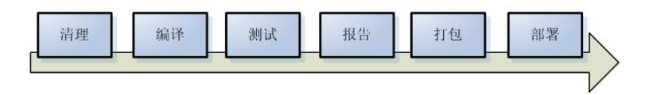
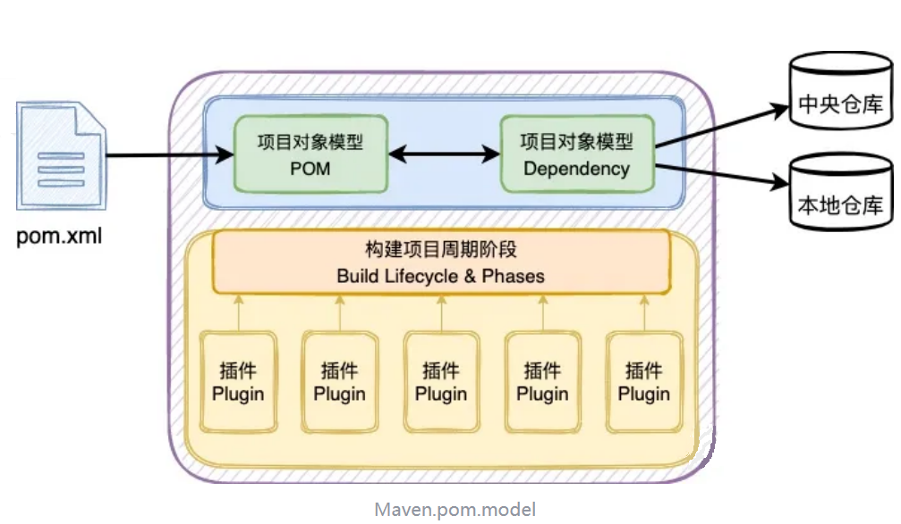

# 什么是Maven

## 1.Maven的概念

Maven 是自动化构建工具。

Maven 是 Apache 软件基金会组织维护的一款自动化构建工具，专注服务于 Java 平台的项目构建和依赖管理。Maven 这个单词的本意是：专家，内行。

Maven 是目前最流行的自动化构建工具，对于生产环境下多框架、多模块整合开发有重要作用，Maven 是一款在大型项目开发过程中不可或缺的重要工具。

## 2.为什么要使用Maven

我们知道，项目开发不仅仅是写写代码而已，期间会伴随着各种必不可少的事情要做，例如：

1. 我们需要引用各种 jar 包，尤其是比较大的工程，引用的 jar 包往往有几十个乃至上百个，每个都要到不同的官网去下载，而且每次用到的 jar 包，都需要手动引入工程目录，而且经常遇到各种让人抓狂的 jar 包冲突，版本冲突，Maven可以自动下载jar包及依赖包添加到项目中，大大减轻了工作负担。
2. 我们开发的 Java 文件，都是需要将它编译成字节码文件。好在这项工作可以由各种集成开发工具帮我们完成，Eclipse、IDEA 等都可以将代码即时编译。但有时候我们需要多个模块同时编译，就必须要借助于Maven工具了。
3. 每个项目或模块开发过程中都会有 bug，因此写完了代码，我们还要写一些单元测试，然后一个个的运行来检验代码质量，Maven提供了专门的测试插件来实施测试。
4. 再优雅的代码也是要出来卖的。我们后面还需要把代码与各种配置文件、资源整合到一起，定型打包，如果是 web项目，还需要将之发布到服务器进行调用，这些都可以通过Maven轻松搞定。

总之，Maven是项目开发必不可少的工具。

类似自动化构建工具还有：Gant,  Gradle。

## 3.项目构建过程

构建(build)是面向过程的(从开始到结尾的多个步骤)，涉及到多个环节的协同工作。

构建过程的几个主要环节

1. 清理：删除以前的编译结果，为重新编译做好准备。
2. 编译：将Java源程序编译为字节码文件。
3. 测试：针对项目中的关键点进行测试，确保项目在迭代开发过程中关键点的正确性。
4. 报告：在每一次测试后以标准的格式记录和展示测试结果。
5. 打包：将一个包含诸多文件的工程封装为一个压缩文件用于安装或部署。Java 工程对应 jar 包，Web 工程对应war包。
6. 安装：在Maven环境下特指将jar包安装到本地仓库中。这样该项目就可以被其他的maven项目通过依赖的方式引入。
7. 部署：将jar包部署到私服上。

## Maven的两大核心功能（重点）

### 项目构建

对项目进行编译，测试，打包，部署等构建。

### 依赖管理

对jar包的统一管理，Maven提供中央仓库，私服，本地仓库解决jar包的依赖和相关依赖的下载。

如下图所示：包括蓝、黄两个部分分别对应着[**依赖关系**](https://www.zhihu.com/search?q=%E4%BE%9D%E8%B5%96%E5%85%B3%E7%B3%BB\&search_source=Entity\&hybrid_search_source=Entity\&hybrid_search_extra=%7B%22sourceType%22%3A%22answer%22%2C%22sourceId%22%3A2811089619%7D)**和**\*\*项目构建\*\*两大核心功能。

# 