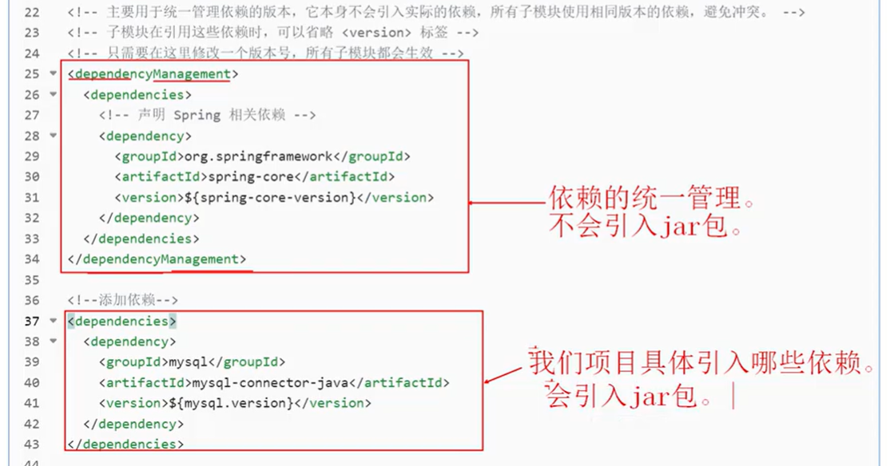
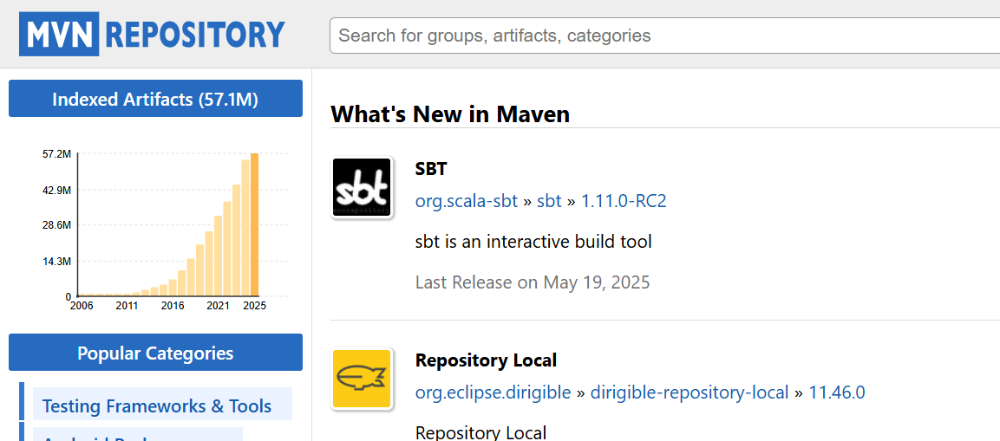

# Maven的核心概念

## 1.POM

POM(Project Object Model)项目对象模型，它是Maven的核心组件。它是Maven中的基本工作单元。它是一个xml文件，以pom.xml驻留在项目的根目录中。POM不仅包含\*\*<font style="color:#DF2A3F;">有关项目的信息</font>**及Maven用于**<font style="color:#DF2A3F;">构建项目的各种配置</font>**的详细信息，还包含**<font style="color:#DF2A3F;">目标和插件</font>\*\*。

pom.xml文件示例：

```xml
<!--添加父工程的引用，当前pom.xml文件中有这个配置，说明当前项目是一个子模块。从父的pom中继承配置-->
<parent>
  <groupId>com.jkweilai.bank</groupId>
  <artifactId>bank-parent</artifactId>
  <version>0.0.1-SNAPSHOT</version>
</parent>

<!--本项目的身份证号gav-->
<groupId>com.jkweilai</groupId>
<artifactId>maven_project</artifactId>	  
<version>1.0.0</version>
<!--打包方式-->
<packaging>war</packaging>

<!--使用Properties集中化管理版本号-->
<properties>
  <!--mysql驱动的依赖-->
  <mysql.version>5.1.32</mysql.version>
  <spring-core-version>5.3.23</spring-core-version>
</properties>

<!-- 主要用于统一管理依赖的版本，它本身不会引入实际的依赖，所有子模块使用相同版本的依赖，避免冲突。 -->
<!-- 子模块在引用这些依赖时，可以省略 <version> 标签 -->
<!-- 只需要在这里修改一个版本号，所有子模块都会生效 -->
<dependencyManagement>
  <dependencies>
    <!-- 声明 Spring 相关依赖 -->
    <dependency>
      <groupId>org.springframework</groupId>
      <artifactId>spring-core</artifactId>
      <version>${spring-core-version}</version>
    </dependency>
  </dependencies>
</dependencyManagement>


<!--添加依赖-->
<dependencies>
  <dependency>
    <groupId>mysql</groupId>
    <artifactId>mysql-connector-java</artifactId>
    <version>${mysql.version}</version>
  </dependency>	    
</dependencies>

<build>
  
  <!--聚合工程-->
  <!--当前项目如果作为一个父项目的话，可以有以下的配置，用于声明该项目包含哪些子模块-->
  <modules>
    <module>bank-manager-pojo</module>
    <module>bank-manager-mapper</module>
    <module>bank-manager-service</module>
    <module>bank-manager-web</module>
  </modules>
  
  <!--插件配置-->
  <plugins>
    <plugin>
      <groupId>org.apache.maven.plugins</groupId>
      <artifactId>maven-compiler-plugin</artifactId>
      <configuration>
        <source>17</source>
        <target>17</target>
        <encoding>UTF-8</encoding>
      </configuration>
    </plugin>
  </plugins>
  
  <!--指定配置文件识别路径-->
  <resources>
    <!--防止项目编译后java文件夹里面的配置文件丢失。一般建议把配置文件写到resources文件夹里面-->
    <resource>
      <directory>src/main/java</directory>
      <includes>
        <include>**/*.properties</include>
        <include>**/*.xml</include>
      </includes>
    </resource>
    <!--下面这个配置可以省略-->
    <resource>
      <directory>src/main/resources</directory>
      <includes>
        <include>**/*.properties</include>
        <include>**/*.xml</include>
      </includes>
    </resource>
  </resources>
</build>
```

## 1.2 dependencyManagement和dependencies的区别



## 2.Maven工程约定的目录结构

会有预先约定好的目录结构，必须要遵循的规范，所有的Maven项目都依照这个规范。主要的目的是将项目的源码文件，测试代码，资源文件完全分开，便于项目管理和扩展。

```plain
maven_project
     |-----src
            |--------main
                       |------java
                       |------resources
            |--------test  
                       |------java //在这里写单元测试代码
                       |------resources
     |-----pom.xml
```

## 3.GAV坐标

maven中使用三个标签来唯一定位jar资源。项目的唯一名称，创建项目时定义gav名称，引用项目时使用gav名称。相当于项目的身份证号。

1. `groupId`：组织名称，一般是公司域名的倒写
2. `artifactId`：项目名称
3. `version`：版本号
   1. 1.0-SNAPSHOT（开发时的临时版本号）
   2. 5.2.5.RELEASE（发布版本）

定义项目

```xml
<groupId>com.jkweilai</groupId>
<artifactId>maven_project</artifactId>	  
<version>1.0.0</version>
```

引用项目

```xml
<dependency>
  <groupId>com.jkweilai</groupId>
  <artifactId>maven_project</artifactId>	  
  <version>1.0.0</version>
</dependency>
```

## 4.仓库

存放jar包的位置 。Maven中所有的jar包都在仓库中。仓库分为<code>**本地仓库**</code>和<code>**远程仓库**</code>。

我们依赖的jar包它从哪儿获取呢？从仓库中获取的。在Maven中，任何一个依赖、插件或者项目构建的输出，都可以称之为\*\*<font style="color:#DF2A3F;">构件（Artifact）</font>\*\*。\*\*Maven 核心程序仅仅定义了自动化构建项目的生命周期，但具体的构建工作是由特定的构件完成的。\*\*而且为了提高构建的效率和构件复用，maven把所有的构件统一存储在某一个位置，这个位置就叫做仓库。

### 4.1.本地仓库

本地仓库，存在于当前电脑上，默认存放在`~\.m2\repository`中，为本机上所有的Maven工程服务。也可以通过Maven的配置文件`MAVEN_HOME/conf/settings.xml`修改本地仓库所在的目录。

### 4.2.远程仓库

远程仓库，包括：

1. 为全世界范围内的开发人员提供服务的中央仓库
2. 为\*\*<font style="color:#DF2A3F;">本公司提供服务</font>\*\*，自己架设的私服

Maven官方的中央仓库地址： <https://repo.maven.apache.org/maven2>，中央仓库包含了绝大多数流行的开源Java构件，以及源码、作者信息、许可证信息等。一般来说，简单的Java项目依赖的构件都可以在这里下载得到。

私服是一种特殊的远程仓库，它是架设在局域网内的仓库服务，私服代理广域网上的远程仓库，供局域网内的Maven用户使用。当Maven需要下载构件的时候，它从私服请求，**如果私服上不存在该构件，则从外部的远程仓库下载，缓存在私服上之后，再为Maven的下载请求提供服务**。另外，我们还可以把一些无法从外部仓库下载到的构件上传到私服上。


### 4.3.GAV坐标去哪里找

Maven中央仓库中存储了各种构件（各种jar包），那么这些jar包的GAV坐标去哪里能找到呢？以下这个网站非常重要，在这个平台上提供了各种构件的GAV坐标，程序员经常通过这个平台来搜索各种构件的GAV坐标：[**http://mvnrepository.com/**](http://mvnrepository.com/)



## 5.依赖

**依赖（Dependency）** 是 Maven 项目中声明的外部库（如 JAR 文件），通过 `pom.xml` 中的 `<dependency>`标签定义，构建时会自动从仓库下载并引入到项目中。

（核心要素：**声明坐标** → **自动下载** → **项目使用**）

```xml
<dependencies>
  <dependency>
    <groupId>org.mybatis</groupId>
    <artifactId>mybatis</artifactId>
    <version>3.5.11</version>
  </dependency>
</dependencies>
```

## 6.生命周期与插件

### 6.1Maven 生命周期的本质

Maven 的构建过程由 **生命周期（Lifecycle）** 驱动，它是一组**预定义的、有序的阶段（Phases）**，用于标准化项目的构建流程（如编译、测试、打包）。但需要注意的是：**生命周期本身只定义阶段顺序！** 真正干活的是 **插件（Plugins）**。

### 6.2三大内置生命周期

Maven 提供三个核心生命周期，每个生命周期包含多个阶段：

| **生命周期** | **用途**                                      | **关键阶段（顺序执行）**                                     |
| ------------ | --------------------------------------------- | ------------------------------------------------------------ |
| `default`    | 项目构建和部署的完整过程                      | `validate` → `compile` → `test` → `package` → `verify` → `install` → `deploy`<br/>+ <code><font style="color:rgb(15, 17, 21);background-color:rgb(235, 238, 242);">validate</font></code><font style="color:rgb(15, 17, 21);">： 看看这个项目的“身份证”（基本信息）全不全，配置对不对。</font><br/>+ <code><font style="color:rgb(15, 17, 21);background-color:rgb(235, 238, 242);">compile</font></code><font style="color:rgb(15, 17, 21);">： 编译项目的源代码。</font><br/>+ <code><font style="color:rgb(15, 17, 21);background-color:rgb(235, 238, 242);">test</font></code><font style="color:rgb(15, 17, 21);">： 执行程序员编写的所有单元测试。</font><br/>+ <code><font style="color:rgb(15, 17, 21);background-color:rgb(235, 238, 242);">package</font></code><font style="color:rgb(15, 17, 21);">： 将编译后的代码打包，如 JAR、WAR。</font><br/>+ <code><font style="color:rgb(15, 17, 21);background-color:rgb(235, 238, 242);">verify</font></code><font style="color:rgb(15, 17, 21);">： 对打包后的内容进行全面检查。确保质量没问题。</font><br/>+ <code><font style="color:rgb(15, 17, 21);background-color:rgb(235, 238, 242);">install</font></code><font style="color:rgb(15, 17, 21);">： 将打包好的构件安装到</font>**<font style="color:rgb(15, 17, 21);">本地仓库</font>**<font style="color:rgb(15, 17, 21);">，这样就可以作为其他本地项目的依赖了。</font><br/>+ <code><font style="color:rgb(15, 17, 21);background-color:rgb(235, 238, 242);">deploy</font></code><font style="color:rgb(15, 17, 21);">： 将最终的构件复制到</font>**<font style="color:rgb(15, 17, 21);">私服（如果你们搭建了私服的话）</font>**<font style="color:rgb(15, 17, 21);">，和其他开发者共享，如果没有安装私服，运行该命令会报错。</font><br/>**<font style="color:#DF2A3F;">注意：某阶段执行时，前面所有的阶段会全部执行一遍。</font>** |
| `clean`      | 清理构建产物                                  | `pre-clean` → `clean` → `post-clean`<br/>+ <code><font style="color:rgb(15, 17, 21);background-color:rgb(235, 238, 242);">pre-clean</font></code><font style="color:rgb(15, 17, 21);">：</font><font style="color:rgb(15, 17, 21);"> </font>**<font style="color:rgb(15, 17, 21);">大扫除之前</font>**<font style="color:rgb(15, 17, 21);">的准备工作。（很少用，比如发个通知说“我要开始删了！”）</font><br/>+ <code><font style="color:rgb(15, 17, 21);background-color:rgb(235, 238, 242);">clean</font></code><font style="color:rgb(15, 17, 21);">：</font><font style="color:rgb(15, 17, 21);"> </font>**<font style="color:rgb(15, 17, 21);">核心阶段</font>**<font style="color:rgb(15, 17, 21);">，就是</font>**<font style="color:rgb(15, 17, 21);">动手删除</font>\*\*\*\*<font style="color:rgb(15, 17, 21);"> </font>**<code>**<font style="color:rgb(15, 17, 21);background-color:rgb(235, 238, 242);">target</font>**</code>**<font style="color:rgb(15, 17, 21);"> </font>\*\*\*\*<font style="color:rgb(15, 17, 21);">文件夹</font>**<font style="color:rgb(15, 17, 21);">。</font><br/>+ <code><font style="color:rgb(15, 17, 21);background-color:rgb(235, 238, 242);">post-clean</font></code><font style="color:rgb(15, 17, 21);">： </font>**<font style="color:rgb(15, 17, 21);">大扫除之后</font>**<font style="color:rgb(15, 17, 21);">的收尾工作。（很少用，比如记录一下“我删完了”）</font> |
| `site`       | 生成文档和报告（本质上就是执行 javadoc 命令） | `pre-site` → `site` → `post-site` → `site-deploy`<br/>site 就是给你的项目自动创建一个“产品说明书网站”。<br/>+ <code><font style="color:rgb(15, 17, 21);background-color:rgb(235, 238, 242);">pre-site</font></code><font style="color:rgb(15, 17, 21);">：</font><font style="color:rgb(15, 17, 21);"> </font>**<font style="color:rgb(15, 17, 21);">建网站之前</font>**<font style="color:rgb(15, 17, 21);">的准备工作。（很少用）</font><br/>+ <code><font style="color:rgb(15, 17, 21);background-color:rgb(235, 238, 242);">site</font></code><font style="color:rgb(15, 17, 21);">：</font><font style="color:rgb(15, 17, 21);"> </font>**<font style="color:rgb(15, 17, 21);">核心阶段</font>**<font style="color:rgb(15, 17, 21);">，就是</font>**<font style="color:rgb(15, 17, 21);">动手生成那个“说明书网站”</font>**<font style="color:rgb(15, 17, 21);">。生成的文件都在</font><font style="color:rgb(15, 17, 21);"> </font><code><font style="color:rgb(15, 17, 21);background-color:rgb(235, 238, 242);">target/site</font></code><font style="color:rgb(15, 17, 21);"> </font><font style="color:rgb(15, 17, 21);">文件夹里。你可以直接用浏览器打开</font><font style="color:rgb(15, 17, 21);"> </font><code><font style="color:rgb(15, 17, 21);background-color:rgb(235, 238, 242);">target/site/index.html</font></code><font style="color:rgb(15, 17, 21);"> </font><font style="color:rgb(15, 17, 21);">来查看。</font><br/>+ <code><font style="color:rgb(15, 17, 21);background-color:rgb(235, 238, 242);">post-site</font></code><font style="color:rgb(15, 17, 21);">：</font><font style="color:rgb(15, 17, 21);"> </font>**<font style="color:rgb(15, 17, 21);">建网站之后</font>**<font style="color:rgb(15, 17, 21);">的收尾工作。（很少用）</font><br/>+ <code><font style="color:rgb(15, 17, 21);background-color:rgb(235, 238, 242);">site-deploy</font></code><font style="color:rgb(15, 17, 21);">： </font>**<font style="color:rgb(15, 17, 21);">把网站发布上网</font>**<font style="color:rgb(15, 17, 21);">，把这个“说明书网站”上传到一台服务器上，这样大家通过一个网址就能访问了，不用每个人自己本地生成。</font><br/><font style="color:rgb(15, 17, 21);">在 pom.xml 文件中配置这个</font><br/><font style="color:rgb(15, 17, 21);">  <distributionManagement></font><br/><font style="color:rgb(15, 17, 21);">    <!-- 配置站点部署的服务器地址 --></font><br/><font style="color:rgb(15, 17, 21);">    <site></font><br/><font style="color:rgb(15, 17, 21);">      <id>my-website-server</id></font><br/><font style="color:rgb(15, 17, 21);">      <url>scp://webhost.mycompany.com/www/docs/myproject/</url></font><br/><font style="color:rgb(15, 17, 21);">    </site></font><br/><font style="color:rgb(15, 17, 21);">  </distributionManagement></font> |

### 插件与生命周期的绑定

**每个生命周期阶段的实际行为由插件目标（Plugin Goals）实现**。Maven 通过两种方式绑定插件到生命周期：

#### 默认绑定（内置）

Maven 为核心阶段预绑定了常用插件。例如：

* `compile`\*\* 阶段\*\* → `maven-compiler-plugin:compile`（编译代码）
* `test`\*\* 阶段\*\* → `maven-surefire-plugin:test`（运行单元测试）
* `package`\*\* 阶段\*\* → `maven-jar-plugin:jar`（打包为 JAR 文件）

#### 自定义绑定（用户配置）

用户可以在 `pom.xml` 中覆盖默认绑定或添加新插件。例如：

```xml
<build>
  <plugins>
    <plugin>
      <groupId>org.apache.maven.plugins</groupId>
      <artifactId>maven-compiler-plugin</artifactId> <!--负责编译的工具包-->
      <version>3.11.0</version>
      <executions>
        <execution>
          <phase>compile</phase>  <!-- 用这个标签来指定：当前的插件具体绑定到生命周期的哪个阶段。compile表示绑定到编译阶段。 -->
          <goals>
            <goal>compile</goal>   <!-- 用这个标签告诉Maven具体干什么：调用maven-compiler-plugin插件里的compile方法来编译源码 -->
          </goals>
        </execution>
      </executions>
    </plugin>
  </plugins>
</build>
```

### 6.3总结生命周期和插件的关系

* **生命周期是“流程框架”**：定义阶段顺序，但无实际功能。
* **插件是“执行引擎”**：通过绑定目标（Goal）实现具体任务。
* **无插件 = 空流程**：若阶段未绑定插件，Maven 会直接跳过它。

### 实战演练，参考：[演练1-maven的下载安装以及手动创建maven项目](演练1-maven的下载安装以及手动创建maven项目.md)

