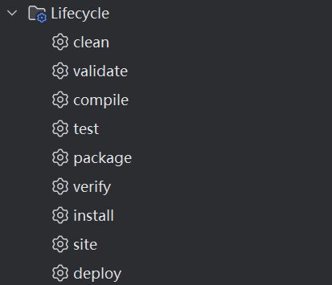

# Maven命令


在 Maven的生命周期中，用户通过执行 **Maven 命令（即指定某个阶段）** 来触发构建流程。每个命令实际上对应生命周期中的一个或多个阶段，Maven 会按顺序执行**从初始阶段到目标阶段的所有步骤**。

## 生命周期上的核心命令

Maven 有 **3 个内置生命周期**，每个生命周期包含多个阶段，用户可通过 `mvn <phase>` 命令触发执行。

### `default` 生命周期（核心构建流程）

**用途**：编译、测试、打包、部署项目。\
**核心阶段（按顺序执行）**：

| **命令（**<code>**mvn <phase>**</code>**）** | **作用**                                                   |
| -------------------------------------------- | ---------------------------------------------------------- |
| `validate`                                   | 验证项目配置是否正确（如 `pom.xml` 是否合法）。            |
| `compile`                                    | 编译项目的主代码（生成 `target/classes`）。                |
| `test`                                       | 运行单元测试（使用 `maven-surefire-plugin`）。             |
| `package`                                    | 打包项目（生成 JAR/WAR 等，存放于 `target/` 目录）。       |
| `verify`                                     | 运行集成测试或检查构建质量（如 `maven-failsafe-plugin`）。 |
| `install`                                    | 将构建的产物安装到本地仓库（默认在 `~/.m2/repository`）。  |
| `deploy`                                     | 将构建的产物部署到远程仓库（如 Nexus、Artifactory）。      |

**常用命令示例**：

```bash
mvn compile    # 执行到 compile 阶段（含 validate + compile）
mvn test       # 执行到 test 阶段（含 validate + compile + test）
mvn package    # 执行到 package 阶段（含 validate → compile → test → package）
mvn install    # 执行到 install 阶段（含前面所有阶段 + install）
```

### `clean` 生命周期（清理构建产物）

**用途**：删除构建生成的目录（如 `target/`）。\
**核心阶段**：

| **命令**     | **作用**                          |
| ------------ | --------------------------------- |
| `pre-clean`  | 清理前的准备工作（很少自定义）。  |
| `clean`      | 删除 `target/` 目录（核心阶段）。 |
| `post-clean` | 清理后的收尾工作（很少自定义）。  |

### `site` 生命周期（生成项目文档）

**用途**：生成项目站点文档（如 API 文档、测试报告等）。\
**核心阶段**：

| **命令**      | **作用**                                |
| ------------- | --------------------------------------- |
| `pre-site`    | 生成站点前的准备工作。                  |
| `site`        | 生成项目站点（默认到 `target/site/`）。 |
| `post-site`   | 生成站点后的收尾工作。                  |
| `site-deploy` | 将站点部署到远程服务器。                |

## 组合命令

Maven 支持在同一命令中组合不同生命周期的阶段：

```bash
mvn clean package      # 先清理再打包
mvn clean test         # 清理后运行测试
mvn clean install      # 清理后安装到本地仓库
mvn clean deploy       # 清理后部署到远程仓库
```

## 特殊命令

* **查看阶段绑定**：

```bash
mvn help:describe -Dcmd=compile  # 查看 compile 阶段绑定的插件【该命令compile可变，其它是固定写法】
```

* **跳过测试**：

```bash
mvn install -DskipTests   # 跳过测试阶段（但编译测试代码）【固定写法】
mvn install -Dmaven.test.skip=true  # 完全跳过测试（不编译也不执行）【固定写法】
```

* **仅执行某个插件的目标**（不依赖生命周期）：

```bash
mvn dependency:tree       # 直接运行 dependency 插件的 tree 目标（直接使用dependency工具包中的tree工具）

mvn compiler:compile  # 不依赖生命周期，仅执行编译插件的compile目标。
```

## 重点规则

* 执行 `mvn <phase>` 时，Maven 会**自动运行该阶段及其之前的所有阶段**。
* 插件目标（Goals）绑定到阶段，实现具体功能。

## 开发工具IDEA对Maven的支持

使用idea后，生命周期要调用的命令被集成化一些按钮，只需要双击即可调用相应的插件来运行。



