# Maven的使用

## 下载Maven

官网：<http://maven.apache.org/>

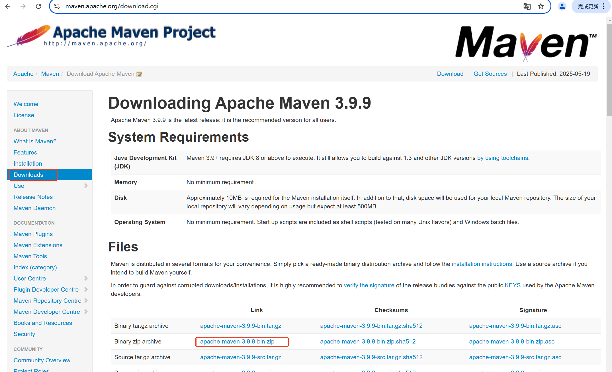

## 配置Maven

<font style="color:#DF2A3F;">Maven解压就是安装。建议将Maven解压到一个没有中文的路径中。</font>

### 配置环境变量

Maven的核心命令是`mvn`，这个命令对应的文件是`MAVEN_HOME/bin/mvn`，打开`mvn`文件，如下：

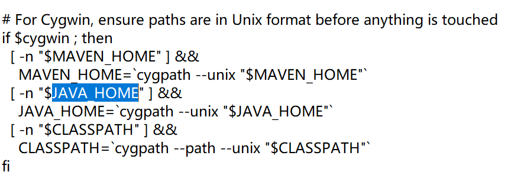

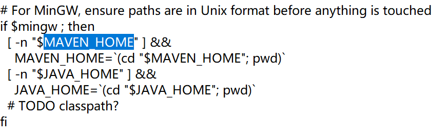

可以看到这个`mvn`命令的使用依赖了`JAVA_HOME`和`MAVEN_HOME`两个环境变量。因此这两个环境变量是必须配置的。

1. JAVA_HOME=JDK的根路径
2. MAVEN_HOME=Maven的根路径
3. PATH=%JAVA_HOME%\bin;%MAVEN_HOME%\bin

### 配置Maven工具参数

`MAVAN_HOME/conf/settings.xml`文件。

#### 配置本地仓库

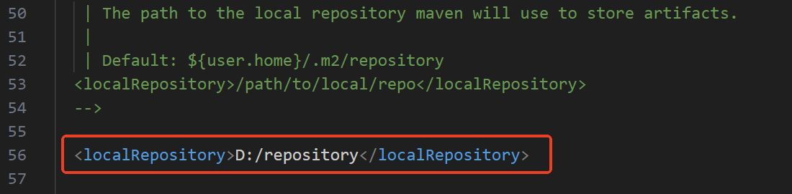

#### 配置远程仓库

找到</mirrors>结束标签，将以下代码贴在其前面：

```xml
<!--配置阿里远程仓库-->
<mirror>
    <id>aliyunmaven</id>
    <mirrorOf>*</mirrorOf>
    <name>阿里云公共仓库</name>
    <url>https://maven.aliyun.com/repository/public</url>
</mirror>
```

这段配置是 Maven 的镜像（Mirror）设置，用于将 Maven 中央仓库（repo.maven.apache.org）的请求自动重定向到阿里云的 Maven 镜像仓库，以加速依赖下载（尤其在国内访问更稳定、更快）。

#### JDK21自适应构建配置

找到</profiles>结束标签，在其前面配置以下代码：

```xml
<profile>
  <id>jdk21</id>
  <activation>
    <activeByDefault>true</activeByDefault>
  </activation>
  <properties>
    <project.build.sourceEncoding>UTF-8</project.build.sourceEncoding>
    <maven.compiler.source>21</maven.compiler.source>
    <maven.compiler.target>21</maven.compiler.target>
  </properties>
</profile>
```

以上配置的作用是：当系统检测到JDK21时，自动使用UTF-8编码，并强制Maven编译器以JDK21版本编译源码和生成字节码（如果不强制的话，maven 会自动通过 JAVA_HOME 环境变量指向的 JDK 进行编译，这样不利于团队协作开发，团队协作开发需要保证 JDK 版本都是一致的。），确保项目在Java 21环境下正确构建（因为我们电脑上安装的 JDK 是 21，因此需要这样配置）。

Maven 本身不包含 Java 编译器：Maven 只是一个构建工具，在编译时，**编译插件**会调用你本地安装的 JDK 中的 javac 编译器来工作。

### IDEA集成Maven

注意：如果使用IDEA集成Maven，则之前配置的`MAVEN_HOME`、`JAVA_HOME`、`PATH`都是没用的。

#### 创建一个空的工程（建议）

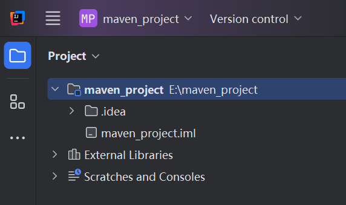

#### 设置空工程的JDK（建议）

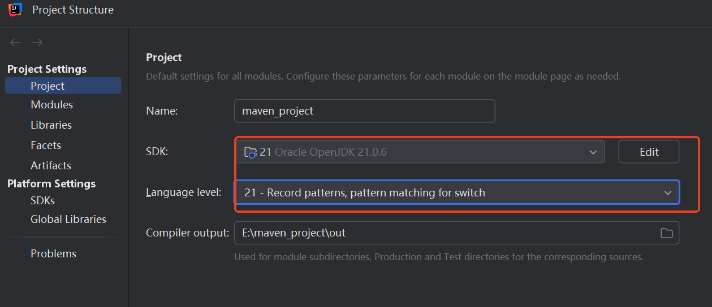

#### 集成Maven

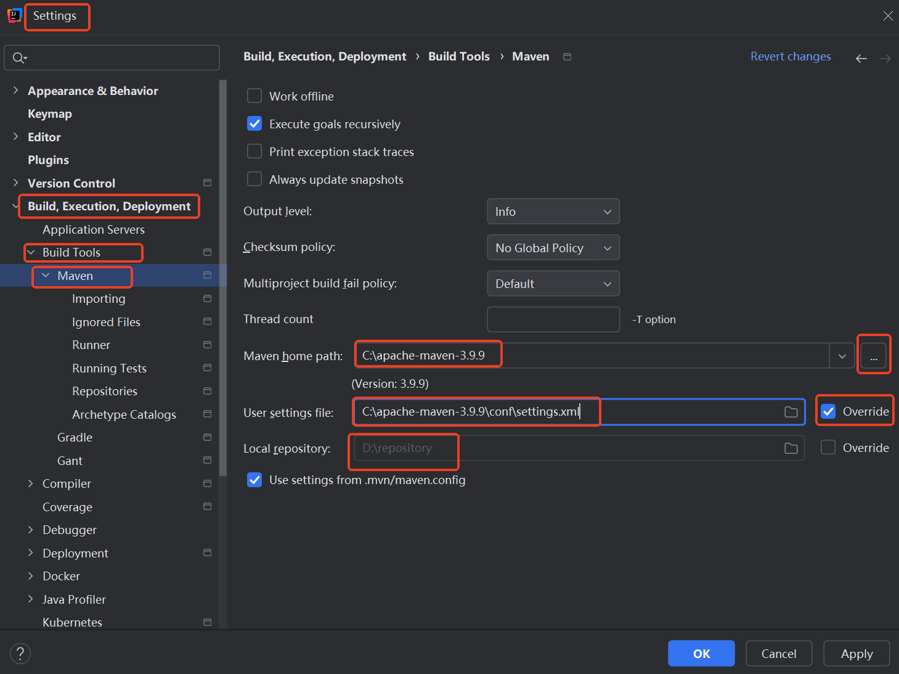

## 手动开发Maven项目

第一步：按照Maven约定的标准目录结构创建Maven项目

```plain
maven-001
    |-------src
              |--------main
                          |------java
                          |------resources
              |--------test
                          |------java
                          |------resources
    |-------pom.xml
```

第二步：编写pom文件

```xml
<?xml version="1.0" encoding="UTF-8"?>
<project xmlns="http://maven.apache.org/POM/4.0.0"
         xmlns:xsi="http://www.w3.org/2001/XMLSchema-instance"
         xsi:schemaLocation="http://maven.apache.org/POM/4.0.0 http://maven.apache.org/xsd/maven-4.0.0.xsd">
    <modelVersion>4.0.0</modelVersion>

    <groupId>com.jkweilai</groupId>
    <artifactId>maven-001</artifactId>
    <version>1.0-SNAPSHOT</version>

    <!--如果配置了这个，那么之前配置的profile就不需要配置了。-->
    <properties>
        <maven.compiler.source>21</maven.compiler.source>
        <maven.compiler.target>21</maven.compiler.target>
        <project.build.sourceEncoding>UTF-8</project.build.sourceEncoding>
    </properties>

</project>
```

第三步：编写Java程序

在`maven-001/src/main/java`目录下新建目录`com/jkweilai/maven`，创建文件`HelloMaven.java`。编写如下java代码：

```java
package com.jkweilai.maven;

public class HelloMaven {
    public static void main(String[] args){
        System.out.println("Hello Maven");
    }
}
```

第四步：执行编译命令，查看target目录是否生成字节码

一定要在项目的**根路径**下执行如下命令：

```shell
mvn clean compile
```

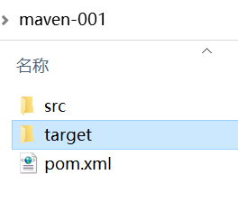

第五步：运行程序

在dos命令窗口中，将目录切换到`target/classes`目录下，然后执行以下命令运行程序：

```shell
java com.jkweilai.maven.HelloMaven
```

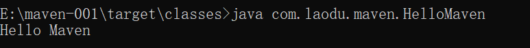

第六步：执行安装命令，查看本地仓库中是否生成jar包

一定要在项目的**根路径**下执行如下命令：

```shell
mvn clean install
```

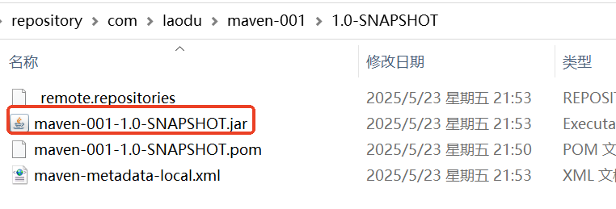

## IDEA开发Maven Java项目

### 创建Maven模块

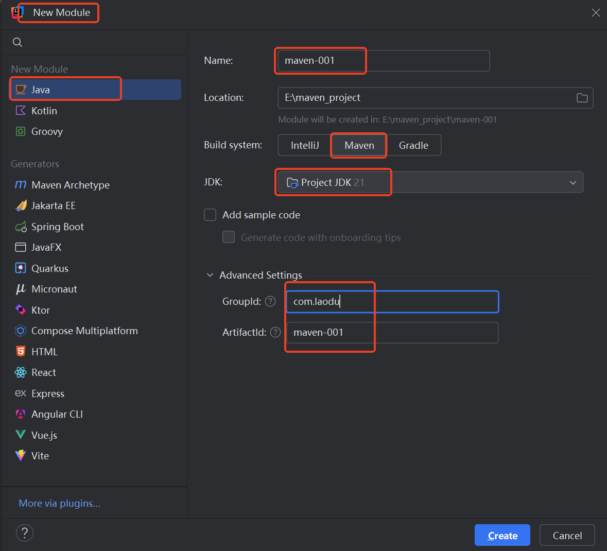

### 补齐目录（非必须）

`test`目录中添加一个子目录：`resources`

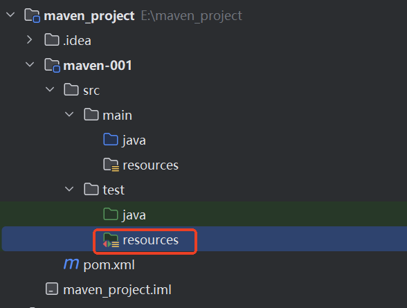

### 添加junit5依赖

```xml
<dependency>
    <groupId>org.junit.jupiter</groupId>
    <artifactId>junit-jupiter-api</artifactId>
    <version>5.12.2</version>
    <scope>test</scope>
</dependency>
```

<font style="color:#DF2A3F;">记得点 M 刷新依赖哦。</font>

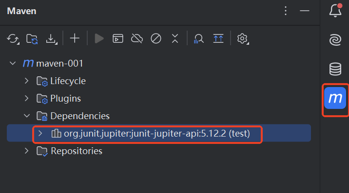<font style="color:#DF2A3F;"> </font>

### 编写Java程序

```java
package com.jkweilai;

public class Hello {
    //加法运算
    public int sum(int num1,int num2){
        return num1 + num2;
    }
    //乘法运算
    public int mul(int num1,int num2){
        return num1 * num2;
    }
}

```

### 编写测试程序

```java
package com.jkweilai;

import org.junit.jupiter.api.Test;

// 测试类的类名命名规范：建议以Test结尾。
public class HelloTest {
    /**
     * 一个测试方法就是一个测试用例
     * 测试用例的编写规范
     * 1)访问权限不能是private，其他都可以。
     * 2)方法返回值类型必须是void
     * 3)方法名称自定义,建议以test开头
     * 4)方法不能有参数，有参数会报错
     * 5)使用@Test注解声明是测试方法
     */
    @Test
    public void testSum(){
        Hello  hello = new Hello();
        System.out.println(hello.sum(3,6));
    }
    @Test
    public void testMul(){
        Hello  hello = new Hello();
        System.out.println(hello.mul(3,6));
    }
}
```

## IDEA开发Maven JavaWeb项目

### 第一种方式：全部手动配置

#### 创建Java Maven模块

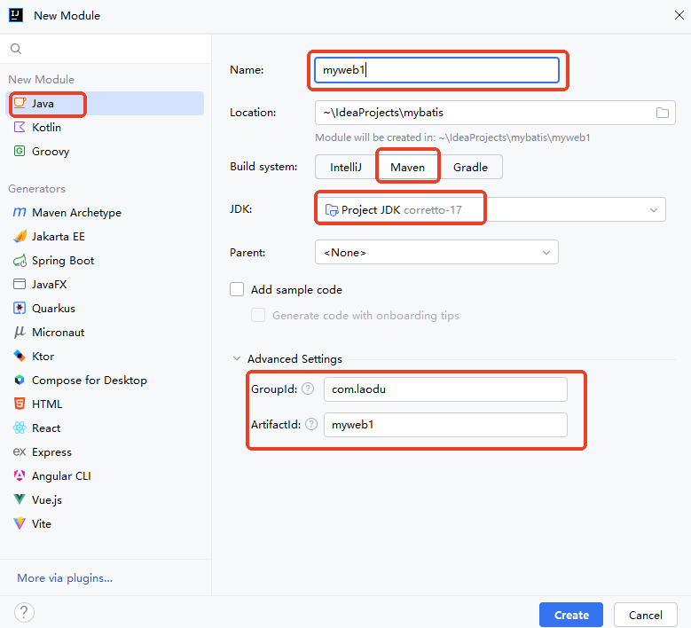

#### 手动创建目录

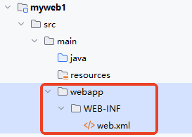

**<font style="color:#DF2A3F;">对于当前 IDEA 版本来说，经过测试，这个目录的名字必须是 </font>**<code>**<font style="color:#DF2A3F;">webapp</font>**</code>**<font style="color:#DF2A3F;">才能识别。</font>**

#### 提供web.xml配置

```xml
<?xml version="1.0" encoding="UTF-8"?>
<web-app xmlns="https://jakarta.ee/xml/ns/jakartaee"
         xmlns:xsi="http://www.w3.org/2001/XMLSchema-instance"
         xsi:schemaLocation="https://jakarta.ee/xml/ns/jakartaee
                             https://jakarta.ee/xml/ns/jakartaee/web-app_6_0.xsd"
         version="6.0">
</web-app>
```

#### 添加打包方式和依赖

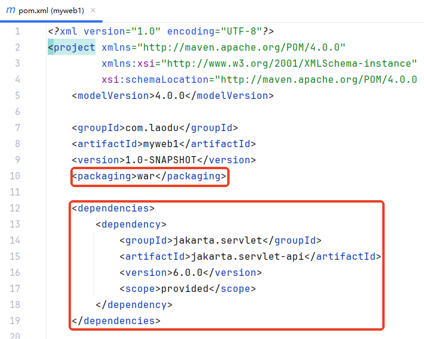

最后记得点M刷新哦。

### 第二种方式：在Module上添加Web支持

#### 创建Java Maven模块

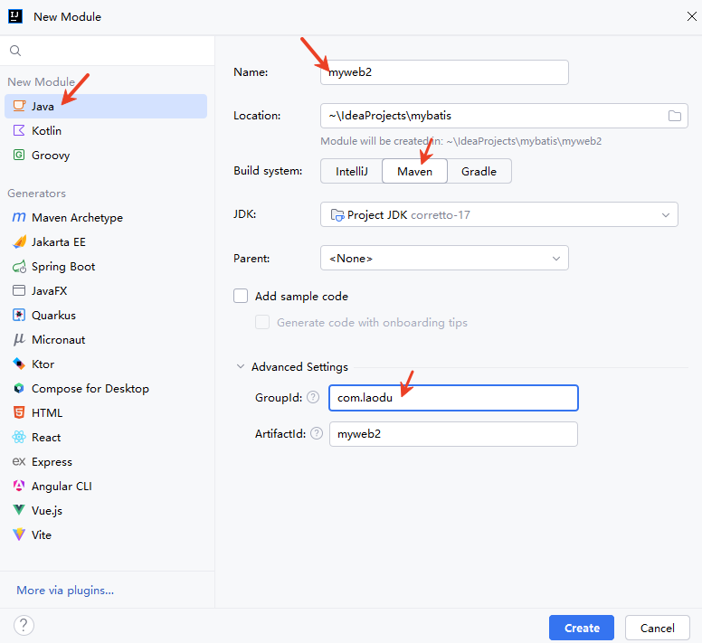

#### 打开项目结构

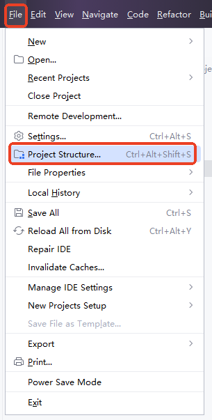

#### 在Module上添加Web支持

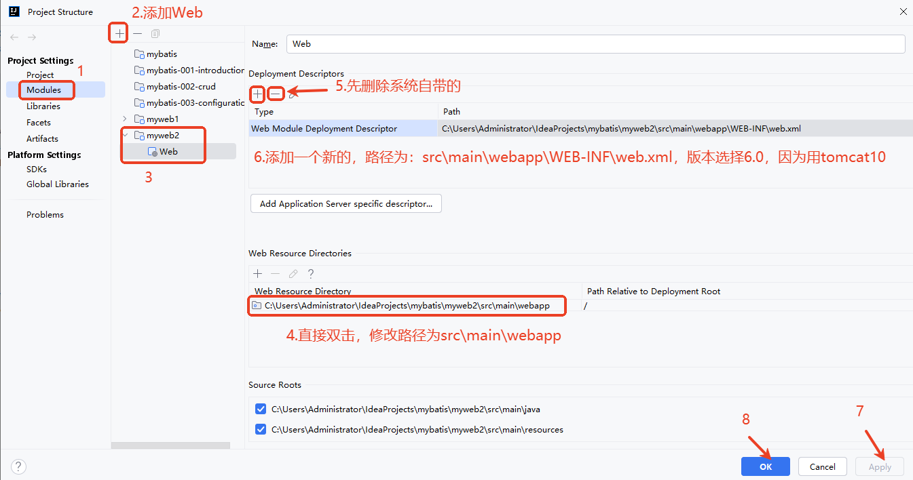

#### 打包方式war并添加servlet依赖

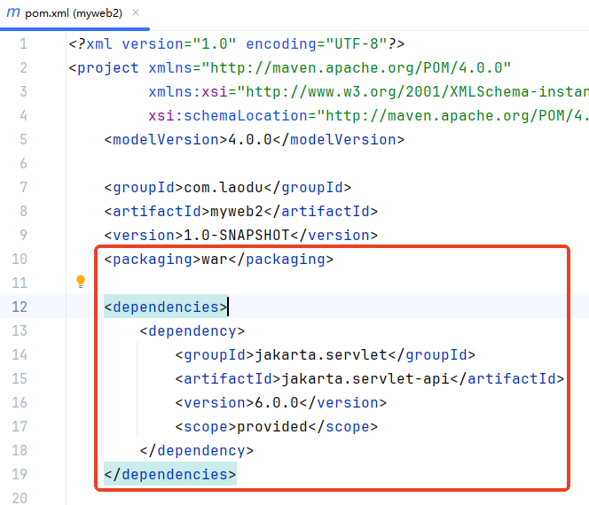

最后记得点M刷新哦。

### 第三种方式：通过Maven的webapp原型创建

#### 选择Archetype

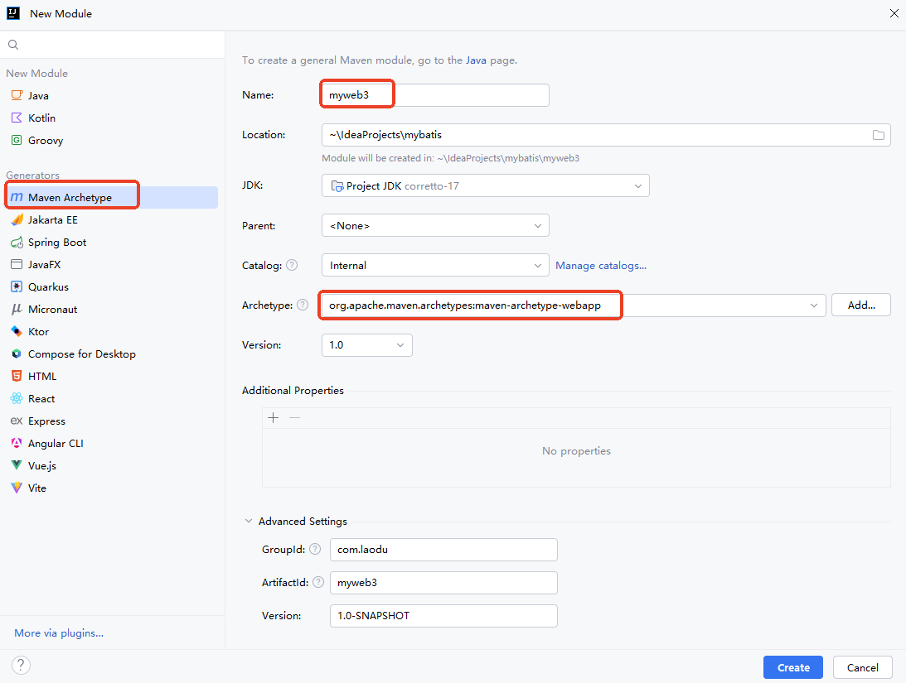

#### 修改web.xml（可选）

```xml
<?xml version="1.0" encoding="UTF-8"?>
<web-app xmlns="https://jakarta.ee/xml/ns/jakartaee"
         xmlns:xsi="http://www.w3.org/2001/XMLSchema-instance"
         xsi:schemaLocation="https://jakarta.ee/xml/ns/jakartaee https://jakarta.ee/xml/ns/jakartaee/web-app_6_0.xsd"
         version="6.0">
</web-app>
```

#### 添加servlet依赖

```xml
<dependency>
    <groupId>jakarta.servlet</groupId>
    <artifactId>jakarta.servlet-api</artifactId>
    <version>6.0.0</version>
    <scope>provided</scope>
</dependency>
```

### 编写Servlet并部署项目到Tomcat

```java
package com.jkweilai.servlet;

import jakarta.servlet.ServletException;
import jakarta.servlet.annotation.WebServlet;
import jakarta.servlet.http.HttpServlet;
import jakarta.servlet.http.HttpServletRequest;
import jakarta.servlet.http.HttpServletResponse;

import java.io.IOException;

@WebServlet("/hello")
public class HelloServlet extends HttpServlet {
    @Override
    protected void doGet(HttpServletRequest req, HttpServletResponse resp) throws ServletException, IOException {
        resp.setContentType("text/html;charset=UTF-8");
        resp.getWriter().println("Hello World");
    }
}

```

## 快速拷贝Maven项目

第一步：在硬盘上直接复制粘贴，例如将`maven-web-002`拷贝为`maven-web-003`。注意：直接在工程目录下复制，然后还是粘贴到工程目录下，修改名字。

第二步：删除target目录。

第三步：修改`pom.xml`中的`<artifactId>maven-web-003</artifactId>`

第四步：打开IDEA工具，在`pom.xml`文件上右键，然后点击`+ Add as Maven Project`。

# 