# 演练：maven的安装和配置

## 1.下载网址： https://maven.apache.org/download.cgi ，输入后选择3.9.16，不需要安装最新的。最好把源码一并下载了

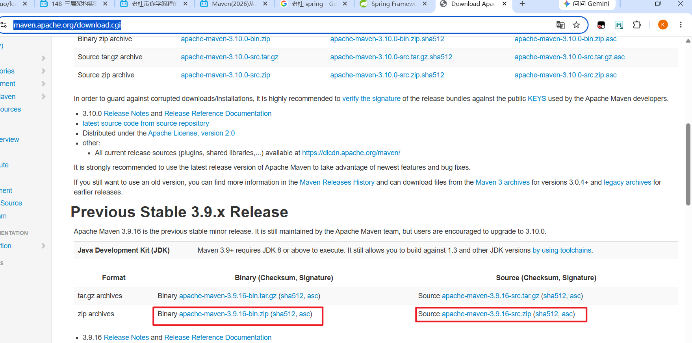

## 2.把他解压缩到d:\programs里面

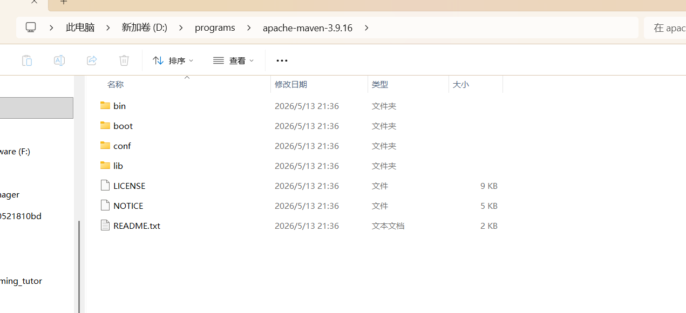

## 3.首先，需要配置JAVA_HOME环境变量，这个我们已经配置了，然后打开系统环境变量，创建一个MAVEN_HOME环境变量，路径是：D:\programs\apache-maven-3.9.16

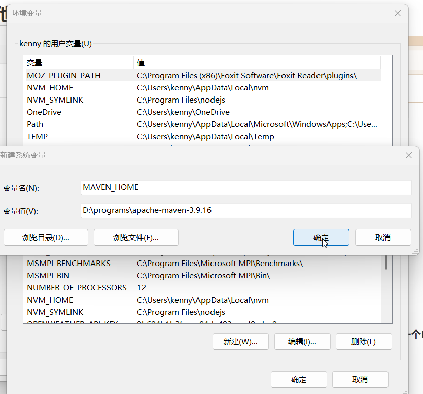

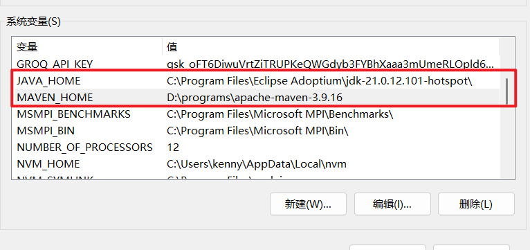

## 4.把maven里面的bin目录配置到环境变量

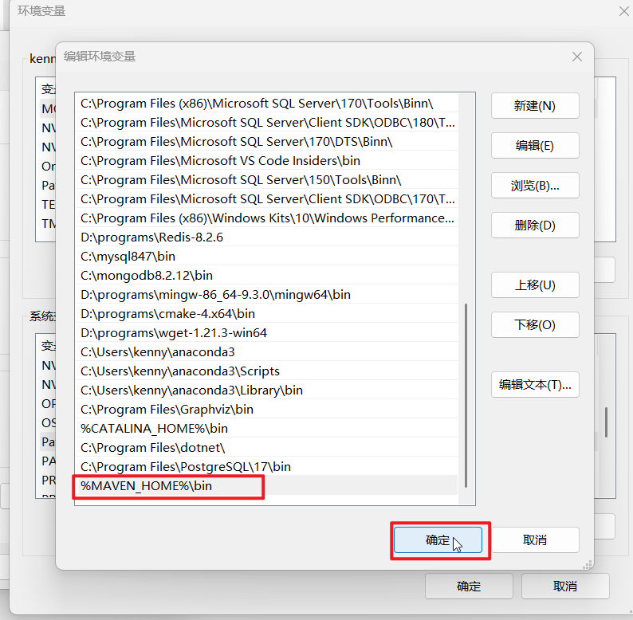

## 5.输入mvn，出现下面的情况说明maven安装成功，但是没有项目可以构建

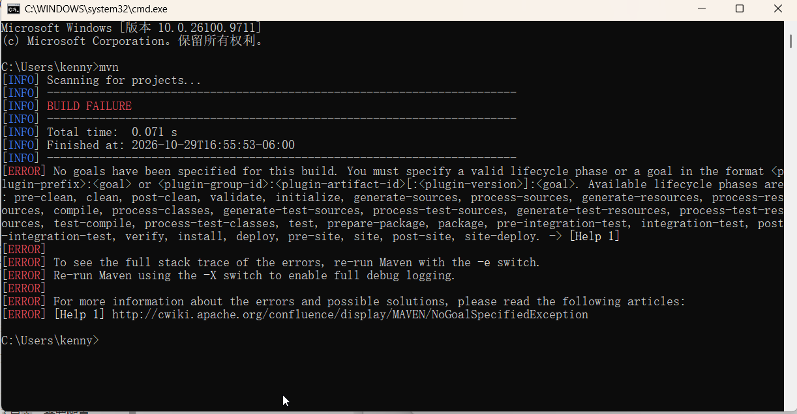

## 6.配置Maven工具参数编辑`MAVAN_HOME/conf/settings.xml`文件。

### 6.1 配置本地仓库，我们在d盘创建一个mavenRepo文件夹作为本地仓库

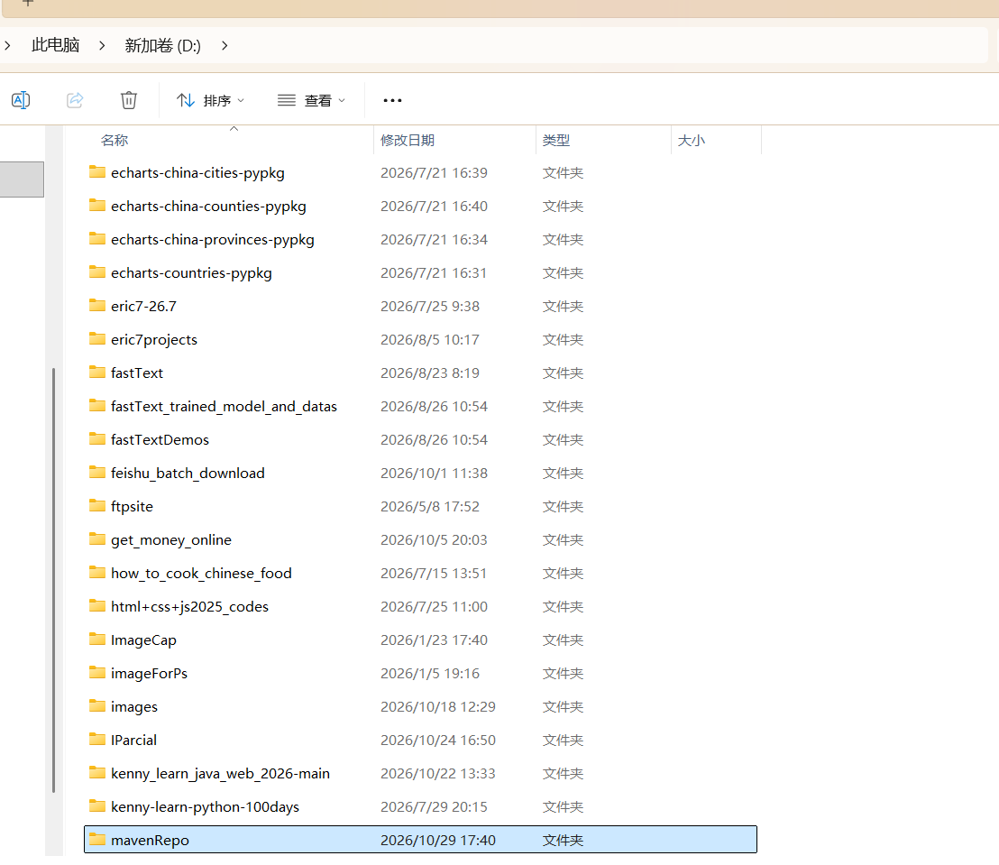

### 6.2 打开%MAVEN_HOME%/CONF/settings.xml,做如下配置

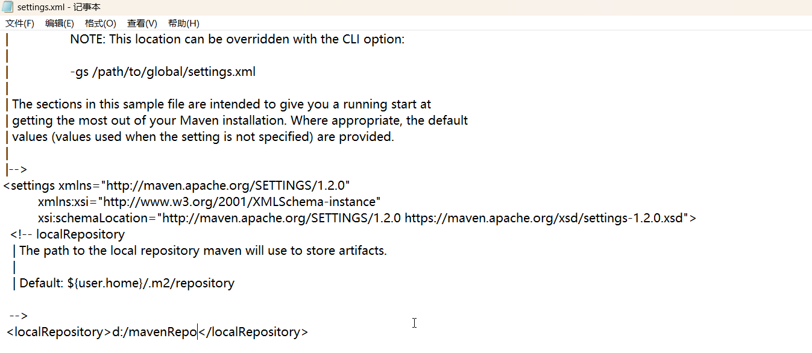

## 6.2 配置jdk自适应，找到profiles标签,在里面创建一个profile标签，内容如下

```
<profiles>
    <!-- profile
     | Specifies a set of introductions to the build process, to be activated using one or more of the
     | mechanisms described above. For inheritance purposes, and to activate profiles via <activatedProfiles/>
     | or the command line, profiles have to have an ID that is unique.
     |
     | An encouraged best practice for profile identification is to use a consistent naming convention
     | for profiles, such as 'env-dev', 'env-test', 'env-production', 'user-jdcasey', 'user-brett', etc.
     | This will make it more intuitive to understand what the set of introduced profiles is attempting
     | to accomplish, particularly when you only have a list of profile id's for debug.
     |
     | This profile example uses the JDK version to trigger activation, and provides a JDK-specific repo.
    <profile>
      <id>jdk-1.4</id>

      <activation>
        <jdk>1.4</jdk>
      </activation>

      <repositories>
        <repository>
          <id>jdk14</id>
          <name>Repository for JDK 1.4 builds</name>
          <url>http://www.myhost.com/maven/jdk14</url>
          <layout>default</layout>
          <snapshotPolicy>always</snapshotPolicy>
        </repository>
      </repositories>
    </profile>
    -->
    
    <profile>
      <id>jdk21</id>
      <activation>
        <activeByDefault>true</activeByDefault>
      </activation>

      <properties>
          <project.build.sourceEncoding>UTF-8</project.build.sourceEncoding>
          <maven.compiler.source>21</maven.compiler.source>
          <maven.compiler.target>21</maven.compiler.target>
      </properties>
    </profile>
 
  </profiles>
```

### 上面的配置强制maven使用jdk21来构建而不是使用默认的jdk14，如果你的电脑只有一个jdk，其实也可以不配置。只有你安装了2个以上的jdk版本时才需要配置

## 7.测试本地仓库是否配置成功，输入命令：mvn help:effective-settings，此时maven就好下载一下apache提供的jar包到本地仓库，我们打开这个仓库，如果有内容，说明本地仓库配置成功

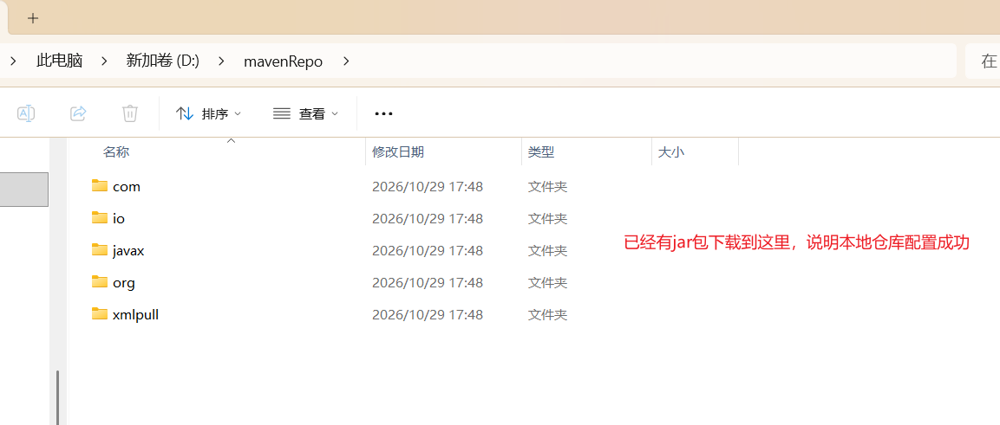

# 演练2.maven命令的使用，手动创建项目

## 2.1手动创建一个maven-project1项目，在里面新建一个src文件夹和一个pom.xml文件

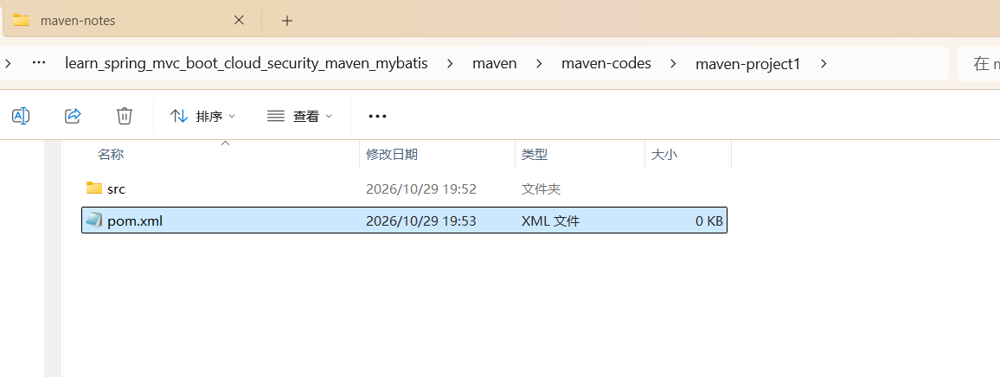

## 2.2 在src文件夹里面新建一个main文件夹和一个test文件夹

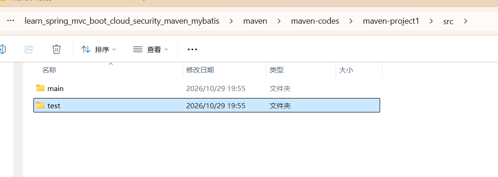

## 2.3 然后在main文件夹里面新建一个java文件夹和一个resources文件夹

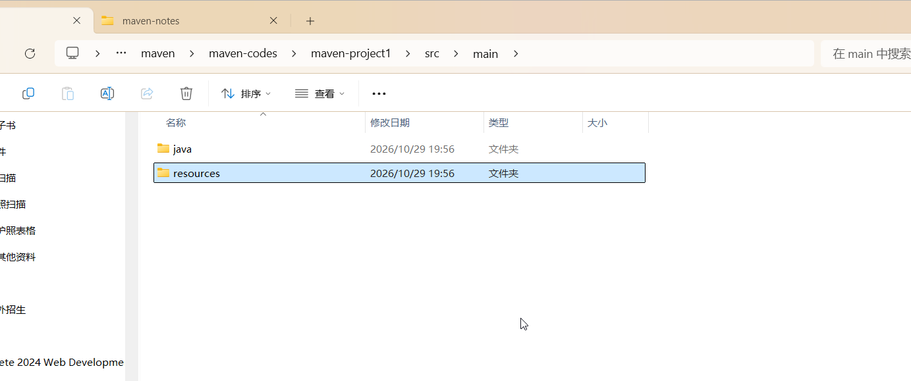

## 2.4 在test文件夹里面也新建一个java文件夹和一个resources文件夹

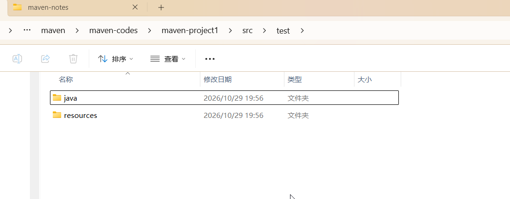

## 2.5 在maven-project1\src\main\java里面新建一个org文件夹，然后在里面新建一个kenny

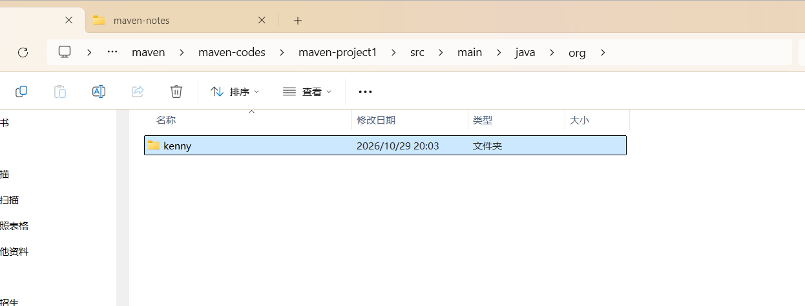

## 2.6在kenny文件夹里面新建一个maven文件夹，在里面新建一个HelloMaven.java文件

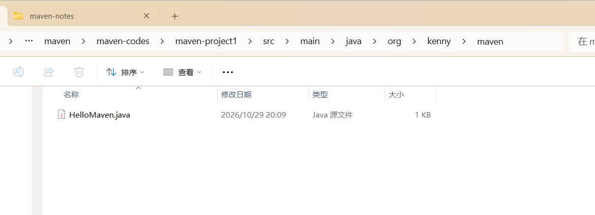

内容如下：

```
package org.kenny.maven;

public class HelloMaven {
    public static void main(String[] args){
          System.out.println("Hello Maven!!!");
    }
}
```

## 2.7 然后我们返回到maven-project1文件夹里面

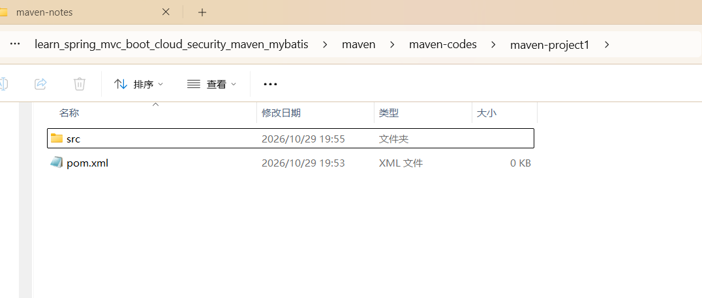

## 2.8 编辑pom.xml文件，内容如下

```
<?xml version="1.0" encoding="UTF-8"?>
<project xmlns="http://apache.org"
         xmlns:xsi="http://w3.org"
         xsi:schemaLocation="http://apache.org https://apache.org">
    <modelVersion>4.0.0</modelVersion>

    <!--  你的项目坐标 -->
    <groupId>org.kenny</groupId>
    <artifactId>maven-project1</artifactId>
    <version>0.0.1-SNAPSHOT</version>

    <packaging>jar</packaging>
</project>

```

## 2.9打开一个cmd窗口定位到项目根目录里面，输出mvn compile,然后maven会下载需要的jar包到本地仓库，然后就构建成功

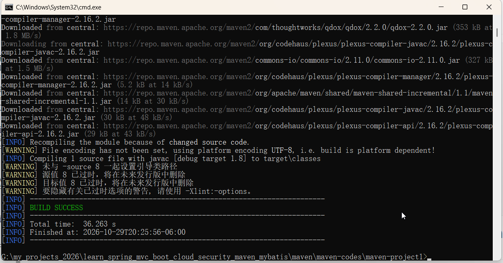

## 2.10查看运行项目目录，发现生成了一个target文件夹，

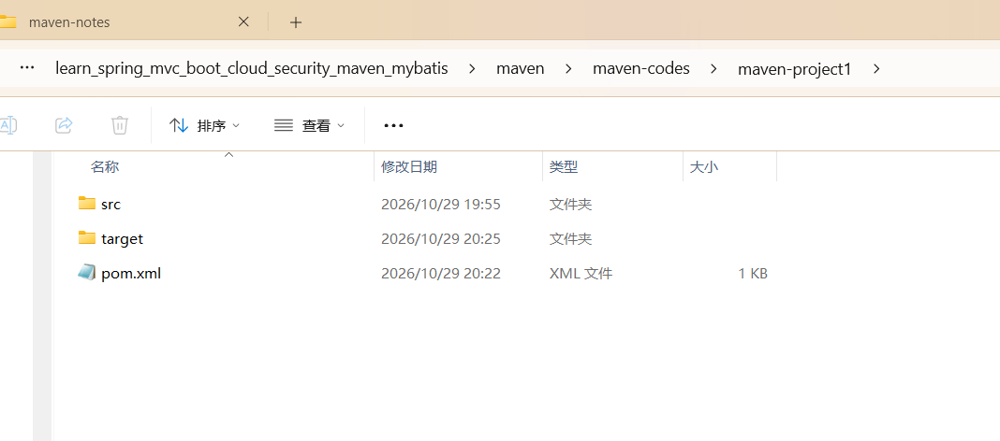

## target里面有3个文件夹，


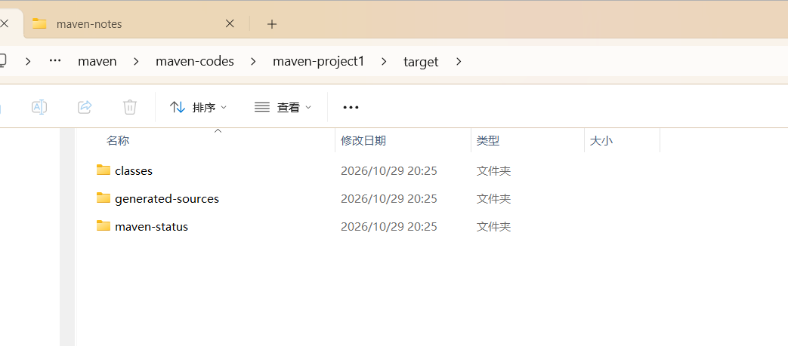


## 其中classes里面就有我们的类生成的字节码文件

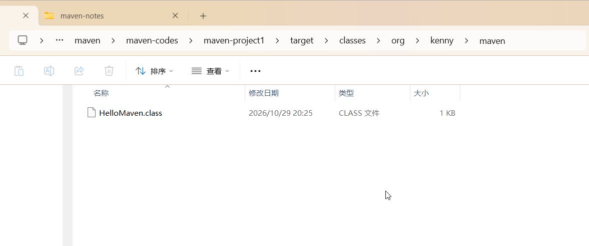

## 2.11需要注意，如果我们要运行这个文件，不能够在maven里面运行需要打开终端定位到classes路径里面，否则会报错说找不到主类，因为我们这个类的网址路径是org.kenny.maven.HelloMaven

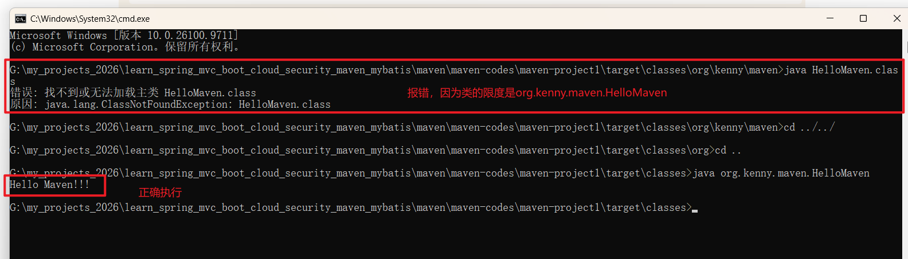

## 2.12 要清除的话，可以输入mvn clean，执行成功后，发现target文件夹被删除了

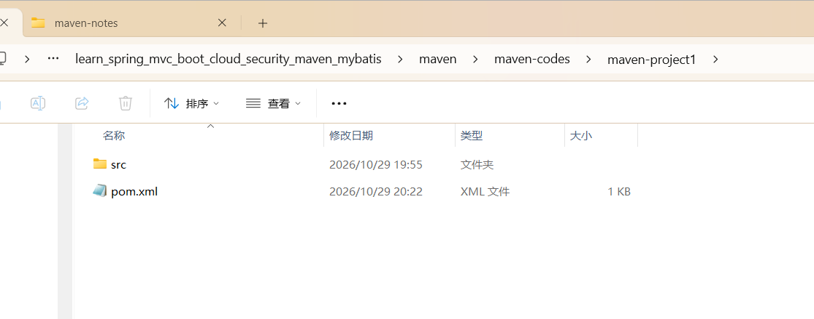

## 2.13还可以使用mvn clean install命令把项目打包安装到maven本地仓库

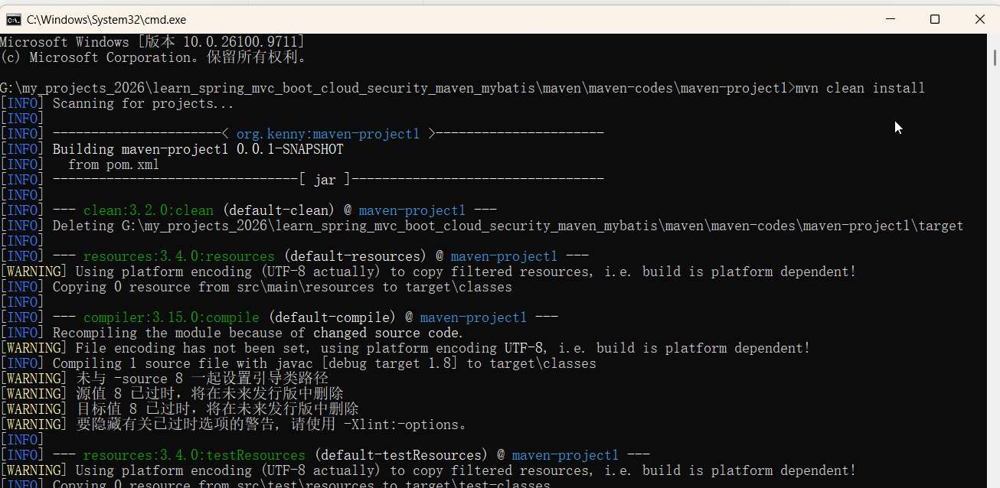

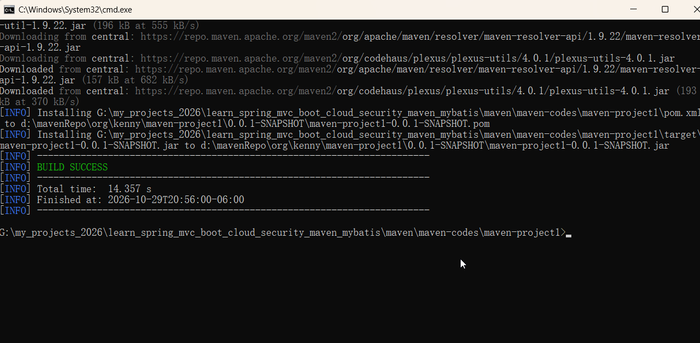

### 执行成功后在本地仓库可以找到我们的jar包

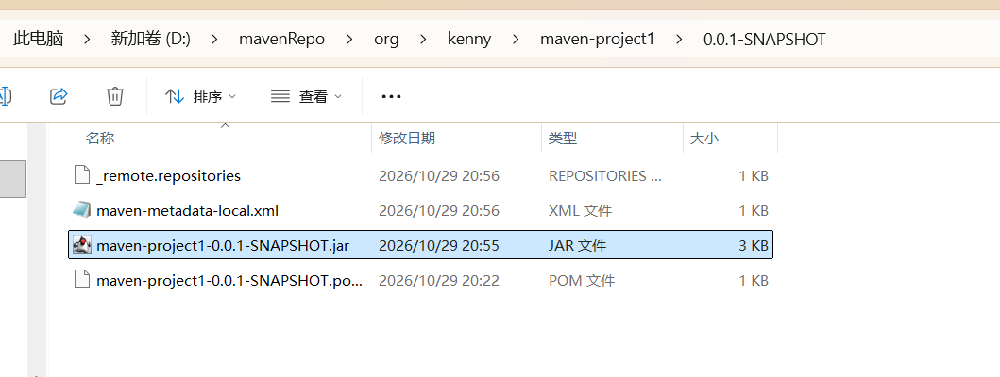

## 2.14 输入mvn site，会生成一个产品说明书网站，注意：如果你只是使用这个命令，不会生成classes文件和安装，只会生成一个site文件夹里面有相关的thml文档和样式表文件

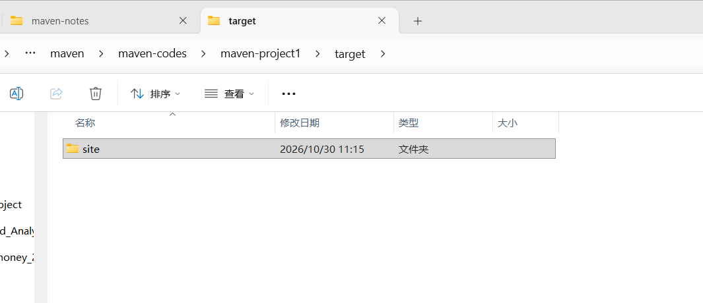

