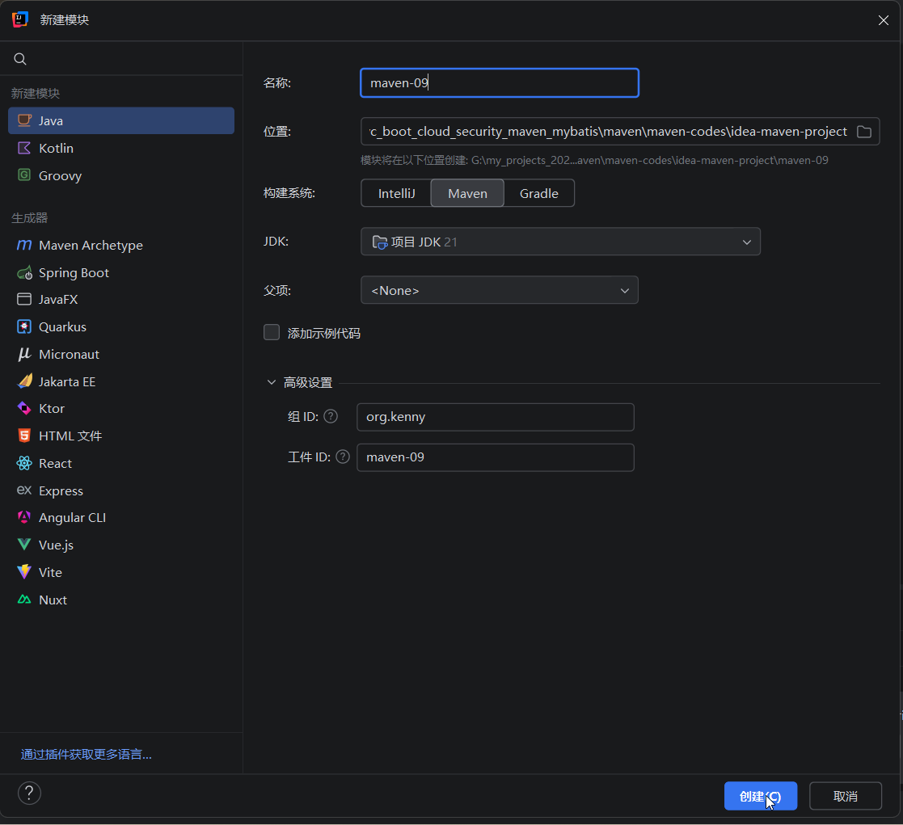
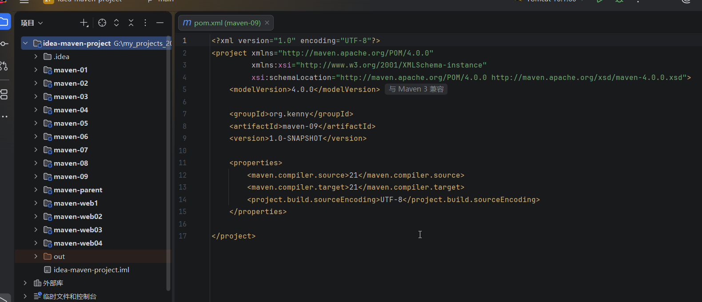
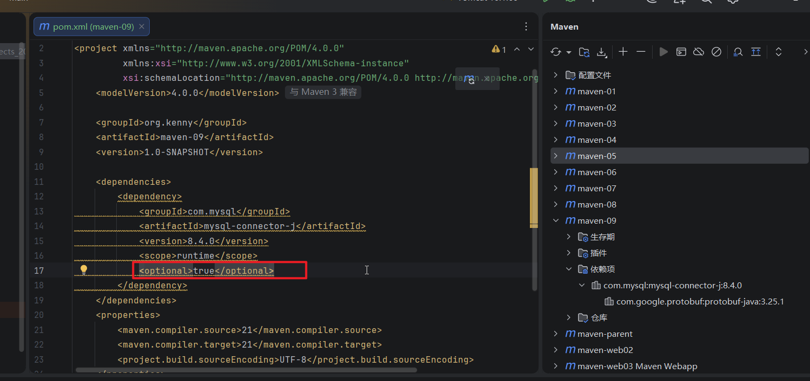
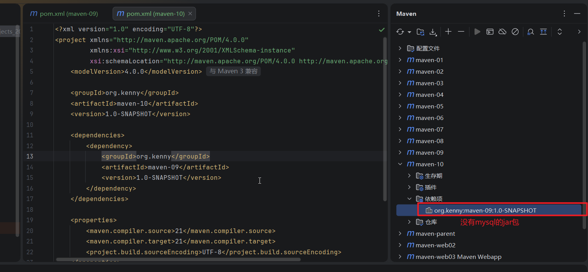
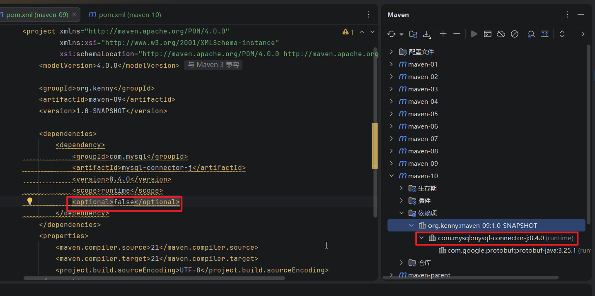

## 1.新建一个模块maven-09

## 2.添加一个mysql依赖，在这个依赖里面添加一个< optional>true< /optional>,这个依赖就变为可选依赖

## 3.设置了optional之后，这个jar包就不支持传递了。我们新建一个maven-10模块，在里面引入maven-09模块，你会发现，它没有mysql的包耶。

## 4.回到maven-09模块，把optional的值设置为false，刷新maven工具在maven-10里面可以看到mysql驱动包

