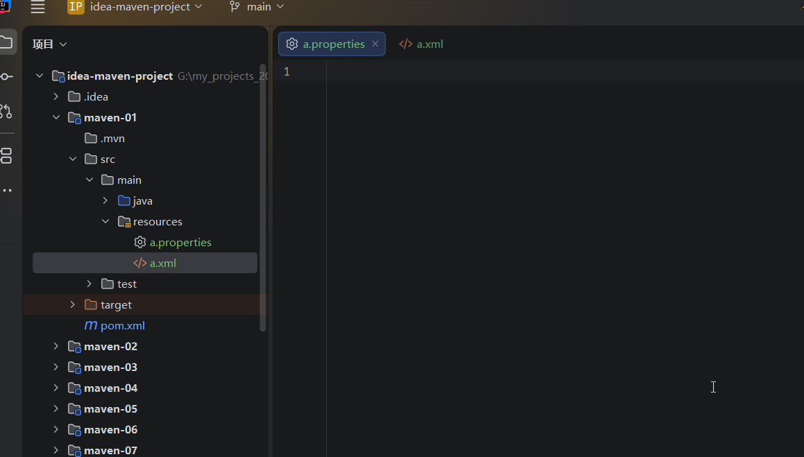
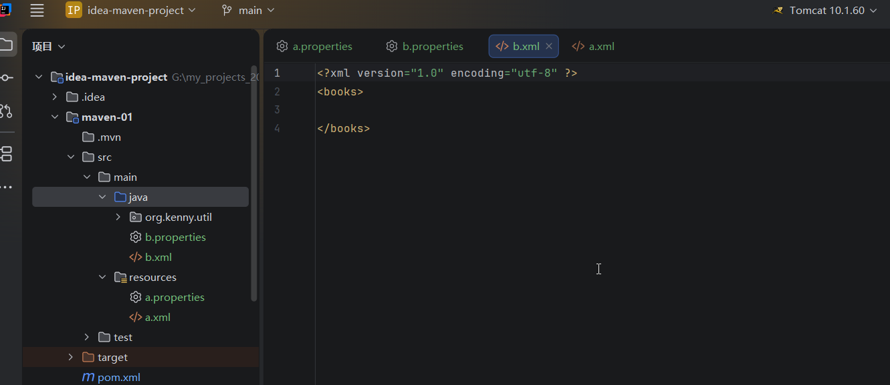
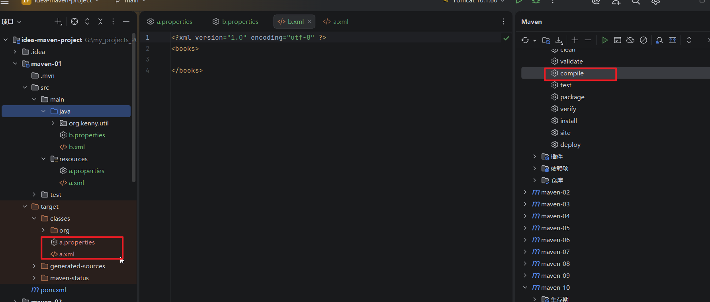
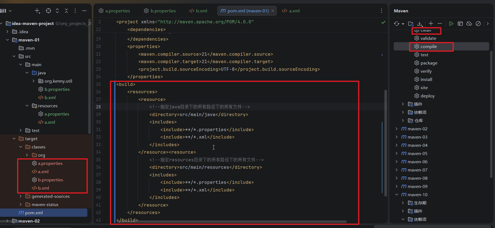

## 1.我们使用maven-01模块来学习，在main/resources/里面新建一个a.properties文件和一个a.xml文件

## 2.然后在main/java/里面新建一个b.properties文件和一个b.xml文件

## 3.然后我们点击maven工具面板，先点击生命周期里面的clean命令清除一下以前编译的结果，然后再双击compile，发现编译后只有resources里面的配置文件被打包，java文件夹里面的配置文件被忽略

## 4.如果你需要把java文件夹里面的配置文件也打包，你需要在pom.xml里面做下面的配置，然后重新clean和重新compile，就会打包所有资源文件

### 注意：老师说resources下面的资源不需要配置，其实是需要的。还是全部配置了好一点。

## 其实我们并不建议把配置文件或者资源放到java文件夹里面，除非有一些特殊情况

