## 1.还是idea-maven-project,新建一个a模块作为父模块，然后新建一个a1子模块和a2子模块

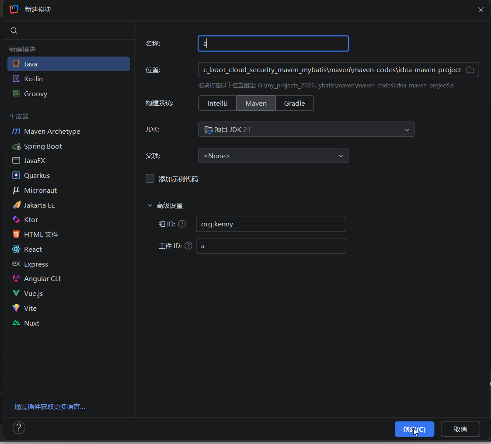

## 2.然后可以把这个模块的src和.mvn文件夹删除，只需要保留pom.xml,因为父工程只做配置，没有业务代码

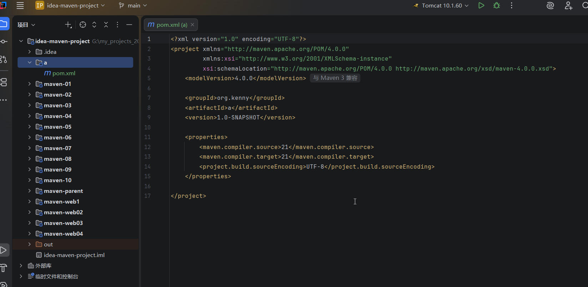

## 3.在a模块上面点击右键-》新建=》模块，创建一个a1模块

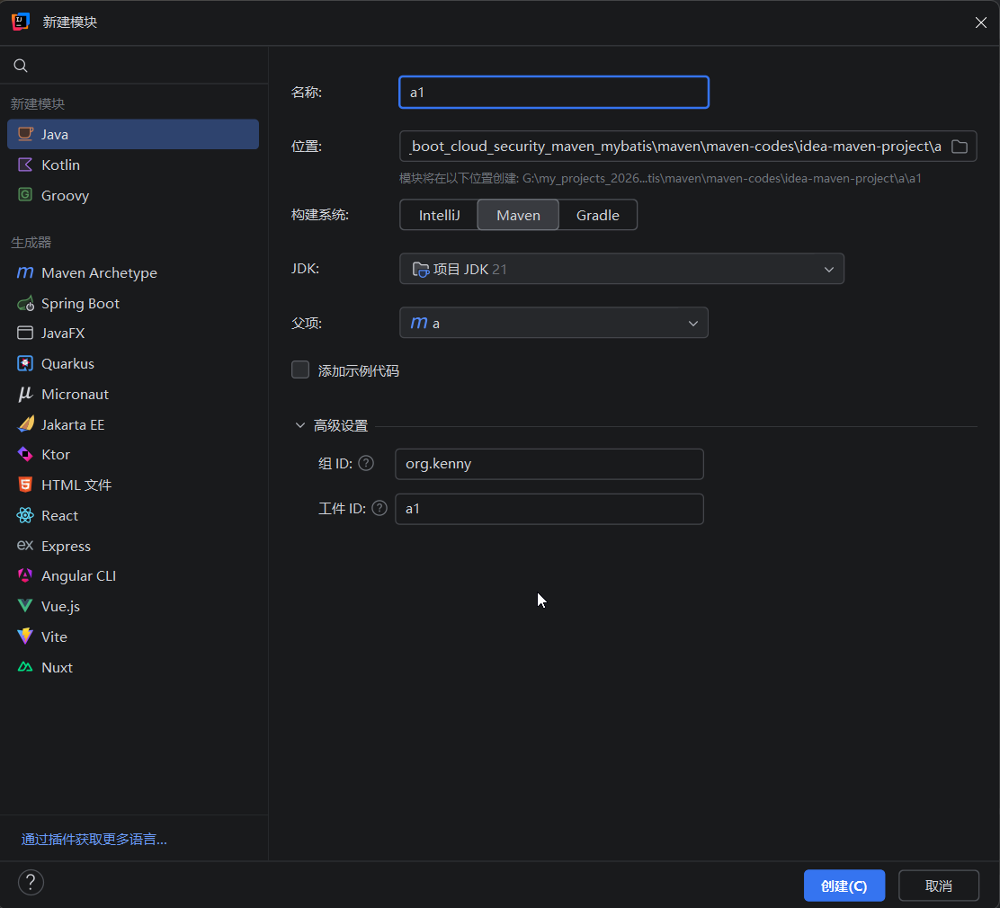

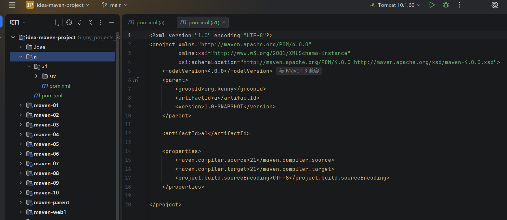

## 4.然后再创建一个a2子模块

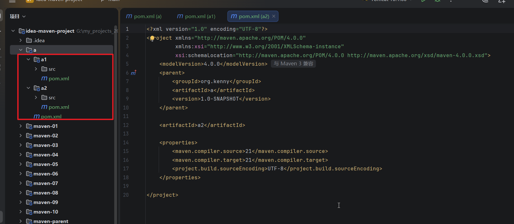

## 5.查看父模块的pom.xml,发现它有项目聚会，会列出所有的子模块

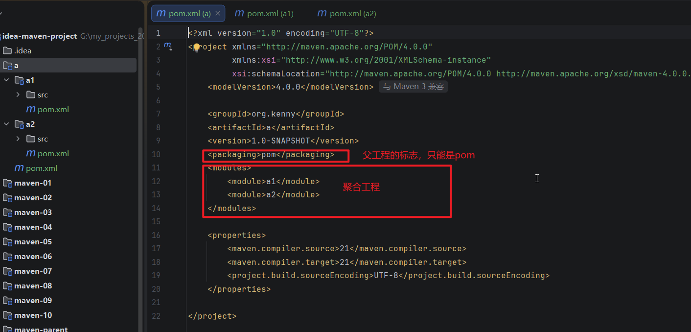

## 6，查看子项目的pom.xml,发现它会引入父模块，会继承g和v，artifact是不能继承的。

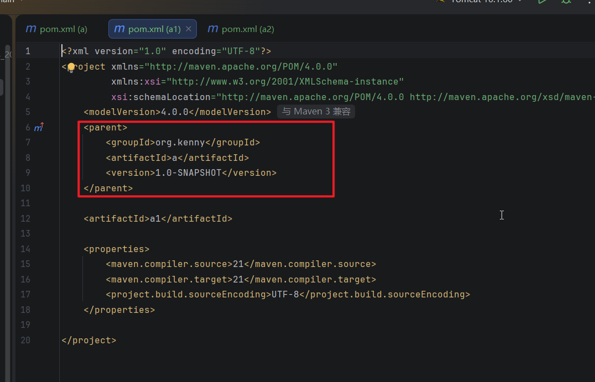

## 7.我们可以在父模块里面做一个dependencyManagement配置

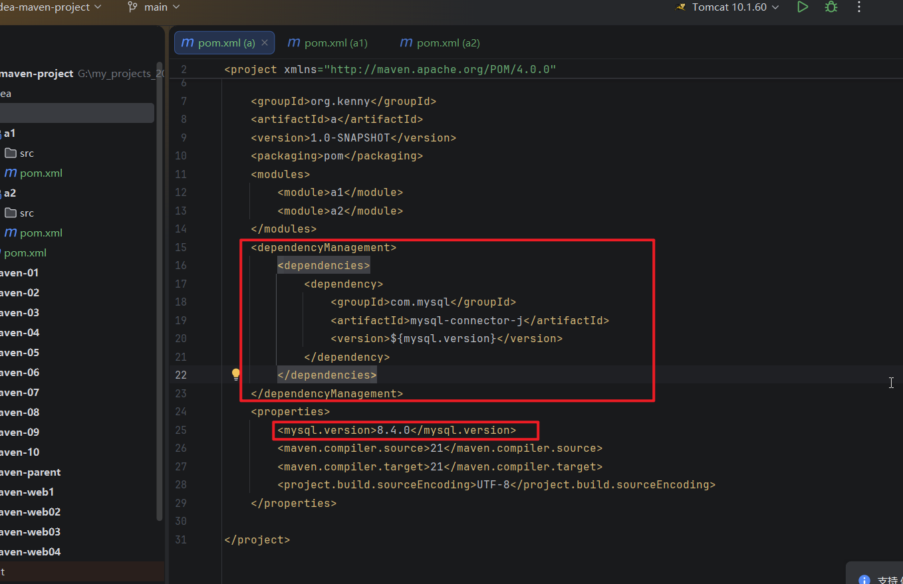

## 8.然后我们再配置一个JUnit依赖

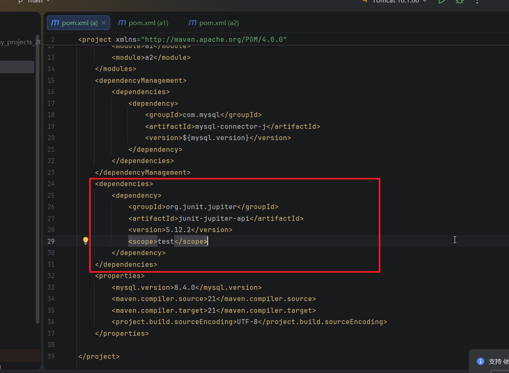

## 9.刷新一些maven工具，发现子项目也会继承这个junit

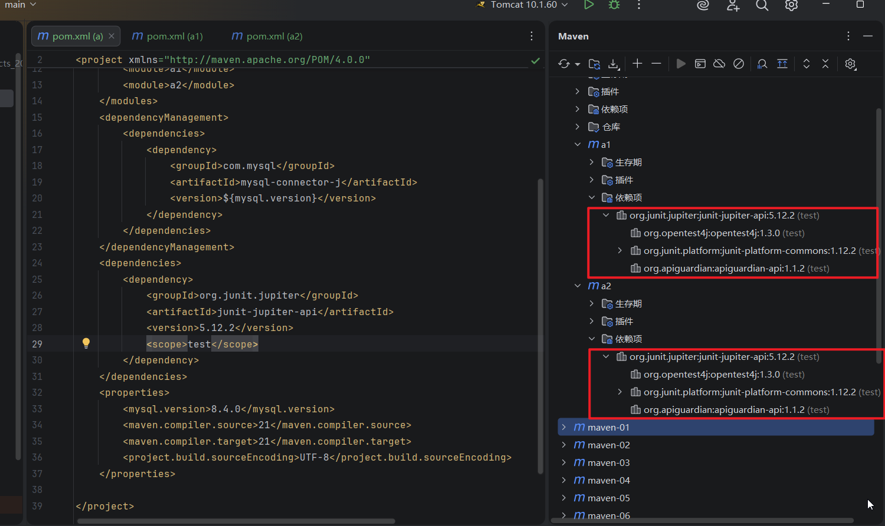

## 10.此时如果我们在a1里面引入mysql依赖，是不需要添加版本号的，因为父模块里面已经约定好了版本号

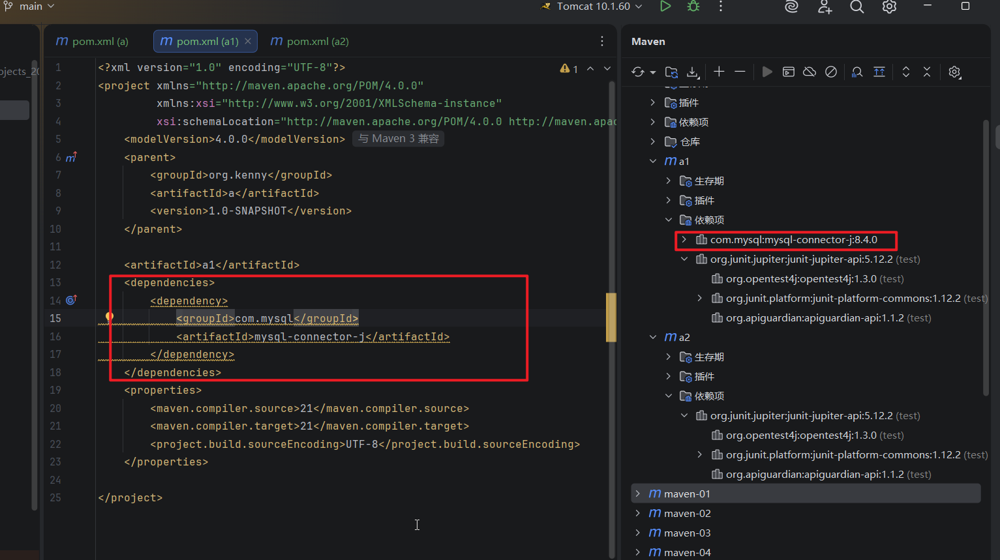