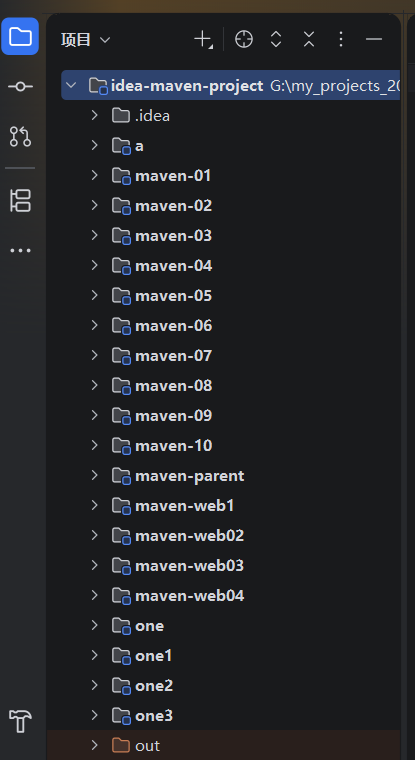
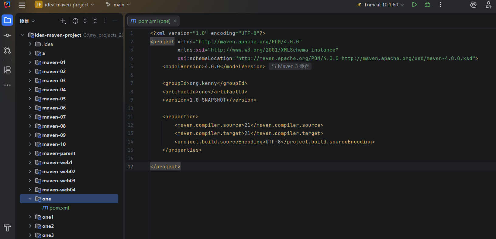
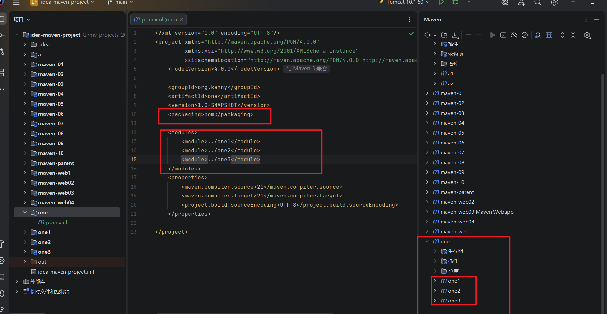
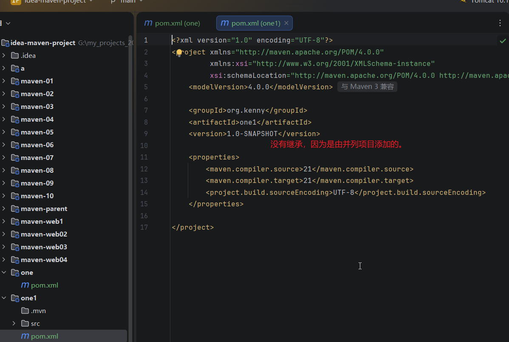
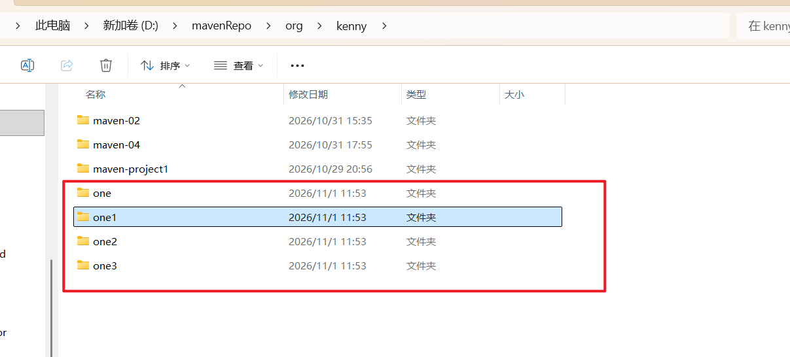

# 可以通过pom.xml把一些并列项目变为一个项目的子项目

## 1.还是idea-maven-project，我们新建one，one1,one2,one3四个模块，此时他们是同一级的，是并列关系

## 2.然后我们在one模块里面把src和.mvn文件夹删除，只剩下一个pom.xml

## 3.修改one模块里面的pom.xml,把packing改为pom，并且添加modules，在里面给one1，one2，one3每一个模块创建一个module，刷新maven工具面板，然后你会发现，虽然左边的视图没有变化，但是在右边maven那里，这三个模块已经被包含到了one模块里面

## 4、然后你打开one1里面的pom.xml,发现它没有继承one模块，说明聚会不一定要继承

## 5.然后我们在one模块的生命周期里面点击install，执行成功后，到maven本地仓库里面查看，发现one，one1，one2，one3都一起打包了

## 注意，这种方式虽然可行，但是不推荐，一般还是使用以父工程作为聚会工程，也就是使用继承的方式

