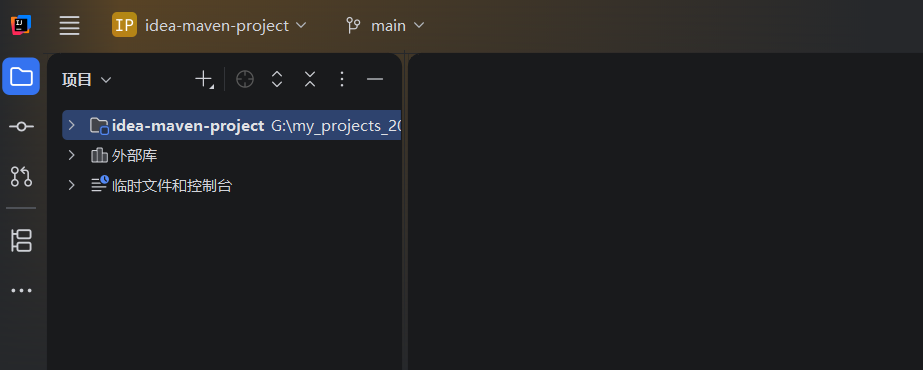
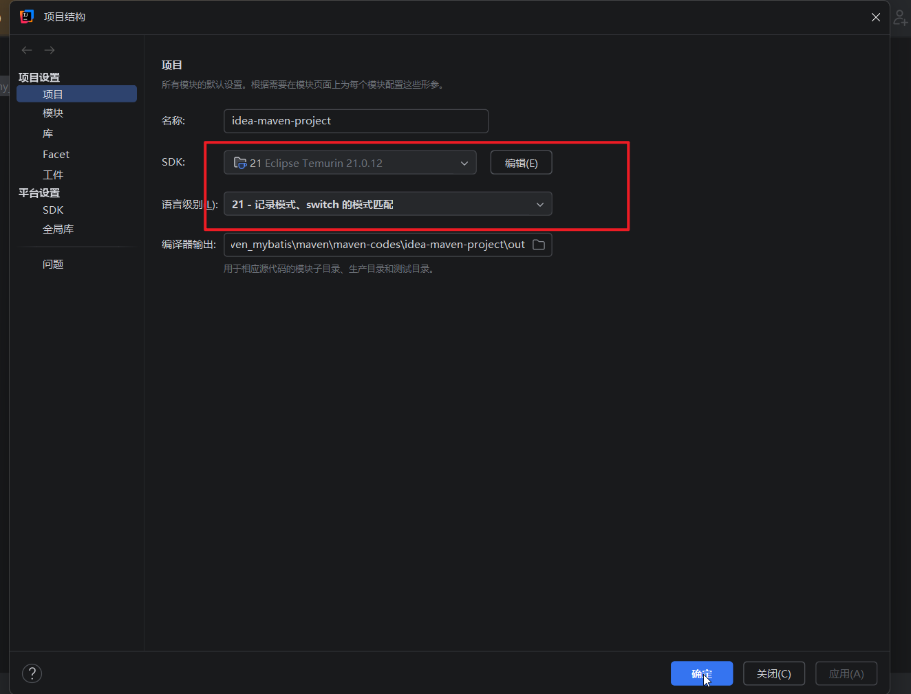
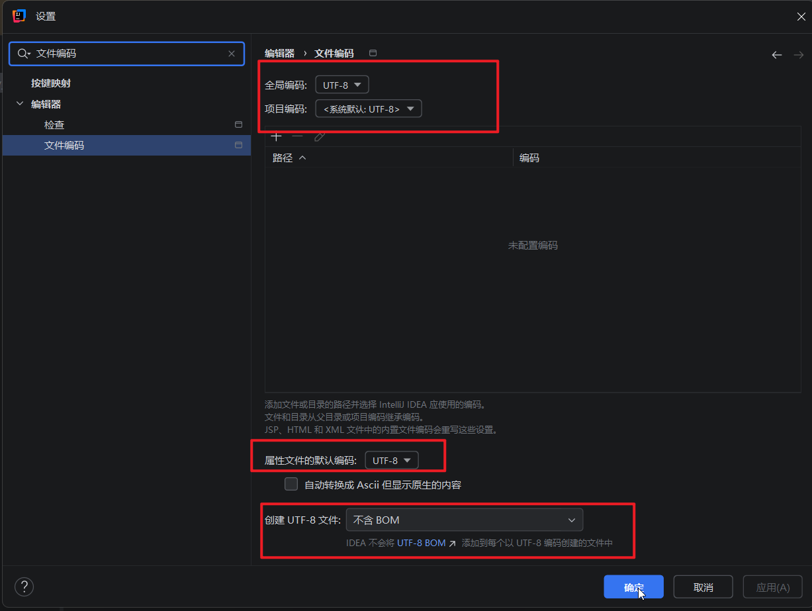
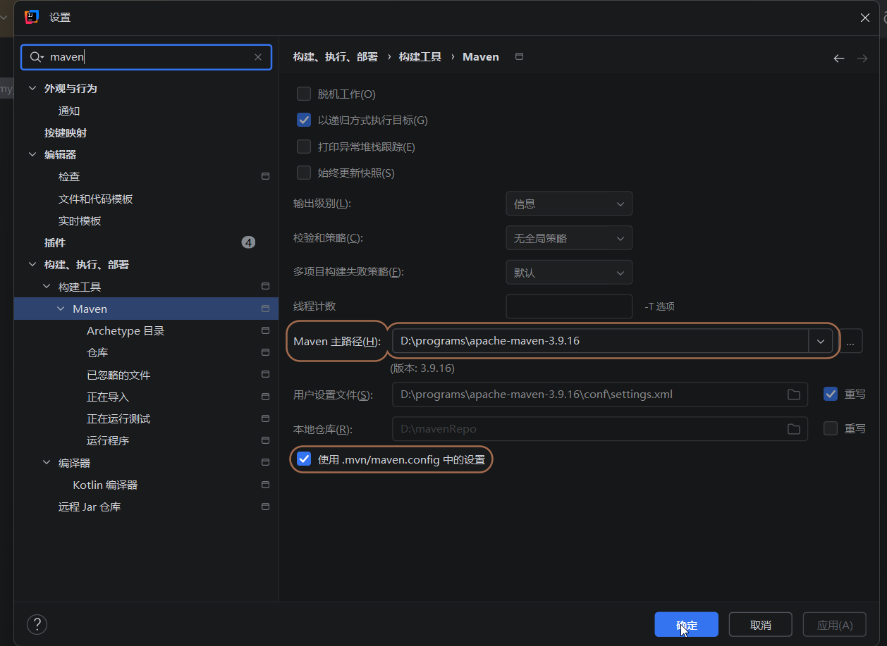

# 1.如果你使用idea来继承maven，我们配置的JAVA_HOME,MAVEN_HOME，Path环境变量都是没有作用的。

# 2.集成过程

## 2.1打开idea，新建一个空项目，起名idea-maven-project

## 2.2点击文件-项目结构，配置jdk

## 2.3.在搜索框输入文件编码，不所有的编码都改为UTF-8

## 2.4点击文件-设置-》构建、执行、部署-》构建工具=》maven，在右边的面板中选择我们自己安装的maven,并且需要重写用户配置文件，把它改为自己安装的maven里面的settings文件

## 至此idea就成功集成了maven