## 1.关于idea集成maven参考这里： [演练2-idea集成maven](演练2-idea集成maven.md)

## 2.我们上一节课以及创建了一个关联maven的项目，现在我们只需要在这个项目里面添加一个模块

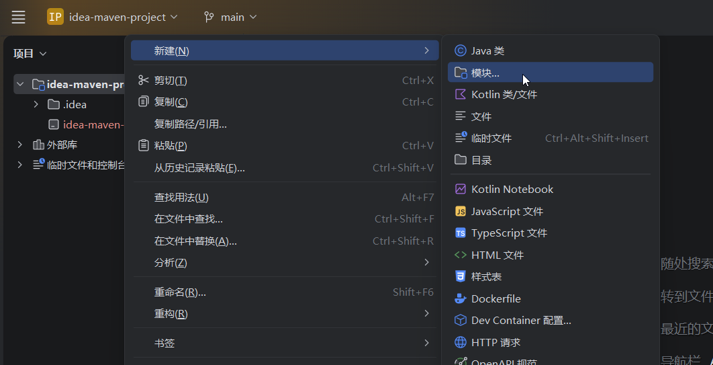

## 3.在弹出的窗口中输入模块名称maven01，然后在勾选系统里面选择maven，检查一下jdk的版本是否是我们设置的版本，一般来说，如果你在idea里面成功集成了maven，这个版本是正确的。取消勾选添加示例代码一栏，在高级设置里面把第一栏改为我们自己的包名，比如这里是org.kenny,然后点击创建按钮

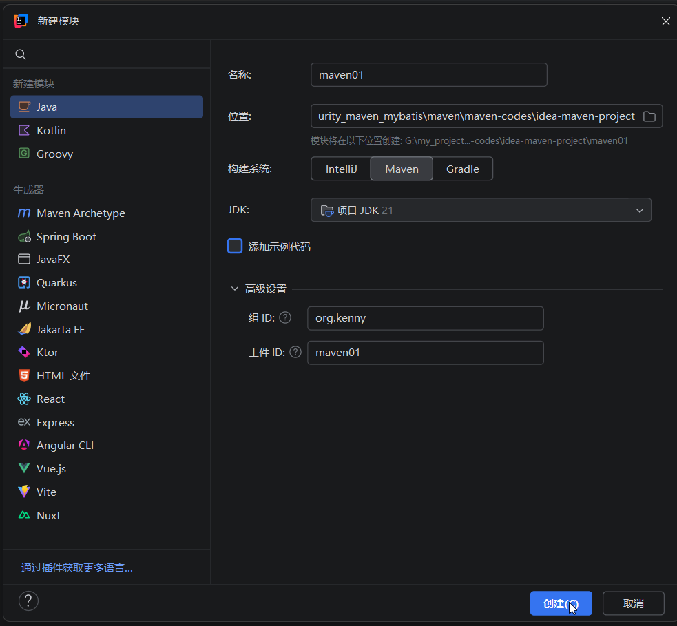

## 4.此时idea会创建一个maven01模块，使用的是maven标准的结构，还会在模块的根目录下面创建一个pom.xml

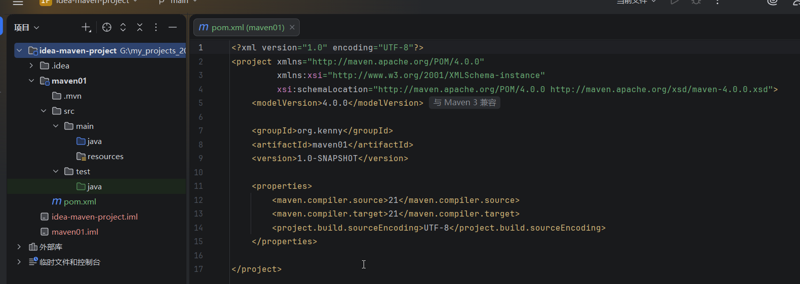

### 可以看到，它把我们在maven/conf/settings.xml里面的jdk配置也拷贝过来了，不过这里的局部配置，settings里面的是全局配置，我们在自己的项目里面可以用局部配置来覆盖全局配置

## 5.点击idea右边工具栏的m按钮，可以打开maven生命周期命令和设置，还有插件和仓库的地址

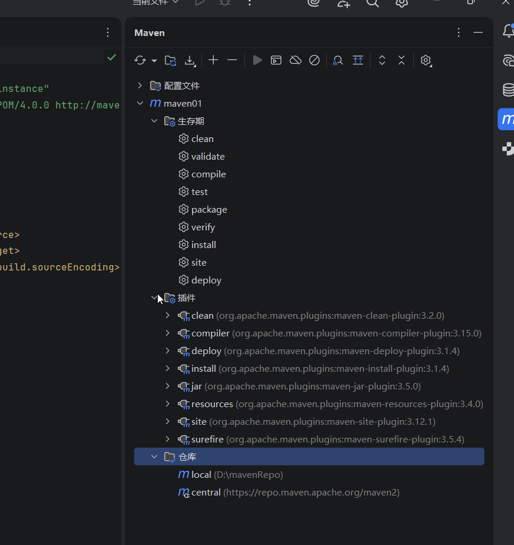

## 6.此时我们还没有配置任何依赖，我们可以配置一个比如JUnit5

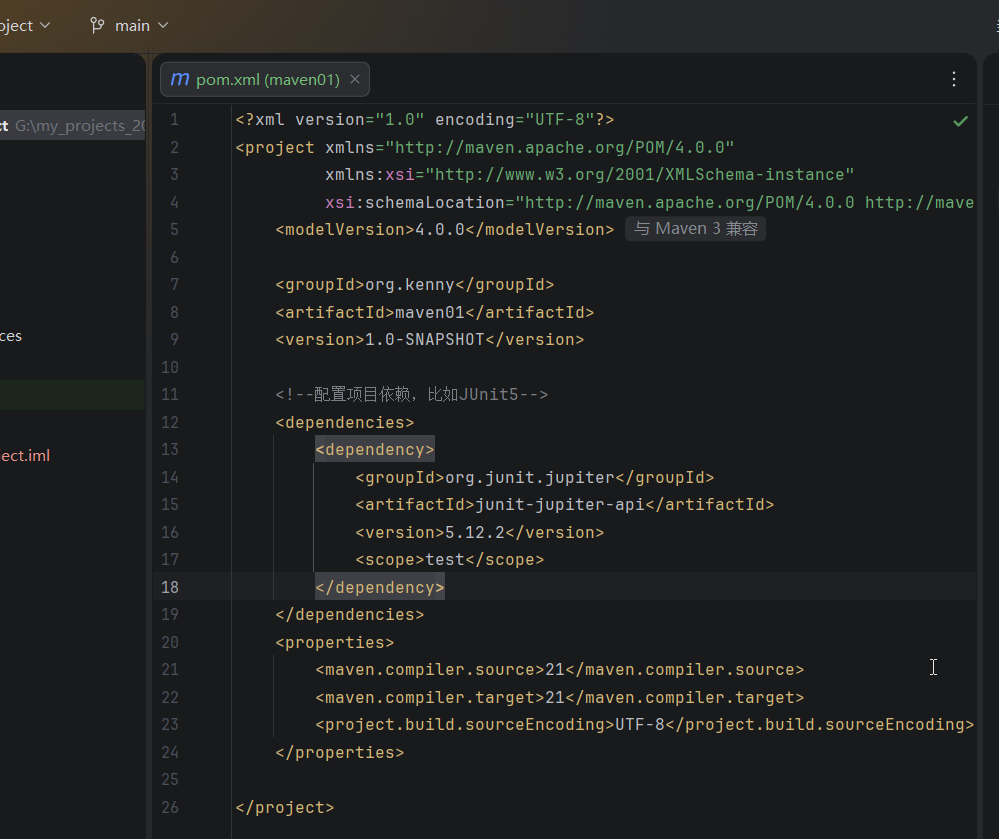

### 注意：添加了依赖后需要在maven工具里面刷新，然后如果能够看到依赖项，说明添加成功

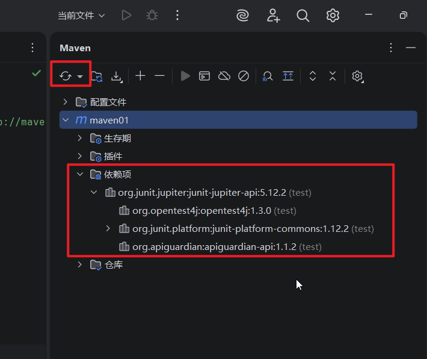

## 7.然后我们在main/java里面添加一个包org.kenny.util,在里面新建一个Math类,有2个静态方法，代码如下,

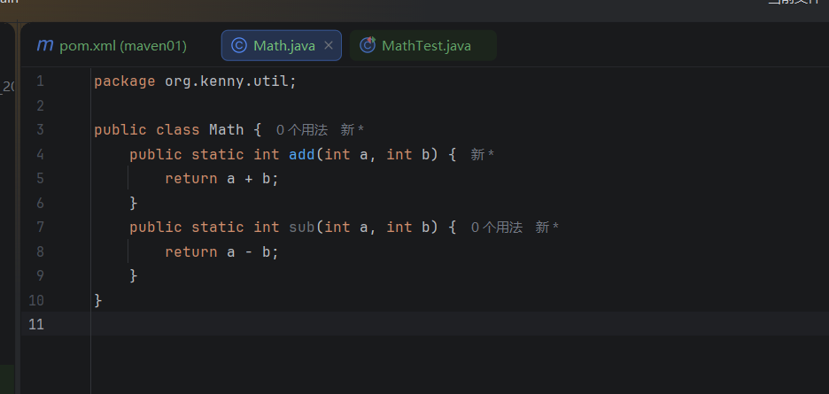

## 8.然后我们要对这个Math类进行单元测试，需要在test/java/里面写代码，需要注意，包名称必须一致，测试类的名称必须叫做MathTest，我们编写测试代码如下

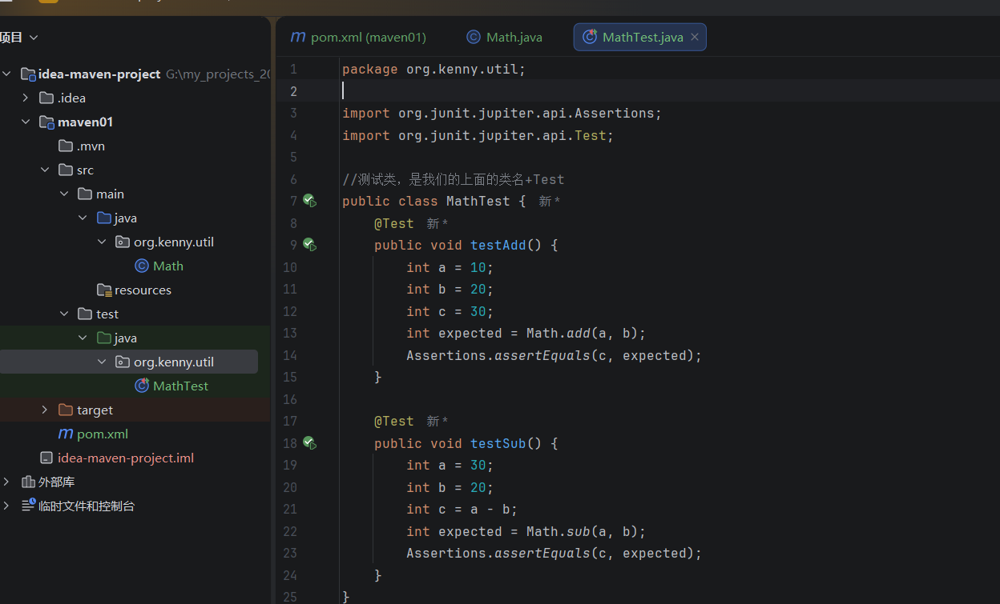

### 运行代码发现测试通过

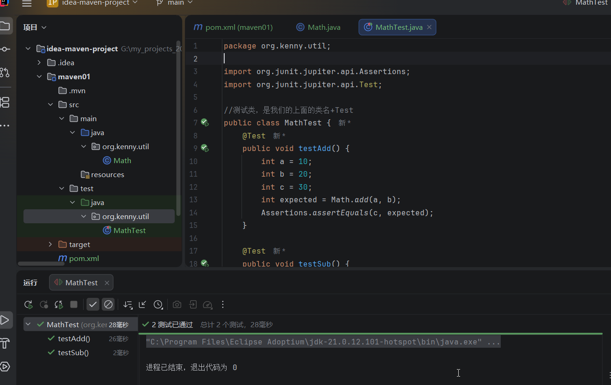

### 注意，假如你把期望的值设置一个错误的值，测试就会失败

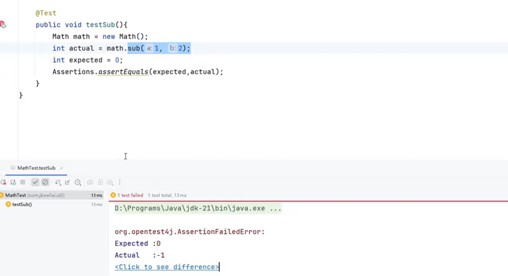

### 注意：

#### 1.测试方法的访问修饰符不能是private

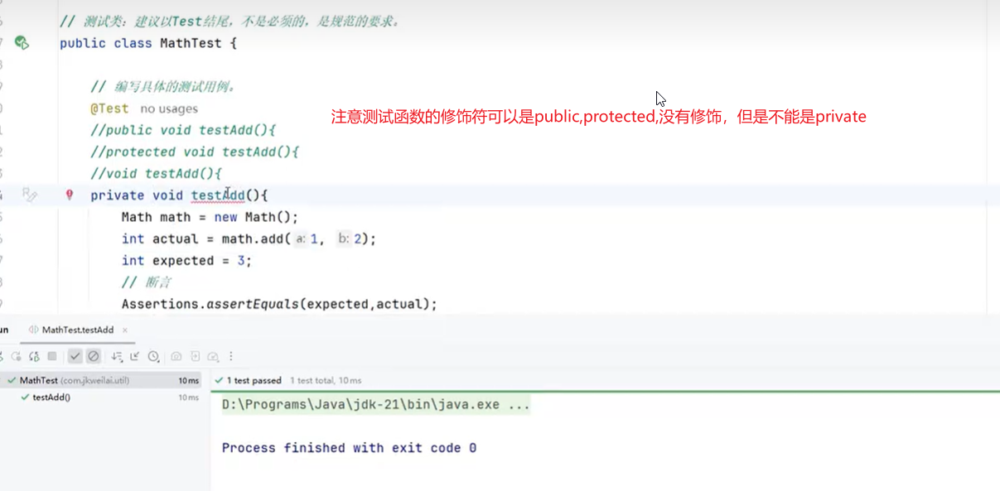

#### 2.测试方法不能有返回值，否则报错

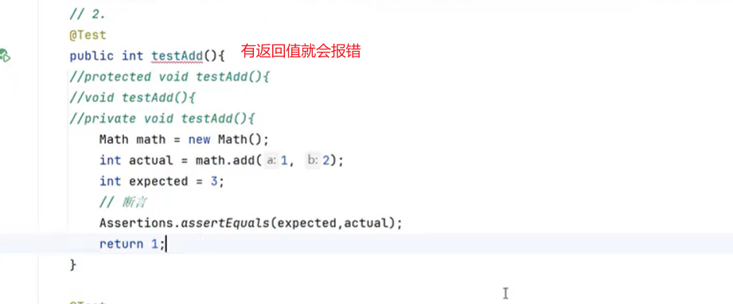

#### 3.测试方法也不能是静态方法

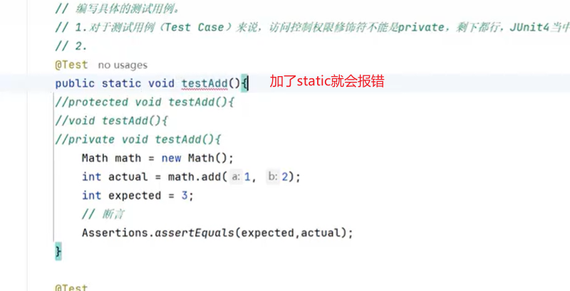

#### 4.测试方法不必以test开头，只是使用了test开头更加符合规范

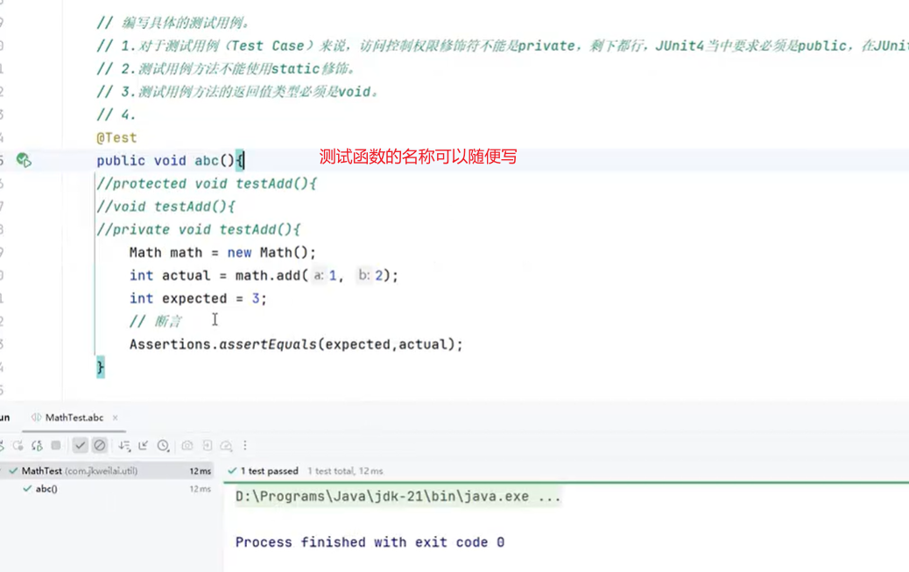

#### 5.测试方法不能够有参数

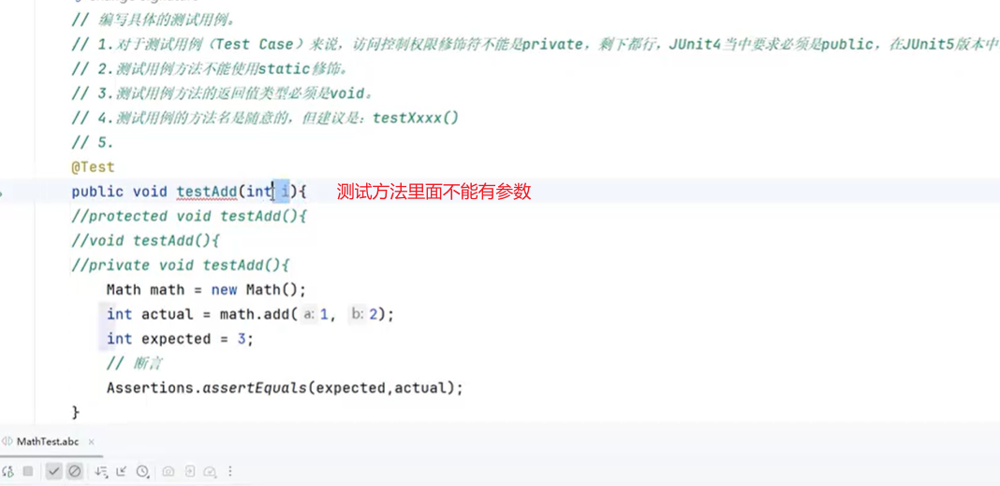