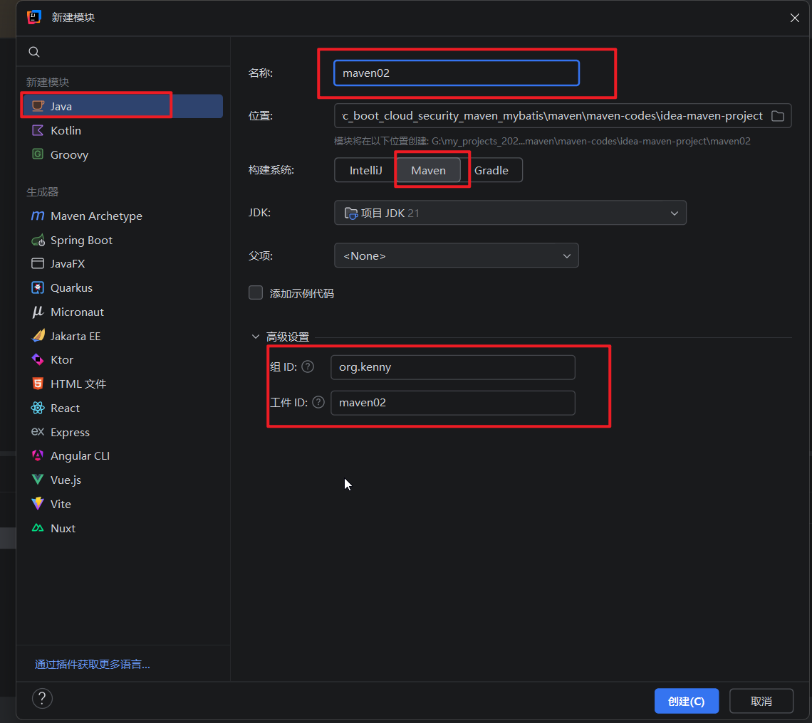
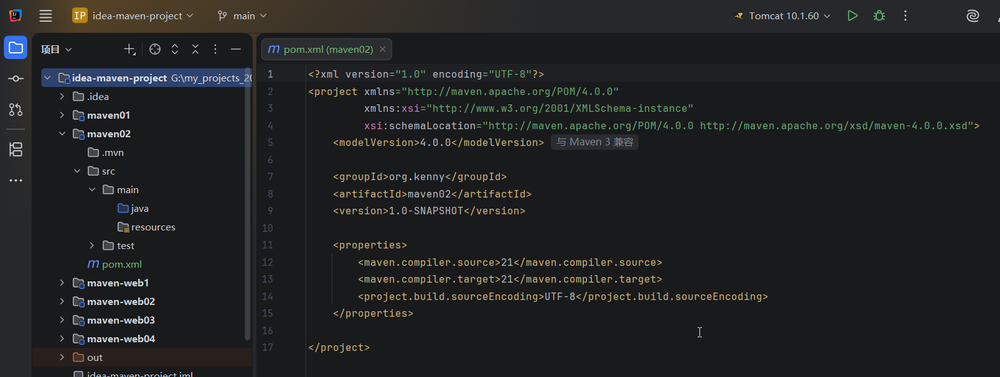
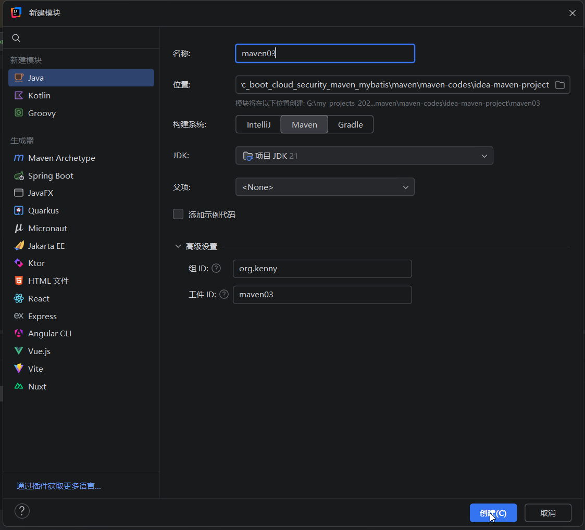
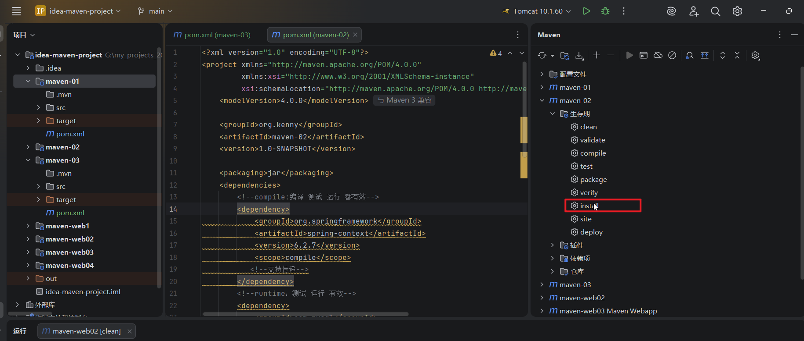
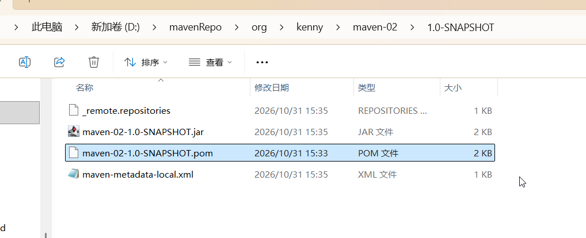
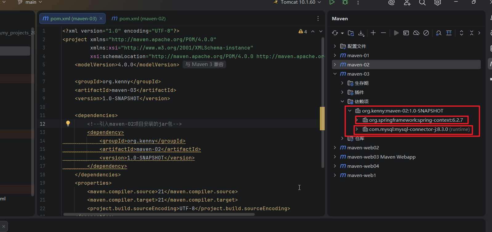

## 1.还是使用Idea-maven-project,我们创建一个maven02模块





## 2.然后我们再添加一个maven03项目模块



## 3.然后在maven-02项目的pom.xml文件里面添加一下依赖，有4个依赖，2个支持传递，2个不支持传递，修改后的pom.xml内容如下

```
<?xml version="1.0" encoding="UTF-8"?>
<project xmlns="http://maven.apache.org/POM/4.0.0"
         xmlns:xsi="http://www.w3.org/2001/XMLSchema-instance"
         xsi:schemaLocation="http://maven.apache.org/POM/4.0.0 http://maven.apache.org/xsd/maven-4.0.0.xsd">
    <modelVersion>4.0.0</modelVersion>

    <groupId>org.kenny</groupId>
    <artifactId>maven02</artifactId>
    <version>1.0-SNAPSHOT</version>
    
     <!--依赖项-->
    <dependencies>
        <!--compile:编译 测试 运行 都有效-->
        <dependency>
            <groupId>org.springframework</groupId>
            <artifactId>spring-context</artifactId>
            <version>6.2.7</version>
            <scope>compile</scope>
           <!--支持传递-->
        </dependency>
        <!--runtime：测试 运行 有效-->
        <dependency>
            <groupId>com.mysql</groupId>
            <artifactId>mysql-connector-j</artifactId>
            <version>8.3.0</version>
            <scope>runtime</scope>
            <!--支持传递-->
        </dependency>
        <!--test：测试 有效-->
        <dependency>
            <groupId>org.junit.jupiter</groupId>
            <artifactId>junit-jupiter-api</artifactId>
            <version>5.12.2</version>
            <scope>test</scope>
            <!--不支持传递-->
        </dependency>
        <!--provided：编译 测试 有效-->
        <dependency>
            <groupId>jakarta.servlet</groupId>
            <artifactId>jakarta.servlet-api</artifactId>
            <version>6.0.0</version>
            <scope>provided</scope>
            <!--不支持传递-->
        </dependency>
    </dependencies>

    <properties>
        <maven.compiler.source>21</maven.compiler.source>
        <maven.compiler.target>21</maven.compiler.target>
        <project.build.sourceEncoding>UTF-8</project.build.sourceEncoding>
    </properties>

</project>
```

## 4.然后我们把项目maven-02打包，打包之前最好在maven面板里面刷新一下，然后双击maven-02生命周期的install进行打包安装



### 安装完成后，他会把jar包放到maven本地仓库里面




## 5.然后我们在maven-03里面引入maven-02的gav坐标，也就是使用maven-02生成的jar包，maven-03的pom.xml文件的内容如下

```
<?xml version="1.0" encoding="UTF-8"?>
<project xmlns="http://maven.apache.org/POM/4.0.0"
         xmlns:xsi="http://www.w3.org/2001/XMLSchema-instance"
         xsi:schemaLocation="http://maven.apache.org/POM/4.0.0 http://maven.apache.org/xsd/maven-4.0.0.xsd">
    <modelVersion>4.0.0</modelVersion>

    <groupId>org.kenny</groupId>
    <artifactId>maven-03</artifactId>
    <version>1.0-SNAPSHOT</version>

    <dependencies>
         <!--引入maven-02项目安装的jar包-->
        <dependency>
            <groupId>org.kenny</groupId>
            <artifactId>maven-02</artifactId>
            <version>1.0-SNAPSHOT</version>
        </dependency>
    </dependencies>
    <properties>
        <maven.compiler.source>21</maven.compiler.source>
        <maven.compiler.target>21</maven.compiler.target>
        <project.build.sourceEncoding>UTF-8</project.build.sourceEncoding>
    </properties>

</project>
```

## 6.刷新maven面板，就可以看到maven-02项目的jar包和他的支持传递的依赖，不支持传递的依赖是没有的



