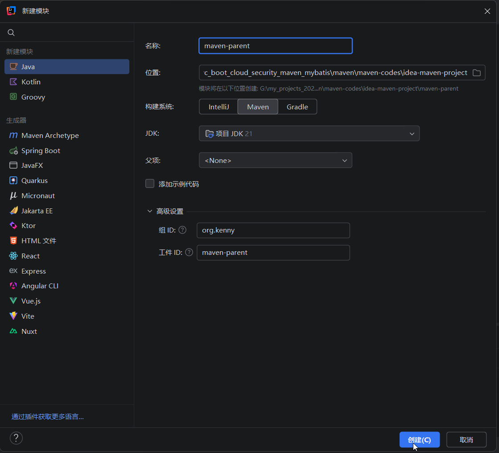
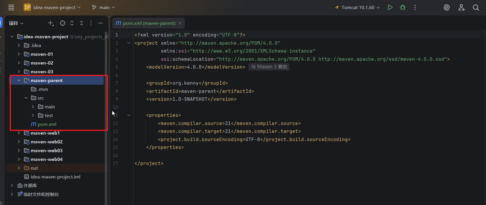
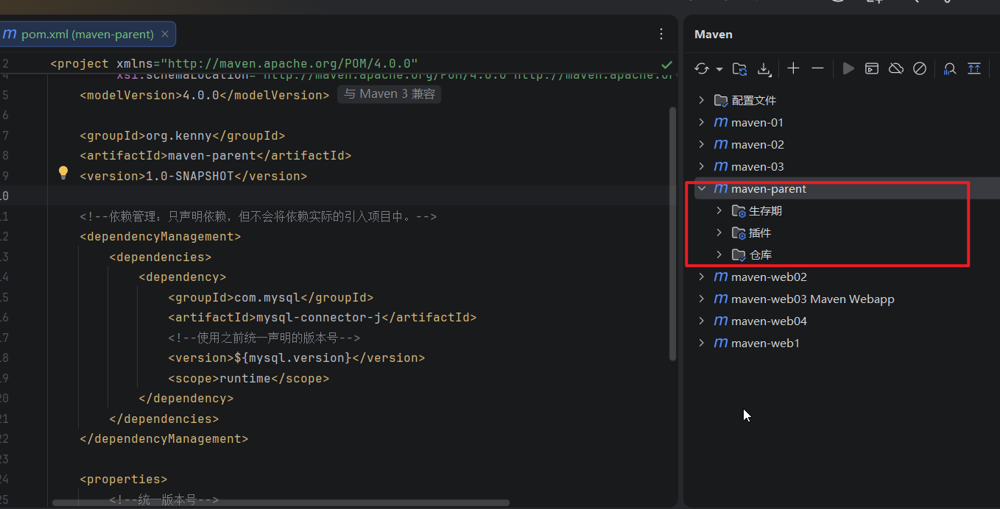
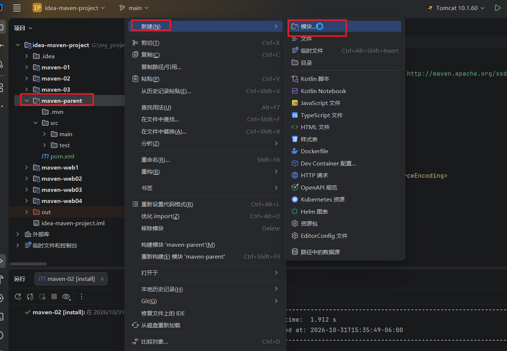
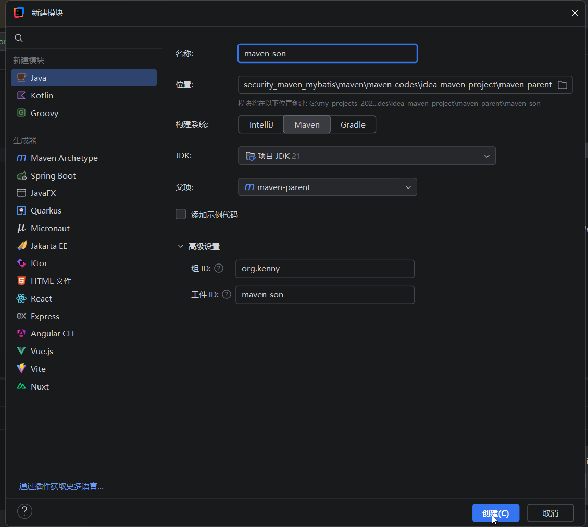
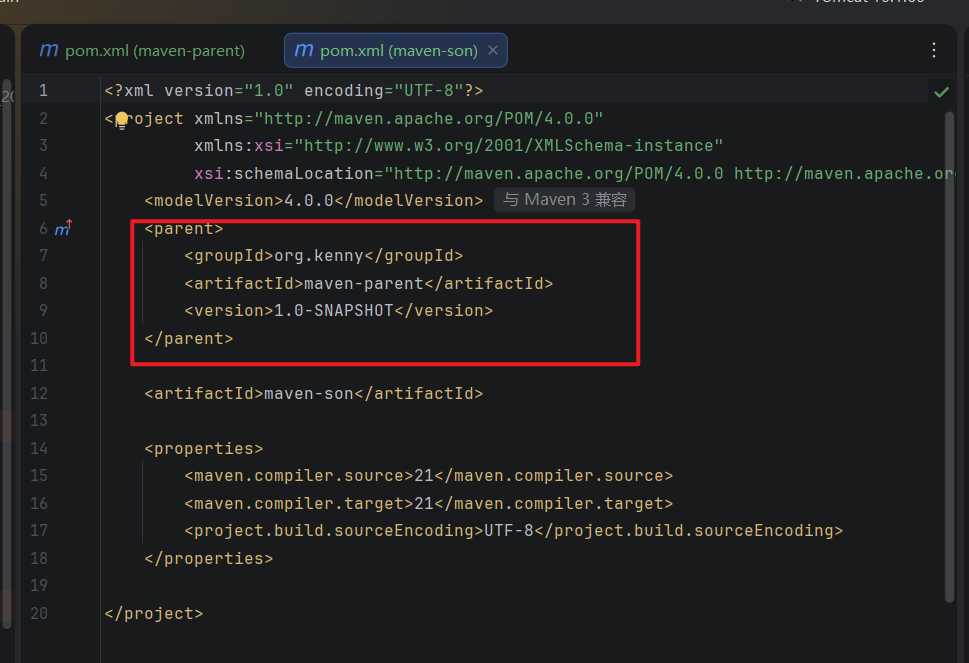
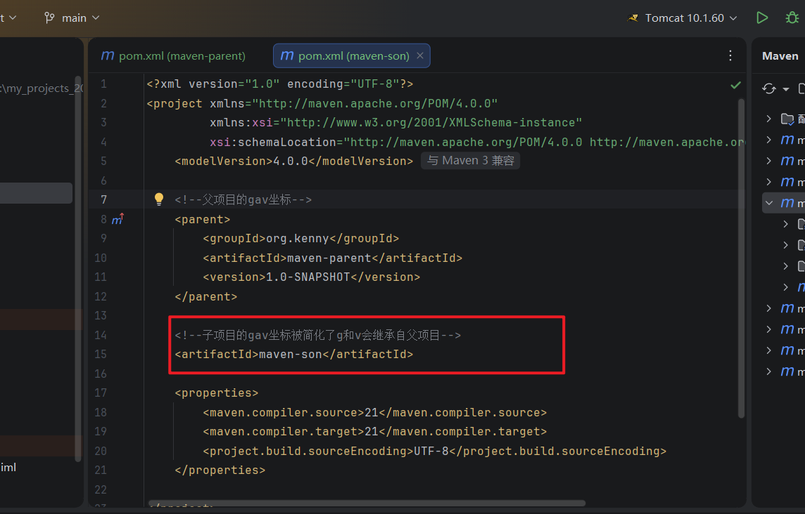
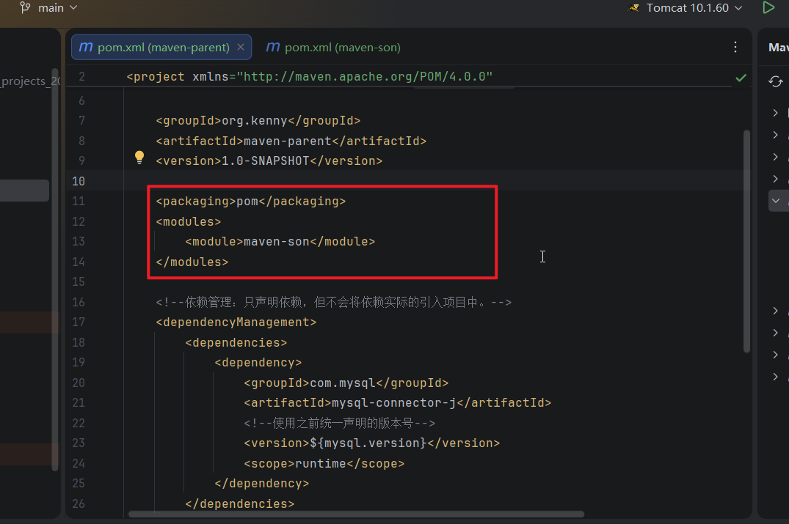
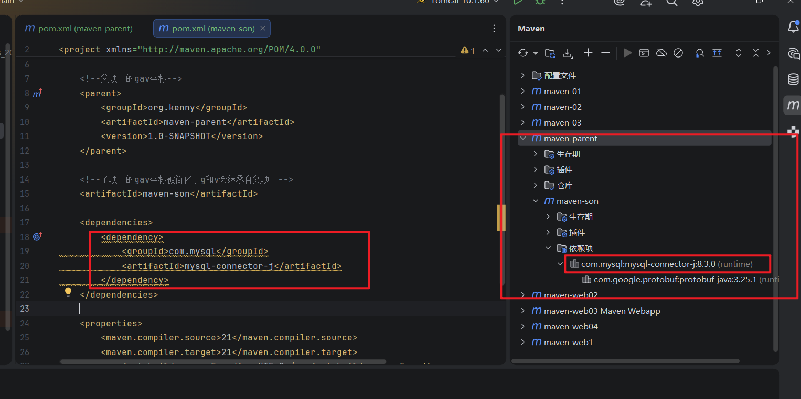

## 1.还是使用idea-maven-project,我们新建一个maven-parent模块





## 2.先在maven-parent里面统一管理版本号，pom.xml(maven-parent)文件的内容如下

```
<?xml version="1.0" encoding="UTF-8"?>
<project xmlns="http://maven.apache.org/POM/4.0.0"
         xmlns:xsi="http://www.w3.org/2001/XMLSchema-instance"
         xsi:schemaLocation="http://maven.apache.org/POM/4.0.0 http://maven.apache.org/xsd/maven-4.0.0.xsd">
    <modelVersion>4.0.0</modelVersion>

    <groupId>org.kenny</groupId>
    <artifactId>maven-parent</artifactId>
    <version>1.0-SNAPSHOT</version>

    <properties>
        <!--统一版本号-->
        <mysql.version>8.3.0</mysql.version>

        <maven.compiler.source>21</maven.compiler.source>
        <maven.compiler.target>21</maven.compiler.target>
        <project.build.sourceEncoding>UTF-8</project.build.sourceEncoding>
    </properties>

    <!--依赖管理：只声明依赖，但不会将依赖实际的引入项目中。-->
    <dependencyManagement>
        <dependencies>
            <dependency>
                <groupId>com.mysql</groupId>
                <artifactId>mysql-connector-j</artifactId>
                <!--使用之前统一声明的版本号-->
                <version>${mysql.version}</version>
                <scope>runtime</scope>
            </dependency>
        </dependencies>
    </dependencyManagement>
</project>
```

## 3.然后在maven面板里面刷新一下，此时是没有依赖项的，因为我们还没有配置真正的dependencies




## 4.在maven-parent模块上面点击右键->新建-》模块，给它添加一个子模块



## 5.给子模块起名maven-son



## 6.查看子模块的pom.xml,发现它已经自动引入了父项目的gav坐标



## 7.此时我们也会看到子项目的gav坐标被简化了，只有一个artifactId，因为他的g和v会集成父项目的g和v



## 8.查看一下父项目的pom.xml,我们发现它也有变化，packing被设置为pom，还多了一个子模块的声明



### 注意：Maven规定，父项目或者父工程的packing必须设置为pom，不能是jar，war或者其他。父项目会把所有的子项目聚会在一起方便管理

## 9.因为我们在父项目里面已经做了依赖吧版本约定，在子项目里面引入这个依赖的时候不需要指定版本



### 在实际开发中，就是这样子的，项目经理在父工程里面的dependencyManagement统一设置号所有包的版本，然后我们在自己负责的子项目中引入g和a，不需要设置版本号

### 这种方式就叫做版本锁定

