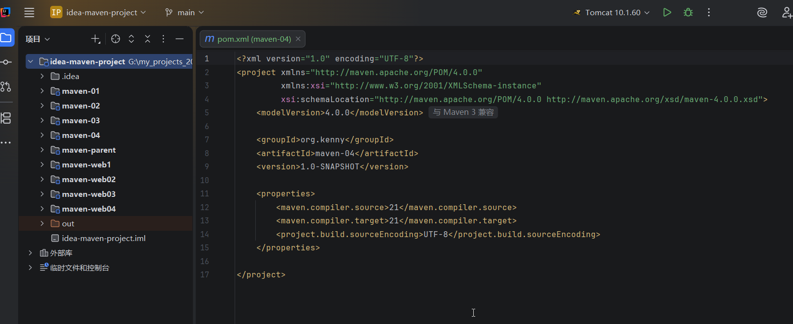
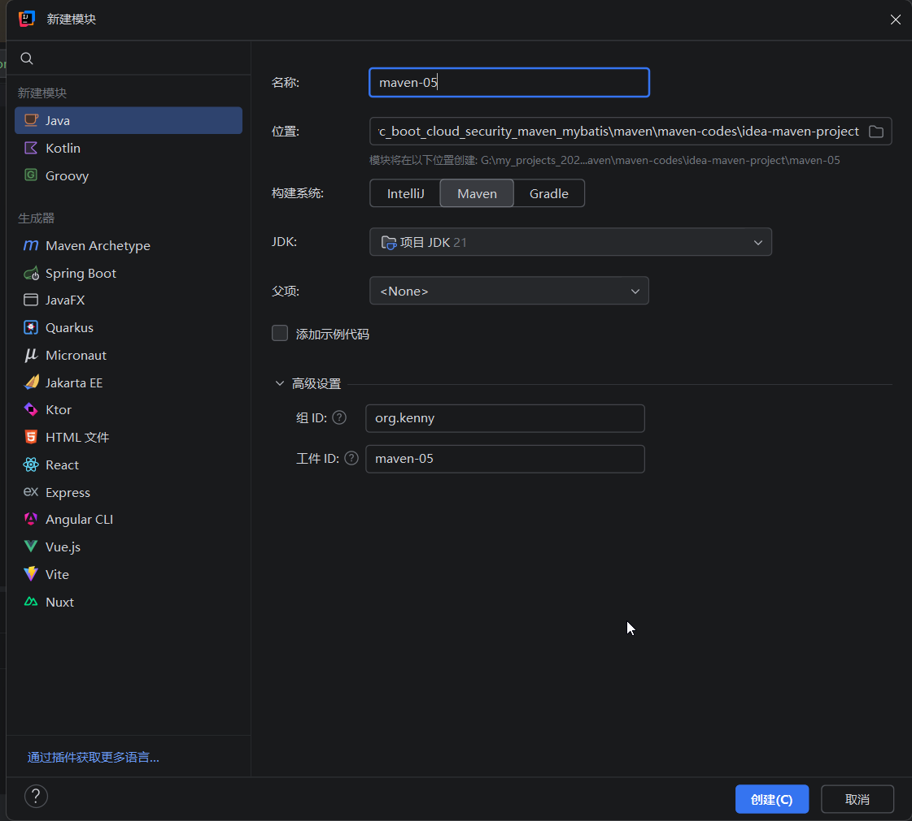
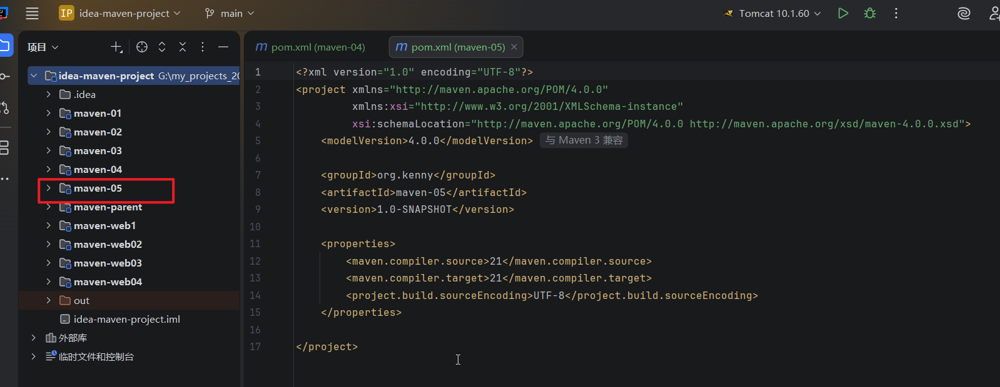
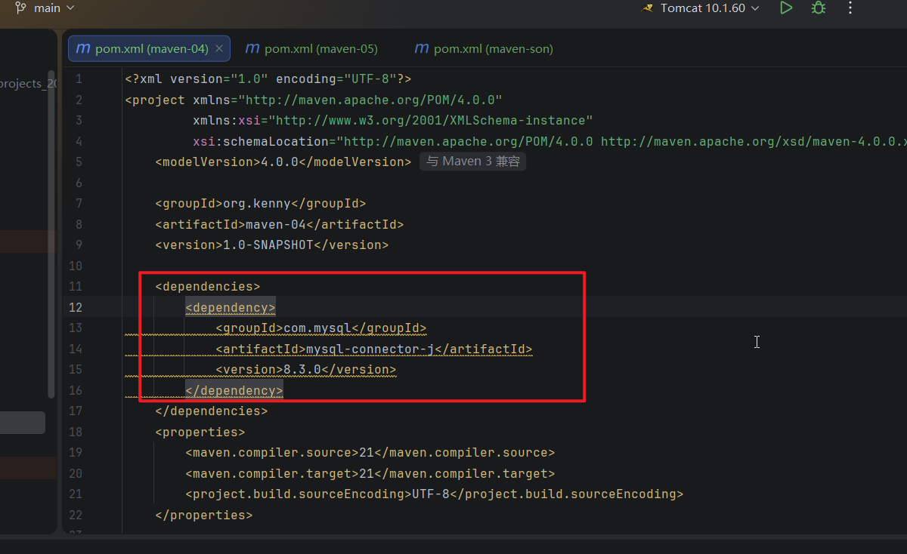
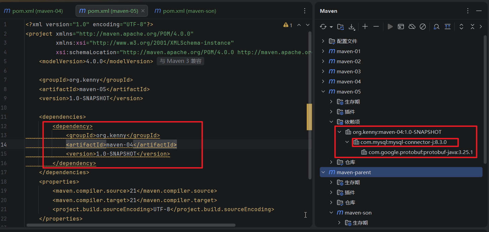
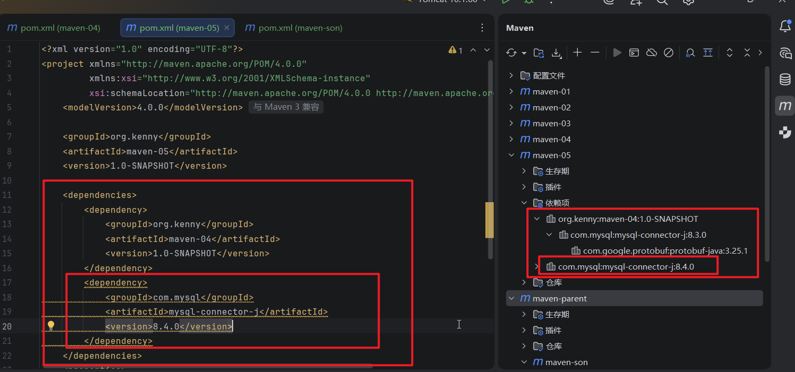
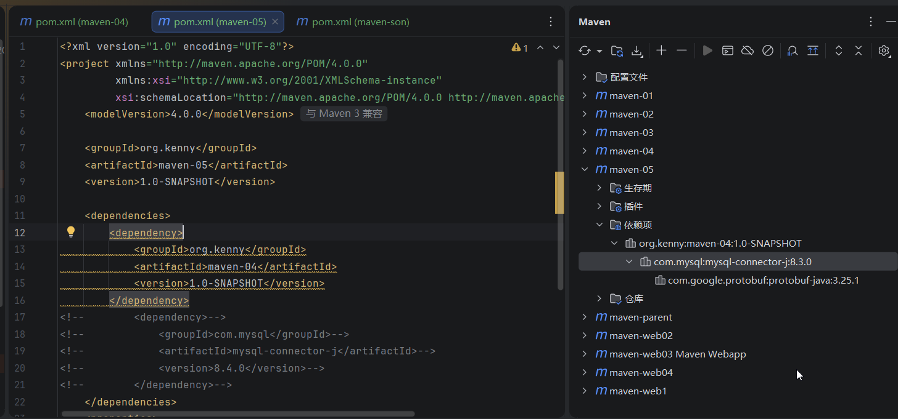

## 1.还是使用idea-maven-project,我们新建一个maven-04模块

## 2.然后我们新建一个maven-05模块

## 3.在maven-04里面我们配置mysql驱动的8.3版本

## 4.然后在maven-05的pom.xml里面配置依赖模块maven-04，

## 此时你会发现，它自动导入了maven-04模块配置的mysql驱动版本

## 5.然后我们在maven-05模块的里面有配置了一个mysql驱动8.4.0版本，此时就发生版本冲突，那么maven是怎么解决这个问题的呢？

## 6.此时它会使用就近原则，使用8.4.0版本忽略8.3.0版本，我们可以吧8.4.0版本注释了。

