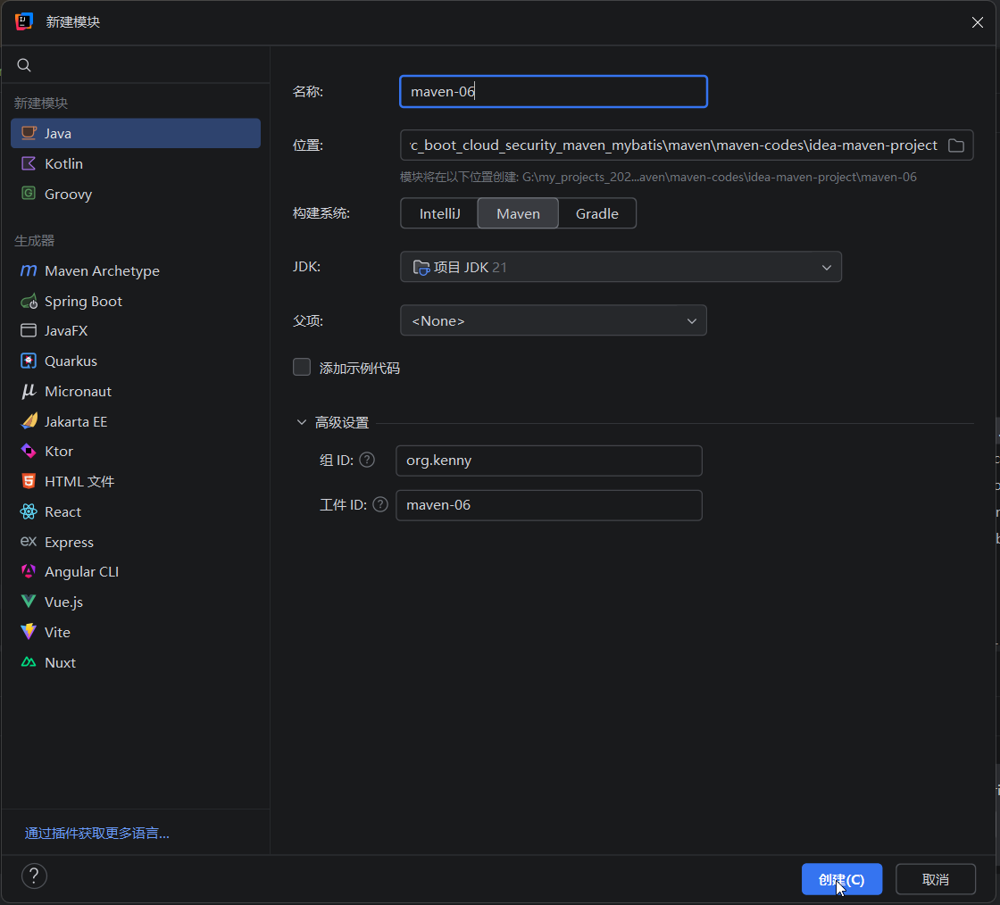
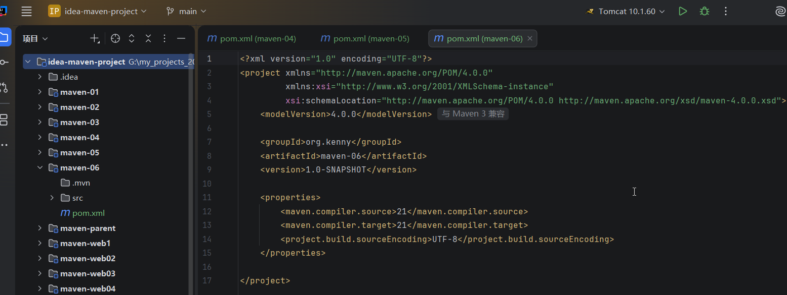
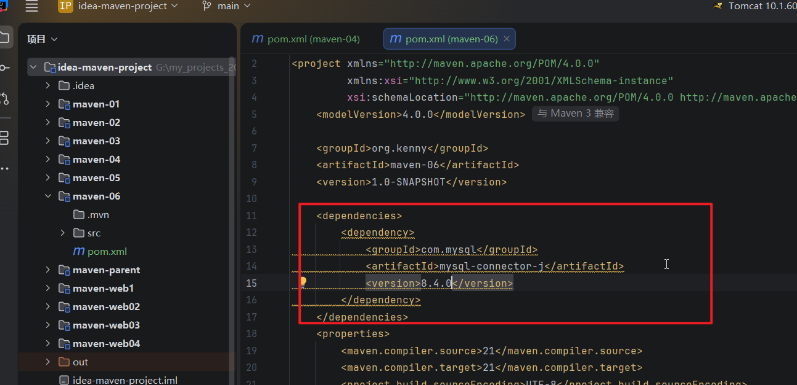
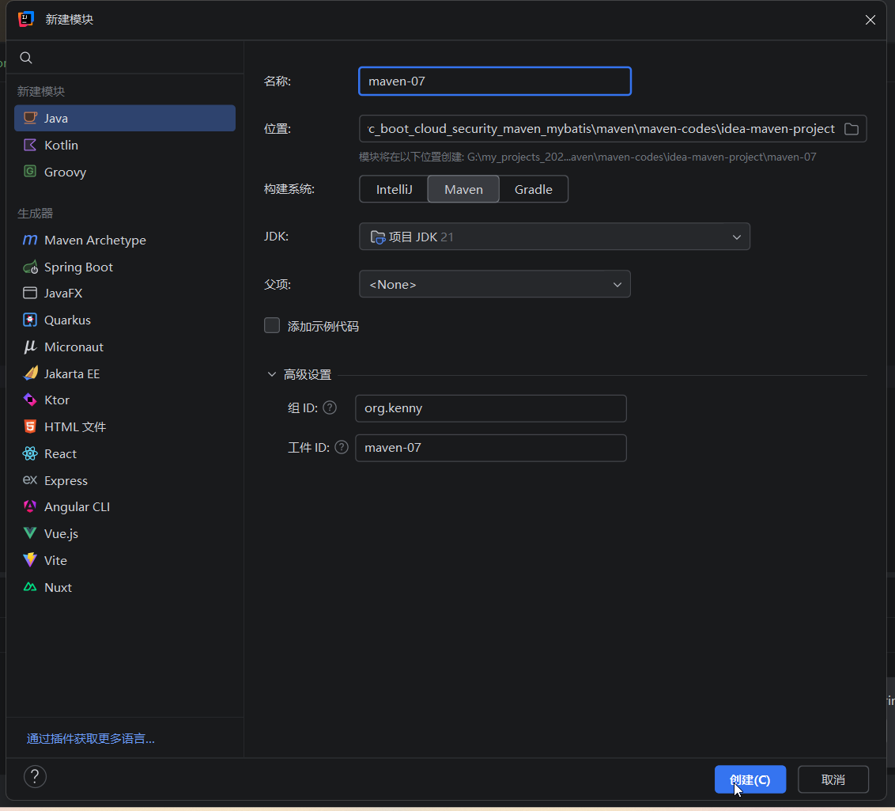
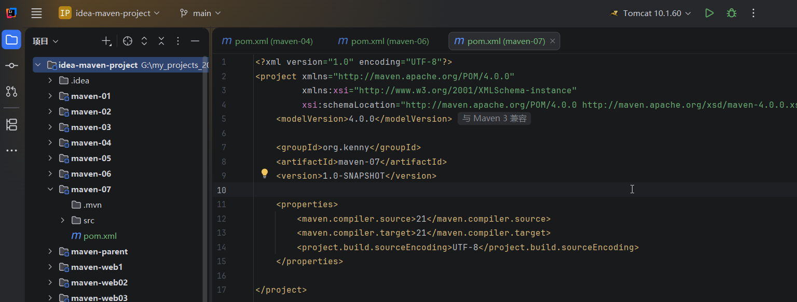
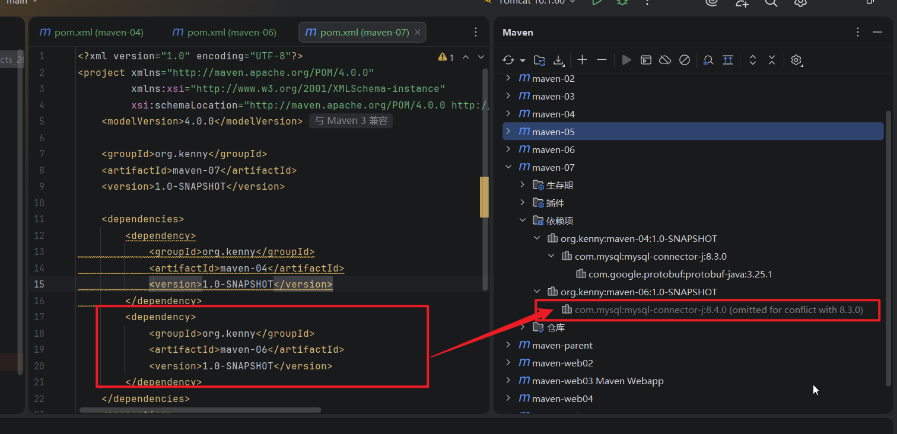
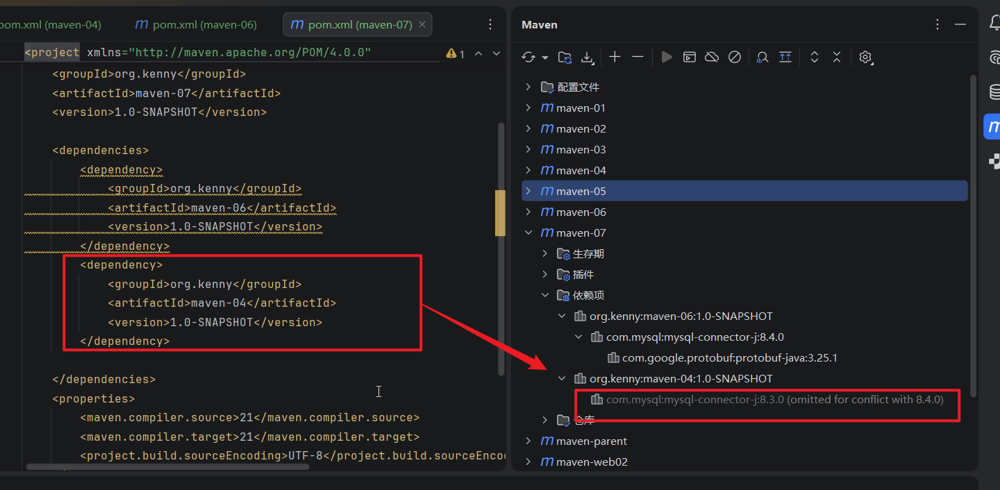

## 1.还是idea-maven-project项目，新建一个模块maven-06

## 2.给06模块添加一个mysql驱动的8.4.0的依赖

## 3.然后新建一个maven07模块

## 4.在07的pom.xml文件里面同时引入04模块和06模块，注意这两个模块的mysql驱动版本是不一样的，此时你会发现后引入的mysql版本被忽略

## 5.我们把这两个模块的声明顺序调换一下，需要先把这个pom文件的所有内容剪切，刷新maven工具，然后再粘贴回来，然后刷新，此时就会使用maven-06的mysql配置

## 