# MyBatis参数处理

**MyBatis参数处理指的是，在MyBatis当中都有哪些方式可以给SQL语句的占位符**<code>**#{}**</code>**传值？通常有以下几种方式：**

1. **单个简单类型参数**
2. **Map参数**
3. **实体类参数**
4. **多参数**
5. **@Param注解（命名参数）**

模块名：mybatis-006-param

表：t_student

```sql
drop table if exists t_student;
create table t_student(
  id bigint primary key auto_increment,
  name varchar(255),
  age int,
  height double,
  birth date,
  sex char(1)
);
insert into t_student values(null,'张三',45,1.81,'1980-10-12','男');
insert into t_student values(null,'李四',45,1.79,'1980-10-12','女');
select * from t_student;
```

pojo类：

```java
package com.jkweilai.mybatis.pojo;

import java.util.Date;

/**
 * 学生类
 * @author 老杜
 */
public class Student {
    private Long id;
    private String name;
    private Integer age;
    private Double height;
    private Character sex;
    private Date birth;
    // constructor
    // setter and getter
    // toString
}
```

## 单个简单类型参数

单个简单类型参数中，简单类型包括：

* byte short int long float double char
* Byte Short Integer Long Float Double Character
* String
* java.util.Date
* java.sql.Date

如果SQL语句的占位符只有一个，以上这些简单类型都可以直接传。

### 测试单个简单类型参数

需求：根据birth查

```java
package com.jkweilai.mybatis.mapper;

import com.jkweilai.mybatis.pojo.Student;

import java.util.Date;
import java.util.List;

/**
 * 学生数据Sql映射器
 * @author 老杜
 */
public interface StudentMapper {
    /**
     * 根据birth查询
     * @param birth
     * @return
     */
    List<Student> selectByBirth(Date birth);
}

```

```xml
<?xml version="1.0" encoding="UTF-8" ?>
<!DOCTYPE mapper
        PUBLIC "-//mybatis.org//DTD Mapper 3.0//EN"
        "http://mybatis.org/dtd/mybatis-3-mapper.dtd">

<mapper namespace="com.jkweilai.mybatis.mapper.StudentMapper">
    <select id="selectByBirth" resultType="student">
        select * from t_student where birth = #{birth}
    </select>
</mapper>
```

```java
package com.jkweilai.mybatis.test;

import com.jkweilai.mybatis.mapper.StudentMapper;
import com.jkweilai.mybatis.pojo.Student;
import com.jkweilai.mybatis.utils.SqlSessionUtil;
import org.junit.jupiter.api.Test;

import java.text.ParseException;
import java.text.SimpleDateFormat;
import java.util.Date;
import java.util.List;

public class StudentMapperTest {

    StudentMapper mapper = SqlSessionUtil.openSession().getMapper(StudentMapper.class);

    @Test
    public void testSelectByBirth(){
        try {
            Date birth = new SimpleDateFormat("yyyy-MM-dd").parse("2022-08-16");
            List<Student> students = mapper.selectByBirth(birth);
            students.forEach(student -> System.out.println(student));
        } catch (ParseException e) {
            throw new RuntimeException(e);
        }

    }
}

```

通过测试得知，简单类型对于mybatis来说都是可以自动类型识别的：

* 也就是说对于mybatis来说，它是可以自动推断出ps.setXxxx()方法的。ps.setString()还是ps.setInt()。它可以自动推断。

其实SQL映射文件中的配置比较完整的写法是：

```xml
<select id="selectByName" resultType="student" parameterType="java.lang.String">
  select * from t_student where name = #{name, javaType=String, jdbcType=VARCHAR}
</select>
```

其中sql语句中的javaType，jdbcType，以及select标签中的parameterType属性，都是用来帮助mybatis进行类型确定的。不过这些配置多数是可以省略的。因为mybatis它有强大的自动类型推断机制。

* javaType：可以省略
* jdbcType：可以省略
* parameterType：可以省略

**<font style="color:#F5222D;">如果参数只有一个的话，#{} 里面的内容就随便写了。</font>**

### 单个简单类型参数小细节

**单个简单类型参数**

```java
// Mapper 接口 - 单个简单参数
Student selectById(Long id);
```

在 XML 中，如果你想在 `<if>` 条件中判断 id 是否为空：**<font style="color:#DF2A3F;">【要测试出以下的错误，要求 mybatis 版本必须是 3.5.1 及之前，3.5.2 及之后的版本已经解决了这个问题】</font>**

```xml
<!-- 错误写法：MyBatis 不知道 'id' 这个参数名 -->
<select id="selectById" resultType="student" parameterType="Long">
    SELECT * FROM t_student
    <if test="id != null">  <!-- 这里会报错，找不到 'id' 属性 -->
        WHERE id = #{id}
    </if>
</select>
<!-- 正确写法：使用 _parameter -->
<select id="selectById" resultType="student">
    SELECT * FROM t_student
    <if test="_parameter != null">  <!-- 使用 _parameter 引用整个参数 -->
        WHERE id = #{_parameter}    <!-- 这里也可以用 #{id} -->
    </if>
</select>
```

**为什么？** 因为对于单个简单参数，MyBatis 没有为其分配参数名，所以在 OGNL 表达式中无法通过 `id` 来引用。

什么是 `_parameter`？

`_parameter` 是 MyBatis 提供的一个**内置参数**，它代表**传入方法的整个参数**。在动态 SQL 的 OGNL 表达式中，当方法只有一个参数且是简单类型时，MyBatis 不会为这个参数自动创建参数名，这时候就需要用 `_parameter` 来引用它。

<code>**_parameter**</code>**不是唯一的解决办法，使用 **<code>**@Param**</code>** 注解也可以解决**

更好的解决方案是使用 `@Param` 注解：

```java
// 使用 @Param 注解明确指定参数名
Student selectById(@Param("id") Long id);
```

```xml
<!-- 现在可以直接使用参数名了 -->
<select id="selectById" resultType="student">
    SELECT * FROM t_student
    <if test="id != null">  <!-- 现在可以正确识别 'id' -->
        WHERE id = #{id}
    </if>
</select>
```

**复杂类型（如 LocalDate、POJO）的情况**

```java
// 复杂类型参数
List<Student> selectByBirth(LocalDate birth);
```

```xml
<!-- 可以直接使用参数名，因为 LocalDate 是复杂类型 -->
<select id="selectByBirth" resultType="student">
    SELECT * FROM t_student
    <if test="birth != null">  <!-- 这里能正常工作 -->
        WHERE birth = #{birth}
    </if>
</select>
```

## Map参数

前面我们已经用过，这里我们就不再赘述了。大家可以简单看一下以下代码：

需求：根据name和age查询

```java
/**
* 根据name和age查询
* @param paramMap
* @return
*/
List<Student> selectByParamMap(Map<String,Object> paramMap);
```

```java
@Test
public void testSelectByParamMap(){
    // 准备Map
    Map<String,Object> paramMap = new HashMap<>();
    paramMap.put("nameKey", "张三");
    paramMap.put("ageKey", 20);

    List<Student> students = mapper.selectByParamMap(paramMap);
    students.forEach(student -> System.out.println(student));
}
```

```xml
<select id="selectByParamMap" resultType="student">
  select * from t_student where name = #{nameKey} and age = #{ageKey}
</select>
```

测试运行正常。

**<font style="color:#E8323C;">这种方式是手动封装Map集合，将每个条件以key和value的形式存放到集合中。然后在使用的时候通过#{map集合的key}来取值。</font>**

## 实体类参数

前面我们已经用过，这里我们就不再赘述了。大家可以简单看一下以下代码：

需求：插入一条Student数据

```java
/**
 * 保存学生数据
 * @param student
 * @return
 */
int insert(Student student);
```

```xml
<insert id="insert">
  insert into t_student values(null,#{name},#{age},#{height},#{birth},#{sex})
</insert>
```

```java
@Test
public void testInsert(){
    Student student = new Student();
    student.setName("李四");
    student.setAge(30);
    student.setHeight(1.70);
    student.setSex('男');
    student.setBirth(new Date());
    int count = mapper.insert(student);
    SqlSessionUtil.openSession().commit();
}
```

运行正常，数据库中成功添加一条数据。

**<font style="color:#E8323C;">这里需要注意的是：#{} 里面写的是属性名字。这个属性名其本质上是：set/get方法名去掉set/get之后的名字。</font>**

## 多参数

需求：通过name和sex查询

```java
/**
 * 根据name和sex查询
 * @param name
 * @param sex
 * @return
 */
List<Student> selectByNameAndSex(String name, Character sex);
```

```java
@Test
public void testSelectByNameAndSex(){
    List<Student> students = mapper.selectByNameAndSex("张三", '女');
    students.forEach(student -> System.out.println(student));
}
```

```xml
<select id="selectByNameAndSex" resultType="student">
  select * from t_student where name = #{name} and sex = #{sex}
</select>
```

执行结果：

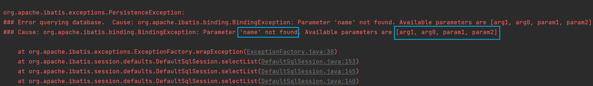

异常信息描述了：name参数找不到，可用的参数包括\[arg1, arg0, param1, param2]

修改StudentMapper.xml配置文件：尝试使用\[arg1, arg0, param1, param2]去参数

```xml
<select id="selectByNameAndSex" resultType="student">
  <!--select * from t_student where name = #{name} and sex = #{sex}-->
  select * from t_student where name = #{arg0} and sex = #{arg1}
</select>
```

运行结果：

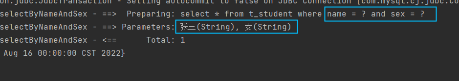

再次尝试修改StudentMapper.xml文件

```xml
<select id="selectByNameAndSex" resultType="student">
  <!--select * from t_student where name = #{name} and sex = #{sex}-->
  <!--select * from t_student where name = #{arg0} and sex = #{arg1}-->
  <!--select * from t_student where name = #{param1} and sex = #{param2}-->
  select * from t_student where name = #{arg0} and sex = #{param2}
</select>
```

通过测试可以看到：

* arg0 是第一个参数
* param1是第一个参数
* arg1 是第二个参数
* param2是第二个参数

实现原理：**<font style="color:#E8323C;">实际上在mybatis底层会创建一个map集合，以arg0/param1为key，以方法上的参数为value</font>**，例如以下代码：

```java
Map<String,Object> map = new HashMap<>();
map.put("arg0", name);
map.put("arg1", sex);
map.put("param1", name);
map.put("param2", sex);

// 所以可以这样取值：#{arg0} #{arg1} #{param1} #{param2}
// 其本质就是#{map集合的key}
```

注意：**<font style="color:#E8323C;">使用mybatis</font>\*\*\*\*<font style="color:#E8323C;">3.4.2之前的版本时：要用#{0}和#{1}这种形式。</font>**

## @Param注解（命名参数）

可以不用arg0 arg1 param1 param2吗？这个map集合的key我们自定义可以吗？当然可以。使用@Param注解即可。这样可以增强可读性。

需求：根据name和age查询

```java
/**
 * 根据name和age查询
 * @param name
 * @param age
 * @return
 */
List<Student> selectByNameAndAge(@Param(value="name") String name, @Param("age") int age);
```

```java
@Test
public void testSelectByNameAndAge(){
    List<Student> stus = mapper.selectByNameAndAge("张三", 20);
    stus.forEach(student -> System.out.println(student));
}
```

```xml
<select id="selectByNameAndAge" resultType="student">
  select * from t_student where name = #{name} and age = #{age}
</select>
```

通过测试，一切正常。

核心：@Param("**<font style="color:#E8323C;">这里填写的其实就是map集合的key</font>**")

# 演练1.单个简单参数

## 1.1新建应该模块起名mybatis-006-param,然后提交mybatis和mysql驱动以及junit的依赖

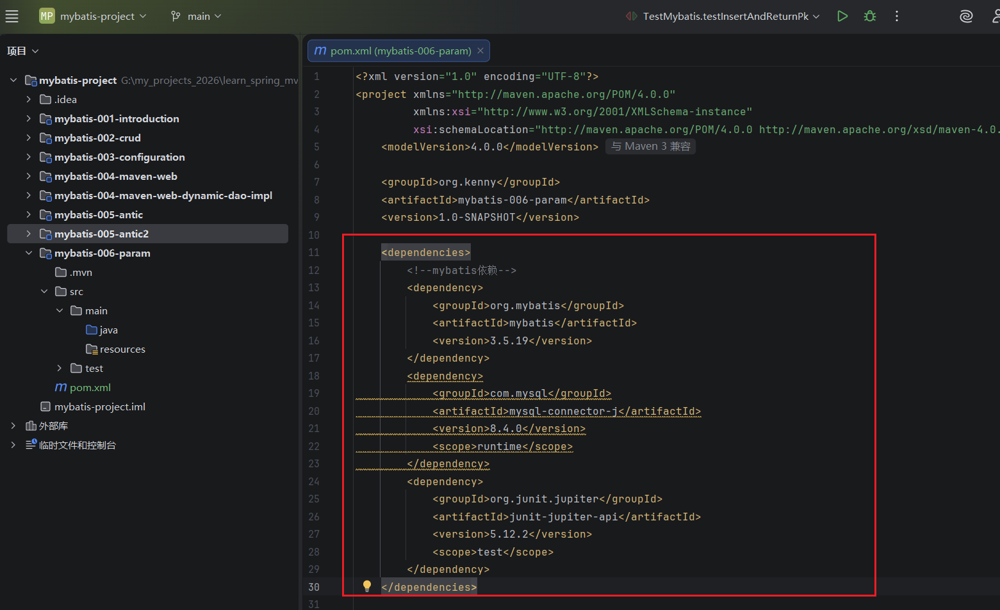

## 1.2创建一个t_user数据表

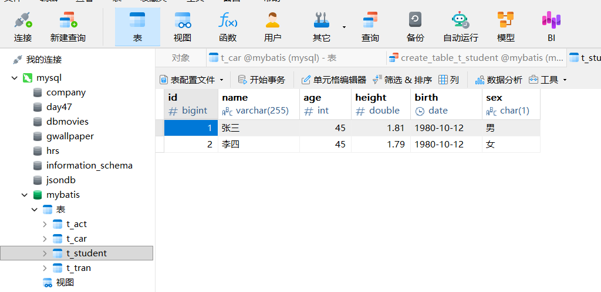

## 1.3 在main/resources文件夹里面新建一个mybatis-config.xml文件

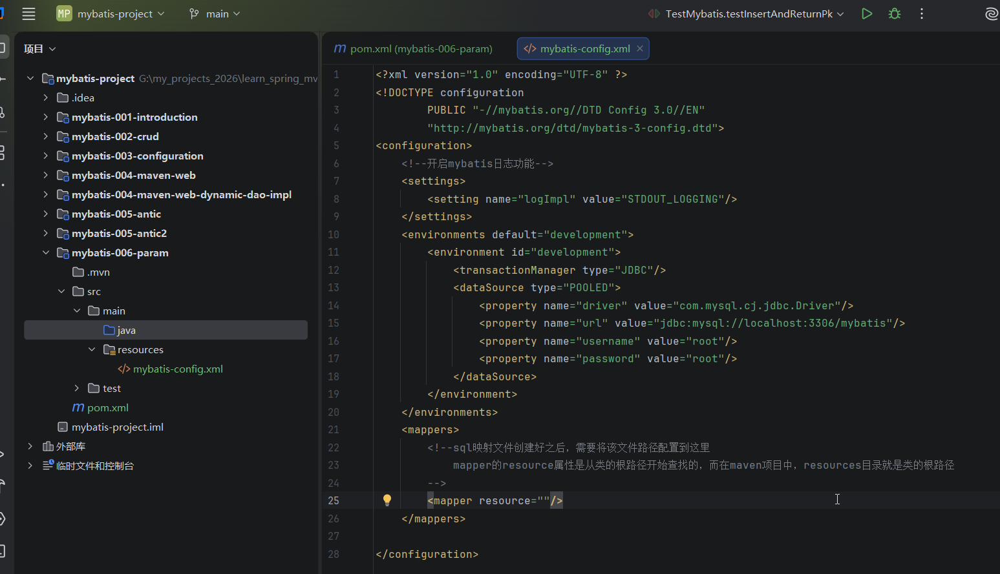

## 1.4 新建一个org.kenny.mybatis包，在里面新建一个entity子包，里面创建一个Student类，新建一个mapper子包，在里面新建一个StudentMapper接口，然后新建一个util子包，把前面的SqlSessionUtil类粘贴过来

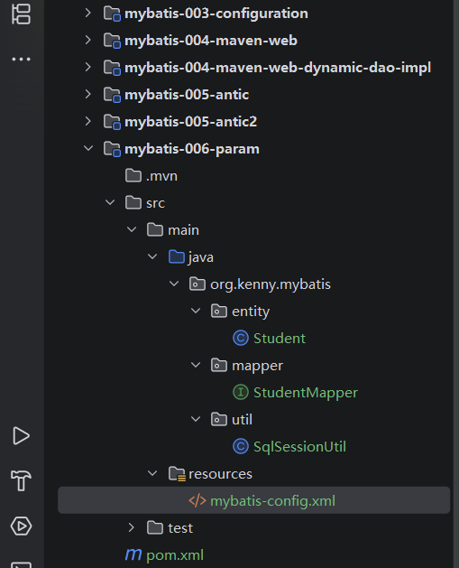

## 1.5在main/resources文件夹里面新建一个文件夹org/kenny/mybatis/mapper,然后在里面新建一个StudentMapper.xml文件

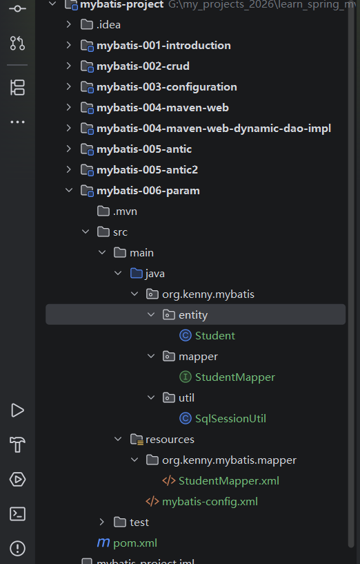

## 1.6.修改一下mybatis-config.xml的mapper和实体类命名空间别名配置

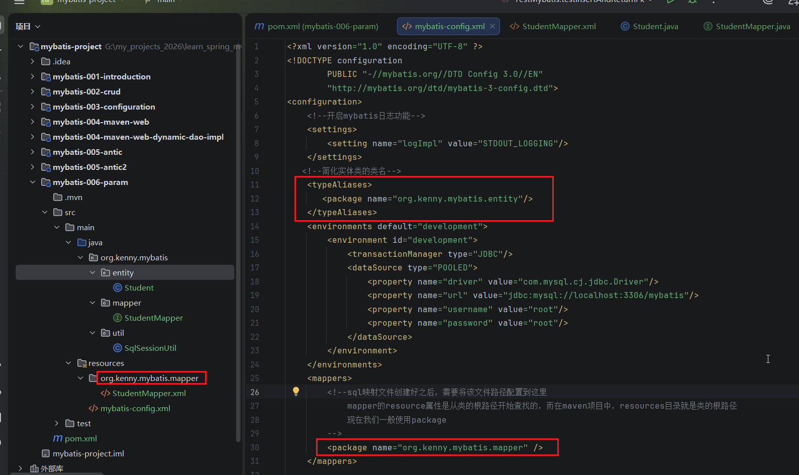

## 1.7 Student类的代码如下

```
package org.kenny.mybatis.entity;

import java.util.Date;

public class Student {
    private int id;
    private String name;
    private int age;
    private double height;
    private Date birth;
    private Character sex;

    public Student() {}

    public Student(int id, String name, int age, double height, Date birth, Character sex) {
        this.id = id;
        this.name = name;
        this.age = age;
        this.height = height;
        this.birth = birth;
        this.sex = sex;
    }

    public int getId() {
        return id;
    }

    public void setId(int id) {
        this.id = id;
    }

    public String getName() {
        return name;
    }

    public void setName(String name) {
        this.name = name;
    }

    public int getAge() {
        return age;
    }

    public void setAge(int age) {
        this.age = age;
    }

    public double getHeight() {
        return height;
    }

    public void setHeight(double height) {
        this.height = height;
    }

    public Date getBirth() {
        return birth;
    }

    public void setBirth(Date birth) {
        this.birth = birth;
    }

    public Character getSex() {
        return sex;
    }

    public void setSex(Character sex) {
        this.sex = sex;
    }

    @Override
    public String toString() {
        return "Student{" +
                "id=" + id +
                ", name='" + name + '\'' +
                ", age=" + age +
                ", height=" + height +
                ", birth=" + birth +
                ", sex=" + sex +
                '}';
    }
}

```

## 1.8 一般的基本数据类型mybatis都能够自动处理，我们需要来测试一下Date的类型是否也可以自动处理，我们先在StudentMapper接口类名添加一个方法，起名selectByBirth

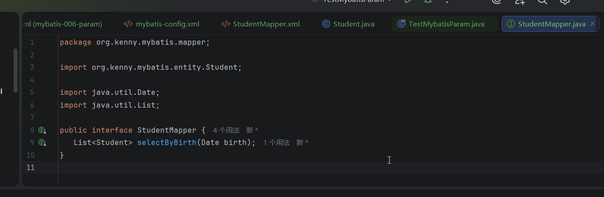


## 1.9然后我们在StudentMapper.xml里面添加一条insert语句，id和mapper接口的方法名称一致

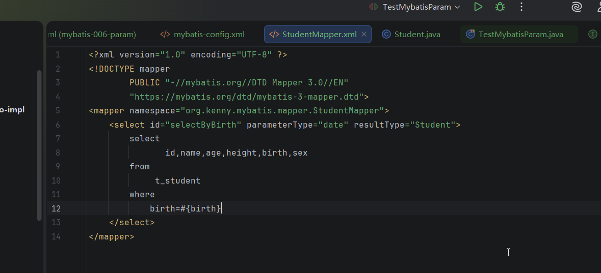

## 1.10编写一个测试类，添加一个测试方法testHandleDate，如下

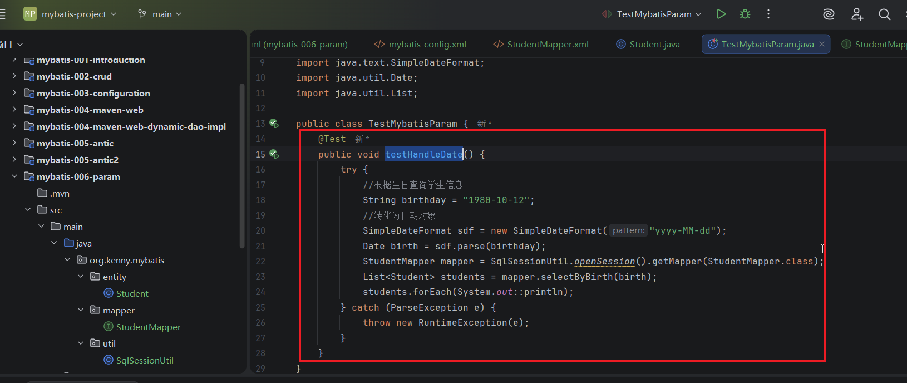

## 1.11运行测试，顺利获取到数据

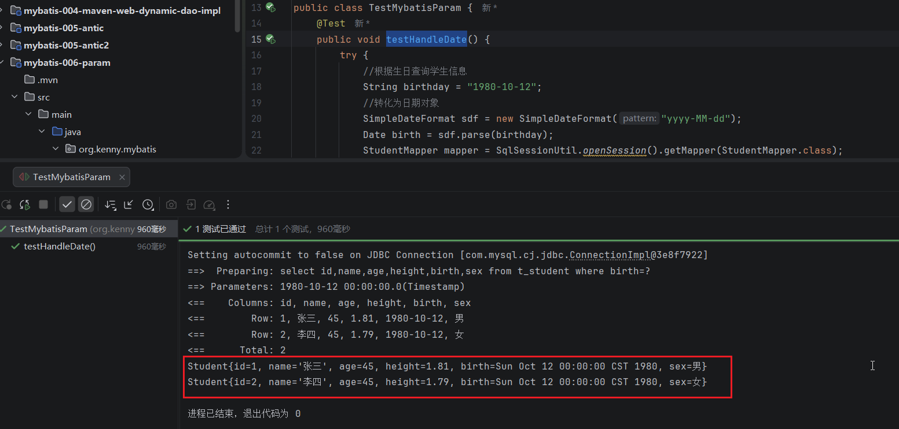

# 演练2.mybatis多参数处理

## 2.1我们给StudentMapper接口添加一个根据姓名和性别来查询学生的方法

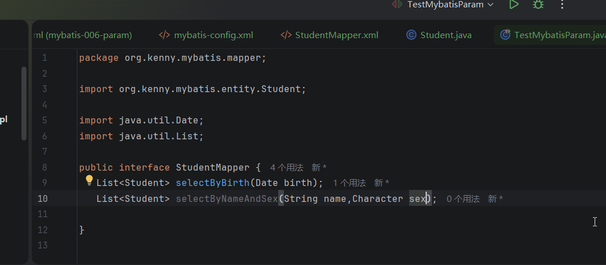

## 2.2 然后我们在StudentMapper.xml文件里面添加一条查询语句，id就是mapper的方法名

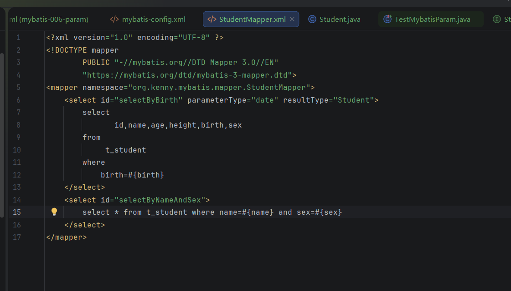

## 2.3然后，我们写一个测试方法testSelectByNameAndSex

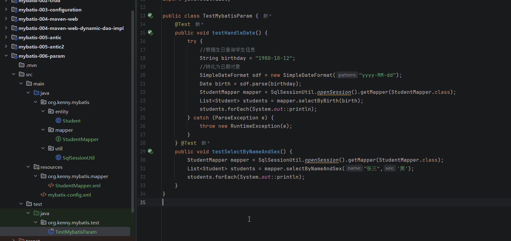

## 2.4运行测试不通过，报错说找不到参数name

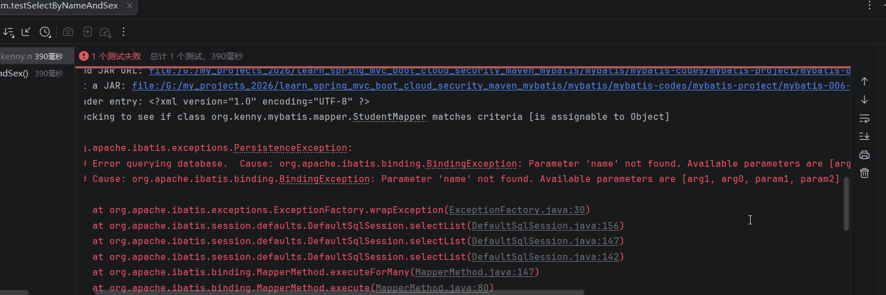

## 2.5这是因为其实默认情况下只有当需要的参数为1个时，mybatis知道怎么处理，但是当需要的参数多于一个时，mybatis默认是不知道怎么处理的。解决办法就是在Mapper接口的方法里面给每一个参数起名字

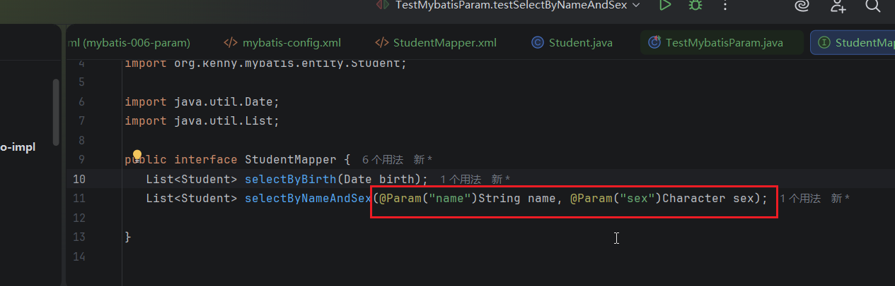

## 2.6再次运行参数，顺利通过

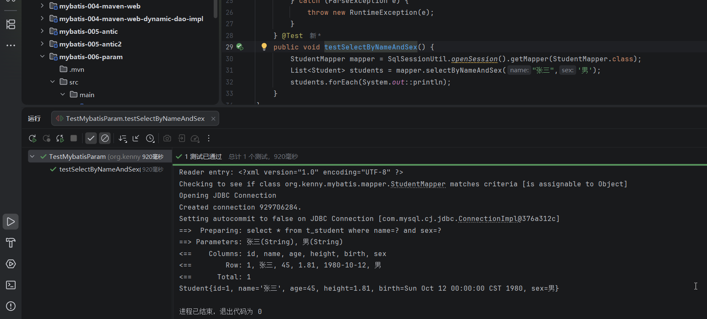

## 2.7 还有一种解决方法，就是使用mybatis提供的arg0和arg1，mapper的方法中的参数不需要起别名

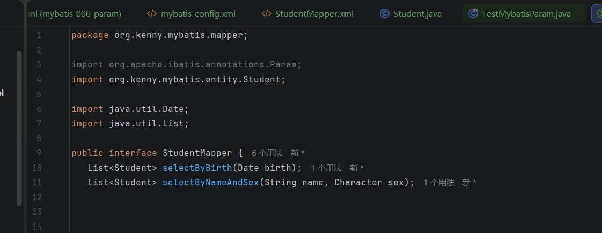

## 其实，如果需要多个参数，还有一个比较好的方法，就是把参数放到一个map集合里面，把它建议使用上面的方法

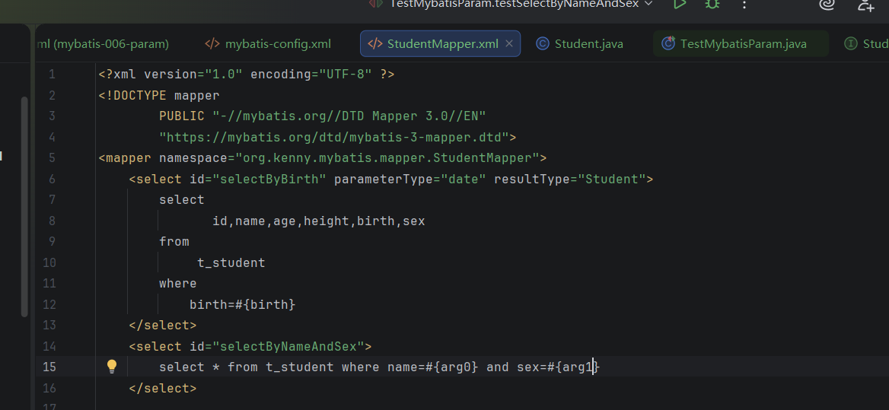

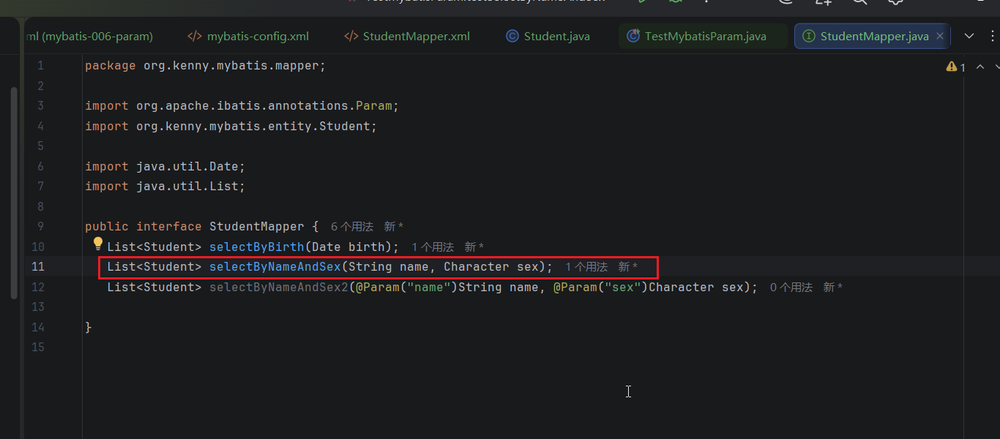

## 运行测试，顺利通过

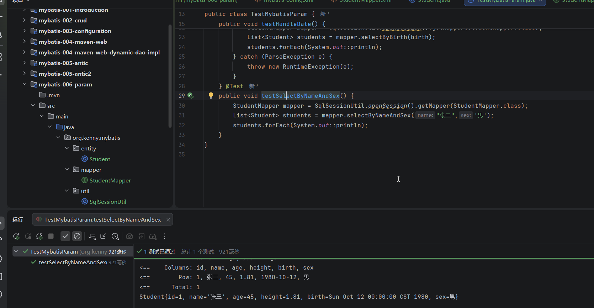

### 注意：arg0，arg1，arg2，。。。这些是mybatis内置的参数名称，我们可以对号入座来使用，有两个参数需要传递，第一个是arg0，第二个是arg1，以此类推，此外也可以使用parm1,param2,param3...,这个是从1开始的

### 其实，使用@Param起别名的方法还是比较好的，又叫做命名参数


