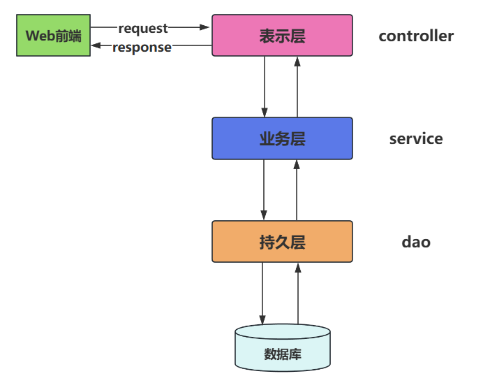
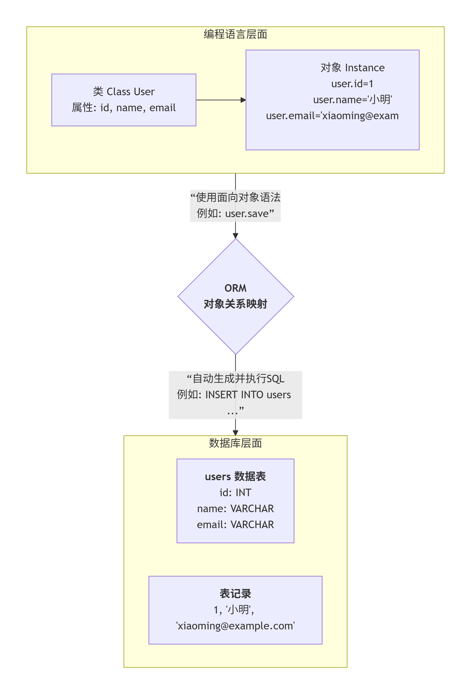

# MyBatis概述

## 框架的理解

* 在文献中看到的framework被翻译为框架
* Java常用框架：
  * SSM三大框架：Spring + SpringMVC + MyBatis
  * SpringBoot
  * SpringCloud
  * 等。。
* 框架其实就是对通用代码的封装，提前写好了一堆接口和类，我们可以在做项目的时候直接引入这些接口和类（引入框架），基于这些现有的接口和类进行开发，可以大大提高开发效率。
* 框架一般都以jar包的形式存在。(jar包中有class文件以及各种配置文件等。)
* SSM三大框架的学习顺序：MyBatis、Spring、SpringMVC（仅仅是建议）

## 三层架构

**MyBatis 属于持久层框架**。类似的框架还有：Hibernate（实现了JPA规范）、jOOQ、Guzz、**Spring Data（实现了JPA规范）**、ActiveJDBC



## JDBC不足

**手动给每个占位符传值，太麻烦了：**

```java
// ......
// sql语句写死在java程序中
String sql = "insert into t_user(id,idCard,username,password,birth,gender,email,city,street,zipcode,phone,grade) values(?,?,?,?,?,?,?,?,?,?,?,?)";
PreparedStatement ps = conn.prepareStatement(sql);
// 繁琐的赋值：思考一下，这种有规律的代码能不能通过反射机制来做自动化。
ps.setString(1, "1");
ps.setString(2, "123456789");
ps.setString(3, "zhangsan");
ps.setString(4, "123456");
ps.setString(5, "1980-10-11");
ps.setString(6, "男");
ps.setString(7, "zhangsan@126.com");
ps.setString(8, "天津");
ps.setString(9, "北辰区河北工业大学河香街");
ps.setString(10, "1000000");
ps.setString(11, "16398574152");
ps.setString(12, "A");
// 执行SQL
int count = ps.executeUpdate();
// ......
```

***

**手动封装结果集，太麻烦了。**

```java
// ......
// sql语句写死在java程序中
String sql = "select id,idCard,username,password,birth,gender,email,city,street,zipcode,phone,grade from t_user";
PreparedStatement ps = conn.prepareStatement(sql);
ResultSet rs = ps.executeQuery();
List<User> userList = new ArrayList<>();
// 思考以下循环中的所有代码是否可以使用反射进行自动化封装。
while(rs.next()){
    // 获取数据
    String id = rs.getString("id");
    String idCard = rs.getString("idCard");
    String username = rs.getString("username");
    String password = rs.getString("password");
    String birth = rs.getString("birth");
    String gender = rs.getString("gender");
    String email = rs.getString("email");
    String city = rs.getString("city");
    String street = rs.getString("street");
    String zipcode = rs.getString("zipcode");
    String phone = rs.getString("phone");
    String grade = rs.getString("grade");
    // 创建对象
    User user = new User();
    // 给对象属性赋值
    user.setId(id);
    user.setIdCard(idCard);
    user.setUsername(username);
    user.setPassword(password);
    user.setBirth(birth);
    user.setGender(gender);
    user.setEmail(email);
    user.setCity(city);
    user.setStreet(street);
    user.setZipcode(zipcode);
    user.setPhone(phone);
    user.setGrade(grade);
    // 添加到集合
    userList.add(user);
}
// ......
```

## MyBatis 简介

<font style="color:rgb(15, 17, 21);">MyBatis是一款优秀的</font>**<font style="color:rgb(15, 17, 21);">持久层框架</font>**<font style="color:rgb(15, 17, 21);"> ，它极大地方便了Java程序与数据库的交互。它的核心特点包括：</font>

**<font style="color:rgb(15, 17, 21);">1. 彻底解放JDBC编码</font>**<font style="color:rgb(15, 17, 21);">\
</font><font style="color:rgb(15, 17, 21);">• 完全避免了手动设置参数、处理结果集等重复性JDBC代码</font><font style="color:rgb(15, 17, 21);">\
</font><font style="color:rgb(15, 17, 21);">• 极大简化了数据库交互的编程模型</font>

**<font style="color:rgb(15, 17, 21);">2. SQL与代码分离</font>**<font style="color:rgb(15, 17, 21);">\
</font><font style="color:rgb(15, 17, 21);">• 支持XML和注解两种开发方式，其中XML方式因其灵活性成为主流选择</font><font style="color:rgb(15, 17, 21);">\
</font><font style="color:rgb(15, 17, 21);">• 实现业务逻辑与数据访问逻辑的彻底解耦，代码结构更清晰</font>

**<font style="color:rgb(15, 17, 21);">3. 灵活的SQL定制能力</font>**<font style="color:rgb(15, 17, 21);">\
</font><font style="color:rgb(15, 17, 21);">• 提供基本映射、高级映射和动态SQL标签</font><font style="color:rgb(15, 17, 21);">\
</font><font style="color:rgb(15, 17, 21);">• 允许编写精确优化的SQL语句，保持完全的SQL控制权</font>

**<font style="color:rgb(15, 17, 21);">4. 简洁的ORM映射</font>**<font style="color:rgb(15, 17, 21);">\
</font><font style="color:rgb(15, 17, 21);">• 将Java接口和简单POJO对象自动映射为数据库记录\
</font><font style="color:rgb(15, 17, 21);">• 架构轻量，学习成本低，仅需少量依赖配置即可快速上手</font>

**MyBatis的发展历程：**

* MyBatis本是apache的一个开源项目iBatis，2010年这个项目由apache software foundation迁移到了google code，并且改名为MyBatis。2013年11月迁移到Github。
* iBATIS一词来源于“internet”和“abatis”的组合，是一个基于Java的持久层框架。iBATIS提供的持久层框架包括SQL Maps和Data Access Objects（DAOs）。

**ORM：对象关系映射（**MyBatis属于半自动化ORM框架。Hibernate属于全自动化的ORM框架。**）**

O（Object）：Java虚拟机中的Java对象

R（Relational）：关系型数据库

M（Mapping）：将 JVM 中的Java对象映射到数据库表中一行记录，或是将数据库表中一行记录映射成 JVM 中的一个Java对象。



# 