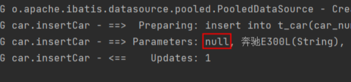
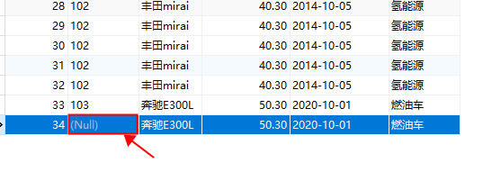
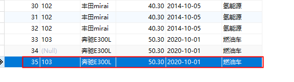
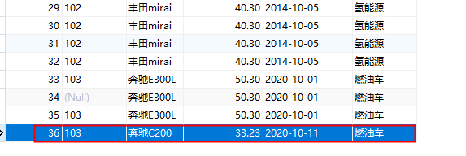
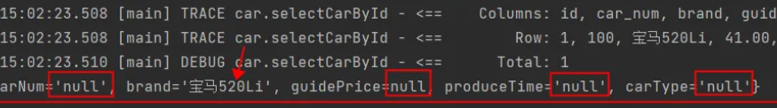
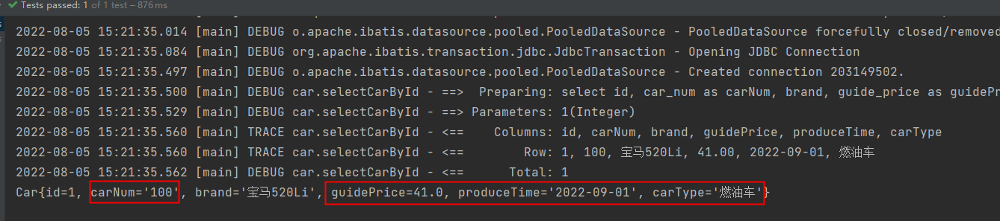
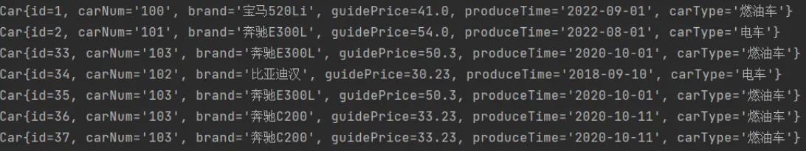

# 3.使用MyBatis完成CRUD


创建module（Maven的普通Java模块）：mybatis-002-crud

## insert

1. 在编写 SQL 语句时，将值写到配置文件中肯定是不行的，因为数据是变化的。
2. 可以使用 `#{}`占位符
3. 在 Java 程序中可以通过 Map 集合给 `#{}`传值，也可以通过普通 Java 对象传值。
4. Map 传值时：`#{}`中编写 `key`，如果 `key`不存在则插入数据库中的数据是 `NULL`
5. 普通 Java 对象传值时：`#{}`中编写对象属性名（底层会调用该属性的 getter 方法）

### 使用 Map 对象传值

分析以下SQL映射文件中SQL语句存在的问题

```xml
<?xml version="1.0" encoding="UTF-8" ?>
<!DOCTYPE mapper
        PUBLIC "-//mybatis.org//DTD Mapper 3.0//EN"
        "http://mybatis.org/dtd/mybatis-3-mapper.dtd">

<!--namespace先随便写-->
<mapper namespace="car">
    <insert id="insertCar">
        insert into t_car(car_num,brand,guide_price,produce_time,car_type) values('103', '奔驰E300L', 50.3, '2022-01-01', '燃油车')
    </insert>
</mapper>
```

存在的问题是：SQL语句中的值不应该写死，值应该是用户提供的。之前的JDBC代码是这样写的：

```java
// JDBC中使用 ? 作为占位符。那么MyBatis中会使用什么作为占位符呢？
String sql = "insert into t_car(car_num,brand,guide_price,produce_time,car_type) values(?,?,?,?,?)";
// ......
// 给 ? 传值。那么MyBatis中应该怎么传值呢？
ps.setString(1,"103");
ps.setString(2,"奔驰E300L");
ps.setDouble(3,50.3);
ps.setString(4,"2022-01-01");
ps.setString(5,"燃油车");
```

在MyBatis中可以这样做：

**<font style="color:#E8323C;">在Java程序中，将数据放到Map集合中</font>**

**<font style="color:#E8323C;">在sql语句中使用 #{map集合的key} 来完成传值，#{} 等同于JDBC中的 ? ，#{}就是占位符</font>**

Java程序这样写：

```java
package com.jkweilai.mybatis;

import com.jkweilai.mybatis.utils.SqlSessionUtil;
import org.apache.ibatis.session.SqlSession;
import org.junit.jupiter.api.Test;

import java.util.HashMap;
import java.util.Map;

/**
 * 测试MyBatis的CRUD
 * @author 老杜
 */
public class CarMapperTest {
    @Test
    public void testInsertCar(){
        // 准备数据
        Map<String, Object> map = new HashMap<>();
        map.put("k1", "103");
        map.put("k2", "奔驰E300L");
        map.put("k3", 50.3);
        map.put("k4", "2020-10-01");
        map.put("k5", "燃油车");
        // 获取SqlSession对象
        SqlSession sqlSession = SqlSessionUtil.openSession();
        // 执行SQL语句（使用map集合给sql语句传递数据）
        int count = sqlSession.insert("insertCar", map);
        System.out.println("插入了几条记录：" + count);
    }
}
```

SQL语句这样写：

```xml
<?xml version="1.0" encoding="UTF-8" ?>
<!DOCTYPE mapper
        PUBLIC "-//mybatis.org//DTD Mapper 3.0//EN"
        "http://mybatis.org/dtd/mybatis-3-mapper.dtd">

<!--namespace先随便写-->
<mapper namespace="car">
    <insert id="insertCar">
        insert into t_car(car_num,brand,guide_price,produce_time,car_type) values(#{k1},#{k2},#{k3},#{k4},#{k5})
    </insert>
</mapper>
```

**<font style="color:#E8323C;">#{} 的里面必须填写map集合的key，不能随便写。</font>**

如果#{}里写的是map集合中不存在的key会有什么问题？

```xml
<?xml version="1.0" encoding="UTF-8" ?>
<!DOCTYPE mapper
        PUBLIC "-//mybatis.org//DTD Mapper 3.0//EN"
        "http://mybatis.org/dtd/mybatis-3-mapper.dtd">

<mapper namespace="car">
    <insert id="insertCar">
        insert into t_car(car_num,brand,guide_price,produce_time,car_type) values(#{kk},#{k2},#{k3},#{k4},#{k5})
    </insert>
</mapper>
```

运行程序：





通过测试，看到程序并没有报错。正常执行。不过 #{kk} 的写法导致无法获取到map集合中的数据，最终导致数据库表car_num插入了NULL。

### 使用普通 Java 对象传值

在以上sql语句中，可以看到#{k1} #{k2} #{k3} #{k4} #{k5}的可读性太差，为了增强可读性，我们可以将Java程序做如下修改：

```java
Map<String, Object> map = new HashMap<>();
// 让key的可读性增强
map.put("carNum", "103");
map.put("brand", "奔驰E300L");
map.put("guidePrice", 50.3);
map.put("produceTime", "2020-10-01");
map.put("carType", "燃油车");
```

SQL语句做如下修改，这样可以增强程序的可读性：

```xml
<?xml version="1.0" encoding="UTF-8" ?>
<!DOCTYPE mapper
        PUBLIC "-//mybatis.org//DTD Mapper 3.0//EN"
        "http://mybatis.org/dtd/mybatis-3-mapper.dtd">
<mapper namespace="car">
    <insert id="insertCar">
        insert into t_car(car_num,brand,guide_price,produce_time,car_type) values(#{carNum},#{brand},#{guidePrice},#{produceTime},#{carType})
    </insert>
</mapper>
```

运行程序，查看数据库表：



使用Map集合可以传参，那使用\*\*<font style="color:#E8323C;">pojo</font>\*\*（简单普通的java对象）可以完成传参吗？测试一下：

* 第一步：定义一个pojo类Car，提供相关属性。

```java
package com.jkweilai.mybatis.pojo;

/**
 * POJOs，简单普通的Java对象。封装数据用的。
 * @author 老杜
 */
public class Car {
    private Long id;
    private String carNum;
    private String brand;
    private Double guidePrice;
    private String produceTime;
    private String carType;

    // setter getter constructor toString...
}
```

* 第二步：Java程序

```java
@Test
public void testInsertCarByPOJO(){
    // 创建POJO，封装数据
    Car car = new Car();
    car.setCarNum("103");
    car.setBrand("奔驰C200");
    car.setGuidePrice(33.23);
    car.setProduceTime("2020-10-11");
    car.setCarType("燃油车");
    // 获取SqlSession对象
    SqlSession sqlSession = SqlSessionUtil.openSession();
    // 执行SQL，传数据
    int count = sqlSession.insert("insertCarByPOJO", car);
    System.out.println("插入了几条记录" + count);
}
```

* 第三步：SQL语句

```xml
<insert id="insertCarByPOJO">
  <!--#{} 里写的是POJO的属性名-->
  insert into t_car(car_num,brand,guide_price,produce_time,car_type) values(#{carNum},#{brand},#{guidePrice},#{produceTime},#{carType})
</insert>
```

* 运行程序，查看数据库表：



**<font style="color:#DF2A3F;">直接告诉大家一个结论：</font>**<code>**<font style="color:#DF2A3F;">#{}</font>**</code>**<font style="color:#DF2A3F;">里写什么？</font>**

* 假如我们写的是 `#{name}`，那么 mybatis 会先调用 `getName()`方法来获取数据，如果没有 `getName()`方法，则去对象中找有没有 `name`字段，如果有 `name`字段，则直接获取该字段的值。如果没有 `getName()`方法，类中也没有 `name`字段，最终会报错。

### parameterType 属性

注意：其实传参数的时候有一个属性parameterType，这个属性用来指定传参的数据类型，不过这个属性是可以省略的

```xml
<insert id="insertCar" parameterType="java.util.Map">
  insert into t_car(car_num,brand,guide_price,produce_time,car_type) values(#{carNum},#{brand},#{guidePrice},#{produceTime},#{carType})
</insert>

<insert id="insertCarByPOJO" parameterType="com.jkweilai.mybatis.pojo.Car">
  insert into t_car(car_num,brand,guide_price,produce_time,car_type) values(#{carNum},#{brand},#{guidePrice},#{produceTime},#{carType})
</insert>
```

## delete

需求：根据car_num进行删除。

SQL语句这样写：

```xml
<delete id="deleteByCarNum">
  delete from t_car where car_num = #{SuiBianXie}
</delete>
```

Java程序这样写：

```java
@Test
public void testDeleteByCarNum(){
    // 获取SqlSession对象
    SqlSession sqlSession = SqlSessionUtil.openSession();
    // 执行SQL语句
    int count = sqlSession.delete("deleteByCarNum", "102");
    System.out.println("删除了几条记录：" + count);
}
```

**<font style="color:#E8323C;">注意：当占位符只有一个的时候，#{} 里面的内容可以随便写。</font>**

## update

需求：修改id=34的Car信息，car_num为102，brand为比亚迪汉，guide_price为30.23，produce_time为2018-09-10，car_type为电车

SQL语句如下：

```xml
<update id="updateCarByPOJO">
  update t_car set 
    car_num = #{carNum}, brand = #{brand}, 
    guide_price = #{guidePrice}, produce_time = #{produceTime}, 
    car_type = #{carType} 
  where id = #{id}
</update>
```

Java代码如下：

```java
    @Test
    public void testUpdateCarByPOJO(){
        // 准备数据
        Car car = new Car();
        car.setId(34L);
        car.setCarNum("102");
        car.setBrand("比亚迪汉");
        car.setGuidePrice(30.23);
        car.setProduceTime("2018-09-10");
        car.setCarType("电车");
        // 获取SqlSession对象
        SqlSession sqlSession = SqlSessionUtil.openSession();
        // 执行SQL语句
        int count = sqlSession.update("updateCarByPOJO", car);
        System.out.println("更新了几条记录：" + count);
    }
```

当然了，如果使用\*\*<font style="color:#E8323C;">map</font>\*\*传数据也是可以的。

## select

select语句和其它语句不同的是：查询会有一个结果集。

1. 查询结果集要封装成什么对象，你需要通过 `resultType`属性来告知 mybatis 框架，如果未指定 `resultType`则会报错。
2. 查询结果的列名需要和 Java 对象的属性名对应上，如果对应不上则 Java 对象的属性不会赋值。（只是赋系统默认值）
3. 如何让查询结果列名和 Java 对象的属性名对应上，可以使用 `as`关键字起别名。

### 查询一条数据

需求：查询id为1的Car信息

SQL语句如下：

```xml
<select id="selectCarById">
  select * from t_car where id = #{id}
</select>
```

Java程序如下：

```java
@Test
public void testSelectCarById(){
    // 获取SqlSession对象
    SqlSession sqlSession = SqlSessionUtil.openSession();
    // 执行SQL语句
    Object car = sqlSession.selectOne("selectCarById", 1);
    System.out.println(car);
}
```

运行结果如下：

```java
### Error querying database.  Cause: org.apache.ibatis.executor.ExecutorException: 
    A query was run and no Result Maps were found for the Mapped Statement 'car.selectCarById'.  【翻译】：对于一个查询语句来说，没有找到查询的结果映射。
    It's likely that neither a Result Type nor a Result Map was specified.						 【翻译】：很可能既没有指定结果类型，也没有指定结果映射。
```

以上的异常大致的意思是：对于一个查询语句来说，你需要指定它的“结果类型”或者“结果映射”。

所以说，你想让mybatis查询之后返回一个Java对象的话，至少你要告诉mybatis返回一个什么类型的Java对象，可以在<select>标签中添加resultType属性，用来指定查询要转换的类型：

```xml
<select id="selectCarById" resultType="com.jkweilai.mybatis.pojo.Car">
  select * from t_car where id = #{id}
</select>
```

运行结果：



运行后之前的异常不再出现了，这说明添加了resultType属性之后，解决了之前的异常，可以看出resultType是不能省略的。

仔细观察控制台的日志信息，不难看出，结果查询出了一条。并且每个字段都查询到值了：Row: 1, 100, 宝马520Li, 41.00, 2022-09-01, 燃油车

但是奇怪的是返回的Car对象，只有id和brand两个属性有值，其它属性的值都是null，这是为什么呢？我们来观察一下查询结果列名和Car类的属性名是否能一一对应：

查询结果集的列名：id, car_num, brand, guide_price, produce_time, car_type

Car类的属性名：id, carNum, brand, guidePrice, produceTime, carType

通过观察发现：只有id和brand是一致的，其他字段名和属性名对应不上，这是不是导致null的原因呢？我们尝试在sql语句中使用as关键字来给查询结果列名起别名试试：

```xml
<select id="selectCarById" resultType="com.jkweilai.mybatis.pojo.Car">
  select 
    id, car_num as carNum, brand, guide_price as guidePrice, produce_time as produceTime, car_type as carType 
  from 
    t_car 
  where 
    id = #{id}
</select>
```

运行结果如下：



通过测试得知，如果当查询结果的字段名和java类的属性名对应不上的话，可以采用as关键字起别名，**<font style="color:#E8323C;">当然还有其它解决方案，我们后面再看</font>**。

### 查询多条数据

查询结果是多条记录时，`resultType`不能设置为 `java.util.List`，需要设置为 `List`集合中元素的类型。

需求：查询所有的Car信息。

SQL语句如下：

```xml
<!--虽然结果是List集合，但是resultType属性需要指定的是List集合中元素的类型。-->
<select id="selectCarAll" resultType="com.jkweilai.mybatis.pojo.Car">
  <!--记得使用as起别名，让查询结果的字段名和java类的属性名对应上。-->
  select
    id, car_num as carNum, brand, guide_price as guidePrice, produce_time as produceTime, car_type as carType
  from
    t_car
</select>
```

Java代码如下：

```java
@Test
public void testSelectCarAll(){
    // 获取SqlSession对象
    SqlSession sqlSession = SqlSessionUtil.openSession();
    // 执行SQL语句
    List<Object> cars = sqlSession.selectList("selectCarAll");
    // 输出结果
    cars.forEach(car -> System.out.println(car));
}
```

## SQL Mapper的namespace

在SQL Mapper配置文件中<mapper>标签的namespace属性可以翻译为命名空间，这个命名空间主要是为了防止sqlId冲突的。

创建CarMapper2.xml文件，代码如下：

```xml
<?xml version="1.0" encoding="UTF-8" ?>
<!DOCTYPE mapper
        PUBLIC "-//mybatis.org//DTD Mapper 3.0//EN"
        "http://mybatis.org/dtd/mybatis-3-mapper.dtd">

<mapper namespace="car2">
    <select id="selectCarAll" resultType="com.jkweilai.mybatis.pojo.Car">
        select
            id, car_num as carNum, brand, guide_price as guidePrice, produce_time as produceTime, car_type as carType
        from
            t_car
    </select>
</mapper>
```

不难看出，CarMapper.xml和CarMapper2.xml文件中都有 id="selectCarAll"

将CarMapper2.xml配置到mybatis-config.xml文件中。

```xml
<mappers>
  <mapper resource="CarMapper.xml"/>
  <mapper resource="CarMapper2.xml"/>
</mappers>
```

编写Java代码如下：

```java
@Test
public void testNamespace(){
    // 获取SqlSession对象
    SqlSession sqlSession = SqlSessionUtil.openSession();
    // 执行SQL语句
    List<Object> cars = sqlSession.selectList("selectCarAll");
    // 输出结果
    cars.forEach(car -> System.out.println(car));
}
```

运行结果如下：

```plain
org.apache.ibatis.exceptions.PersistenceException: 
### Error querying database.  Cause: java.lang.IllegalArgumentException: 
  selectCarAll is ambiguous in Mapped Statements collection (try using the full name including the namespace, or rename one of the entries) 
  【翻译】selectCarAll在Mapped Statements集合中不明确（请尝试使用包含名称空间的全名，或重命名其中一个条目）
  【大致意思是】selectCarAll重名了，你要么在selectCarAll前添加一个名称空间，要有你改个其它名字。
```

Java代码修改如下：

```java
@Test
public void testNamespace(){
    // 获取SqlSession对象
    SqlSession sqlSession = SqlSessionUtil.openSession();
    // 执行SQL语句
    //List<Object> cars = sqlSession.selectList("car.selectCarAll");
    List<Object> cars = sqlSession.selectList("car2.selectCarAll");
    // 输出结果
    cars.forEach(car -> System.out.println(car));
}
```

运行结果如下：



# 