# 在WEB中应用MyBatis（使用三层架构）

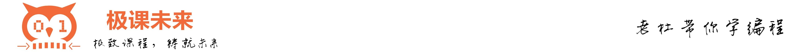

我们在学习Servlet的时候，编写了一个银行账户转账的功能。并且当时开发的这个功能使用了三层架构，并且也解决了事务的问题。只不过底层使用了JDBC。我们现在把持久层换成MyBatis。当然，大家也可以按照下面的手册重新从零写一个全新的账户转账功能。

**目标：**

* 掌握mybatis在web应用中怎么用
* mybatis三大对象的作用域和生命周期
* ThreadLocal原理及使用
* 巩固三层架构模式与MVC架构模式
* 为学习MyBatis的接口代理机制做准备

**实现功能：**

* 银行账户转账

**使用技术：**

* HTML + Servlet + MyBatis

**WEB应用的名称：**

* bank\*\*\*\*

## 1.需求描述

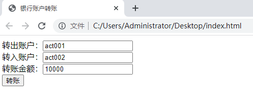

## 2.数据库表的设计和准备数据

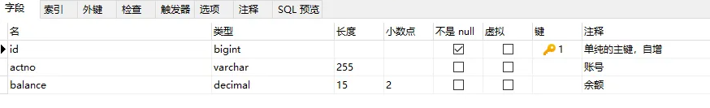

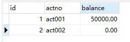

## 3.实现步骤

### 第一步：创建web应用

* IDEA中创建Maven WEB应用（**<font style="color:#E8323C;">mybatis-004-web</font>**）
* IDEA配置Tomcat，这里Tomcat使用10+版本。并部署应用到tomcat。
* 我们项目中不使用JSP，直接使用html即可，在web应用的根目录下创建`index.html`页面
* 确定pom.xml文件中的打包方式是war包。
* 引入相关依赖
  * 引入的依赖包括：mybatis，mysql驱动，junit，servlet。

```xml
<dependencies>
    <!--servlet api-->
    <dependency>
        <groupId>jakarta.servlet</groupId>
        <artifactId>jakarta.servlet-api</artifactId>
        <version>6.0.0</version>
        <scope>provided</scope>
    </dependency>
    <!--mysql-->
    <dependency>
        <groupId>mysql</groupId>
        <artifactId>mysql-connector-java</artifactId>
        <version>8.0.30</version>
    </dependency>
    <!--mybatis-->
    <dependency>
        <groupId>org.mybatis</groupId>
        <artifactId>mybatis</artifactId>
        <version>3.5.10</version>
    </dependency>
    <!--junit-->
    <dependency>
        <groupId>org.junit.jupiter</groupId>
        <artifactId>junit-jupiter</artifactId>
        <version>5.10.2</version>
        <scope>test</scope>
    </dependency>
</dependencies>
```

* 引入相关配置文件，放到resources目录下（全部放到类的根路径下）
  * mybatis-config.xml
  * AccountMapper.xml
  * jdbc.properties

```properties
jdbc.driver=com.mysql.cj.jdbc.Driver
jdbc.url=jdbc:mysql://localhost:3306/mybatis
jdbc.username=root
jdbc.password=root
```

```xml
<?xml version="1.0" encoding="UTF-8" ?>
<!DOCTYPE configuration
        PUBLIC "-//mybatis.org//DTD Config 3.0//EN"
        "http://mybatis.org/dtd/mybatis-3-config.dtd">
<configuration>

    <properties resource="jdbc.properties"/>

    <environments default="dev">
        <environment id="dev">
            <transactionManager type="JDBC"/>
            <dataSource type="POOLED">
                <property name="driver" value="${jdbc.driver}"/>
                <property name="url" value="${jdbc.url}"/>
                <property name="username" value="${jdbc.username}"/>
                <property name="password" value="${jdbc.password}"/>
            </dataSource>
        </environment>
    </environments>
    <mappers>
        <!--一定要注意这里的路径哦！！！-->
        <mapper resource="AccountMapper.xml"/>
    </mappers>
</configuration>
```

```xml
<?xml version="1.0" encoding="UTF-8" ?>
<!DOCTYPE mapper
        PUBLIC "-//mybatis.org//DTD Mapper 3.0//EN"
        "http://mybatis.org/dtd/mybatis-3-mapper.dtd">

<mapper namespace="account">

</mapper>
```

### 第二步：前端页面index.html

```html
<!DOCTYPE html>
<html lang="en">
<head>
    <meta charset="UTF-8">
    <title>银行账户转账</title>
</head>
<body>
<!--/bank是应用的根，部署web应用到tomcat的时候一定要注意这个名字-->
<form action="/bank/transfer" method="post">
    转出账户：<input type="text" name="fromActno"/><br>
    转入账户：<input type="text" name="toActno"/><br>
    转账金额：<input type="text" name="money"/><br>
    <input type="submit" value="转账"/>
</form>
</body>
</html>
```

### 第三步：创建pojo包、service包、dao包、web包、utils包

* com.jkweilai.bank.pojo
* com.jkweilai.bank.service
* com.jkweilai.bank.service.impl
* com.jkweilai.bank.dao
* com.jkweilai.bank.dao.impl
* com.jkweilai.bank.web.controller
* com.jkweilai.bank.exception
* com.jkweilai.bank.utils：**<font style="color:#E8323C;">将之前编写的SqlSessionUtil工具类拷贝到该包下。</font>**

### 第四步：定义pojo类：Account

```java
package com.jkweilai.bank.pojo;

/**
 * 银行账户类
 * @author 老杜
 */
public class Account {
    private Long id;
    private String actno;
    private Double balance;

    @Override
    public String toString() {
        return "Account{" +
                "id=" + id +
                ", actno='" + actno + '\'' +
                ", balance=" + balance +
                '}';
    }

    public Account() {
    }

    public Account(Long id, String actno, Double balance) {
        this.id = id;
        this.actno = actno;
        this.balance = balance;
    }

    public Long getId() {
        return id;
    }

    public void setId(Long id) {
        this.id = id;
    }

    public String getActno() {
        return actno;
    }

    public void setActno(String actno) {
        this.actno = actno;
    }

    public Double getBalance() {
        return balance;
    }

    public void setBalance(Double balance) {
        this.balance = balance;
    }
}

```

### 第五步：编写AccountDao接口，以及AccountDaoImpl实现类

分析dao中至少要提供几个方法，才能完成转账：

* 转账前需要查询余额是否充足：selectByActno
* 转账时要更新账户：update

```java
package com.jkweilai.bank.dao;

import com.jkweilai.bank.pojo.Account;

/**
 * 账户数据访问对象
 * @author 老杜
 */
public interface AccountDao {

    /**
     * 根据账号获取账户信息
     * @param actno 账号
     * @return 账户信息
     */
    Account selectByActno(String actno);

    /**
     * 更新账户信息
     * @param act 账户信息
     * @return 1表示更新成功，其他值表示失败
     */
    int update(Account act);
}

```

```java
package com.jkweilai.bank.dao.impl;

import com.jkweilai.bank.dao.AccountDao;
import com.jkweilai.bank.pojo.Account;
import com.jkweilai.bank.utils.SqlSessionUtil;
import org.apache.ibatis.session.SqlSession;

public class AccountDaoImpl implements AccountDao {
    @Override
    public Account selectByActno(String actno) {
        SqlSession sqlSession = SqlSessionUtil.openSession();
        Account act = (Account)sqlSession.selectOne("selectByActno", actno);
        sqlSession.close();
        return act;
    }

    @Override
    public int update(Account act) {
        SqlSession sqlSession = SqlSessionUtil.openSession();
        int count = sqlSession.update("update", act);
        sqlSession.commit();
        sqlSession.close();
        return count;
    }
}

```

### 第六步：AccountDaoImpl中编写了mybatis代码，需要编写SQL映射文件了

```xml
<?xml version="1.0" encoding="UTF-8" ?>
<!DOCTYPE mapper
        PUBLIC "-//mybatis.org//DTD Mapper 3.0//EN"
        "http://mybatis.org/dtd/mybatis-3-mapper.dtd">

<mapper namespace="account">
    <select id="selectByActno" resultType="com.jkweilai.bank.pojo.Account">
        select * from t_act where actno = #{actno}
    </select>
    <update id="update">
        update t_act set balance = #{balance} where actno = #{actno}
    </update>
</mapper>
```

### 第七步：编写AccountService接口以及AccountServiceImpl

```java
package com.jkweilai.bank.exception;

/**
 * 余额不足异常
 * @author 老杜
 */
public class MoneyNotEnoughException extends Exception{
    public MoneyNotEnoughException(){}
    public MoneyNotEnoughException(String msg){ super(msg); }
}

```

```java
package com.jkweilai.bank.exception;

/**
 * 应用异常
 * @author 老杜
 */
public class AppException extends Exception{
    public AppException(){}
    public AppException(String msg){ super(msg); }
}

```

```java
package com.jkweilai.bank.service;

import com.jkweilai.bank.exception.AppException;
import com.jkweilai.bank.exception.MoneyNotEnoughException;

/**
 * 账户业务类。
 * @author 老杜
 */
public interface AccountService {

    /**
     * 银行账户转正
     * @param fromActno 转出账户
     * @param toActno 转入账户
     * @param money 转账金额
     * @throws MoneyNotEnoughException 余额不足异常
     * @throws AppException App发生异常
     */
    void transfer(String fromActno, String toActno, double money) throws MoneyNotEnoughException, AppException;
}

```

```java
package com.jkweilai.bank.service.impl;

import com.jkweilai.bank.dao.AccountDao;
import com.jkweilai.bank.dao.impl.AccountDaoImpl;
import com.jkweilai.bank.exception.AppException;
import com.jkweilai.bank.exception.MoneyNotEnoughException;
import com.jkweilai.bank.pojo.Account;
import com.jkweilai.bank.service.AccountService;

public class AccountServiceImpl implements AccountService {

    private AccountDao accountDao = new AccountDaoImpl();

    @Override
    public void transfer(String fromActno, String toActno, double money) throws MoneyNotEnoughException, AppException {
        // 查询转出账户的余额
        Account fromAct = accountDao.selectByActno(fromActno);
        if (fromAct.getBalance() < money) {
            throw new MoneyNotEnoughException("对不起，您的余额不足。");
        }
        try {
            // 程序如果执行到这里说明余额充足
            // 修改账户余额
            Account toAct = accountDao.selectByActno(toActno);
            fromAct.setBalance(fromAct.getBalance() - money);
            toAct.setBalance(toAct.getBalance() + money);
            // 更新数据库
            accountDao.update(fromAct);
            accountDao.update(toAct);
        } catch (Exception e) {
            throw new AppException("转账失败，未知原因！");
        }
    }
}

```

### 第八步：编写AccountController

```java
package com.jkweilai.bank.web.controller;

import com.jkweilai.bank.exception.AppException;
import com.jkweilai.bank.exception.MoneyNotEnoughException;
import com.jkweilai.bank.service.AccountService;
import com.jkweilai.bank.service.impl.AccountServiceImpl;

import javax.servlet.ServletException;
import javax.servlet.http.HttpServlet;
import javax.servlet.http.HttpServletRequest;
import javax.servlet.http.HttpServletResponse;
import java.io.IOException;
import java.io.PrintWriter;

/**
 * 账户控制器
 * @author 老杜
 */
@WebServlet("/transfer")
public class AccountController extends HttpServlet {

    @Override
    protected void doPost(HttpServletRequest request, HttpServletResponse response)
            throws ServletException, IOException {
        
        // 获取响应流
        response.setContentType("text/html;charset=UTF-8");
        PrintWriter out = response.getWriter();
        // 获取账户信息
        String fromActno = request.getParameter("fromActno");
        String toActno = request.getParameter("toActno");
        double money = Integer.parseInt(request.getParameter("money"));
        // 调用业务方法完成转账
        try {
            // 注意：创建service对象的代码必须放到 doPost 方法内部，以局部变量的方式创建。
            // 如果定义为实例变量，会导致service对象单例，service对象单例就会导致dao单例。
            // 将来dao对象是通过mybatis接口代理机制生成的，而接口代理生成的对象必须要保证一个线程一个。如果dao是单例的就会有问题。
            AccountService accountService = new AccountServiceImpl();
            
            accountService.transfer(fromActno, toActno, money);
            out.print("<h1>转账成功！！！</h1>");
        } catch (MoneyNotEnoughException e) {
            out.print(e.getMessage());
        } catch (AppException e) {
            out.print(e.getMessage());
        }
    }
}

```

启动服务器，打开浏览器，输入地址：http://localhost:8080/bank，测试：

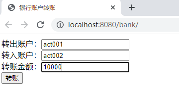

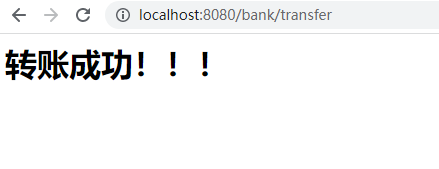

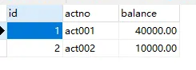

## 4.MyBatis对象作用域以及事务问题

### MyBatis核心对象的作用域

**SqlSessionFactoryBuilder**

<font style="color:rgb(51, 51, 51);">这个类可以被实例化、使用和丢弃，一旦创建了 SqlSessionFactory，就不再需要它了。 因此 SqlSessionFactoryBuilder 实例的最佳作用域是方法作用域（也就是局部方法变量）。 你可以重用 SqlSessionFactoryBuilder 来创建多个 SqlSessionFactory 实例，但最好还是不要一直保留着它，以保证所有的 XML 解析资源可以被释放给更重要的事情。</font>

**SqlSessionFactory**

<font style="color:rgb(51, 51, 51);">SqlSessionFactory 一旦被创建就应该在应用的运行期间一直存在，没有任何理由丢弃它或重新创建另一个实例。 使用 SqlSessionFactory 的最佳实践是在应用运行期间不要重复创建多次，多次重建 SqlSessionFactory 被视为一种代码“坏习惯”。因此 SqlSessionFactory 的最佳作用域是应用作用域。 有很多方法可以做到，最简单的就是使用单例模式或者静态单例模式。</font>

**SqlSession**

<font style="color:rgb(51, 51, 51);">每个线程都应该有它自己的 SqlSession 实例。SqlSession 的实例不是线程安全的，因此是不能被共享的，所以它的最佳的作用域是请求或方法作用域。 绝对不能将 SqlSession 实例的引用放在一个类的静态域，甚至一个类的实例变量也不行。 也绝不能将 SqlSession 实例的引用放在任何类型的托管作用域中，比如 Servlet 框架中的 HttpSession。 如果你现在正在使用一种 Web 框架，考虑将 SqlSession 放在一个和 HTTP 请求相似的作用域中。 换句话说，每次收到 HTTP 请求，就可以打开一个 SqlSession，返回一个响应后，就关闭它。 这个关闭操作很重要，为了确保每次都能执行关闭操作，你应该把这个关闭操作放到 finally 块中。 下面的示例就是一个确保 SqlSession 关闭的标准模式：</font>

```java
try (SqlSession session = sqlSessionFactory.openSession()) {
  // 你的应用逻辑代码
}
```

### 事务问题

在之前的转账业务中，更新了两个账户，我们需要保证它们的同时成功或同时失败，这个时候就需要使用事务机制，在transfer方法开始执行时开启事务，直到两个更新都成功之后，再提交事务，我们尝试将transfer方法进行如下修改：

```java
package com.jkweilai.bank.service.impl;

import com.jkweilai.bank.dao.AccountDao;
import com.jkweilai.bank.dao.impl.AccountDaoImpl;
import com.jkweilai.bank.exception.AppException;
import com.jkweilai.bank.exception.MoneyNotEnoughException;
import com.jkweilai.bank.pojo.Account;
import com.jkweilai.bank.service.AccountService;
import com.jkweilai.bank.utils.SqlSessionUtil;
import org.apache.ibatis.session.SqlSession;

public class AccountServiceImpl implements AccountService {

    private AccountDao accountDao = new AccountDaoImpl();

    @Override
    public void transfer(String fromActno, String toActno, double money) throws MoneyNotEnoughException, AppException {
        // 查询转出账户的余额
        Account fromAct = accountDao.selectByActno(fromActno);
        if (fromAct.getBalance() < money) {
            throw new MoneyNotEnoughException("对不起，您的余额不足。");
        }
        try {
            // 程序如果执行到这里说明余额充足
            // 修改账户余额
            Account toAct = accountDao.selectByActno(toActno);
            fromAct.setBalance(fromAct.getBalance() - money);
            toAct.setBalance(toAct.getBalance() + money);
            // 更新数据库（添加事务）
            SqlSession sqlSession = SqlSessionUtil.openSession();
            accountDao.update(fromAct);
            // 模拟异常
            String s = null;
            s.toString();
            accountDao.update(toAct);
            sqlSession.commit();
            sqlSession.close();
        } catch (Exception e) {
            throw new AppException("转账失败，未知原因！");
        }
    }
}

```

运行前注意看数据库表中当前的数据：

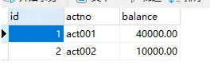

执行程序：

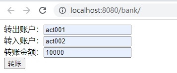

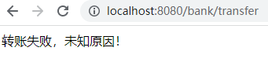

再次查看数据库表中的数据：

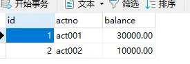

**<font style="color:#E8323C;">傻眼了吧！！！事务出问题了，转账失败了，钱仍然是少了1万。这是什么原因呢？主要是因为service和dao中使用的SqlSession对象不是同一个。</font>**

怎么办？为了保证service和dao中使用的SqlSession对象是同一个，可以将SqlSession对象存放到ThreadLocal当中。修改SqlSessionUtil工具类：

```java
package com.jkweilai.bank.utils;

import org.apache.ibatis.io.Resources;
import org.apache.ibatis.session.SqlSession;
import org.apache.ibatis.session.SqlSessionFactory;
import org.apache.ibatis.session.SqlSessionFactoryBuilder;

/**
 * MyBatis工具类
 *
 * @author 老杜
 */
public class SqlSessionUtil {
    private static SqlSessionFactory sqlSessionFactory;

    /**
     * 类加载时初始化sqlSessionFactory对象
     */
    static {
        try {
            SqlSessionFactoryBuilder sqlSessionFactoryBuilder = new SqlSessionFactoryBuilder();
            sqlSessionFactory = sqlSessionFactoryBuilder.build(Resources.getResourceAsStream("mybatis-config.xml"));
        } catch (Exception e) {
            e.printStackTrace();
        }
    }

    private static ThreadLocal<SqlSession> local = new ThreadLocal<>();

    /**
     * 每调用一次openSession()可获取一个新的会话，该会话支持自动提交。
     *
     * @return 新的会话对象
     */
    public static SqlSession openSession() {
        SqlSession sqlSession = local.get();
        if (sqlSession == null) {
            sqlSession = sqlSessionFactory.openSession();
            local.set(sqlSession);
        }
        return sqlSession;
    }

    /**
     * 关闭SqlSession对象
     * @param sqlSession
     */
    public static void close(SqlSession sqlSession){
        if (sqlSession != null) {
            sqlSession.close();
        }
        local.remove();
    }
}
```

修改dao中的方法：AccountDaoImpl中所有方法中的提交commit和关闭close代码全部删除。

```java
package com.jkweilai.bank.dao.impl;

import com.jkweilai.bank.dao.AccountDao;
import com.jkweilai.bank.pojo.Account;
import com.jkweilai.bank.utils.SqlSessionUtil;
import org.apache.ibatis.session.SqlSession;

public class AccountDaoImpl implements AccountDao {
    @Override
    public Account selectByActno(String actno) {
        SqlSession sqlSession = SqlSessionUtil.openSession();
        Account act = (Account)sqlSession.selectOne("account.selectByActno", actno);
        return act;
    }

    @Override
    public int update(Account act) {
        SqlSession sqlSession = SqlSessionUtil.openSession();
        int count = sqlSession.update("account.update", act);
        return count;
    }
}

```

修改service中的方法：

```java
package com.jkweilai.bank.service.impl;

import com.jkweilai.bank.dao.AccountDao;
import com.jkweilai.bank.dao.impl.AccountDaoImpl;
import com.jkweilai.bank.exception.AppException;
import com.jkweilai.bank.exception.MoneyNotEnoughException;
import com.jkweilai.bank.pojo.Account;
import com.jkweilai.bank.service.AccountService;
import com.jkweilai.bank.utils.SqlSessionUtil;
import org.apache.ibatis.session.SqlSession;

public class AccountServiceImpl implements AccountService {

    private AccountDao accountDao = new AccountDaoImpl();

    @Override
    public void transfer(String fromActno, String toActno, double money) throws MoneyNotEnoughException, AppException {
        // 查询转出账户的余额
        Account fromAct = accountDao.selectByActno(fromActno);
        if (fromAct.getBalance() < money) {
            throw new MoneyNotEnoughException("对不起，您的余额不足。");
        }
        try {
            // 程序如果执行到这里说明余额充足
            // 修改账户余额
            Account toAct = accountDao.selectByActno(toActno);
            fromAct.setBalance(fromAct.getBalance() - money);
            toAct.setBalance(toAct.getBalance() + money);
            // 更新数据库（添加事务）
            SqlSession sqlSession = SqlSessionUtil.openSession();
            accountDao.update(fromAct);
            // 模拟异常
            String s = null;
            s.toString();
            accountDao.update(toAct);
            sqlSession.commit();
            SqlSessionUtil.close(sqlSession);  // 只修改了这一行代码。
        } catch (Exception e) {
            throw new AppException("转账失败，未知原因！");
        }
    }
}

```

当前数据库表中的数据：

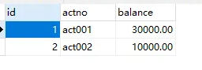

再次运行程序：


查看数据库表：没有问题。

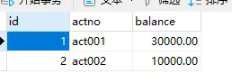

再测试转账成功：


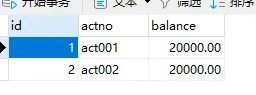

如果余额不足呢：

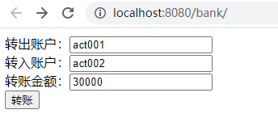

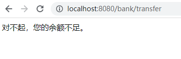

账户的余额依然正常：

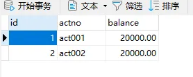


