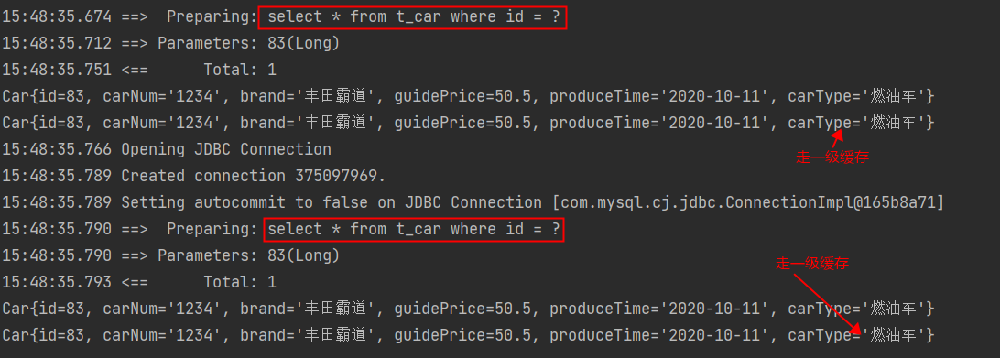
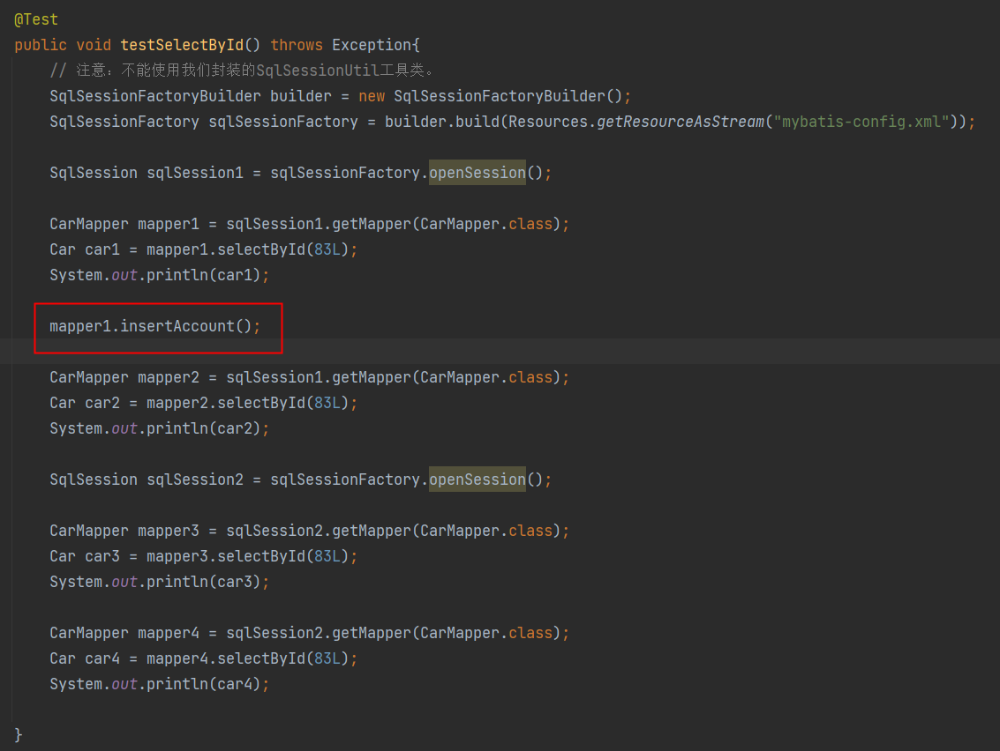
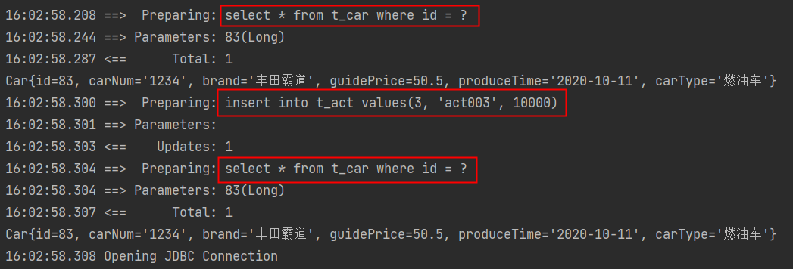
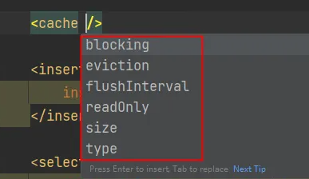

# MyBatis的缓存

缓存：cache

缓存的作用：通过减少IO的方式，来提高程序的执行效率。

mybatis的缓存：将select语句的查询结果放到缓存（内存）当中，下一次还是这条select语句的话，直接从缓存中取，不再查数据库。一方面是减少了IO。另一方面不再执行繁琐的查找算法。效率大大提升。

mybatis缓存包括：

* 一级缓存：将查询到的数据存储到SqlSession中。
* 二级缓存：将查询到的数据存储到SqlSessionFactory中。
* 或者集成其它第三方的缓存：比如EhCache【Java语言开发的】、Memcache【C语言开发的】、\*\*<font style="color:#DF2A3F;">Redis【C语言开发的】</font>\*\*等。

**<font style="color:#F5222D;">缓存只针对于DQL语句，也就是说缓存机制只对应select语句。</font>**

## 一级缓存

一级缓存默认是开启的。不需要做任何配置。

原理：只要使用同一个SqlSession对象执行同一条SQL语句，就会走缓存。

模块名：<code>**mybatis-010-cache**</code>

```java
package com.jkweilai.mybatis.mapper;

import com.jkweilai.mybatis.pojo.Car;

public interface CarMapper {

    /**
     * 根据id获取Car信息。
     * @param id
     * @return
     */
    Car selectById(Long id);
}

```

```xml
<?xml version="1.0" encoding="UTF-8" ?>
<!DOCTYPE mapper
        PUBLIC "-//mybatis.org//DTD Mapper 3.0//EN"
        "http://mybatis.org/dtd/mybatis-3-mapper.dtd">

<mapper namespace="com.jkweilai.mybatis.mapper.CarMapper">

  <select id="selectById" resultType="Car">
    select * from t_car where id = #{id}
  </select>

</mapper>
```

```java
package com.jkweilai.mybatis.test;

import com.jkweilai.mybatis.mapper.CarMapper;
import com.jkweilai.mybatis.pojo.Car;
import com.jkweilai.mybatis.utils.SqlSessionUtil;
import org.apache.ibatis.io.Resources;
import org.apache.ibatis.session.SqlSession;
import org.apache.ibatis.session.SqlSessionFactory;
import org.apache.ibatis.session.SqlSessionFactoryBuilder;
import org.junit.jupiter.api.Test;

public class CarMapperTest {

    @Test
    public void testSelectById() throws Exception{
        // 注意：不能使用我们封装的SqlSessionUtil工具类。
        SqlSessionFactoryBuilder builder = new SqlSessionFactoryBuilder();
        SqlSessionFactory sqlSessionFactory = builder.build(Resources.getResourceAsStream("mybatis-config.xml"));

        SqlSession sqlSession1 = sqlSessionFactory.openSession();

        CarMapper mapper1 = sqlSession1.getMapper(CarMapper.class);
        Car car1 = mapper1.selectById(83L);
        System.out.println(car1);

        CarMapper mapper2 = sqlSession1.getMapper(CarMapper.class);
        Car car2 = mapper2.selectById(83L);
        System.out.println(car2);

        SqlSession sqlSession2 = sqlSessionFactory.openSession();

        CarMapper mapper3 = sqlSession2.getMapper(CarMapper.class);
        Car car3 = mapper3.selectById(83L);
        System.out.println(car3);

        CarMapper mapper4 = sqlSession2.getMapper(CarMapper.class);
        Car car4 = mapper4.selectById(83L);
        System.out.println(car4);

    }
}

```

执行结果：



**什么情况下不走缓存？**

* 第一种：不同的SqlSession对象。
* 第二种：查询条件变化了。

**一级缓存失效情况包括两种：**

* 第一种：第一次查询和第二次查询之间，手动清空了一级缓存。

```java
sqlSession.clearCache();
```

* 第二种：第一次查询和第二次查询之间，执行了增删改操作。【**<font style="color:#DF2A3F;">这个增删改和哪张表没有关系，只要有insert delete update操作，一级缓存就失效。</font>**】

```java
/**
* 保存账户信息
*/
void insertAccount();
```

```xml
<insert id="insertAccount">
  insert into t_act values(3, 'act003', 10000)
</insert>
```



执行结果：



## 二级缓存

MyBatis 自带的二级缓存我们实际开发中用不上。以前没有缓存技术的时候，它用得上。现在缓存技术很多，比如 redis。现代开发中一般是集成第三方缓存，比如我们项目使用 MyBatis 查询数据库，将查询到的数据，需要缓存的话，放到 redis 中，然后使用 SpringCache 来管理 redis 缓存。因此以下内容作为一个了解。

二级缓存的范围是SqlSessionFactory。

使用二级缓存需要具备以下几个条件：

1. <setting name="cacheEnabled" value="true"> 全局性地开启或关闭所有映射器配置文件中已配置的任何缓存。默认就是true，无需设置。
2. 在需要使用二级缓存的SqlMapper.xml文件中添加配置：<cache />
3. 使用二级缓存的实体类对象必须是可序列化的，也就是必须实现java.io.Serializable接口
4. SqlSession对象关闭或提交之后，一级缓存中的数据才会被写入到二级缓存当中。此时二级缓存才可用。

测试二级缓存：

```xml
<cache/>
```

```java
public class Car implements Serializable {
//......
}
```

```java
@Test
public void testSelectById2() throws Exception{
    SqlSessionFactory sqlSessionFactory = new SqlSessionFactoryBuilder().build(Resources.getResourceAsStream("mybatis-config.xml"));

    SqlSession sqlSession1 = sqlSessionFactory.openSession();
    CarMapper mapper1 = sqlSession1.getMapper(CarMapper.class);
    Car car1 = mapper1.selectById(83L);
    System.out.println(car1);

    // 关键一步
    sqlSession1.close();

    SqlSession sqlSession2 = sqlSessionFactory.openSession();
    CarMapper mapper2 = sqlSession2.getMapper(CarMapper.class);
    Car car2 = mapper2.selectById(83L);
    System.out.println(car2);
}
```

**执行结果可以看到：缓存命中率为0.5，它表示两次查询中有一次是从缓存中读取的数据。**

**<font style="color:#F5222D;">二级缓存的失效：只要两次查询之间出现了增删改操作。二级缓存就会失效。【一级缓存也会失效】</font>**

**二级缓存的相关配置：**



1. eviction：指定从缓存中移除<font style="color:#DF2A3F;">某个对象的淘汰算法</font>。默认采用LRU策略。
   1. LRU：Least Recently Used。最近最少使用。优先淘汰在间隔时间内使用频率最低的对象。(其实还有一种淘汰算法LFU，最不常用。)
   2. FIFO：First In First Out。一种先进先出的数据缓存器。先进入二级缓存的对象最先被淘汰。
   3. SOFT：软引用（<font style="color:rgb(15, 17, 21);">内存不够时，垃圾回收器</font>**<font style="color:rgb(15, 17, 21);">才会</font>**<font style="color:rgb(15, 17, 21);">回收它。</font>）。淘汰软引用指向的对象。具体算法和JVM的垃圾回收算法有关。
   4. WEAK：弱引用（<font style="color:rgb(15, 17, 21);">只要垃圾回收器一工作，</font>**<font style="color:rgb(15, 17, 21);">立刻</font>**<font style="color:rgb(15, 17, 21);">回收它</font>）。淘汰弱引用指向的对象。具体算法和JVM的垃圾回收算法有关。
2. flushInterval：
   1. 二级缓存的刷新时间间隔。单位毫秒。如果没有设置。就代表不刷新缓存，只要内存足够大，一直会向二级缓存中缓存数据。除非执行了增删改。
3. readOnly：
   1. true：多条相同的sql语句执行之后返回的对象是共享的同一个。性能好。但是多线程并发可能会存在安全问题。
   2. false：多条相同的sql语句执行之后返回的对象是副本，调用了clone方法。性能一般。但安全。
4. size：
   1. 设置二级缓存中最多可存储的java对象数量。默认值1024。