# MyBatis的逆向工程

## 注意，这一章作为了解即可，因为idea工具的MybatisX插件就有逆向工程能力，我们后面会经常使用这个插件来做逆向工程

所谓的逆向工程是：根据数据库表逆向生成Java的pojo类，SqlMapper.xml文件，以及Mapper接口类等。

要完成这个工作，需要借助别人写好的逆向工程插件。

思考：使用这个插件的话，需要给这个插件配置哪些信息？

* 实体类的类名、包名以及生成位置。
* SqlMapper.xml文件名以及生成位置。
* Mapper接口名以及生成位置。
* 连接数据库的信息。
* 指定哪些表参与逆向工程。
* ......

## 逆向工程配置与生成

### 第一步：基础环境准备

新建模块：`mybatis-011-generator`

打包方式：jar

### 第二步：在pom中添加逆向工程插件

```xml
<!--定制构建过程-->
<build>
  <!--可配置多个插件-->
  <plugins>
    <!--其中的一个插件：mybatis逆向工程插件-->
    <plugin>
      <!--插件的GAV坐标-->
      <groupId>org.mybatis.generator</groupId>
      <artifactId>mybatis-generator-maven-plugin</artifactId>
      <version>1.4.1</version>
      <!--允许覆盖-->
      <configuration>
        <overwrite>true</overwrite>
      </configuration>
      <!--插件的依赖-->
      <dependencies>
        <!--mysql驱动依赖-->
        <dependency>
          <groupId>mysql</groupId>
          <artifactId>mysql-connector-java</artifactId>
          <version>8.0.30</version>
        </dependency>
      </dependencies>
    </plugin>
  </plugins>
</build>
```

### 第三步：配置generatorConfig.xml

该文件名必须叫做：generatorConfig.xml

该文件必须放在类的根路径下。

```xml
<?xml version="1.0" encoding="UTF-8"?>
<!DOCTYPE generatorConfiguration
        PUBLIC "-//mybatis.org//DTD MyBatis Generator Configuration 1.0//EN"
        "http://mybatis.org/dtd/mybatis-generator-config_1_0.dtd">

<generatorConfiguration>
    <!--
        targetRuntime有两个值：
            MyBatis3Simple：生成的是基础版，只有基本的增删改查。
            MyBatis3：生成的是增强版，除了基本的增删改查之外还有复杂的增删改查。
    -->
    <context id="DB2Tables" targetRuntime="MyBatis3">
        <!--防止生成重复代码-->
        <plugin type="org.mybatis.generator.plugins.UnmergeableXmlMappersPlugin"/>
      
        <commentGenerator>
            <!--是否去掉生成日期-->
            <property name="suppressDate" value="true"/>
            <!--是否去除注释-->
            <property name="suppressAllComments" value="true"/>
        </commentGenerator>

        <!--连接数据库信息-->
        <jdbcConnection driverClass="com.mysql.cj.jdbc.Driver"
                        connectionURL="jdbc:mysql://localhost:3306/mybatis"
                        userId="root"
                        password="123456">
        </jdbcConnection>

        <!-- 生成entity包名和位置 -->
        <javaModelGenerator targetPackage="com.jkweilai.mybatis.entity" targetProject="src/main/java">
            <!--是否开启子包-->
            <property name="enableSubPackages" value="true"/>
            <!--是否去除字段名的前后空白-->
            <property name="trimStrings" value="true"/>
        </javaModelGenerator>

        <!-- 生成SQL映射文件的包名和位置 -->
        <sqlMapGenerator targetPackage="com.jkweilai.mybatis.mapper" targetProject="src/main/resources">
            <!--是否开启子包-->
            <property name="enableSubPackages" value="true"/>
        </sqlMapGenerator>

        <!-- 生成Mapper接口的包名和位置 -->
        <javaClientGenerator
                type="xmlMapper"
                targetPackage="com.jkweilai.mybatis.mapper"
                targetProject="src/main/java">
            <property name="enableSubPackages" value="true"/>
        </javaClientGenerator>

        <!-- 表名和对应的实体类名-->
        <table tableName="t_car" domainObjectName="Car"/>

    </context>
</generatorConfiguration>
```

### 第四步：运行插件

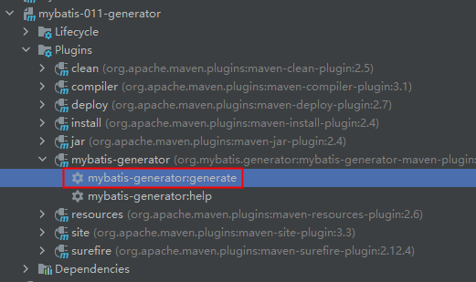

## 测试逆向工程生成的是否好用

### 第一步：环境准备

* 依赖：mybatis依赖、mysql驱动依赖、junit依赖
* jdbc.properties
* mybatis-config.xml

### 第二步：编写测试程序

```java
package com.jkweilai.mybatis.test;

import com.jkweilai.mybatis.mapper.CarMapper;
import com.jkweilai.mybatis.pojo.Car;
import com.jkweilai.mybatis.pojo.CarExample;
import org.apache.ibatis.io.Resources;
import org.apache.ibatis.session.SqlSession;
import org.apache.ibatis.session.SqlSessionFactory;
import org.apache.ibatis.session.SqlSessionFactoryBuilder;
import org.junit.jupiter.api.Test;

import java.math.BigDecimal;
import java.util.List;

public class GeneratorTest {
    @Test
    public void testGenerator() throws Exception{
        SqlSessionFactory sqlSessionFactory = new SqlSessionFactoryBuilder().build(Resources.getResourceAsStream("mybatis-config.xml"));
        SqlSession sqlSession = sqlSessionFactory.openSession();
        CarMapper mapper = sqlSession.getMapper(CarMapper.class);
        // 增
        /*Car car = new Car();
        car.setCarNum("1111");
        car.setBrand("比亚迪唐");
        car.setGuidePrice(new BigDecimal(30.0));
        car.setProduceTime("2010-10-12");
        car.setCarType("燃油车");
        int count = mapper.insert(car);
        System.out.println("插入了几条记录：" + count);*/
        // 删
        /*int count = mapper.deleteByPrimaryKey(83L);
        System.out.println("删除了几条记录：" + count);*/
        // 改
        // 根据主键修改
        /*Car car = new Car();
        car.setId(89L);
        car.setGuidePrice(new BigDecimal(20.0));
        car.setCarType("新能源");
        int count = mapper.updateByPrimaryKey(car);
        System.out.println("更新了几条记录：" + count);*/
        // 根据主键选择性修改
        /*car = new Car();
        car.setId(89L);
        car.setCarNum("3333");
        car.setBrand("宝马520Li");
        car.setProduceTime("1999-01-10");
        count = mapper.updateByPrimaryKeySelective(car);
        System.out.println("更新了几条记录：" + count);*/

        // 查一个
        Car car = mapper.selectByPrimaryKey(89L);
        System.out.println(car);
        // 查所有
        List<Car> cars = mapper.selectByExample(null);
        cars.forEach(c -> System.out.println(c));
        // 多条件查询
        // QBC 风格：Query By Criteria 一种查询方式，比较面向对象，看不到sql语句。
        // 1. 创建一个查询条件容器
        CarExample carExample = new CarExample();
        // 2. 创建第一组查询条件：品牌必须是"丰田霸道" AND 指导价大于60万
        carExample.createCriteria()
                .andBrandEqualTo("丰田霸道")
                .andGuidePriceGreaterThan(new BigDecimal(60.0));
        // 3. 添加OR条件：生产时间在2000-10-11到2022-10-11之间
        carExample.or().andProduceTimeBetween("2000-10-11", "2022-10-11");
        // 4. 执行查询
        mapper.selectByExample(carExample);
        sqlSession.commit();
    }
}

```

# 演练1

## 1.把10项目拷贝一份，改名mybatis-011-generator，然后把target文件夹删除，修改项目名称，并且添加为maven项目

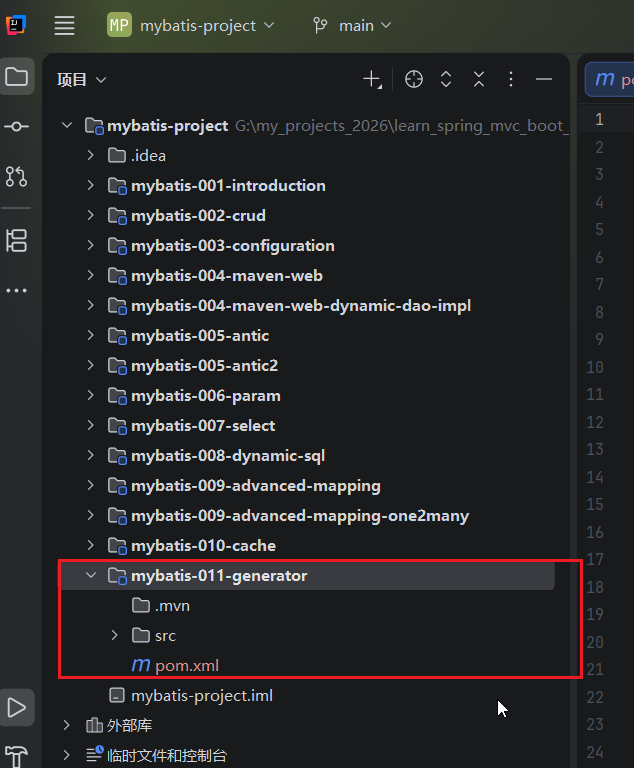

## 2.把CarMapper接口和xml文件删除，把Car类也删除

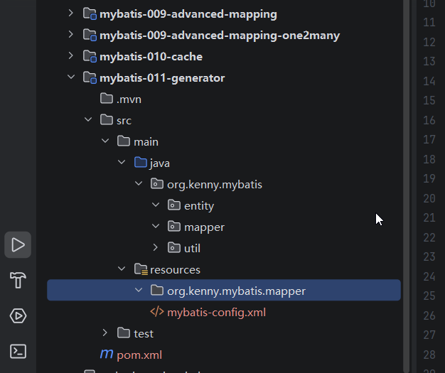

## 3.把测试类的所有方法也删除了

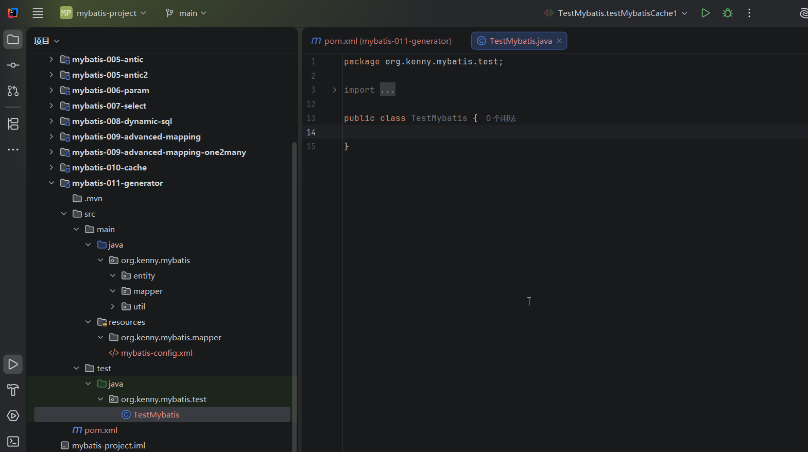

## 4.在pom.xml文件里面添加一个mybatis-generator-maven-plugin插件，注意在build>plugins>里面

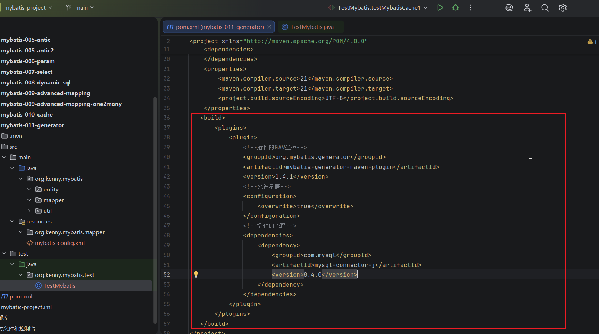

## 5.此时你在右边的maven面板上11项目的插件文件夹里面库看到这个插件，需要使用的时候，只需要双击这个插件里面的generate项即可

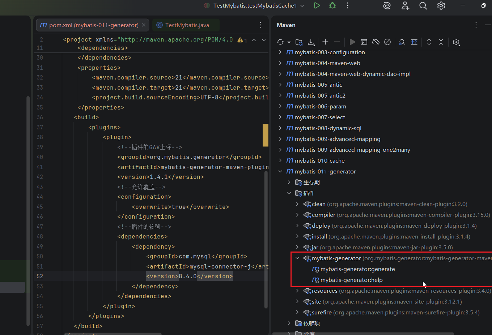

## 6.然后我们需要写一个generatorConfig.xml文件，放在类的根目录下面，也就是maven项目的main/resources文件夹

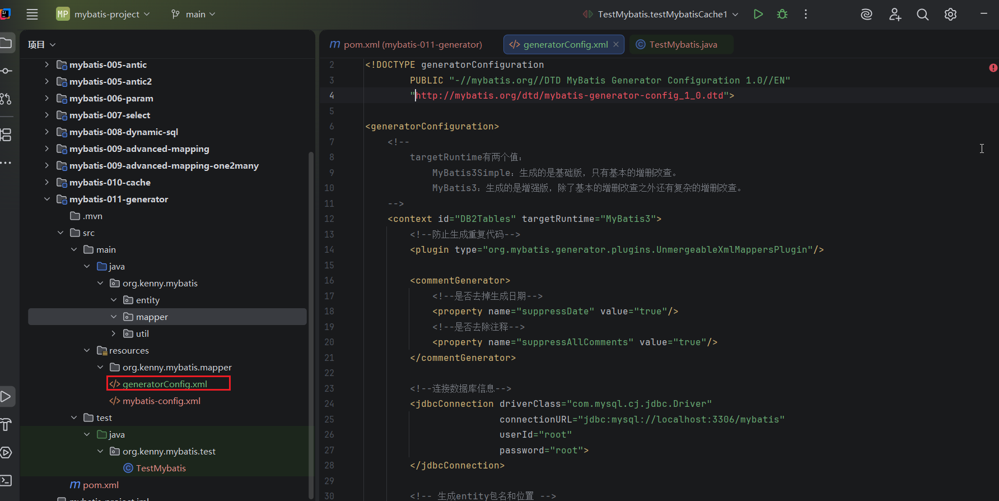

### generatorConfig.xml的内容如下

```
<?xml version="1.0" encoding="UTF-8"?>
<!DOCTYPE generatorConfiguration
        PUBLIC "-//mybatis.org//DTD MyBatis Generator Configuration 1.0//EN"
        "http://mybatis.org/dtd/mybatis-generator-config_1_0.dtd">

<generatorConfiguration>
    <!--
        targetRuntime有两个值：
            MyBatis3Simple：生成的是基础版，只有基本的增删改查。
            MyBatis3：生成的是增强版，除了基本的增删改查之外还有复杂的增删改查。
    -->
    <context id="DB2Tables" targetRuntime="MyBatis3">
        <!--防止生成重复代码-->
        <plugin type="org.mybatis.generator.plugins.UnmergeableXmlMappersPlugin"/>

        <commentGenerator>
            <!--是否去掉生成日期-->
            <property name="suppressDate" value="true"/>
            <!--是否去除注释-->
            <property name="suppressAllComments" value="true"/>
        </commentGenerator>

        <!--连接数据库信息-->
        <jdbcConnection driverClass="com.mysql.cj.jdbc.Driver"
                        connectionURL="jdbc:mysql://localhost:3306/mybatis"
                        userId="root"
                        password="root">
        </jdbcConnection>

        <!-- 生成entity包名和位置 -->
        <javaModelGenerator targetPackage="org.kenny.mybatis.entity" targetProject="src/main/java">
            <!--是否开启子包-->
            <property name="enableSubPackages" value="true"/>
            <!--是否去除字段名的前后空白-->
            <property name="trimStrings" value="true"/>
        </javaModelGenerator>

        <!-- 生成SQL映射文件的包名和位置 -->
        <sqlMapGenerator targetPackage="org.kenny.mybatis.mapper" targetProject="src/main/resources">
            <!--是否开启子包-->
            <property name="enableSubPackages" value="true"/>
        </sqlMapGenerator>

        <!-- 生成Mapper接口的包名和位置 -->
        <javaClientGenerator
                type="xmlMapper"
                targetPackage="org.kenny.mybatis.mapper"
                targetProject="src/main/java">
            <property name="enableSubPackages" value="true"/>
        </javaClientGenerator>

        <!-- 表名和对应的实体类名,可以写多个-->
        <table tableName="t_car" domainObjectName="Car"/>


    </context>
</generatorConfiguration>
```

## 7.然后就可以运行插件，在generate上面双击

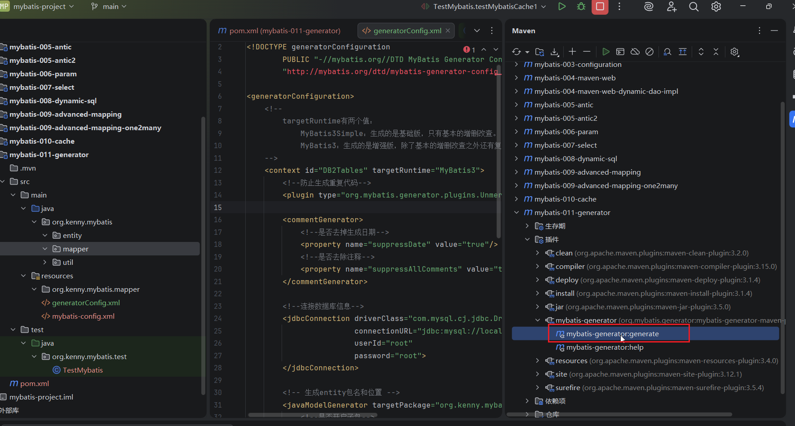

## 8.生成成功，不过，生成的类没有构造函数和toString方法还给我们创建了一个CarExample类

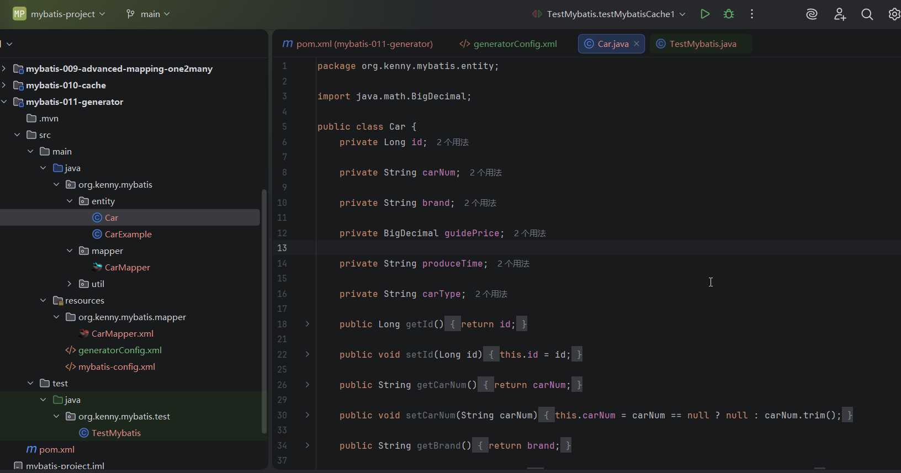

## 9.生成的Mapper接口和Mapper.xml非常复杂

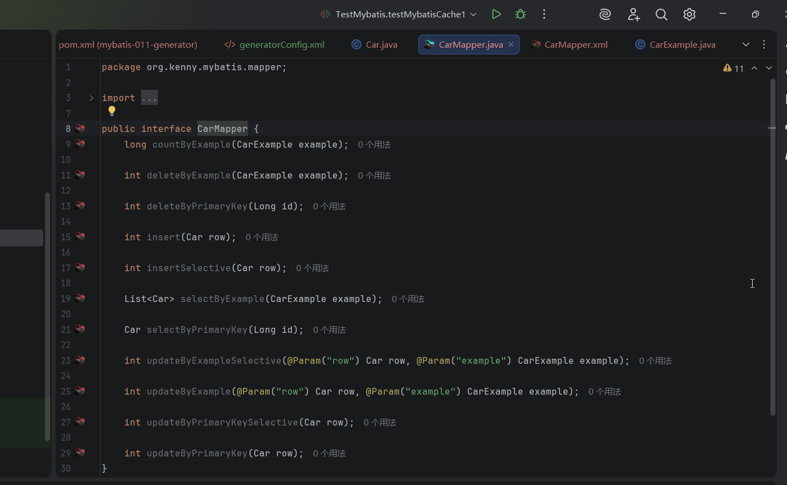

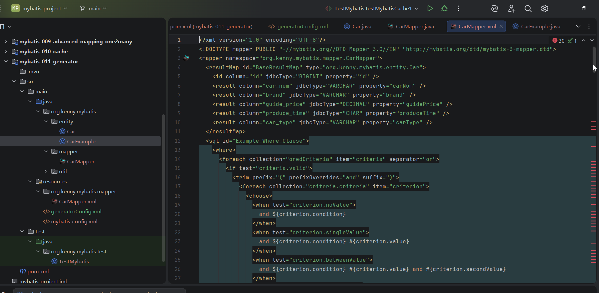

## 10.然后我们在测试类里面写一个测试代码，看看能否使用，发现是可以用的

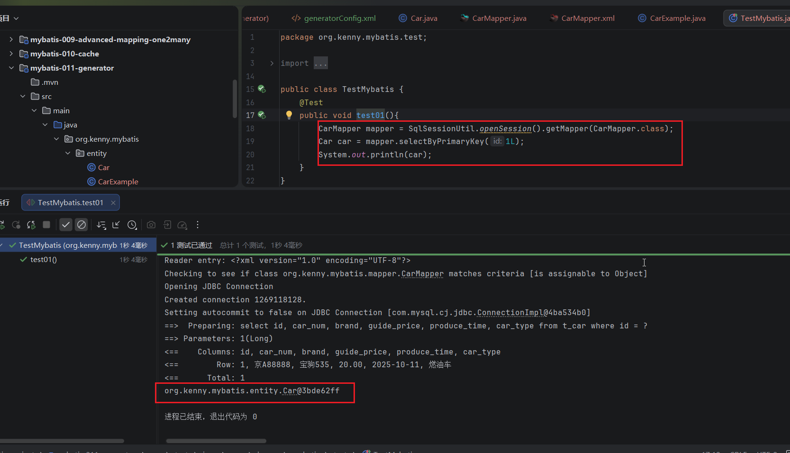

## 11.我们可以给Car类添加构造方法和toString方法，其实我们最需要的是它帮我们生成实体类。

## 以后我们都是使用idea的MybatisX创建


