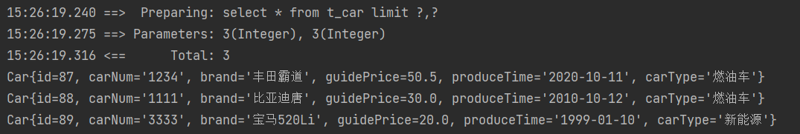
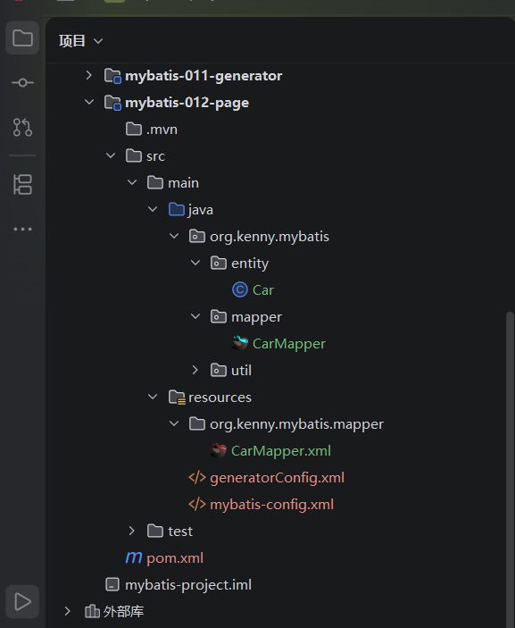
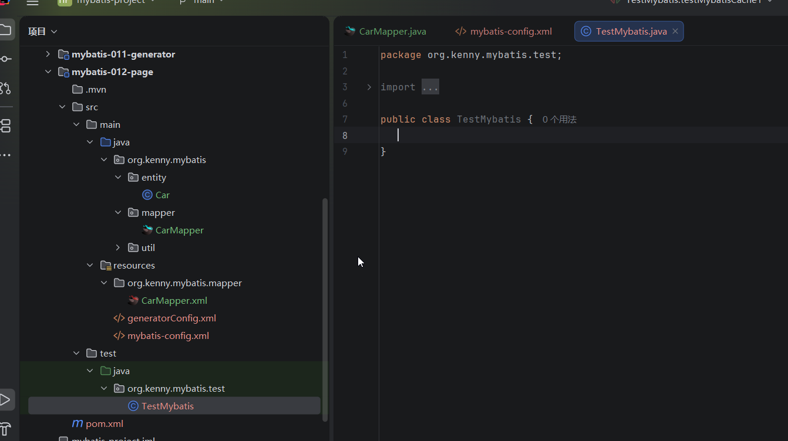
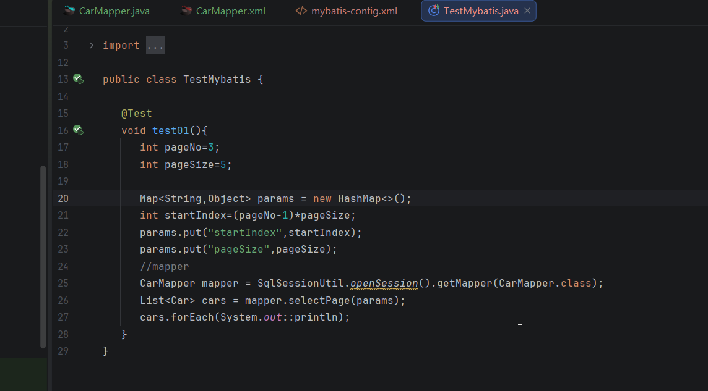
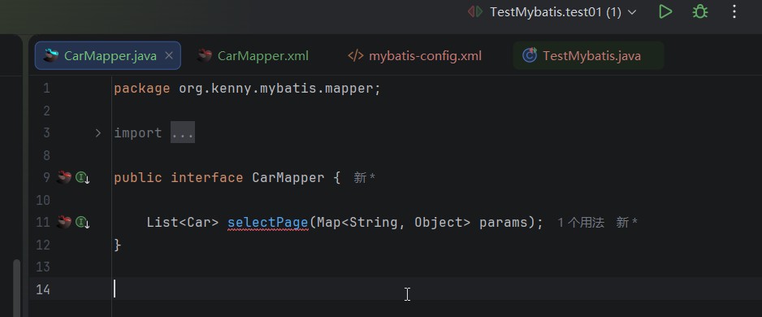
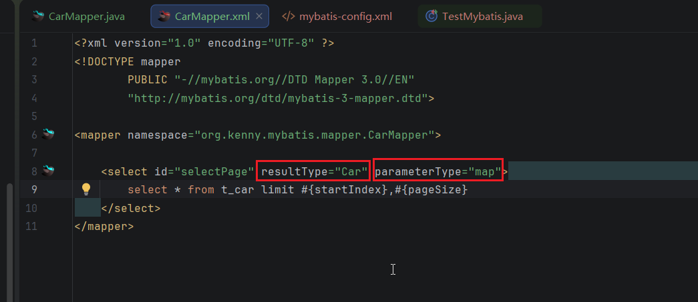
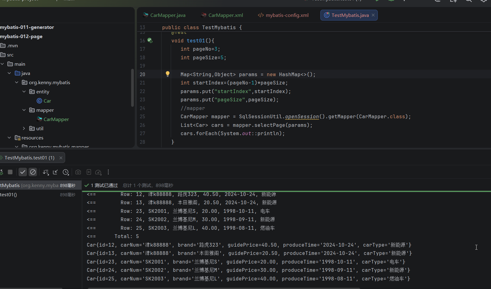

# MyBatis使用PageHelper

## limit分页

mysql的limit后面两个数字：

* 第一个数字：startIndex（起始下标。下标从0开始。）
* 第二个数字：pageSize（每页显示的记录条数）

假设已知页码pageNum，还有每页显示的记录条数pageSize，第一个数字可以动态的获取吗？

* startIndex = (pageNum - 1) \* pageSize

所以，标准通用的mysql分页SQL：

```sql
select 
  * 
from 
  tableName ...... 
limit 
  (pageNum - 1) * pageSize, pageSize
```

使用mybatis应该怎么做？

模块名：mybatis-012-page

```java
package com.jkweilai.mybatis.mapper;

import com.jkweilai.mybatis.pojo.Car;
import org.apache.ibatis.annotations.Param;

import java.util.List;

public interface CarMapper {
    
    /**
    * 通过分页的方式获取Car列表
    * @param startIndex 页码
    * @param pageSize 每页显示记录条数
    * @return
    */
    List<Car> selectAllByPage(@Param("startIndex") Integer startIndex, @Param("pageSize") Integer pageSize);
}
```

```xml
<?xml version="1.0" encoding="UTF-8" ?>
<!DOCTYPE mapper
        PUBLIC "-//mybatis.org//DTD Mapper 3.0//EN"
        "http://mybatis.org/dtd/mybatis-3-mapper.dtd">

<mapper namespace="com.jkweilai.mybatis.mapper.CarMapper">

    <select id="selectAllByPage" resultType="Car">
        select * from t_car limit #{startIndex},#{pageSize}
    </select>
</mapper>
```

```java
package com.jkweilai.mybatis.test;

import com.jkweilai.mybatis.mapper.CarMapper;
import com.jkweilai.mybatis.pojo.Car;
import org.apache.ibatis.io.Resources;
import org.apache.ibatis.session.SqlSession;
import org.apache.ibatis.session.SqlSessionFactory;
import org.apache.ibatis.session.SqlSessionFactoryBuilder;
import org.junit.jupiter.api.Test;

import java.util.List;

public class PageTest {
    @Test
    public void testPage()throws Exception{
        SqlSessionFactory sqlSessionFactory = new SqlSessionFactoryBuilder().build(Resources.getResourceAsStream("mybatis-config.xml"));
        SqlSession sqlSession = sqlSessionFactory.openSession();
        CarMapper mapper = sqlSession.getMapper(CarMapper.class);

        // 页码
        Integer pageNum = 2;
        // 每页显示记录条数
        Integer pageSize = 3;
        // 起始下标
        Integer startIndex = (pageNum - 1) * pageSize;

        List<Car> cars = mapper.selectAllByPage(startIndex, pageSize);
        cars.forEach(car -> System.out.println(car));

        sqlSession.commit();
        sqlSession.close();
    }
}

```

执行结果：



获取数据不难，难的是获取分页相关的数据比较难。可以借助mybatis的PageHelper插件。

## PageHelper插件

使用PageHelper插件进行分页，更加的便捷。

### 第一步：引入依赖

```xml
<dependency>
  <groupId>com.github.pagehelper</groupId>
  <artifactId>pagehelper</artifactId>
  <version>5.3.1</version>
</dependency>
```

### 第二步：在mybatis-config.xml文件中配置插件

typeAliases标签下面进行配置：

```xml
<plugins>
  <plugin interceptor="com.github.pagehelper.PageInterceptor"></plugin>
</plugins>
```

### 第三步：编写Java代码

```java
List<Car> selectAll();
```

```xml
<select id="selectAll" resultType="Car">
  select * from t_car
</select>
```

关键点：

* 在查询语句之前开启分页功能。
* 在查询语句之后封装PageInfo对象。（PageInfo对象将来会存储到request域当中。在页面上展示。）

```java
@Test
public void testPageHelper() throws Exception{
    SqlSessionFactory sqlSessionFactory = new SqlSessionFactoryBuilder().build(Resources.getResourceAsStream("mybatis-config.xml"));
    SqlSession sqlSession = sqlSessionFactory.openSession();
    CarMapper mapper = sqlSession.getMapper(CarMapper.class);

    // 开启分页
    // 第一个参数：pageNo
    // 第二个参数：pageSize
    PageHelper.startPage(2, 2);

    // 执行查询语句
    List<Car> cars = mapper.selectAll();

    // 获取分页信息对象
    PageInfo<Car> pageInfo = new PageInfo<>(cars, 5);

    System.out.println(pageInfo);
}
```

执行结果：

PageInfo{pageNum=2, pageSize=2, size=2, startRow=3, endRow=4, total=6, pages=3, list=Page{count=true, pageNum=2, pageSize=2, startRow=2, endRow=4, total=6, pages=3, reasonable=false, pageSizeZero=false}\[Car{id=86, carNum='1234', brand='丰田霸道', guidePrice=50.5, produceTime='2020-10-11', carType='燃油车'}, Car{id=87, carNum='1234', brand='丰田霸道', guidePrice=50.5, produceTime='2020-10-11', carType='燃油车'}], prePage=1, nextPage=3, isFirstPage=false, isLastPage=false, hasPreviousPage=true, hasNextPage=true, navigatePages=5, navigateFirstPage=1, navigateLastPage=3, navigatepageNums=\[1, 2, 3]}

对执行结果进行格式化：

```plain
PageInfo{
  pageNum=2, pageSize=2, size=2, startRow=3, endRow=4, total=6, pages=3, 
  list=Page{count=true, pageNum=2, pageSize=2, startRow=2, endRow=4, total=6, pages=3, reasonable=false, pageSizeZero=false}
  [Car{id=86, carNum='1234', brand='丰田霸道', guidePrice=50.5, produceTime='2020-10-11', carType='燃油车'}, 
  Car{id=87, carNum='1234', brand='丰田霸道', guidePrice=50.5, produceTime='2020-10-11', carType='燃油车'}], 
  prePage=1, nextPage=3, isFirstPage=false, isLastPage=false, hasPreviousPage=true, hasNextPage=true, 
  navigatePages=5, navigateFirstPage=1, navigateLastPage=3, navigatepageNums=[1, 2, 3]
}
```

# 演练-手动分页查询

## 1.把10项目复杂一份，改名：mybatis-012-page，然后修改pom.xml里面的项目名称。把target删除，在idea中把项目添加为maven项目



## 2，把mapper接口和mapper.xml文件的内容清空，把测试类的方法删除



## 3.我们先在测试类里面添加一个测试方法test01,代码如下



## 4.此时selectPage还没有实现，我们在她上面点击一下，按alt+enter-》在mapper接口在生成这个方法



## 5.然后点击这个方法，按alt+enter-》生成sql语句，就可以在mapper.xml中添加一个select语句的框架，我们需要修改一下参数，并且把这条语句完成



## 6.运行代码，顺利通过测试



# 演练2.pageHelper插件