# 演练1，没有使用事务功能，单纯看看把前面的bank项目改为Mybatis版本，看看能否跑起来

# 用HTML + Servlet + MyBatis+Maven做一个模拟银行转账的项目，还是使用mybatis数据库实现步骤如下

## 1.还是mybatis-project项目，我们把一个叫做maven-web的项目粘贴进来改名mybatis-004-meven-web,注意，此时它并没有被识别为maven项目

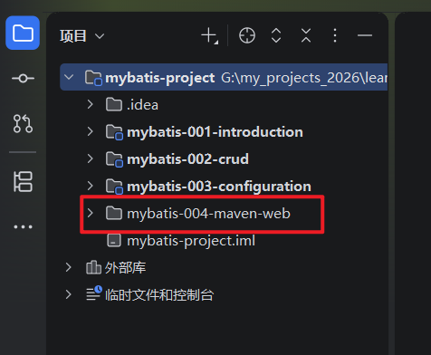


## 2. 我们把这个项目里面的target文件夹删除，修改pom.xml里面的项目id

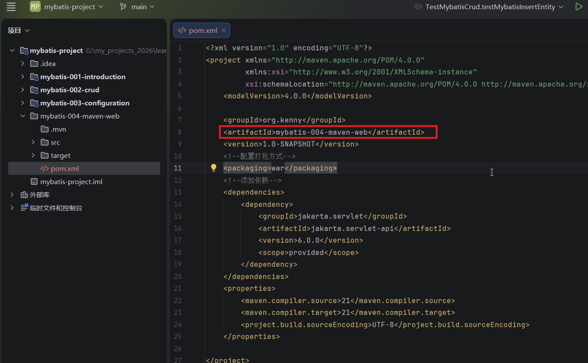

## 3.把以前的代码删除了，然后在idea中在项目的pom.xml文件上面点击右键-》添加为maven项目，此时idea就会识别出来

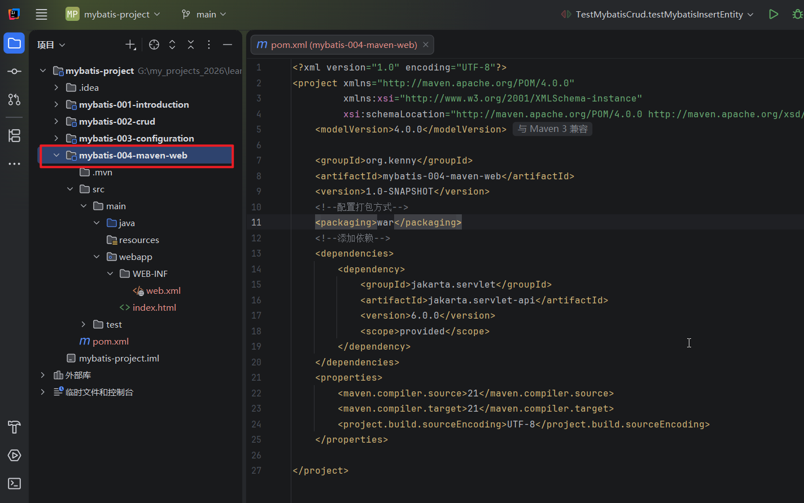

## 4.给项目配置tomcat服务器，也就是部署

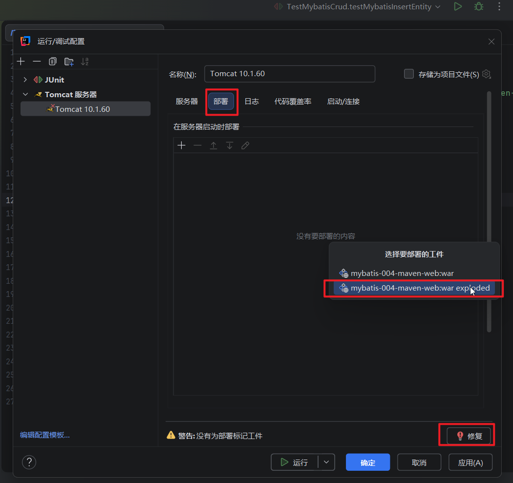

### 把项目部署为/bank

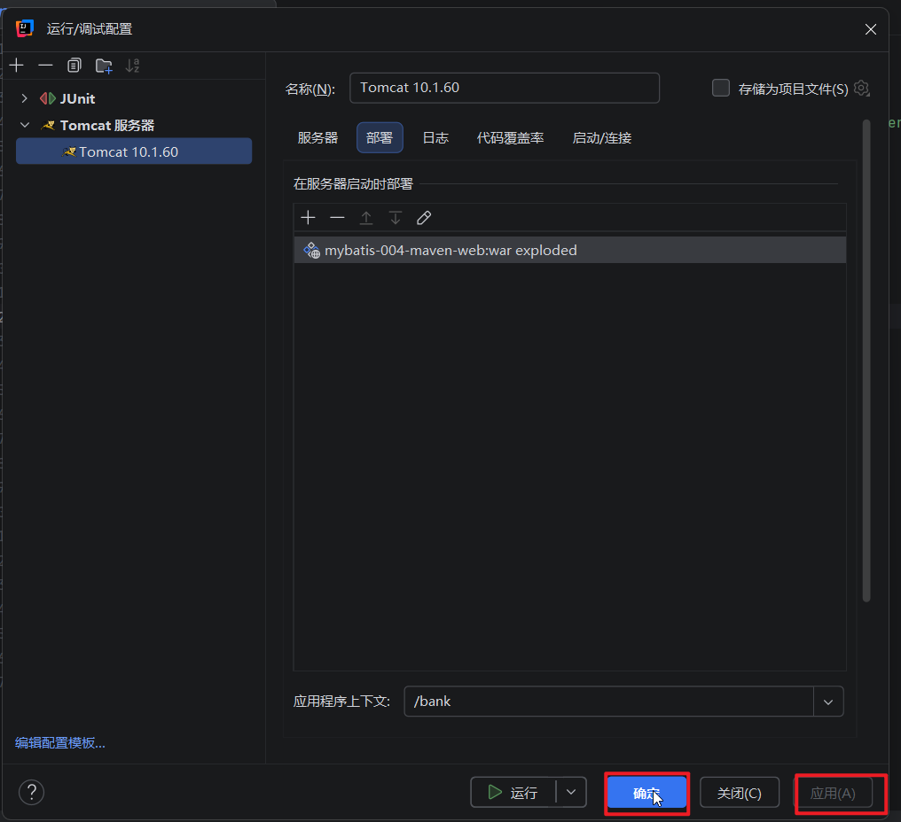

### 测试一下，可以正常定位到/bank

## 5. 接下来需要用点技巧， 我们打开以前的bank项目，在里面打开一个cmd窗口，输入dir，

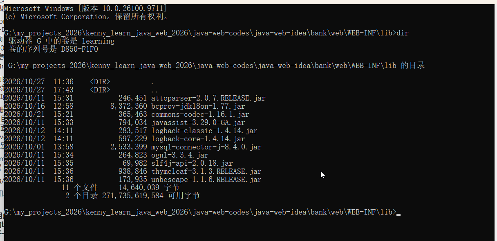

### 然后复制这些文件名，利用chatgpt来批量查找gav坐标，然后覆盖我们的pom文件的dependecies标签，标签刷新maven工具，这样子依赖问题就讲解了

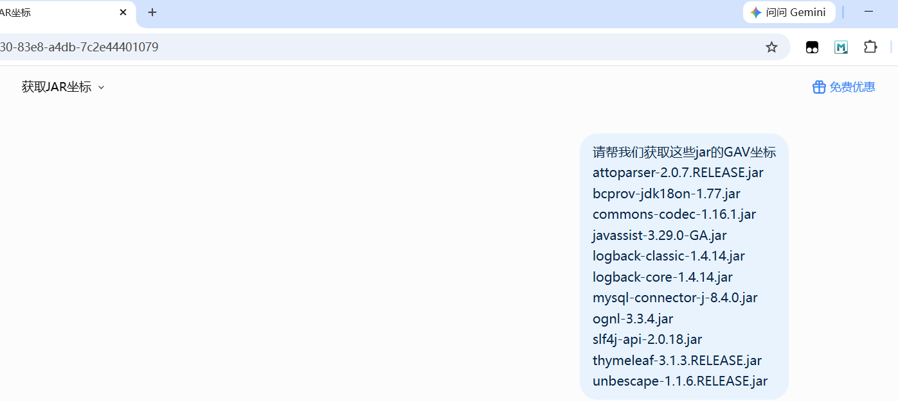

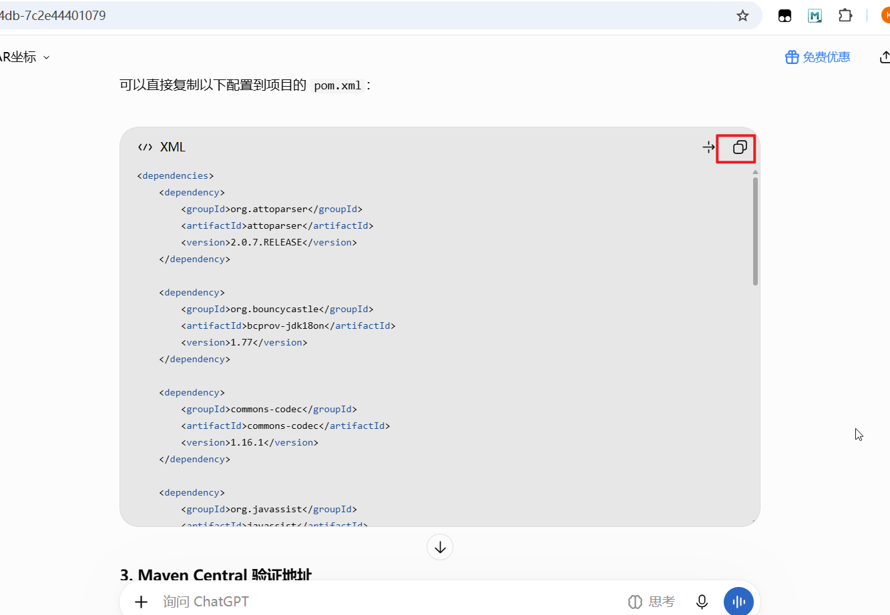

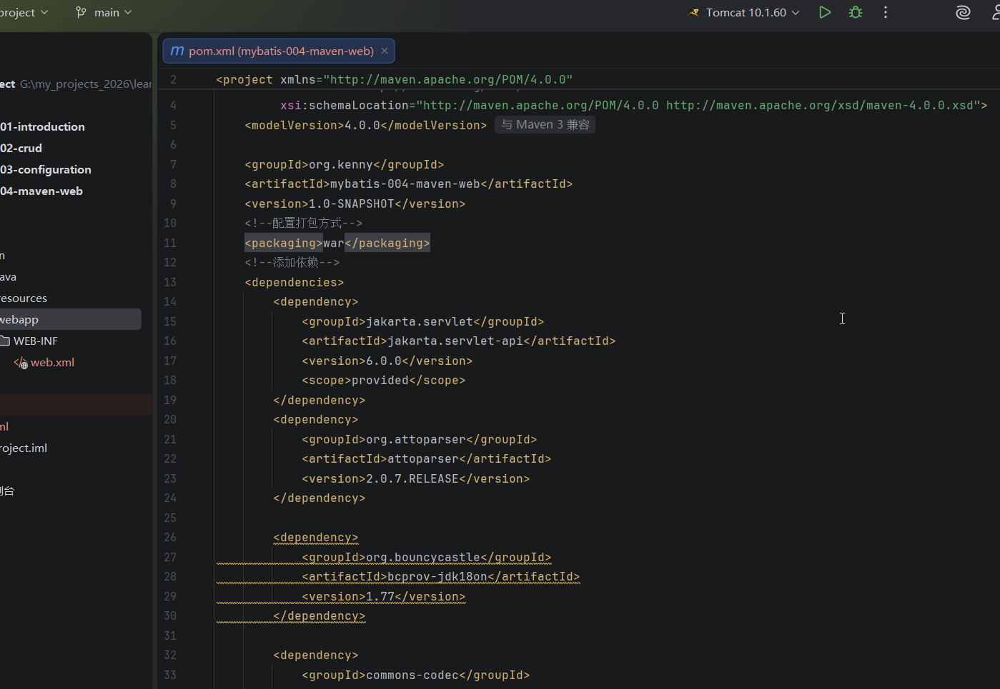

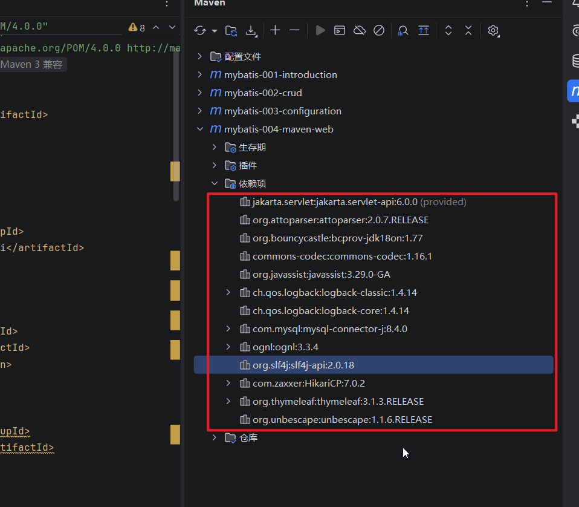

### 修改后的pom.xml文件如下

```
<?xml version="1.0" encoding="UTF-8"?>
<project xmlns="http://maven.apache.org/POM/4.0.0"
         xmlns:xsi="http://www.w3.org/2001/XMLSchema-instance"
         xsi:schemaLocation="http://maven.apache.org/POM/4.0.0 http://maven.apache.org/xsd/maven-4.0.0.xsd">
    <modelVersion>4.0.0</modelVersion>

    <groupId>org.kenny</groupId>
    <artifactId>mybatis-004-maven-web</artifactId>
    <version>1.0-SNAPSHOT</version>
    <!--配置打包方式-->
    <packaging>war</packaging>
    <!--添加依赖-->
    <dependencies>
        <dependency>
            <groupId>jakarta.servlet</groupId>
            <artifactId>jakarta.servlet-api</artifactId>
            <version>6.0.0</version>
            <scope>provided</scope>
        </dependency>
        <dependency>
            <groupId>org.attoparser</groupId>
            <artifactId>attoparser</artifactId>
            <version>2.0.7.RELEASE</version>
        </dependency>

        <dependency>
            <groupId>org.bouncycastle</groupId>
            <artifactId>bcprov-jdk18on</artifactId>
            <version>1.77</version>
        </dependency>

        <dependency>
            <groupId>commons-codec</groupId>
            <artifactId>commons-codec</artifactId>
            <version>1.16.1</version>
        </dependency>

        <dependency>
            <groupId>org.javassist</groupId>
            <artifactId>javassist</artifactId>
            <version>3.29.0-GA</version>
        </dependency>

        <dependency>
            <groupId>ch.qos.logback</groupId>
            <artifactId>logback-classic</artifactId>
            <version>1.4.14</version>
        </dependency>

        <dependency>
            <groupId>ch.qos.logback</groupId>
            <artifactId>logback-core</artifactId>
            <version>1.4.14</version>
        </dependency>

        <dependency>
            <groupId>com.mysql</groupId>
            <artifactId>mysql-connector-j</artifactId>
            <version>8.4.0</version>
            <scope>runtime</scope>
        </dependency>

        <dependency>
            <groupId>ognl</groupId>
            <artifactId>ognl</artifactId>
            <version>3.3.4</version>
        </dependency>

        <dependency>
            <groupId>org.slf4j</groupId>
            <artifactId>slf4j-api</artifactId>
            <version>2.0.18</version>
        </dependency>
        <dependency>
            <groupId>org.thymeleaf</groupId>
            <artifactId>thymeleaf</artifactId>
            <version>3.1.3.RELEASE</version>
        </dependency>

        <dependency>
            <groupId>org.unbescape</groupId>
            <artifactId>unbescape</artifactId>
            <version>1.1.6.RELEASE</version>
        </dependency>
    </dependencies>
    <properties>
        <maven.compiler.source>21</maven.compiler.source>
        <maven.compiler.target>21</maven.compiler.target>
        <project.build.sourceEncoding>UTF-8</project.build.sourceEncoding>
    </properties>

</project>
```

## 6.把bank项目里面的webapp/WEB-INF里面的templates文件状态过来，把web.xml的内容复制粘贴到我们项目的web.xml中，内容如下

```
<?xml version="1.0" encoding="UTF-8"?>
<web-app xmlns="https://jakarta.ee/xml/ns/jakartaee"
         xmlns:xsi="http://www.w3.org/2001/XMLSchema-instance"
         xsi:schemaLocation="https://jakarta.ee/xml/ns/jakartaee
                             https://jakarta.ee/xml/ns/jakartaee/web-app_6_0.xsd"
         version="6.0">

    <welcome-file-list>
        <welcome-file>index</welcome-file>
    </welcome-file-list>

    <!--配置服务器级别的全局异常处理器-->
    <error-page>
        <exception-type>java.lang.Throwable</exception-type>
        <location>/error-handler</location>
    </error-page>
    <error-page>
        <error-code>404</error-code>
        <location>/error-handler</location>
    </error-page>
    <error-page>
        <error-code>500</error-code>
        <location>/error-handler</location>
    </error-page>
    
</web-app>
```

## 7.把bank项目里面的logack.xml配置文件也拿过来，然后把jdbc.properties文件也拿过来，然后把003项目的mybatis-config.xml拿过来，放到main/resources里面

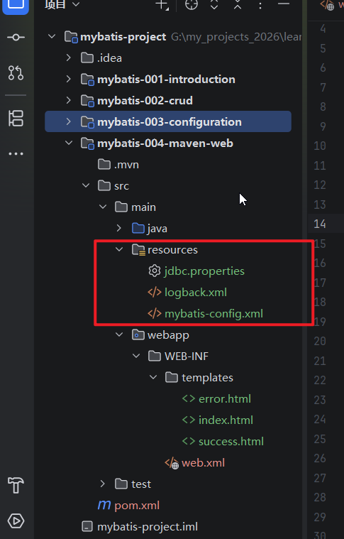

## 8.把bank项目里面的整个org包以及他的子包拿过来，放在main/java里面

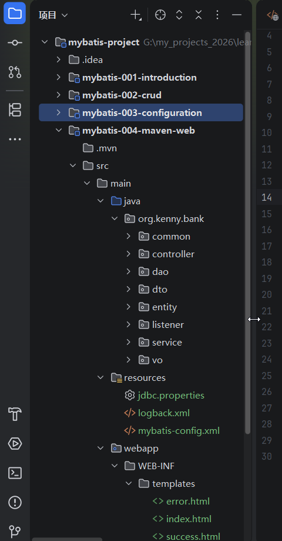


## 9.集成mybatis,首先在pom.xml文件在添加mybatis依赖

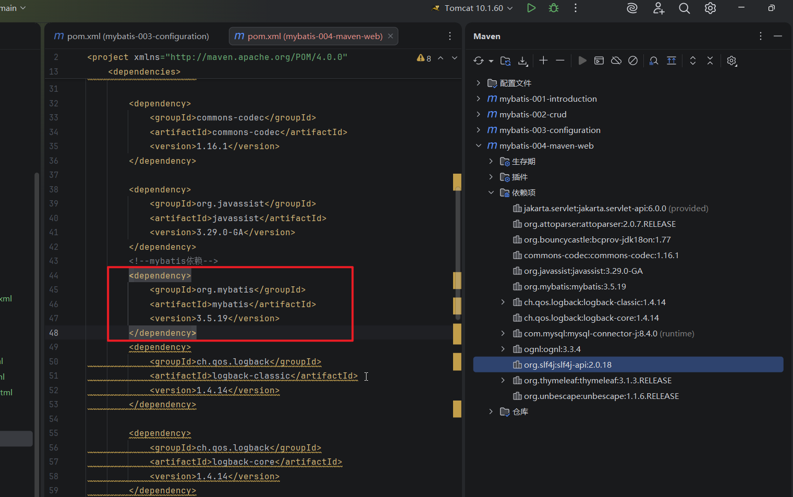

## 10.把company数据库里面的t_act和t_tran数据表复制到mybatis数据库中

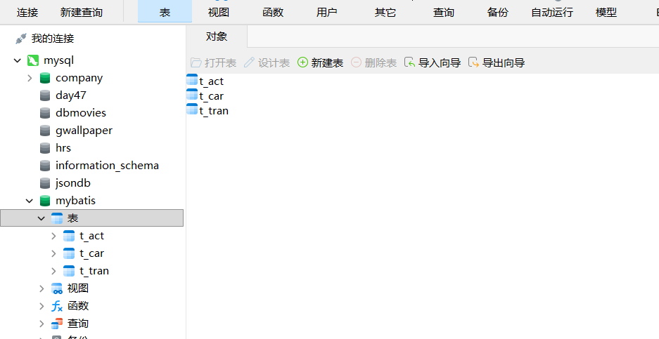

## 11.在main/resources文件夹里面新建一个文件夹org/kenny/bank/dao文件夹（注意创建的时候输入org/kenny/bank/dao，在idea里面显示和包类似，但是不是包，因为它上面没有小圆圈），然后在里面AccountMapper.xml,内容如下

```
<?xml version="1.0" encoding="UTF-8" ?>
<!DOCTYPE mapper
        PUBLIC "-//mybatis.org//DTD Mapper 3.0//EN"
        "https://mybatis.org/dtd/mybatis-3-mapper.dtd">
<mapper namespace="Account">
   <select id="selectByActNo" resultType="org.kenny.bank.entity.Account">
       select id,act_no as ActNo,balance from t_act where act_no=#{actNo}
   </select>

    <update id="updateByActNo" parameterType="org.kenny.bank.entity.Account">
        update t_act set balance=#{balance} where act_no=#{actNo}
    </update>
</mapper>
```

## 12.在main/resources/org/kenny/bank/dao文件夹里面新建一个TranMapper.xml文件，内容如下

```
<?xml version="1.0" encoding="UTF-8" ?>
<!DOCTYPE mapper
        PUBLIC "-//mybatis.org//DTD Mapper 3.0//EN"
        "https://mybatis.org/dtd/mybatis-3-mapper.dtd">
<mapper namespace="Tran">
    <insert id="insertTran" parameterType="org.kenny.bank.entity.Tran">
        insert into
             t_tran(from_act_no,to_act_no,amount,tran_time,tran_no)
        values
             (#{fromActNo},#{toActNo},#{amount},NOW(),#{tranNo})
    </insert>
</mapper>
```

## 13.然后我们在mybatis-config.xml文件里面把这两个sqlMapper配置进来

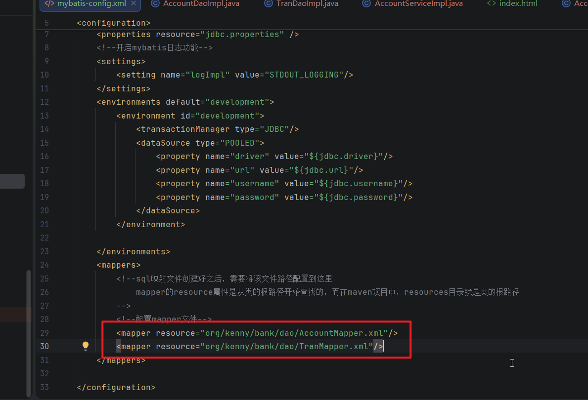

## 14.把002项目的SqlSessionUtil粘贴过来

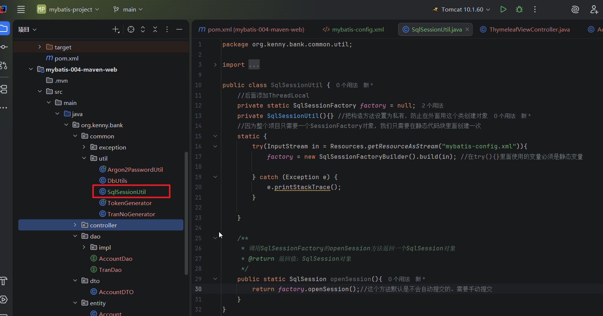

## 15.然后我们来修改AccountDaoImpl类的代码，非常简洁，修改后代码如下

```
package org.kenny.bank.dao.impl;

import org.apache.ibatis.session.SqlSession;
import org.kenny.bank.common.exception.DataAccessException;
import org.kenny.bank.common.util.DbUtils;
import org.kenny.bank.common.util.SqlSessionUtil;
import org.kenny.bank.dao.AccountDao;
import org.kenny.bank.entity.Account;
import org.slf4j.Logger;
import org.slf4j.LoggerFactory;

import java.math.BigDecimal;
import java.sql.Connection;
import java.sql.PreparedStatement;
import java.sql.ResultSet;


public class AccountDaoImpl implements AccountDao {
    //定义一个日志记录器
    private  static final Logger logger = LoggerFactory.getLogger(AccountDaoImpl.class);

    @Override
    public Account selectByAcctNo(String accNo) {
        try{
             SqlSession sqlSession = SqlSessionUtil.openSession();
             Account  account = (Account)sqlSession.selectOne("selectByActNo", accNo);
             return account;
        } catch (Exception e) {
            e.printStackTrace();
            //记录日志
            logger.error("查询账号{}查询账户信息异常",accNo);
            //将异常转化为自定义数据访问异常，往上抛
            throw new DataAccessException("查询账号"+accNo+"查询账户信息异常",e);
        }
    }

    @Override
    public int updateBalance(Account newAccount) {
        try{
            SqlSession sqlSession = SqlSessionUtil.openSession();
            return sqlSession.update("updateByActNo", newAccount);
        } catch (Exception e) {
            e.printStackTrace();
            //记录日志
            logger.error("更新账户{}余额异常",newAccount.getActNo());
            //将异常转化为自定义数据访问异常，往上抛
            throw new DataAccessException("更新账号"+newAccount.getActNo()+"查询账户余额异常",e);
        }

    }
}

```

## 16.然后我们来修改TranDaoImpl类的代码，修改后的代码如下

```
package org.kenny.bank.dao.impl;

import org.apache.ibatis.session.SqlSession;
import org.kenny.bank.common.exception.DataAccessException;
import org.kenny.bank.common.util.DbUtils;
import org.kenny.bank.common.util.SqlSessionUtil;
import org.kenny.bank.dao.TranDao;
import org.kenny.bank.entity.Tran;
import org.slf4j.Logger;
import org.slf4j.LoggerFactory;

import java.sql.Connection;
import java.sql.PreparedStatement;
import java.sql.Timestamp;
import java.time.LocalDateTime;

public class TranDaoImpl implements TranDao {
    private static final Logger logger= LoggerFactory.getLogger(TranDaoImpl.class);
    @Override
    public int insert(Tran record) {
        try{
            SqlSession sqlSession = SqlSessionUtil.openSession();
            return sqlSession.insert("insertTran", record);
        } catch (Exception e) {
            e.printStackTrace();
            //记录日志
            logger.error("保存转账记录错误,详情：转出账号{}到转入账号{}，交易金额{}，交易时间{}，交易流水号{}",
                    record.getFromActNo(), record.getToActNo(), record.getAmount(),record.getTranTime(), record.getTranNo());
            //把异常封装后往上抛
            throw new DataAccessException("保存转账记录错误",e);
        }

    }
}

```

## 17.把AccountServiceImpl的代码修改一下，修改后如图，注意这里暂时没有开启事务功能

```
package org.kenny.bank.service.impl;

import org.apache.ibatis.session.SqlSession;
import org.kenny.bank.common.exception.BusinessException;
import org.kenny.bank.common.util.SqlSessionUtil;
import org.kenny.bank.common.util.TranNoGenerator;
import org.kenny.bank.dao.AccountDao;
import org.kenny.bank.dao.TranDao;
import org.kenny.bank.dao.impl.AccountDaoImpl;
import org.kenny.bank.dao.impl.TranDaoImpl;
import org.kenny.bank.dto.AccountDTO;
import org.kenny.bank.entity.Account;
import org.kenny.bank.entity.Tran;
import org.kenny.bank.service.AccountService;
import org.slf4j.Logger;
import org.slf4j.LoggerFactory;

import java.time.LocalDateTime;

public class AccountServiceImpl implements AccountService {
    //定义一个日志记录器
    private static final Logger logger = LoggerFactory.getLogger(AccountServiceImpl.class);
    //定义dao实例对象
    private AccountDao accountDao = new AccountDaoImpl();
    private TranDao tranDao = new TranDaoImpl();
    //核心转账方法实现
    //必须在这里控制事务
    @Override
    public Tran transfer(AccountDTO accountDTO) {
        //重要的操作最好做日志记录
        logger.info("开始转账，从{}向{}转账{}",accountDTO.getFromAccount(),accountDTO.getToAccount(),accountDTO.getAmount());

        Tran tran=null;
        try(SqlSession sqlSession = SqlSessionUtil.openSession()){
            try{
                //执行核心业务
                //1.查询转出账户的信息，看看余额是否充足
                Account fromAcc = accountDao.selectByAcctNo(accountDTO.getFromAccount());
                //如果余额不足
                if(fromAcc.getBalance().compareTo(accountDTO.getAmount()) < 0){
                    //记录日志
                    logger.warn("{}账户余额不足",accountDTO.getFromAccount());
                    //抛异常
                    throw new BusinessException("BALANCE_NOT_ENOUGH","账户余额不足");
                }
                //2.查询转入账户的信息
                Account toAcc = accountDao.selectByAcctNo(accountDTO.getToAccount());
                //3.更新转出账户的余额
                fromAcc.setBalance(fromAcc.getBalance().subtract(accountDTO.getAmount()));
                int count = accountDao.updateBalance(fromAcc); //更新之后需要保存到数据库
                if(count != 1){ //更新失败
                    logger.warn("更新转出账户失败"); //记录日志
                    //抛异常
                    throw new BusinessException("BALANCE_UPDATE_FAIL","更新转出账户余额失败");
                }


                //4.更新转入账户的余额
                toAcc.setBalance(toAcc.getBalance().add(accountDTO.getAmount()));
                count += accountDao.updateBalance(toAcc);
                if(count != 2){ //更新失败
                    logger.warn("更新转入账户失败"); //记录日志
                    //抛异常
                    throw new BusinessException("BALANCE_UPDATE_FAIL","更新转入账户余额失败");
                }
                //5.保存转账记录
                String tranNo = TranNoGenerator.generate();
                tran = new Tran(accountDTO.getFromAccount(),accountDTO.getToAccount(),
                        accountDTO.getAmount(),LocalDateTime.now(),tranNo);
                count += tranDao.insert(tran);

                if(count != 3){
                    logger.warn("保存转账记录失败"); //记录日志
                    //抛异常
                    throw new BusinessException("INSERT_TRAN_FAIL","保存转账记录失败");
                }

                //提交事务,最好也做一下日志记录
                logger.info("转账成功，从{}向{}转账{}",accountDTO.getFromAccount(),accountDTO.getToAccount(),accountDTO.getAmount());
                sqlSession.commit();
            }  catch (Exception e) {
                e.printStackTrace();
                throw new BusinessException("TRANSFER_ERROR","转账失败");
            } finally {
                //关闭数据库连接,需要在DbUtils里面添加一个新的close方法，只需要一个Connection参数

            }
        } catch (Exception e) {
            throw new BusinessException("TRANSFER_ERROR","转账失败");
        }

        return tran;
    }
}

```

## 18.启动服务器可以正常打开转账页面

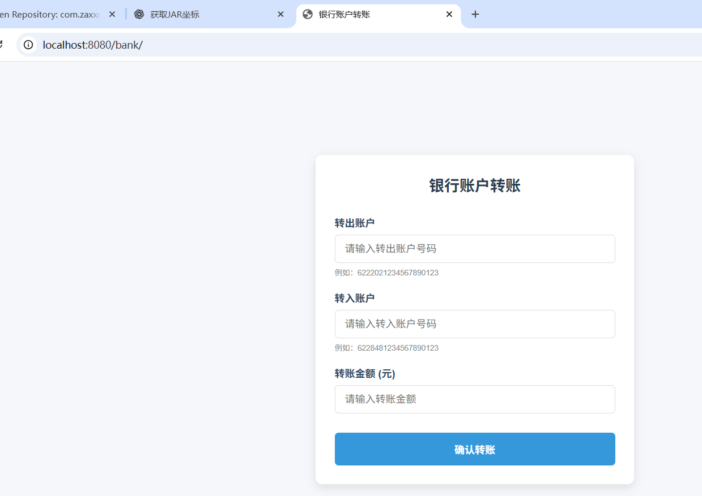


## 19.先查看一下账户情况，第一个账户有50000元，第二个账户没有钱

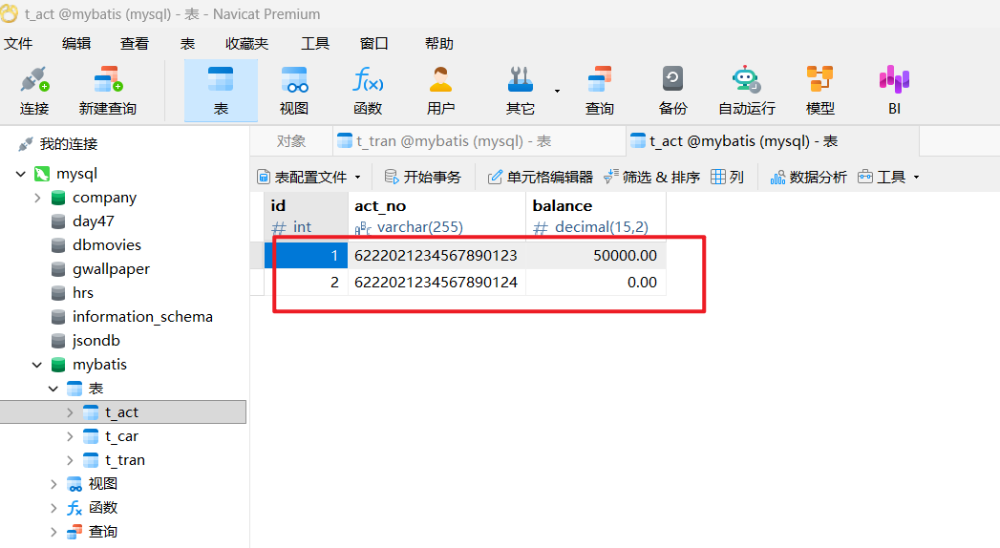

## 20.填写表，从第一个账户转10000元到第二个账户，单然后提交


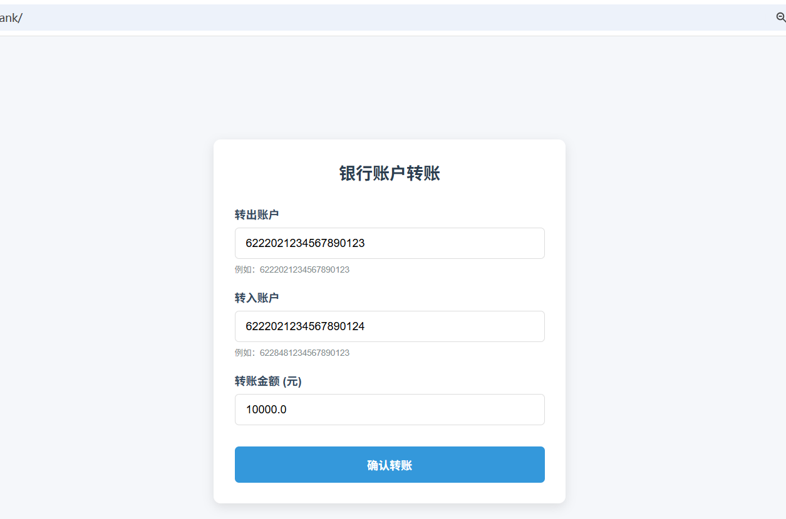


## 21.发现转账失败

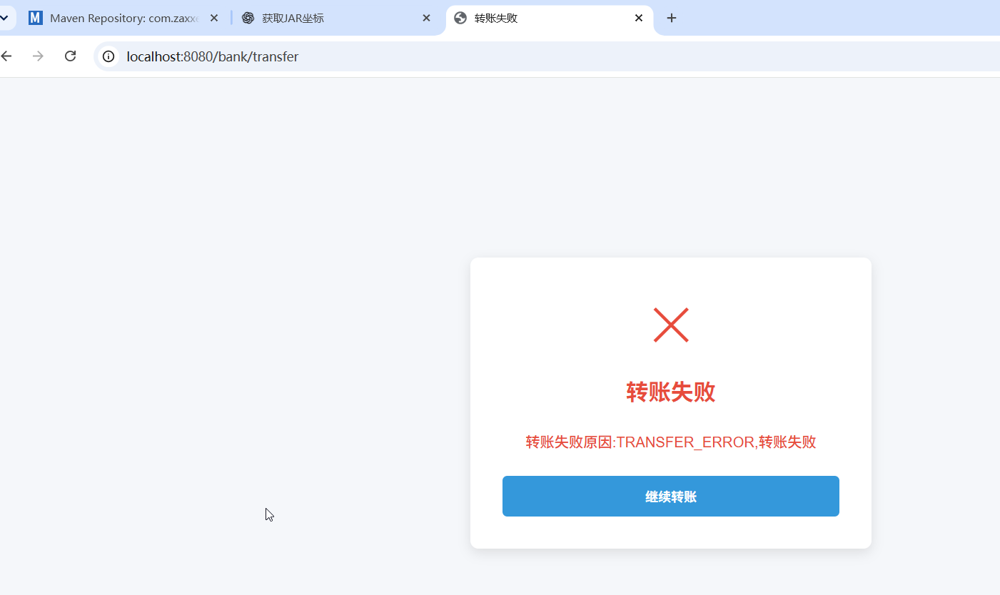


## 22.排除了几个sql语句错误后，又报一个新错误，说锁超时了

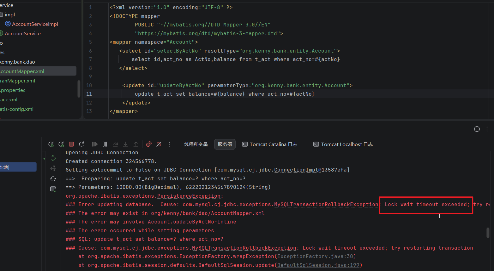

## 23.修改一下AccountDaoImpl里面的代码，把sqlSession放在try()的括号里面，修改后的代码如下

```
package org.kenny.bank.dao.impl;

import org.apache.ibatis.session.SqlSession;
import org.kenny.bank.common.exception.DataAccessException;
import org.kenny.bank.common.util.SqlSessionUtil;
import org.kenny.bank.dao.AccountDao;
import org.kenny.bank.entity.Account;
import org.slf4j.Logger;
import org.slf4j.LoggerFactory;


public class AccountDaoImpl implements AccountDao {
    //定义一个日志记录器
    private  static final Logger logger = LoggerFactory.getLogger(AccountDaoImpl.class);

    @Override
    public Account selectByAcctNo(String accNo) {
        try(SqlSession sqlSession = SqlSessionUtil.openSession();){
             Account  account = (Account)sqlSession.selectOne("selectByActNo", accNo);
             return account;
        } catch (Exception e) {
            e.printStackTrace();
            //记录日志
            logger.error("查询账号{}查询账户信息异常",accNo);
            //将异常转化为自定义数据访问异常，往上抛
            throw new DataAccessException("查询账号"+accNo+"查询账户信息异常",e);
        }
    }

    @Override
    public int updateBalance(Account newAccount) {
        try( SqlSession sqlSession = SqlSessionUtil.openSession()){
            return sqlSession.update("updateByActNo", newAccount);
        } catch (Exception e) {
            e.printStackTrace();
            //记录日志
            logger.error("更新账户{}余额异常",newAccount.getActNo());
            //将异常转化为自定义数据访问异常，往上抛
            throw new DataAccessException("更新账号"+newAccount.getActNo()+"查询账户余额异常",e);
        }

    }
}

```

## 24.把TranDaoImpl的代码也修改一下

```
package org.kenny.bank.dao.impl;

import org.apache.ibatis.session.SqlSession;
import org.kenny.bank.common.exception.DataAccessException;
import org.kenny.bank.common.util.SqlSessionUtil;
import org.kenny.bank.dao.TranDao;
import org.kenny.bank.entity.Tran;
import org.slf4j.Logger;
import org.slf4j.LoggerFactory;

public class TranDaoImpl implements TranDao {
    private static final Logger logger= LoggerFactory.getLogger(TranDaoImpl.class);
    @Override
    public int insert(Tran record) {
        try( SqlSession sqlSession = SqlSessionUtil.openSession();){
            return sqlSession.insert("insertTran", record);
        } catch (Exception e) {
            e.printStackTrace();
            //记录日志
            logger.error("保存转账记录错误,详情：转出账号{}到转入账号{}，交易金额{}，交易时间{}，交易流水号{}",
                    record.getFromActNo(), record.getToActNo(), record.getAmount(),record.getTranTime(), record.getTranNo());
            //把异常封装后往上抛
            throw new DataAccessException("保存转账记录错误",e);
        }

    }
}

```

## 25.重启服务器，再做一次转账

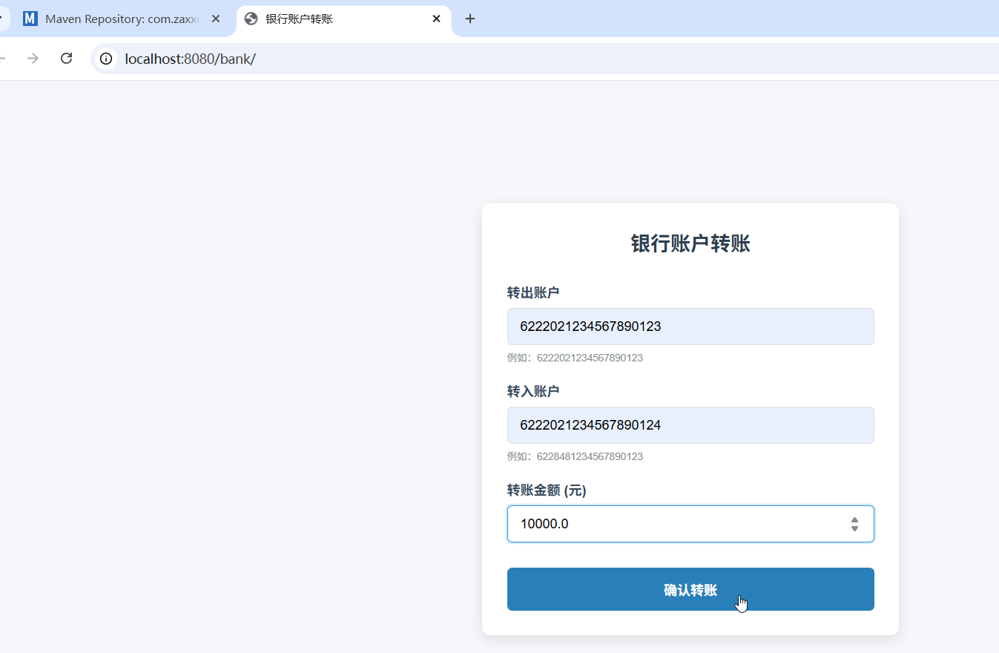


## 26.页面说转账成功

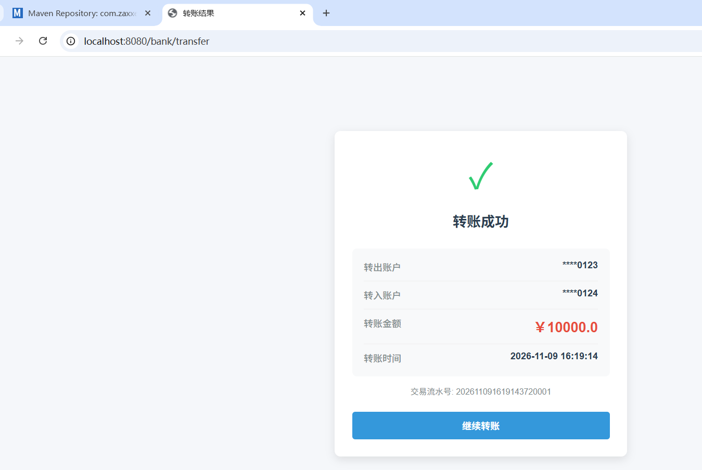

## 27.刷新数据库，发现数据没有变化？为什么会这样？

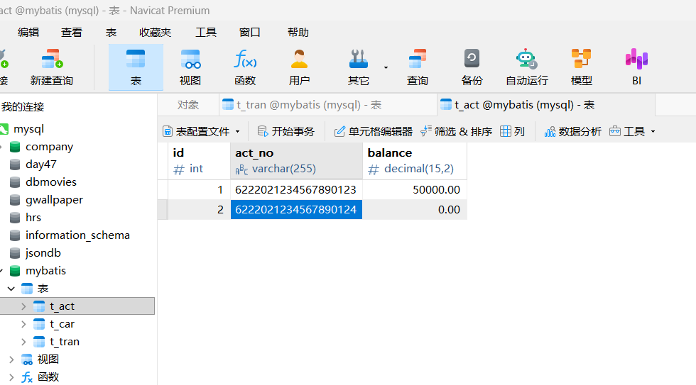

## 28.原因是我们的代码根本没有提交。我们先修改AccountDaoImpl的代码，修改后如下

```
package org.kenny.bank.dao.impl;

import org.apache.ibatis.session.SqlSession;
import org.kenny.bank.common.exception.DataAccessException;
import org.kenny.bank.common.util.SqlSessionUtil;
import org.kenny.bank.dao.AccountDao;
import org.kenny.bank.entity.Account;
import org.slf4j.Logger;
import org.slf4j.LoggerFactory;


public class AccountDaoImpl implements AccountDao {
    //定义一个日志记录器
    private  static final Logger logger = LoggerFactory.getLogger(AccountDaoImpl.class);

    @Override
    public Account selectByAcctNo(String accNo) {
        try(SqlSession sqlSession = SqlSessionUtil.openSession();){
             Account  account = (Account)sqlSession.selectOne("selectByActNo", accNo);
             return account;
        } catch (Exception e) {
            e.printStackTrace();
            //记录日志
            logger.error("查询账号{}查询账户信息异常",accNo);
            //将异常转化为自定义数据访问异常，往上抛
            throw new DataAccessException("查询账号"+accNo+"查询账户信息异常",e);
        }
    }

    @Override
    public int updateBalance(Account newAccount) {
        try( SqlSession sqlSession = SqlSessionUtil.openSession()){
            int count = sqlSession.update("updateByActNo", newAccount);
            sqlSession.commit();//必须提交，否则数据库的数据不会改变。
            return count;
        } catch (Exception e) {
            e.printStackTrace();
            //记录日志
            logger.error("更新账户{}余额异常",newAccount.getActNo());
            //将异常转化为自定义数据访问异常，往上抛
            throw new DataAccessException("更新账号"+newAccount.getActNo()+"查询账户余额异常",e);
        }

    }
}

```

## 29.然后再修改一下TranDaoImpl的代码，修改后代码如下

```
package org.kenny.bank.dao.impl;

import org.apache.ibatis.session.SqlSession;
import org.kenny.bank.common.exception.DataAccessException;
import org.kenny.bank.common.util.SqlSessionUtil;
import org.kenny.bank.dao.TranDao;
import org.kenny.bank.entity.Tran;
import org.slf4j.Logger;
import org.slf4j.LoggerFactory;

public class TranDaoImpl implements TranDao {
    private static final Logger logger= LoggerFactory.getLogger(TranDaoImpl.class);
    @Override
    public int insert(Tran record) {
        try( SqlSession sqlSession = SqlSessionUtil.openSession();){
            int count = sqlSession.insert("insertTran", record);
            sqlSession.commit(); //需要提交
            return count;
        } catch (Exception e) {
            e.printStackTrace();
            //记录日志
            logger.error("保存转账记录错误,详情：转出账号{}到转入账号{}，交易金额{}，交易时间{}，交易流水号{}",
                    record.getFromActNo(), record.getToActNo(), record.getAmount(),record.getTranTime(), record.getTranNo());
            //把异常封装后往上抛
            throw new DataAccessException("保存转账记录错误",e);
        }

    }
}

```

## 30.重启服务器，再来转账一次

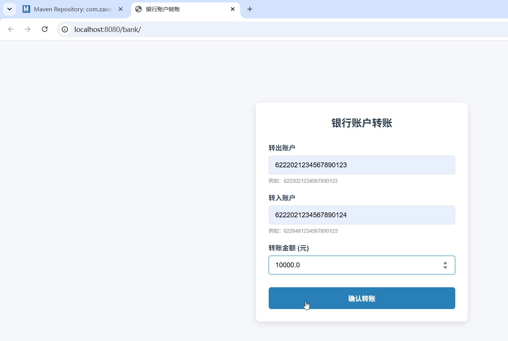

## 31.页面上说转账成功

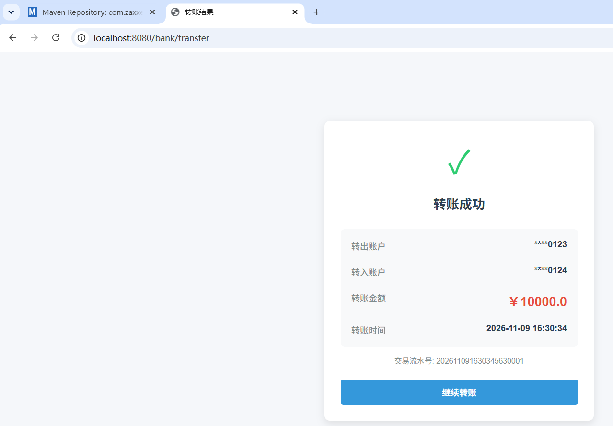

## 32.刷新数据库，发现的确转账成功

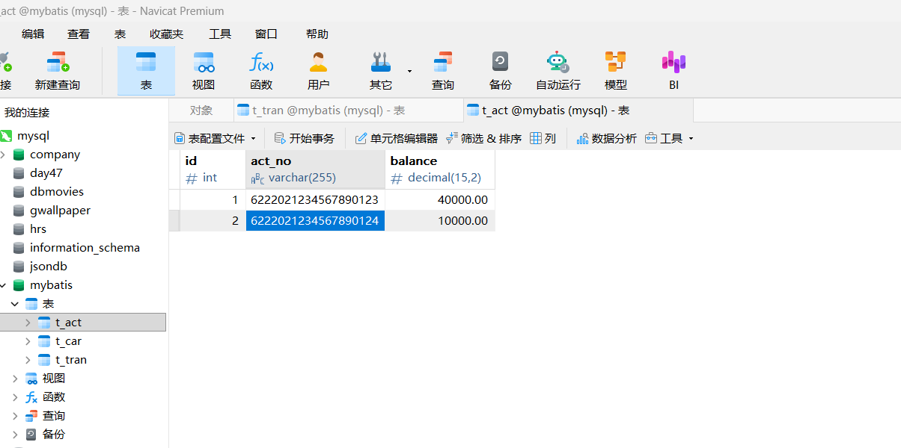

# 演练2.开启事务功能，通过使用ThreadLocal类来实现

在继续编程之前，我们需要搞清楚一点，就是mybatis那几个常用对象的生命周期，SqlSessionFactoryBuilder只是用来创建SqlSessionFactory的，一旦创建完毕，它就没有用了。可以丢弃。SqlSessionFactory需要在程序运行期间一直存在，不能随便丢弃，也不能随便创建实例。也就是相当于单例模式。重复创建SqlSessionFactory对象是一种“坏习惯”。SqlSession是线程不安全的。每一个线程都应该有自己的SqlSession对象而不要和其他线程共享SqlSession对象。SqlSession对象需要绑定到ThreadLocal中

## 2.1继续使用这个项目，回到SqlSessionUtil类中，创建一个ThreadLocal对象

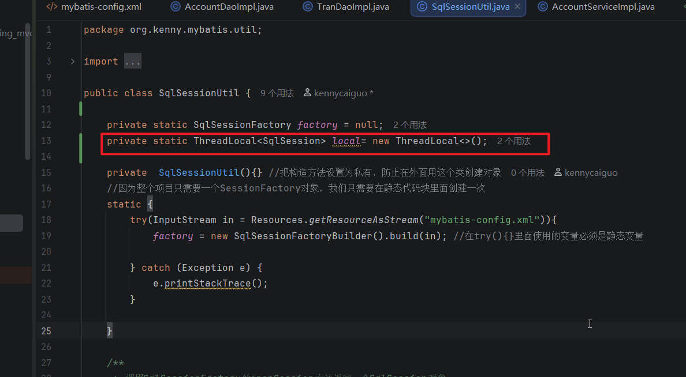

### 2.2我们先来模拟一下异常，看看修改之前的代码有什么问题

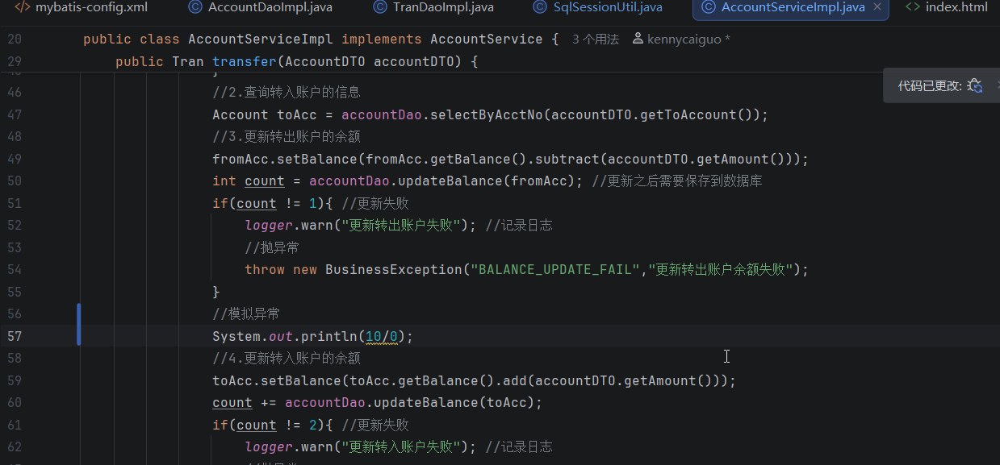

### 2.3在运行程序之前，我们先看看数据库，现在是一个账户有40000元另外一个账户有10000元。

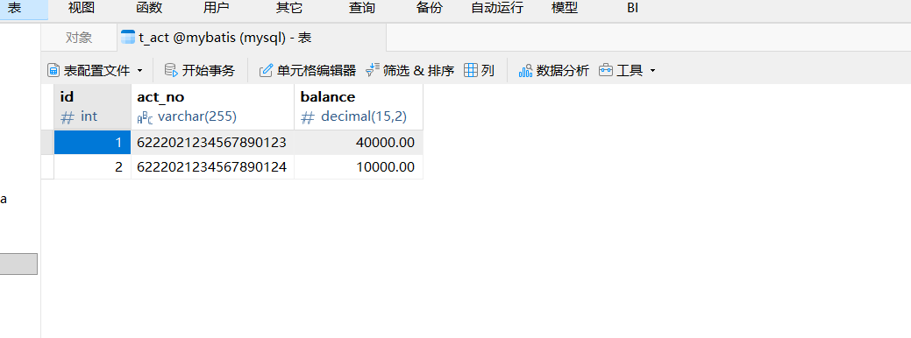

## 2.4 启动服务器，做一次转账

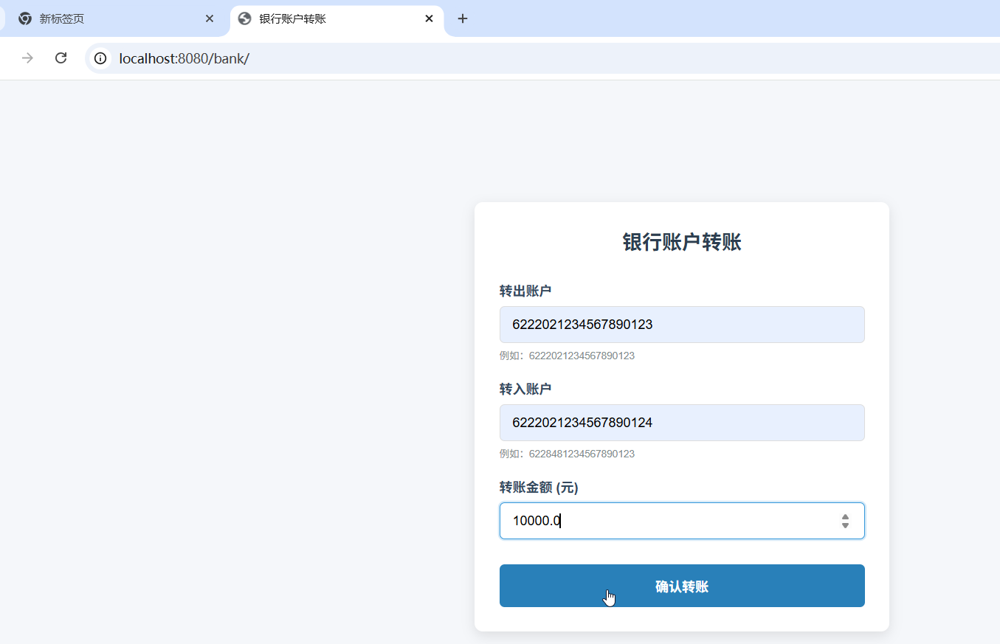

## 2.5此时页面说转账失败

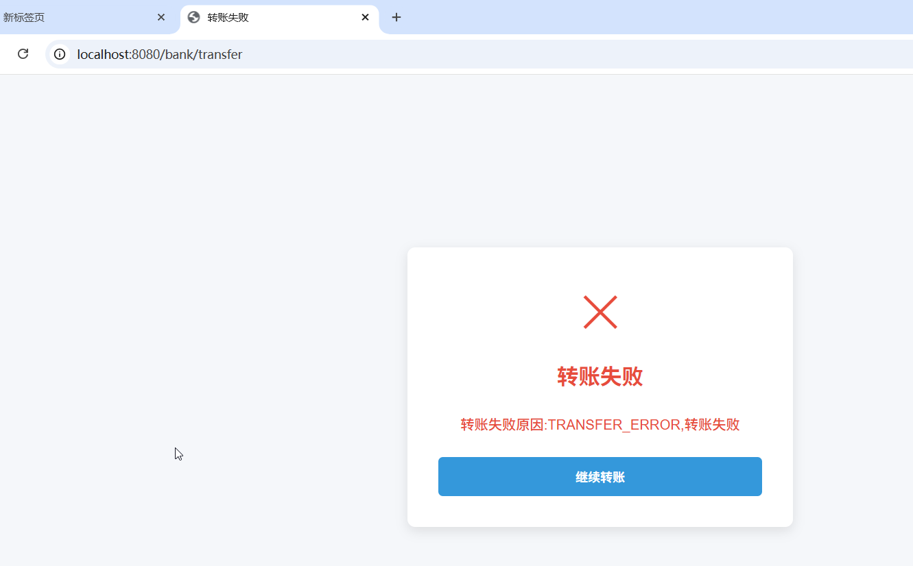

## 2.6我们来刷新数据库，发现第一个账户亏了10000元，另外一个账户没有变化

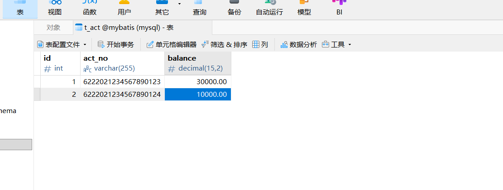

## 2.7 然后我们修改一下创建SqlSession对象的方法，把它绑定到ThreadLocal中

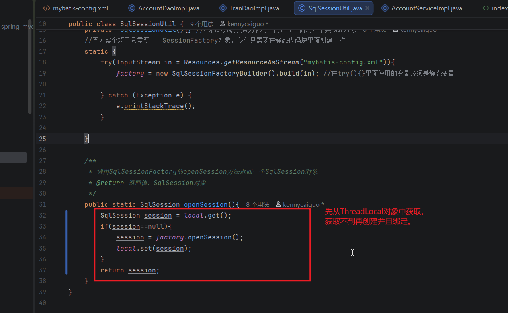

## 2.8我们先不移除移除代码，重启服务器再来做一次转账


## 2.9此外我们还需要修改一下dao中的代码，因为我们现在在service里面的seqlSession对象和这里的sqlSession对象是同一个对象，我们在service里面提交和不好异常所以这里也不需要捕获异常

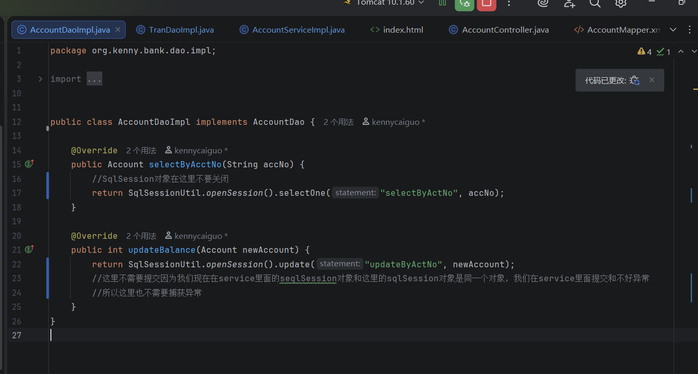

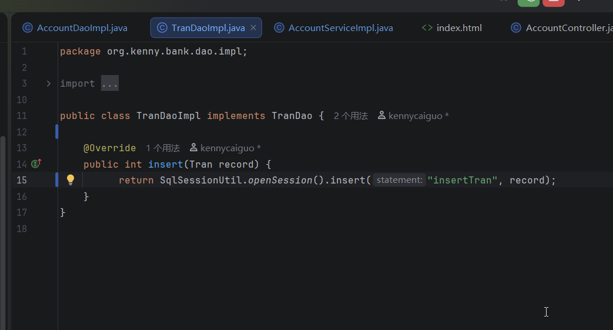

## 2.10此时转账还是会失败

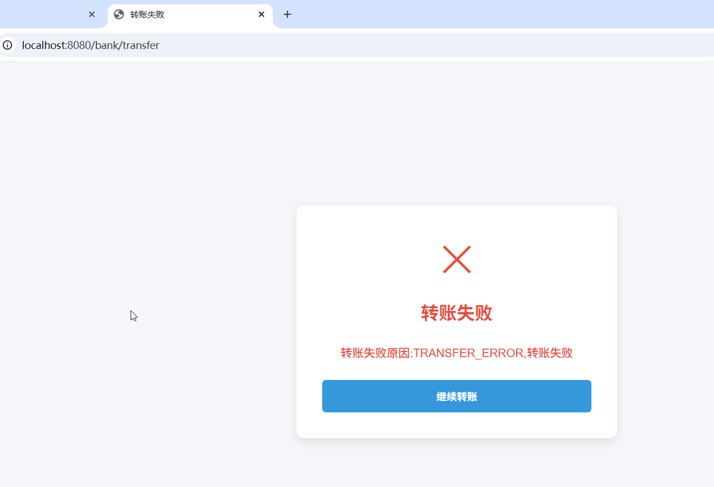

## 2.11查看数据库，发现没有程序亏钱的现象了

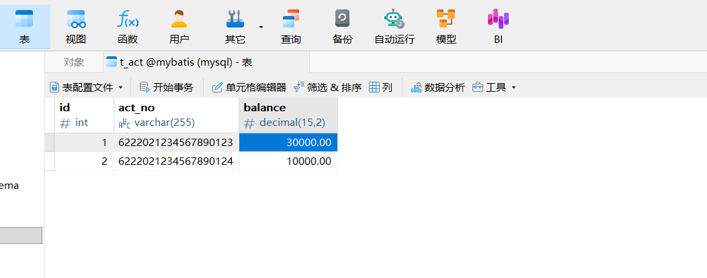

## 2.12，我们把异常代码移除，再来做一次转账

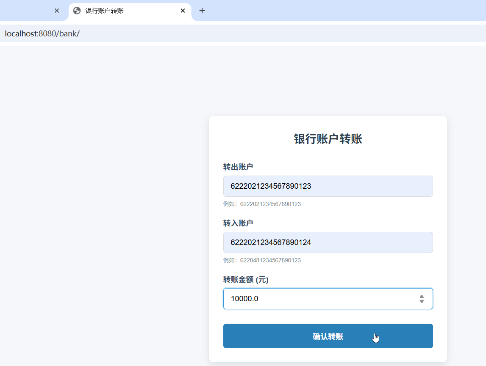

## 2.13页面说转账成功

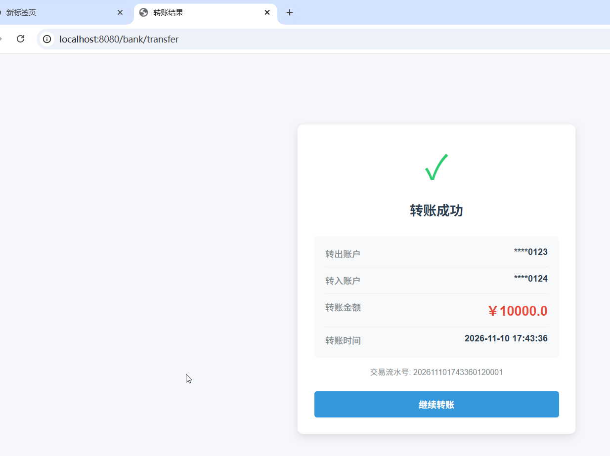

## 2.14查看数据库，发现转账成功

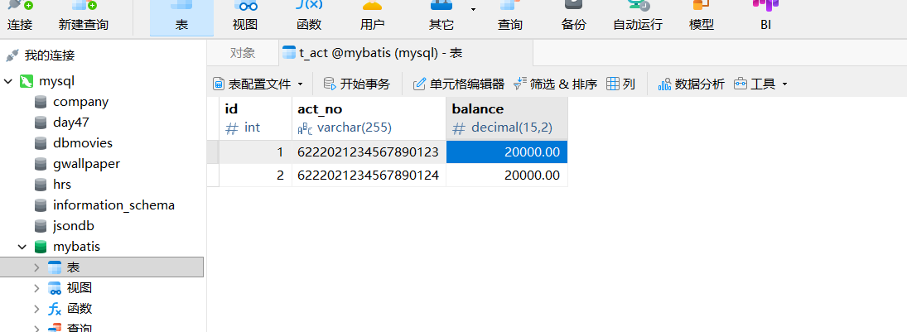
