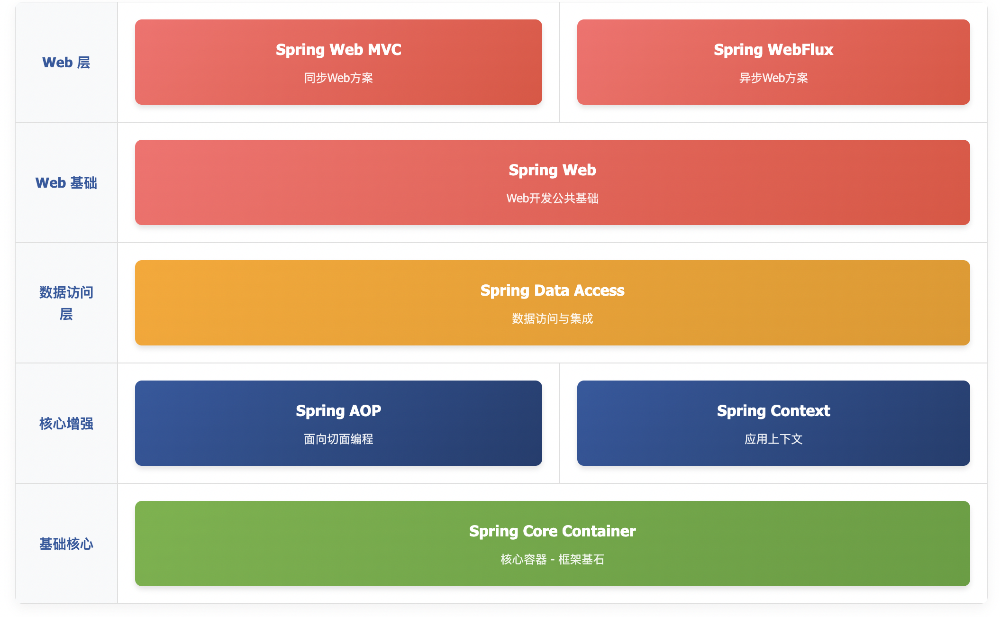
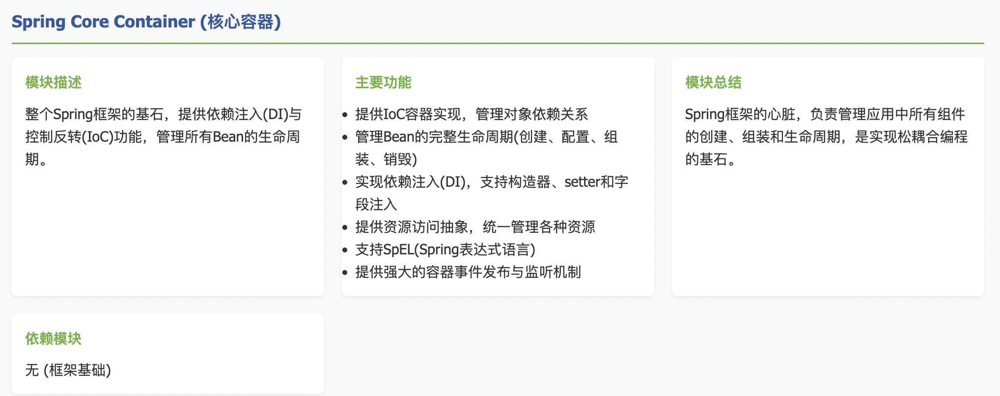
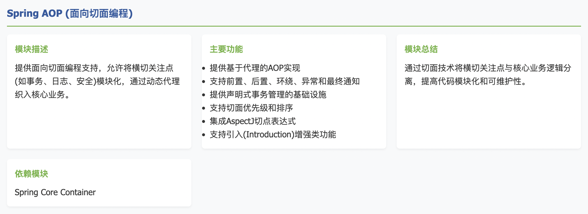
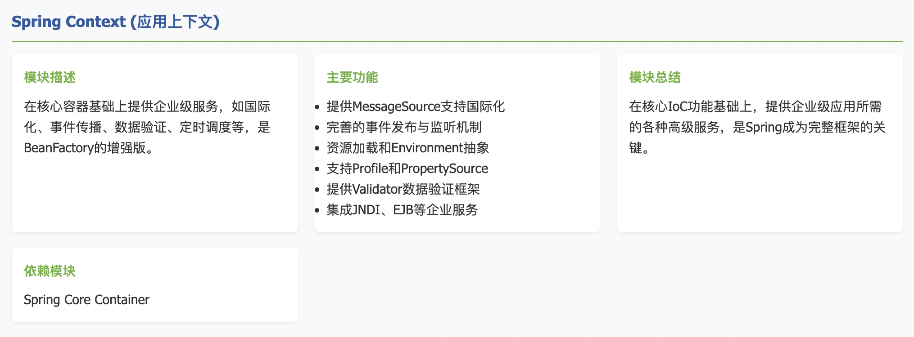
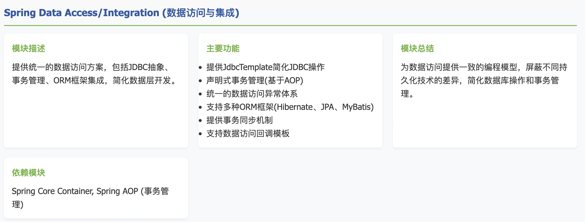
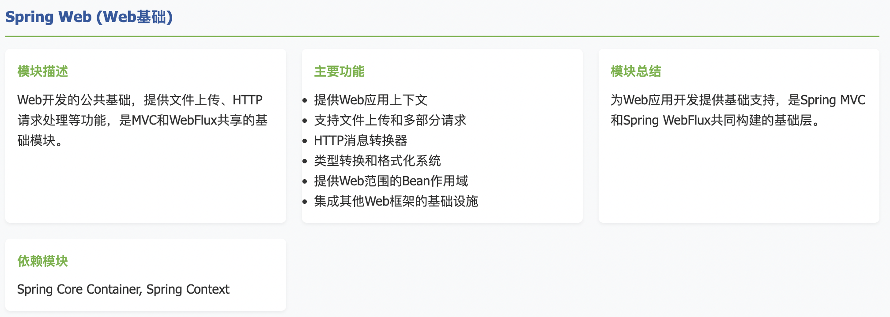
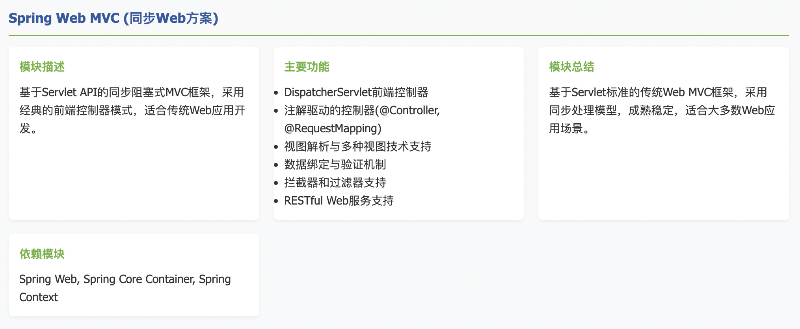
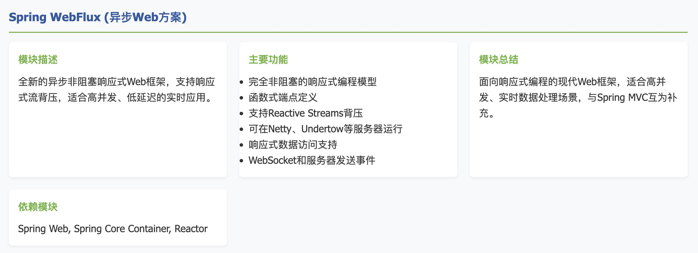

# Spring概述

## 1.Spring简介


来自百度百科

> <font style="color:rgb(15, 17, 21);">Spring是一个由Rod Johnson创建的开源框架，其核心目标是简化复杂的企业级应用开发。通过提供</font>**<font style="color:#DF2A3F;">简单性、可测试性与松耦合性</font>**<font style="color:rgb(15, 17, 21);">这三大特性，它能让任何Java应用的开发都变得更加高效和优雅。</font>
>
> **<font style="color:#E8323C;">Spring是一个轻量级的控制反转(IoC)和面向切面(AOP)的容器框架。</font>**
>
> **<font style="color:#E8323C;">Spring最初的出现是为了解决EJB臃肿的设计，以及难以测试等问题。</font>**
>
> **<font style="color:#E8323C;">Spring为简化开发而生，让程序员只需关注核心业务的实现，尽可能的不再关注非业务逻辑代码（事务控制，安全日志等）。</font>**

**<font style="color:#E8323C;"></font>**

## 2.Spring 的 7 个模块,spring本身也提供了orm，如JdbcTemplate，SpringData jpa等等

















**<font style="color:rgb(15, 17, 21);">背压就是：当下游消费者处理速度跟不上上游生产者时，下游主动向上游喊"慢点发，我处理不过来"，上游收到信号后减慢发送速度的一种流量控制机制。</font>**

**<font style="color:rgb(15, 17, 21);">传统方式：</font>**<font style="color:rgb(15, 17, 21);">上游猛发，下游硬接，接不住就崩溃（OOM）</font>

**<font style="color:rgb(15, 17, 21);">响应式流+背压</font>**<font style="color:rgb(15, 17, 21);">：下游说"慢点"，上游乖乖减速</font>

```java
// 传统 JDBC 方式（没有背压）一次性查出 100 万条数据
List<User> users = userMapper.selectAll();
// 内存直接爆了！这就是“上游猛发，下游硬接”
```

```java
// WebFlux（支持背压）数据一条一条流过来
Flux<User> users = userRepository.findAll(); 
users.subscribe(user -> {
    // 处理一条，再要下一条
    // 下游说“慢慢来，我能处理多少你给我多少”
});
```

## 3.web 同步与 web 异步的区别

Spring Web MVC 是同步方案。Spring WebFlux 是异步方案。它们的区别是：

***

**想象一个异步文件下载：**

**1. 传统同步方式 (MVC):**

```java
// 线程会停在这里等待，直到文件下载完成
byte[] data = downloadFileFromNetwork("http://example.com/file");
// 下载完成后，才继续执行这里
return data;
```

**2. WebFlux方式 (基于回调):**

```java
// 立即返回，不等待
downloadFileFromNetwork("http://example.com/file", new Callback() {
    // 这是一个回调函数
    @Override 
    public void onDataReceived(byte[] data) {
        // 当数据真正到达时，这个函数会被自动调用
        sendResponse(data);
    }
    
    @Override
    public void onError(Throwable error) {
        // 出错时的回调
        sendError(error);
    }
});
// 注意：代码执行到这里时，文件可能还没开始下载！
```

**核心要点：**

* **"你先去忙，好了call我"**：主线程不等待，立即返回
* **回调函数是"联系方式"**：告诉系统"数据到了之后，请调用我这个函数"
* **事件驱动**：当网络数据到达、数据库查询完成等事件发生时，自动触发相应的回调函数

## 4.Spring特点

1. **<font style="color:rgb(15, 17, 21);">控制反转/依赖注入</font>**<font style="color:rgb(15, 17, 21);">：对象不用自己找依赖，Spring容器自动"送货上门"，实现松耦合。</font>
2. **<font style="color:rgb(15, 17, 21);">面向切面编程</font>**<font style="color:rgb(15, 17, 21);">：像切洋葱一样把通用功能（日志、事务）横向抽取，让核心业务更纯净。</font>
3. **<font style="color:rgb(15, 17, 21);">数据访问支持</font>**<font style="color:rgb(15, 17, 21);">：用统一的方式操作各种数据库，告别繁琐的JDBC代码和不同数据库的兼容问题。</font>
4. **<font style="color:rgb(15, 17, 21);">声明式事务管理</font>**<font style="color:rgb(15, 17, 21);">：只需一个</font><code><font style="color:rgb(15, 17, 21);background-color:rgb(235, 238, 242);">@Transactional</font></code><font style="color:rgb(15, 17, 21);">注解，复杂的事务管理就像"开关"一样简单可控。</font>
5. **<font style="color:rgb(15, 17, 21);">高度模块化设计</font>**<font style="color:rgb(15, 17, 21);">：像乐高积木，需要什么拿什么，不必引入整个框架。</font>
6. **<font style="color:rgb(15, 17, 21);">强大测试支持</font>**<font style="color:rgb(15, 17, 21);">：专为测试而生，轻松模拟完整Spring环境进行单元测试和集成测试。</font>