# GoF之工厂模式

* 设计模式：一种可以被重复利用的解决方案。
* GoF（Gang of Four），中文名——四人组。
* 《Design Patterns: Elements of Reusable Object-Oriented Software》（即《设计模式》一书），1995年由 Erich Gamma、Richard Helm、Ralph Johnson 和 John Vlissides 合著。这几位作者常被称为"四人组（Gang of Four）"。
* 该书中描述了23种设计模式。我们平常所说的设计模式就是指这23种设计模式。
* 不过除了GoF23种设计模式之外，还有其它的设计模式，比如：JavaEE的设计模式（DAO模式、MVC模式等）。
* GoF23种设计模式可分为三大类：
  * **<font style="color:#E8323C;">创建型</font>**（5个）：解决对象创建问题。
    * 单例模式
    * 工厂方法模式
    * 抽象工厂模式
    * 建造者模式
    * 原型模式
  * **<font style="color:#E8323C;">结构型</font>**（7个）：一些类或对象组合在一起的经典结构。
    * 代理模式
    * 装饰模式
    * 适配器模式
    * 组合模式
    * 享元模式
    * 外观模式
    * 桥接模式
  * **<font style="color:#E8323C;">行为型</font>**（11个）：解决类或对象之间的交互问题。
    * 策略模式
    * 模板方法模式
    * 责任链模式
    * 观察者模式
    * 迭代子模式
    * 命令模式
    * 备忘录模式
    * 状态模式
    * 访问者模式
    * 中介者模式
    * 解释器模式
* 工厂模式是解决对象创建问题的，所以工厂模式属于创建型设计模式。这里为什么学习工厂模式呢？这是因为Spring框架底层使用了大量的工厂模式。

## 工厂模式的三种形态

工厂模式通常有三种形态：

* 第一种：**<font style="color:#E8323C;">简单工厂模式（Simple Factory）：不属于23种设计模式之一。简单工厂模式又叫做：静态 工厂方法模式。简单工厂模式是工厂方法模式的一种特殊实现。</font>**
* 第二种：工厂方法模式（Factory Method）：是23种设计模式之一。
* 第三种：抽象工厂模式（Abstract Factory）：是23种设计模式之一。

## 简单工厂模式

简单工厂模式的角色包括三个：

* 抽象产品 角色
* 具体产品 角色
* 工厂类 角色

简单工厂模式的代码如下：

抽象产品角色：

```java
public abstract class Weapon {
    /**
     * 所有的武器都有攻击行为
     */
    public abstract void attack();
}
```

具体产品角色：

```java
// 坦克
public class Tank extends Weapon{
    @Override
    public void attack() {
        System.out.println("坦克开炮！");
    }
}

```

```java
// 战斗机
public class Fighter extends Weapon{
    @Override
    public void attack() {
        System.out.println("战斗机投下原子弹！");
    }
}

```

```java
// 匕首
public class Dagger extends Weapon{
    @Override
    public void attack() {
        System.out.println("砍他丫的！");
    }
}

```

工厂类角色：

```java
public class WeaponFactory {
    /**
     * 根据不同的武器类型生产武器
     * @param weaponType 武器类型
     * @return 武器对象
     */
    public static Weapon get(String weaponType){
        if (weaponType == null || weaponType.trim().length() == 0) {
            return null;
        }
        Weapon weapon = null;
        if ("TANK".equals(weaponType)) {
            weapon = new Tank();
        } else if ("FIGHTER".equals(weaponType)) {
            weapon = new Fighter();
        } else if ("DAGGER".equals(weaponType)) {
            weapon = new Dagger();
        } else {
            throw new RuntimeException("不支持该武器！");
        }
        return weapon;
    }
}

```

测试程序（客户端程序）：

```java
public class Client {
    public static void main(String[] args) {
        Weapon weapon1 = WeaponFactory.get("TANK");
        weapon1.attack();

        Weapon weapon2 = WeaponFactory.get("FIGHTER");
        weapon2.attack();

        Weapon weapon3 = WeaponFactory.get("DAGGER");
        weapon3.attack();
    }
}

```

执行结果：

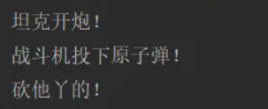

**简单工厂模式的优点：**

* 客户端程序不需要关心对象的创建细节，需要哪个对象时，只需要向工厂索要即可，初步实现了责任的分离。客户端只负责“消费”，工厂负责“生产”。生产和消费分离。

**简单工厂模式的缺点：**

* 缺点1：工厂类集中了所有产品的创造逻辑，形成一个无所不知的全能类，有人把它叫做上帝类。显然工厂类非常关键，不能出问题，一旦出问题，整个系统瘫痪。
* 缺点2：不符合OCP开闭原则，在进行系统扩展时，需要修改工厂类。

**<font style="color:#E8323C;"></font>**

**<font style="color:#E8323C;">Spring中的BeanFactory 是简单工厂模式吗？</font>**

**<font style="color:#E8323C;">从最表层的“根据名字拿对象”的功能来看，BeanFactory 的 getBean(String name) 方法扮演了类似简单工厂的角色。但从本质和实现上来看，BeanFactory 是一个功能极其丰富的 IoC容器，它包含并远远超越了简单工厂的功能。</font>**

**<font style="color:#E8323C;"></font>**

## 简单工厂模式演练

### 1.新建一个模块simple-factory,并且添加spring-context和JUnit依赖

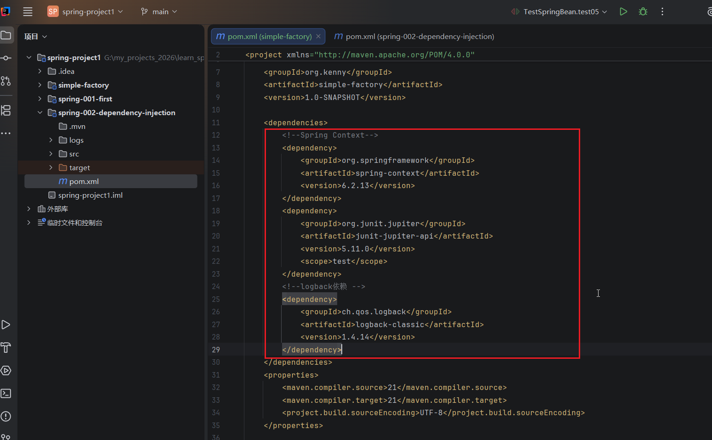

### 2.把002项目的logback.xml粘贴过来

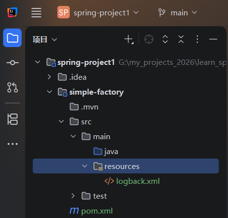


### 3.新建一个包org.kenny.simple在里面新建一个抽象类Weapon

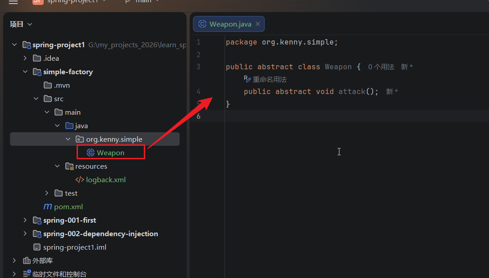

### 4.然后我们新建Tank，Fighter和Dagger类，继承这个Weapon类

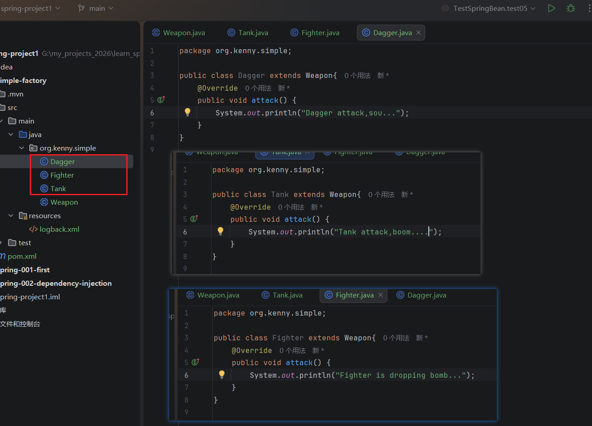

### 5.然后创建一个WeaponFactory类，里面有一个静态方法create，

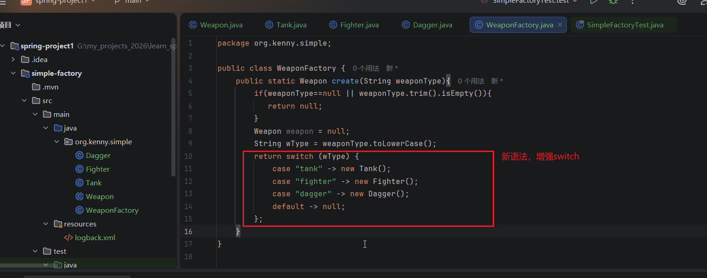

### 6.然后我们写一个测试方法，顺利通过

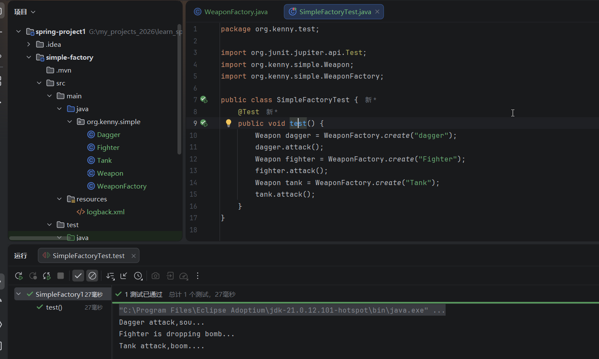

### 这种模式的优缺点参考上面的笔记。


## 工厂方法模式

工厂方法模式既保留了简单工厂模式的优点，同时又解决了简单工厂模式的缺点。

工厂方法模式的角色包括：

* **<font style="color:#E8323C;">抽象工厂角色</font>**
* **<font style="color:#E8323C;">具体工厂角色</font>**
* 抽象产品角色
* 具体产品角色

代码如下：

```java
public abstract class Weapon {
    /**
     * 所有武器都有攻击行为
     */
    public abstract void attack();
}

```

```java
public class Gun extends Weapon{
    @Override
    public void attack() {
        System.out.println("开枪射击！");
    }
}

```

```java
public class Fighter extends Weapon{
    @Override
    public void attack() {
        System.out.println("战斗机发射核弹！");
    }
}

```

```java
public interface WeaponFactory {
    Weapon get();
}

```

```java
public class GunFactory implements WeaponFactory{
    @Override
    public Weapon get() {
        return new Gun();
    }
}

```

```java
public class FighterFactory implements WeaponFactory{
    @Override
    public Weapon get() {
        return new Fighter();
    }
}

```

客户端程序：

```java
public class Client {
    public static void main(String[] args) {
        WeaponFactory factory = new GunFactory();
        Weapon weapon = factory.get();
        weapon.attack();

        WeaponFactory factory1 = new FighterFactory();
        Weapon weapon1 = factory1.get();
        weapon1.attack();
    }
}

```

执行客户端程序：

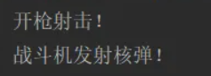

如果想扩展一个新的产品，只要新增一个产品类，再新增一个该产品对应的工厂即可，例如新增：匕首

```java
public class Dagger extends Weapon{
    @Override
    public void attack() {
        System.out.println("砍丫的！");
    }
}

```

```java
public class DaggerFactory implements WeaponFactory{
    @Override
    public Weapon get() {
        return new Dagger();
    }
}

```

客户端程序：

```java
public class Client {
    public static void main(String[] args) {
        WeaponFactory factory = new GunFactory();
        Weapon weapon = factory.get();
        weapon.attack();

        WeaponFactory factory1 = new FighterFactory();
        Weapon weapon1 = factory1.get();
        weapon1.attack();

        WeaponFactory factory2 = new DaggerFactory();
        Weapon weapon2 = factory2.get();
        weapon2.attack();
    }
}

```

执行结果如下：

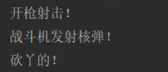

我们可以看到在进行功能扩展的时候，不需要修改之前的源代码，显然工厂方法模式符合OCP原则。

**工厂方法模式的优点：**

* 扩展性高，如果想增加一个产品，只要扩展一个工厂类就可以。（符合 OCP 开闭原则）
* 屏蔽产品的具体实现，调用者只关心产品的接口。（客户端不需要关注对象的具体创建细节，客户端和对象创建细节进行了职责分离。）

**工厂方法模式的缺点：**

* 每次增加一个产品时，都需要增加一个工厂类，会导致类爆炸问题。

## 工厂方法模式演练

### 1.把simple-factory项目复制一份，改名factory-method,修改pom.xml里面的项目名称，然后在idea中添加为maven项目，然后利用重构来修改报名，并且把测试类的名称也修改一下

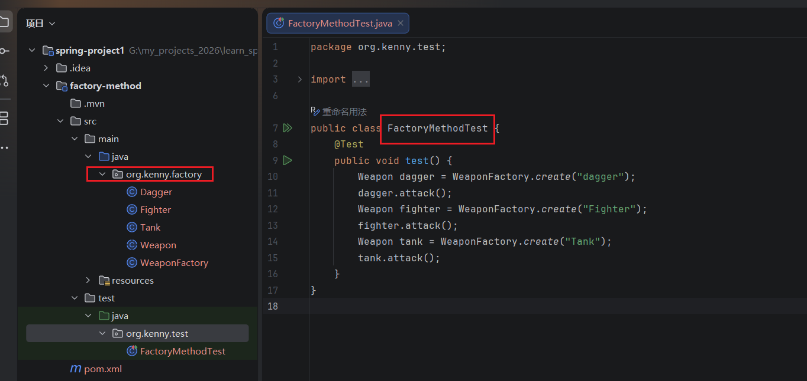

### 2.把WeaponFactory改为一个接口

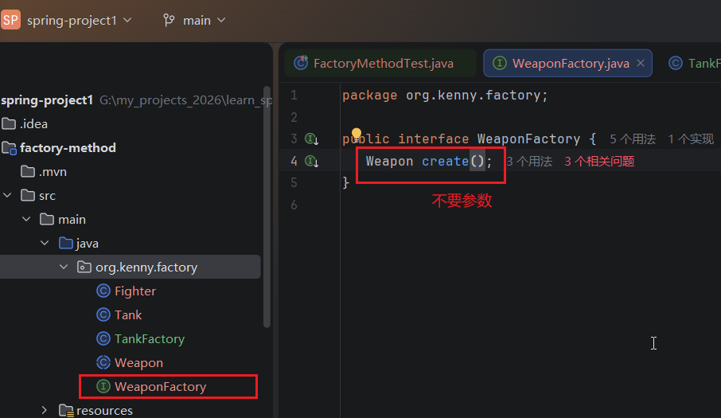

### 3.然后我们把Dagger类删除，然后新建一个TankFactory和一个FighterFactory，都需要实现WeaponFactory接口

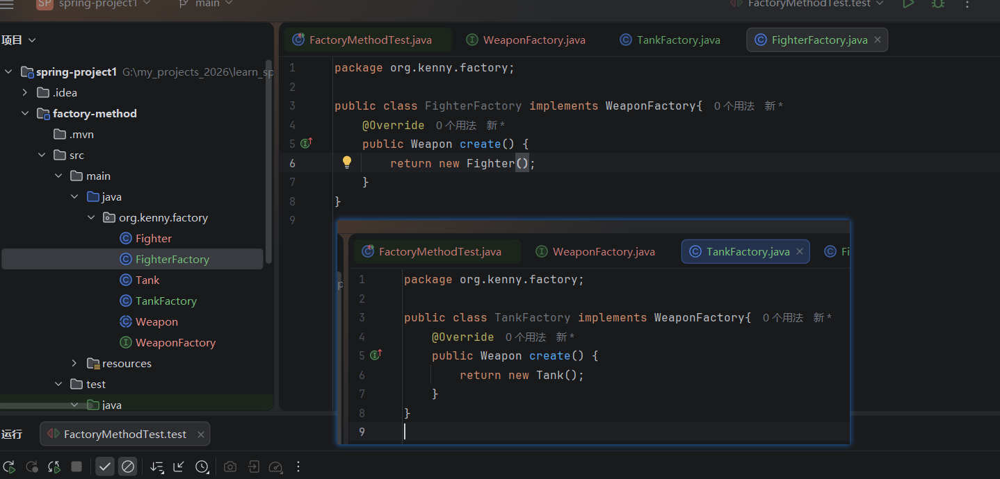

### 4.运行测试代码，可以顺利通过

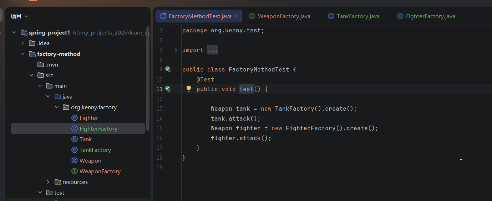

### 5.也可以这么写，此时不是使用测试类，使用main方法

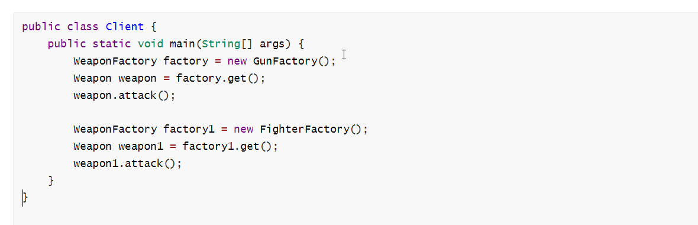

### 老实说，这种方法还是挺麻烦的


## 抽象工厂模式

**抽象工厂中也是包含4个角色：**

* 抽象工厂角色
* 具体工厂角色
* 抽象产品角色
* 具体产品角色

**工厂方法模式与抽象工厂模式的目的不同：**

* 工厂方法模式的目的：<font style="color:rgb(15, 17, 21);">为</font>**<font style="color:rgb(15, 17, 21);">解决</font>**<font style="color:rgb(15, 17, 21);">“简单工厂模式违反开闭原则”的问题而存在，</font>**<font style="color:rgb(15, 17, 21);">工厂方法管“新增单一产品不修改老代码”。</font>**
* 抽象工厂模式的目的：<font style="color:rgb(15, 17, 21);">为</font>**<font style="color:rgb(15, 17, 21);">解决</font>**<font style="color:rgb(15, 17, 21);">“需要保证一系列配套产品一致，且便于整体切换”的问题而存在。</font>**<font style="color:rgb(15, 17, 21);">抽象工厂管“换就换一整套配套产品”。</font>**

### 需求场景

<font style="color:rgb(15, 17, 21);">我们要开发一个跨平台的 UI 组件库，支持两种风格：</font>

* **<font style="color:rgb(15, 17, 21);">Windows 风格</font>**<font style="color:rgb(15, 17, 21);">：蓝色按钮、方形复选框</font>
* **<font style="color:rgb(15, 17, 21);">Mac 风格</font>**<font style="color:rgb(15, 17, 21);">：灰色圆角按钮、圆形复选框</font>

<font style="color:rgb(15, 17, 21);">客户端只需要选择一次工厂，后续所有组件自动配套，</font>**<font style="color:rgb(15, 17, 21);">绝不会混搭</font>**<font style="color:rgb(15, 17, 21);">。</font>

### <font style="color:rgb(15, 17, 21);">完整代码结构</font>

```plain
com.jkweilai.product.button
    ├── Button (抽象产品)
    ├── WindowsButton (具体产品)
    └── MacButton (具体产品)

com.jkweilai.product.checkbox
    ├── Checkbox (抽象产品)
    ├── WindowsCheckbox (具体产品)
    └── MacCheckbox (具体产品)

com.jkweilai.factory
    ├── UIFactory (抽象工厂)
    ├── WindowsFactory (具体工厂)
    └── MacFactory (具体工厂)

com.jkweilai.client
    └── Client (客户端)
```

### 抽象产品

Button.java

```java
package com.jkweilai.product.button;

/**
 * 抽象产品：按钮
 */
public abstract class Button {
    public abstract void display();
}
```

Checkbox.java

```java
package com.jkweilai.product.checkbox;

/**
 * 抽象产品：复选框
 */
public abstract class Checkbox {
    public abstract void display();
}
```

### 具体产品（Windows 风格）

WindowsButton.java

```java
package com.jkweilai.product.button;

public class WindowsButton extends Button {
    @Override
    public void display() {
        System.out.println("【Windows 风格】蓝色方形按钮");
    }
}
```

WindowsCheckbox.java

```java
package com.jkweilai.product.checkbox;

public class WindowsCheckbox extends Checkbox {
    @Override
    public void display() {
        System.out.println("【Windows 风格】方形复选框 ☑");
    }
}
```

### 具体产品（Mac 风格）

MacButton.java

```java
package com.jkweilai.product.button;

public class MacButton extends Button {
    @Override
    public void display() {
        System.out.println("【Mac 风格】灰色圆角按钮");
    }
}
```

MacCheckbox.java

```java
package com.jkweilai.product.checkbox;

public class MacCheckbox extends Checkbox {
    @Override
    public void display() {
        System.out.println("【Mac 风格】圆形复选框 ◉");
    }
}
```

### 抽象工厂

UIFactory.java

```java
package com.jkweilai.factory;

import com.jkweilai.product.button.Button;
import com.jkweilai.product.checkbox.Checkbox;

/**
 * 抽象工厂：定义了一整套 UI 组件的创建方法
 */
public interface UIFactory {
    Button createButton();
    Checkbox createCheckbox();
}
```

### 具体工厂

WindowsFactory.java

```java
package com.jkweilai.factory;

import com.jkweilai.product.button.Button;
import com.jkweilai.product.button.WindowsButton;
import com.jkweilai.product.checkbox.Checkbox;
import com.jkweilai.product.checkbox.WindowsCheckbox;

/**
 * 具体工厂：生产 Windows 风格的全套组件
 */
public class WindowsFactory implements UIFactory {
    @Override
    public Button createButton() {
        return new WindowsButton();
    }

    @Override
    public Checkbox createCheckbox() {
        return new WindowsCheckbox();
    }
}
```

MacFactory.java

```java
package com.jkweilai.factory;

import com.jkweilai.product.button.Button;
import com.jkweilai.product.button.MacButton;
import com.jkweilai.product.checkbox.Checkbox;
import com.jkweilai.product.checkbox.MacCheckbox;

/**
 * 具体工厂：生产 Mac 风格的全套组件
 */
public class MacFactory implements UIFactory {
    @Override
    public Button createButton() {
        return new MacButton();
    }

    @Override
    public Checkbox createCheckbox() {
        return new MacCheckbox();
    }
}
```

### 客户端

Client.java

```java
package com.jkweilai.client;

import com.jkweilai.factory.UIFactory;
import com.jkweilai.factory.WindowsFactory;
import com.jkweilai.factory.MacFactory;
import com.jkweilai.product.button.Button;
import com.jkweilai.product.checkbox.Checkbox;

public class Client {
    public static void main(String[] args) {
        // 场景1：使用 Windows 风格
        System.out.println("=== 当前系统：Windows 风格 ===");
        UIFactory windowsFactory = new WindowsFactory(); // 这个位置可以继续使用简单工厂进行优化，隐藏对象的创建细节。
        Button winBtn = windowsFactory.createButton();
        Checkbox winCb = windowsFactory.createCheckbox();
        winBtn.display();
        winCb.display();

        System.out.println();

        // 场景2：使用 Mac 风格
        System.out.println("=== 当前系统：Mac 风格 ===");
        UIFactory macFactory = new MacFactory();
        Button macBtn = macFactory.createButton();
        Checkbox macCb = macFactory.createCheckbox();
        macBtn.display();
        macCb.display();

        // 关键验证：Windows 工厂绝不会生产 Mac 风格的组件
        // 下面的代码编译器就不让通过，因为类型不匹配
        // WindowsFactory f = new WindowsFactory();
        // MacButton btn = f.createButton();  //编译错误！
    }
}
```

### 抽象工厂的核心要点总结

| **特性**                 | \*\*\*\* | **说明**                                                     |
| ------------------------ | -------- | ------------------------------------------------------------ |
| **产品族一致性**         | ✅        | `WindowsFactory` 保证所有组件都是 Windows 风格，绝不混搭     |
| **换工厂即换整套风格**   | ✅        | 只需把 `new WindowsFactory()` 换成 `new MacFactory()`，整套 UI 风格全变 |
| **开闭原则（横向扩展）** | ✅        | 新增一个 `LinuxFactory`，无需修改 `WindowsFactory` 和 `MacFactory` |
| **开闭原则（纵向扩展）** | ❌        | 如果要新增一个 `Scrollbar` 产品，所有工厂类都要改 → 这是抽象工厂的固有缺点 |
| **类爆炸**               | ⚠️        | 2 个产品等级 × 2 个产品族 = 4 个产品类 + 2 个工厂类，尚可接受；若产品等级和产品族都增多，类数量急剧膨胀 |

# 