# Bean的实例化方式

Spring为Bean提供了多种实例化方式，通常包括4种方式。（也就是说在Spring中为Bean对象的创建准备了多种方案，目的是：更加灵活）

* 第一种：通过构造方法实例化
* 第二种：通过简单工厂模式实例化
* 第三种：通过factory-bean实例化
* 第四种：通过FactoryBean接口实例化

## 通过构造方法实例化

我们之前一直使用的就是这种方式。默认情况下，会调用Bean的无参数构造方法。

```java
package com.jkweilai.spring.bean;

public class User {
    public User() {
        System.out.println("User类的无参数构造方法执行。");
    }
}

```

```xml
<?xml version="1.0" encoding="UTF-8"?>
<beans xmlns="http://www.springframework.org/schema/beans"
       xmlns:xsi="http://www.w3.org/2001/XMLSchema-instance"
       xsi:schemaLocation="http://www.springframework.org/schema/beans http://www.springframework.org/schema/beans/spring-beans.xsd">

    <bean id="userBean" class="com.jkweilai.spring.bean.User"/>

</beans>
```

```java
package com.jkweilai.spring.test;

import com.jkweilai.spring.bean.User;
import org.junit.Test;
import org.springframework.context.ApplicationContext;
import org.springframework.context.support.ClassPathXmlApplicationContext;

public class SpringInstantiationTest {

    @Test
    public void testConstructor(){
        ApplicationContext applicationContext = new ClassPathXmlApplicationContext("spring.xml");
        User user = applicationContext.getBean("userBean", User.class);
        System.out.println(user);
    }
}

```

## 通过 factory-method 属性实例化

底层使用了简单工厂模式。

第一步：定义一个Bean

```java
package com.jkweilai.spring.bean;

public class Vip {
}

```

第二步：编写简单工厂模式当中的工厂类

```java
package com.jkweilai.spring.bean;

public class VipFactory {
    public static Vip get(){
        return new Vip();
    }
}

```

第三步：在Spring配置文件中指定创建该Bean的方法（使用factory-method属性指定）

```xml
<bean id="vipBean" class="com.jkweilai.spring.bean.VipFactory" factory-method="get"/>
```

第四步：编写测试程序

```java
@Test
public void testSimpleFactory(){
    ApplicationContext applicationContext = new ClassPathXmlApplicationContext("spring.xml");
    Vip vip = applicationContext.getBean("vipBean", Vip.class);
    System.out.println(vip);
}
```

执行结果：

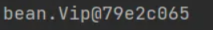

## 演练1-通过factory-method标签属性实例化bean

### 1.新建一个项目起名spring-003-bean-create,添加spring-context和logback和JUnit依赖，然后把logback.xml粘贴到main/resources文件夹里面，并且新建一个appContext.xml配置文件

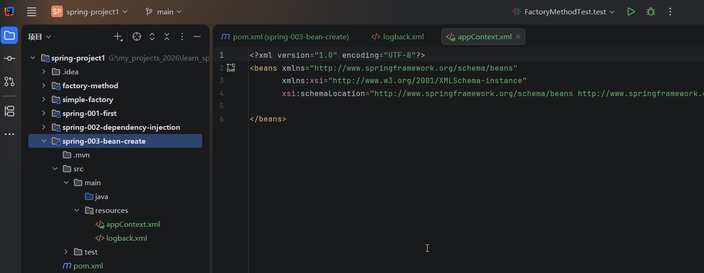

### 1.新建一个包org.kenny.spring.beancreate,然后在里面新建一个Star类

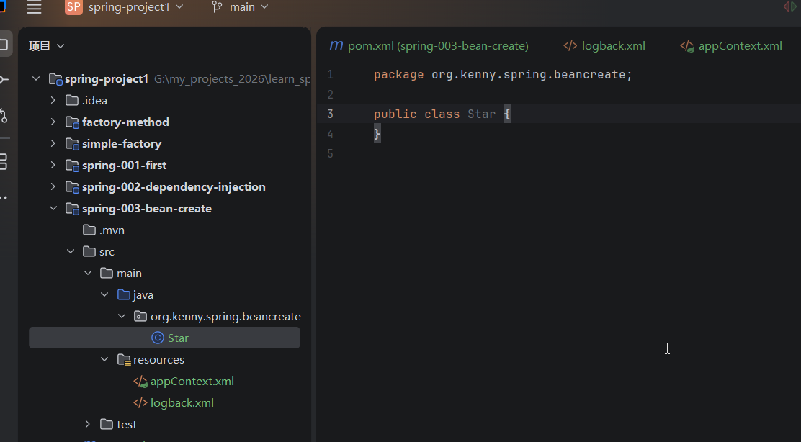

### 2.然后我们新建一个StarFactory类

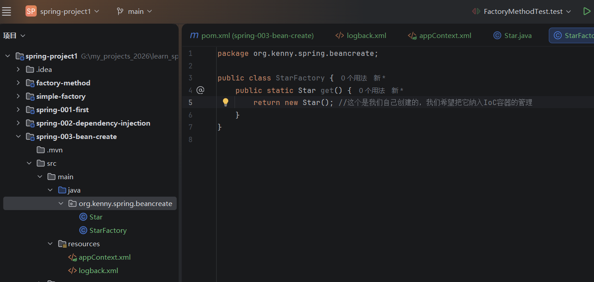

### 3.然后我们在appContext.xml里面配置这个bean，注意此时class不能是Star，应该是StarFactory，还要指定factory的方法

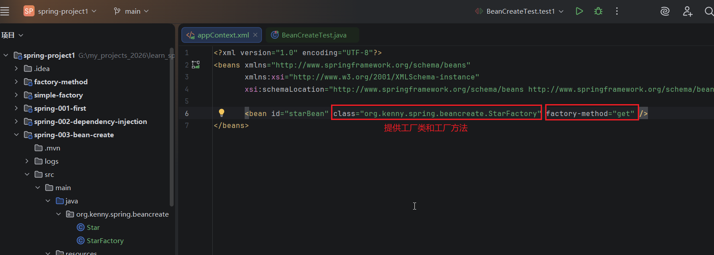

### 4.运行测试，顺利通过

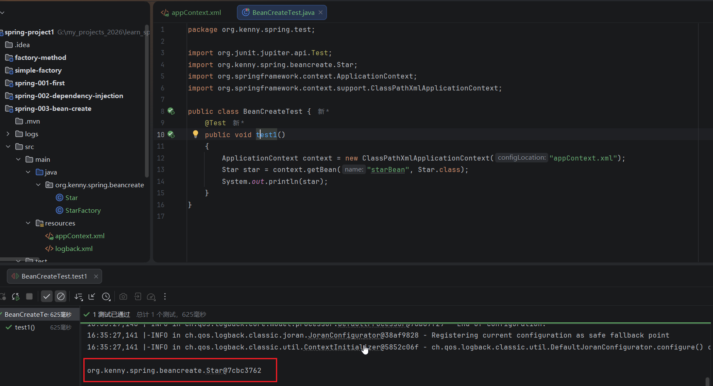


## 通过factory-bean实例化

这种方式本质上是：通过工厂方法模式进行实例化。

第一步：定义一个Bean

```java
package com.jkweilai.spring.bean;

public class Order {
}

```

第二步：定义具体工厂类，工厂类中定义实例方法

```java
package com.jkweilai.spring.bean;

public class OrderFactory {
    public Order get(){
        return new Order();
    }
}

```

第三步：在Spring配置文件中指定factory-bean以及factory-method

```xml
<bean id="orderFactory" class="com.jkweilai.spring.bean.OrderFactory"/>
<bean id="orderBean" factory-bean="orderFactory" factory-method="get"/>
```

第四步：编写测试程序

```java
@Test
public void testSelfFactoryBean(){
    ApplicationContext applicationContext = new ClassPathXmlApplicationContext("spring.xml");
    Order orderBean = applicationContext.getBean("orderBean", Order.class);
    System.out.println(orderBean);
}
```

执行结果：

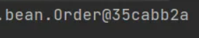

## 演练2.通过factory-bean标签属性化bean

### 2.1还是上面的项目我们创建一个Order是一个空的类，然后新建一个OrderFactory类，这个类没有具体方法，只有一个get方法是实例方法

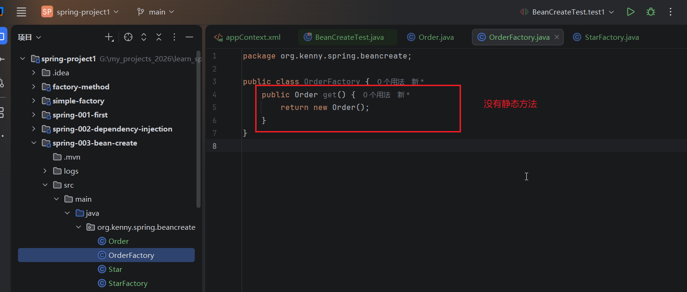

### 2.2 然后我们来配置，需要2个bean标签，一个指向Order工厂类，一个指向Order，在这个bean里面使用factory-bean标签指向工厂的bean

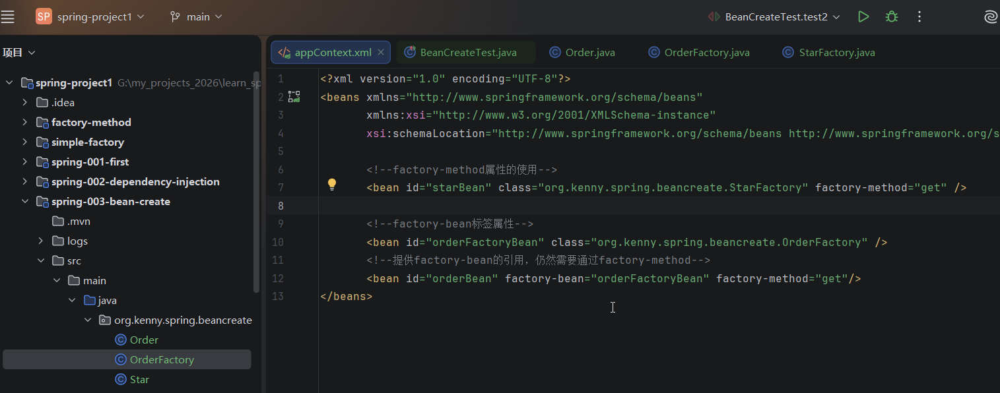

### 2.3.运行测试代码顺利通过

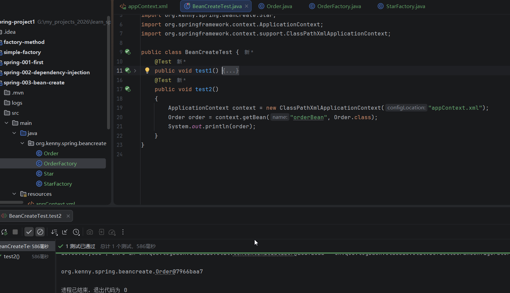


## 通过FactoryBean接口实例化

以上的第三种方式中，factory-bean是我们自定义的，factory-method也是我们自己定义的。

在Spring中，当你编写的类直接实现FactoryBean接口之后，factory-bean不需要指定了，factory-method也不需要指定了。

factory-bean会自动指向实现FactoryBean接口的类，factory-method会自动指向getObject()方法。

第一步：定义一个Bean

```java
public class Person {
}

```

第二步：编写一个类实现FactoryBean接口

```java
public class PersonFactoryBean implements FactoryBean<Person> {

    @Override
    public Person getObject() throws Exception {
        return new Person();
    }

    @Override
    public Class<?> getObjectType() {
        return null;
    }

    @Override
    public boolean isSingleton() {
        // true表示单例
        // false表示原型
        return true;
    }
}

```

第三步：在Spring配置文件中配置FactoryBean

```xml
<bean id="personBean" class="com.jkweilai.spring.bean.PersonFactoryBean"/>
```

测试程序：

```java
@Test
public void testFactoryBean(){
    ApplicationContext applicationContext = new ClassPathXmlApplicationContext("spring.xml");
    Person personBean = applicationContext.getBean("personBean", Person.class);
    System.out.println(personBean);

    Person personBean2 = applicationContext.getBean("personBean", Person.class);
    System.out.println(personBean2);
}
```

执行结果：

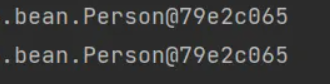

**<font style="color:#E8323C;">FactoryBean在Spring中是一个接口。被称为“工厂Bean”。“工厂Bean”是一种特殊的Bean。所有的“工厂Bean”都是用来</font>****<font style="color:#117CEE;">协助Spring</font>****<font style="color:#E8323C;">框架来创建其他Bean对象的。</font>**

**<font style="color:#E8323C;"></font>**

## BeanFactory和FactoryBean的区别

### BeanFactory

Spring IoC容器的顶级对象，BeanFactory被翻译为“Bean工厂”，在Spring的IoC容器中，“Bean工厂”负责创建Bean对象。

BeanFactory是工厂。

### FactoryBean

FactoryBean：它是一个Bean，是一个能够\*\*<font style="color:#E8323C;">辅助Spring</font>\*\*实例化其它Bean对象的一个Bean。

在Spring中，Bean可以分为两类：

* 第一类：普通Bean
* 第二类：工厂Bean（记住：工厂Bean也是一种Bean，只不过这种Bean比较特殊，它可以辅助Spring实例化其它Bean对象。）

## 注入自定义Date

我们前面说过，java.util.Date在Spring中被当做简单类型，简单类型在注入的时候可以直接使用value属性或value标签来完成，对于Date类型来说，采用value属性或value标签赋值的时候，对日期字符串的格式要求非常严格，必须是这种格式的：Mon Oct 10 14:30:26 CST 2025。其他格式是不会被识别的。如以下代码：

```java
public class Student {
    private Date birth;

    public void setBirth(Date birth) {
        this.birth = birth;
    }

    @Override
    public String toString() {
        return "Student{" +
                "birth=" + birth +
                '}';
    }
}

```

```xml
<bean id="studentBean" class="com.jkweilai.spring.bean.Student">
  <property name="birth" value="Mon Oct 10 14:30:26 CST 2002"/>
</bean>
```

```java
@Test
public void testDate(){
    ApplicationContext applicationContext = new ClassPathXmlApplicationContext("spring.xml");
    Student studentBean = applicationContext.getBean("studentBean", Student.class);
    System.out.println(studentBean);
}
```

执行结果：

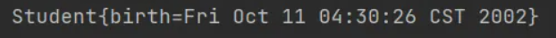

如果把日期格式修改一下：

```xml
<bean id="studentBean" class="com.jkweilai.spring.bean.Student">
  <property name="birth" value="2002-10-10"/>
</bean>
```

执行结果：

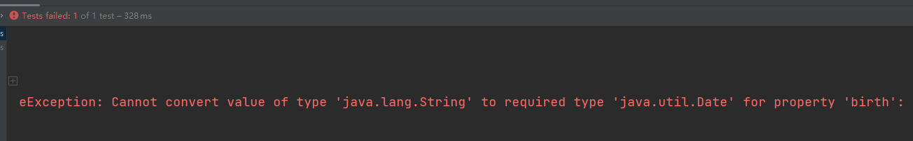

这种情况下，我们就可以使用FactoryBean来完成这个骚操作。

编写DateFactoryBean实现FactoryBean接口：

```java
public class DateFactoryBean implements FactoryBean<Date> {

    // 定义属性接收日期字符串
    private String date;

    // 通过构造方法给日期字符串属性赋值
    public DateFactoryBean(String date) {
        this.date = date;
    }

    @Override
    public Date getObject() throws Exception {
        SimpleDateFormat sdf = new SimpleDateFormat("yyyy-MM-dd");
        return sdf.parse(this.date);
    }

    @Override
    public Class<?> getObjectType() {
        return null;
    }
}

```

编写spring配置文件：

```xml
<bean id="dateBean" class="com.jkweilai.spring.bean.DateFactoryBean">
  <constructor-arg name="date" value="1999-10-11"/>
</bean>

<bean id="studentBean" class="com.jkweilai.spring.bean.Student">
  <property name="birth" ref="dateBean"/>
</bean>
```

执行测试程序：

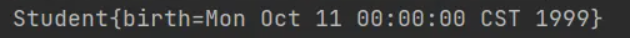

# 