# Bean的生命周期

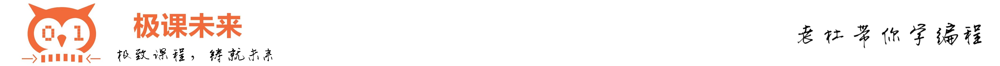

## 什么是Bean的生命周期

Spring其实就是一个管理Bean对象的工厂。它负责对象的创建，对象的销毁等。

所谓的生命周期就是：对象从创建开始到最终销毁的整个过程。

### 什么时候创建Bean对象？

Spring 创建 Bean 对象的时机主要取决于 **作用域（Scope）** 和 **是否延迟加载（Lazy Init）**。 

1. 默认情况：容器启动阶段创建

- **非懒加载的单例 Bean（`singleton` 且非 `@Lazy`）**：在 Spring 容器初始化/刷新（如 `AbstractApplicationContext#refresh()` 的 `finishBeanFactoryInitialization` 阶段）时，就会提前创建并完成初始化。
- 这样做可以在启动时尽早暴露配置或依赖错误，减少运行时的首次请求延迟。 
- 按需/使用时创建

- **原型 Bean（`prototype`）**：容器启动时**不会**创建，每次通过 `getBean()` 获取或注入到其他 Bean 时，才会创建一个新的实例。
- **懒加载的单例 Bean（`@Lazy` 或 `lazy-init="true"`）**：容器启动时**不会**创建，直到第一次被请求获取或被其他 Bean 依赖注入时才创建。
- **Web 作用域 Bean（如 `request`、`session`）**：在对应的 Web 请求或会话生命周期开始并被访问时创建。
- 底层创建过程（简述）

当真正触发创建时，Spring 核心会在 `AbstractAutowireCapableBeanFactory#doCreateBean` 中依次执行：

1. **实例化**：通过反射、构造器或工厂方法创建对象实例。
2. **属性填充**：注入依赖的属性或 Bean。
3. **初始化**：执行 Aware 接口回调、`@PostConstruct`、`InitializingBean` 或自定义 `init-method`。

### 创建Bean对象的前后会调用什么方法？

在 Spring 中（通常指 Bean 的创建与初始化过程），创建 Bean 对象前后会依次调用以下回调和生命周期方法：

1. 实例化之前

- **`InstantiationAwareBeanPostProcessor.postProcessBeforeInstantiation(...)`**：在真正 `new` 或反射创建实例前执行。若返回非 `null` 对象，可短路默认实例化流程，直接进入初始化后阶段。
- 实例化之后、属性赋值之前

- **构造方法 / `@Bean` 工厂方法**：生成原始 Bean 对象。
- **`InstantiationAwareBeanPostProcessor.postProcessAfterInstantiation(...)`**：实例创建后、填充属性前调用，返回 `false` 可跳过后续属性注入。 
- 属性填充与初始化之前

- **依赖注入（字段 / Setter 方法）**：注入依赖与属性值。
- **`InstantiationAwareBeanPostProcessor.postProcessProperties(...)`**：处理 `@Autowired`、`@Value`、`@Resource` 等注解注入。
- **`Aware` 接口回调**：如 `BeanNameAware.setBeanName()`、`BeanClassLoaderAware.setBeanClassLoader()`、`BeanFactoryAware.setBeanFactory()`、`ApplicationContextAware.setApplicationContext()` 等。
- **`BeanPostProcessor.postProcessBeforeInitialization(...)`**：在正式初始化方法执行前调用。 
- 初始化阶段

按先后顺序调用： 

1. **`@PostConstruct` 标注的方法**
2. **`InitializingBean.afterPropertiesSet()`**
3. **自定义初始化方法**（如 `@Bean(initMethod = "...")` 或 XML 的 `init-method`） 
4. 初始化之后

- **`BeanPostProcessor.postProcessAfterInitialization(...)`**：初始化完成后调用，常用于创建 AOP 代理对象或做最终增强。 

> 补充：容器关闭销毁 Bean 时，还会按 `@PreDestroy` -> `DisposableBean.destroy()` -> 自定义 `destroy-method` 的顺序调用销毁方法。 

### Bean对象什么时候销毁？

参考链接1：https://juejin.cn/post/7450409016708186164

参考链接2：https://developer.aliyun.com/article/1372227

在 Spring 中，Bean 的销毁时机主要取决于它的**作用域（Scope）**以及 **Spring 容器的状态**：

- **单例 Bean（`singleton`，默认）**：在 **Spring 容器正常关闭时**触发销毁。容器会先调用销毁逻辑清理资源，随后对象等待 JVM 垃圾回收（GC）。
- **原型 Bean（`prototype`）**：**Spring 容器不会执行销毁方法**。实例创建并交给调用方后，Spring 不再追踪其生命周期，对象不再被引用时由 JVM GC 回收。 
- **其他作用域（如 Web 场景的 `request`、`session`）**：通常在对应的请求结束或会话失效/销毁时被回收。

常见定义销毁逻辑的方式（按执行顺序）：

1. `@PreDestroy` 注解方法
2. 实现 `DisposableBean` 接口的 `destroy()` 方法
3. 自定义销毁方法（如 `@Bean(destroyMethod = "...")` 或 XML 的 `destroy-method`

### Bean对象的销毁前后调用什么方法？

参考链接：https://www.cnblogs.com/krock/p/14847741.html

在 Spring 中，Bean 对象的销毁阶段**主要在销毁前调用回调方法**，用于在释放资源前执行清理逻辑。

销毁前调用的方法（按常见执行顺序）

1. **`@PreDestroy` 注解方法**：标记在方法上，Bean 被容器移除/销毁前执行。
2. **`DisposableBean.destroy()`**：实现 `DisposableBean` 接口并重写 `destroy()` 方法，在销毁前调用。
3. **自定义 `destroy-method`（或 `@Bean(destroyMethod = "...")`）**：在 XML 配置或 `@Bean` 注解中指定的自定义销毁方法。

销毁后与注意事项

- **销毁后**：Bean 对象被销毁后，通常不再调用业务层面的回调方法，而是由 JVM 垃圾回收器回收对象内存。
- **触发条件**：只有**正常关闭 Spring 容器**（如调用 `close()` 或注册关闭钩子 `registerShutdownHook()`）时，单例 Bean 的销毁方法才会被调用；`prototype`（原型）作用域的 Bean 销毁通常不由容器完整托管。

## 为什么要知道Bean的生命周期

其实生命周期的本质是：在哪个时间节点上调用了哪个类的哪个方法。

我们需要充分的了解在这个生命线上，都有哪些特殊的时间节点。

只有我们知道了特殊的时间节点都在哪，到时我们才可以确定代码写到哪。

我们可能需要在某个特殊的时间点上执行一段特定的代码，这段代码就可以放到这个节点上。当生命线走到这里的时候，自然会被调用。

任何一个生命周期都是基于回调机制的。（提前写好回调函数，到了这个时刻就会调用对应的回调函数。）

## Bean的生命周期可以有5步，7步，10步之说，其中7b是说法比较重要，需要好好掌握

## Bean的生命周期之5步

Bean生命周期的管理，可以参考Spring的源码：**<font style="color:#F5222D;">AbstractAutowireCapableBeanFactory类的doCreateBean()方法</font>\*\*\*\*。**

Bean生命周期可以粗略的划分为五大步：

* 第一步：实例化Bean
* 第二步：Bean属性赋值
* 第三步：初始化Bean，调用我们写的init方法，如果没有这个方法，这一步没有效果，这个init方法的执行时机是当对象创建了，并且所有属性都赋值成功之后。也就是说此时对象以及实例化并且所有的属性都有值了。在bean的scope为singleton时，多次获取bean也只会执行一次，但是当scope为prototype时，这个方法每创建一次对象，都会执行一次。获取同一个对象，就只执行一次。
* 第四步：使用Bean
* 第五步：销毁Bean，这个方法也是执行一次

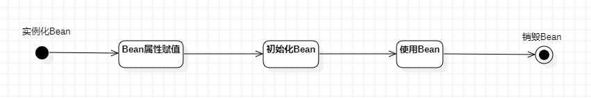

编写测试程序：

定义一个Bean

```java
public class User {
    private String name;

    public User() {
        System.out.println("1.实例化Bean");
    }

    public void setName(String name) {
        this.name = name;
        System.out.println("2.Bean属性赋值");
    }

    public void initBean(){
        System.out.println("3.初始化Bean");
    }

    public void destroyBean(){
        System.out.println("5.销毁Bean");
    }

}

```

```xml
<!--
  init-method属性指定初始化方法。
  destroy-method属性指定销毁方法。
-->
<bean id="userBean" class="com.jkweilai.spring.bean.User" init-method="initBean" destroy-method="destroyBean">
    <property name="name" value="zhangsan"/>
</bean>
```

```java
public class BeanLifecycleTest {
    @Test
    public void testLifecycle(){
        ApplicationContext applicationContext = new ClassPathXmlApplicationContext("spring.xml");
        User userBean = applicationContext.getBean("userBean", User.class);
        System.out.println("4.使用Bean");
        // 只有正常关闭spring容器才会执行销毁方法
        ClassPathXmlApplicationContext context = (ClassPathXmlApplicationContext) applicationContext;
        context.close();
    }
}

```

执行结果：

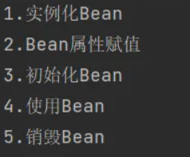

需要注意的：

* 第一：只有正常关闭spring容器，bean的销毁方法才会被调用。
* 第二：ClassPathXmlApplicationContext类才有close()方法。
* 第三：配置文件中的init-method指定初始化方法。destroy-method指定销毁方法。

## 演练1.bean生命周期的5步说法示例

### 1.1把001项目复制一份改名spring-004-bean-lifecycle，删除target文件夹和修改项目名称，然后在idea中把它添加为maven项目，把Vip类删除，把bean.xml改名appContext.xml,User类的代码如下，

#### User.java

```
package org.kenny.spring.bean;

public class User {

        private String name;

        public User() {
            System.out.println("1.实例化Bean");
        }

        public void setName(String name) {
            this.name = name;
            System.out.println("2.Bean属性赋值");
        }

        public void initBean(){
            System.out.println("3.初始化Bean");
        }

        public void destroyBean(){
            System.out.println("5.销毁Bean");
        }

    @Override
    public String toString() {
        System.out.println("4.使用Bean");
        return "User{" +
                "name='" + name + '\'' +
                '}';
    }
}

```

### 注意：由于Java的类是没有析构函数的，所以最后一步很难测试。解决办法就是使用ClassPathXmlApplicationContext对象来替代ApplicationContext，因为后者没有close方法

### 1.2然后我们在appContext.xml中配置User的bean，注意为了测试第二步，你需要给属性赋值

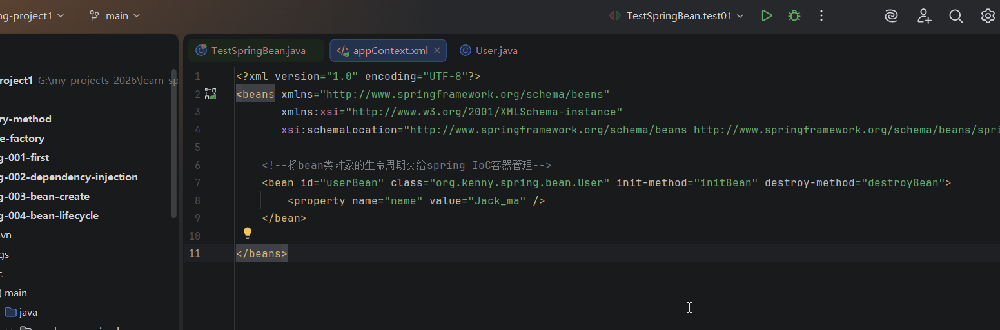

### 1.3测试效果如下

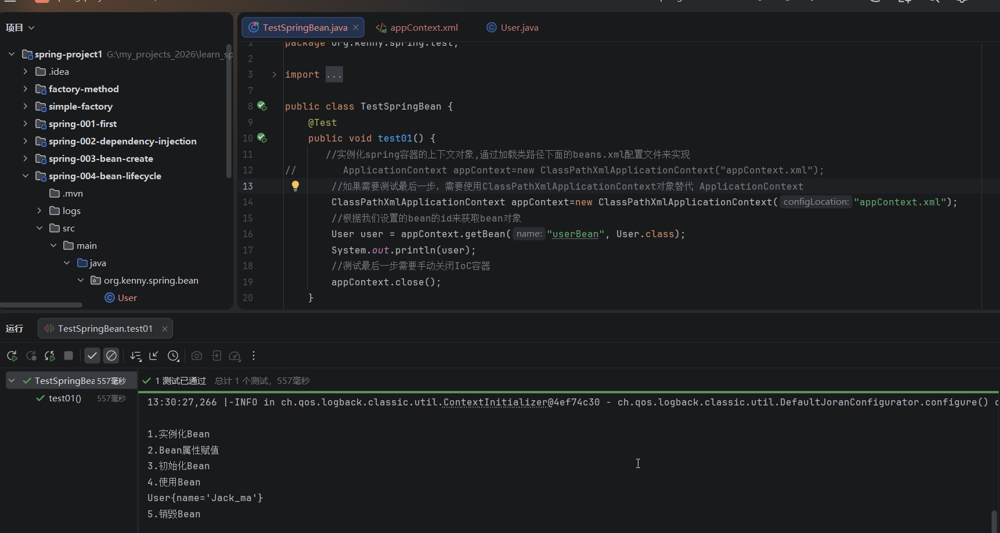

### 注意：默认spring创建的bean是单例的，所以你多次获取bean，你会发现，这几个步骤只有步骤4执行了多次。

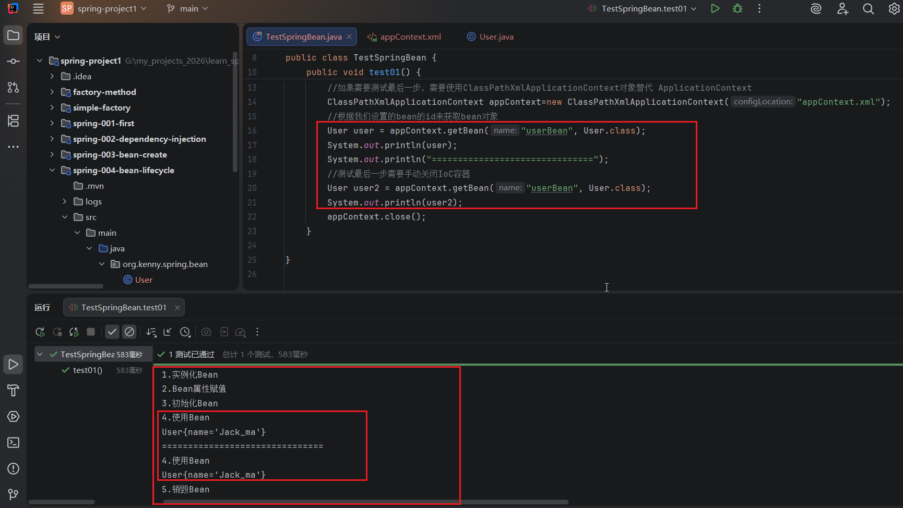

### 如果你把它的scope改为prototype

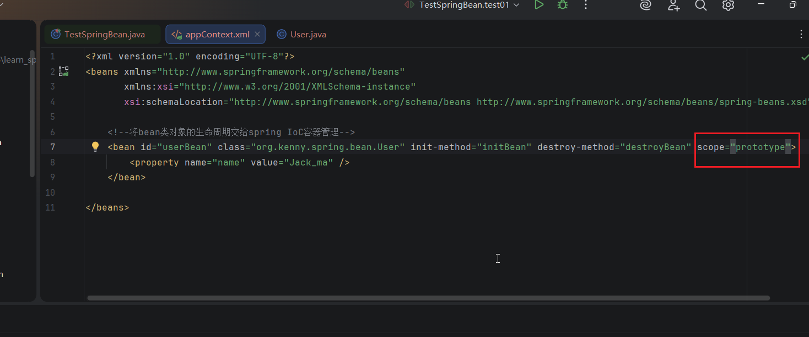

### 运行测试代码，你会发现处理步骤5之外，其他方法都执行了2次，在这种情况下，spring容器不管理对象的销毁，所以步骤5不会执行。

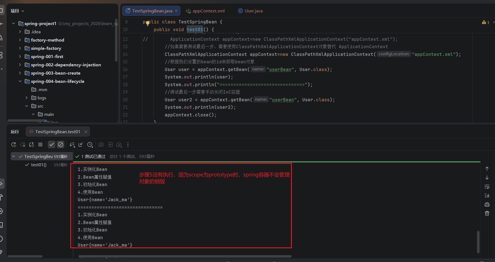

## Bean生命周期之7步

在以上的5步中，第3步是初始化Bean，如果你还想在初始化前和初始化后添加代码，可以加入“Bean后处理器”。

编写一个类实现BeanPostProcessor类，并且重写before和after方法：

```java
public class LogBeanPostProcessor implements BeanPostProcessor {
    @Override
    public Object postProcessBeforeInitialization(Object bean, String beanName) throws BeansException {
        System.out.println("Bean后处理器的before方法执行，即将开始初始化");
        return bean;
    }

    @Override
    public Object postProcessAfterInitialization(Object bean, String beanName) throws BeansException {
        System.out.println("Bean后处理器的after方法执行，已完成初始化");
        return bean;
    }
}

```

在spring.xml文件中配置“Bean后处理器”：

```xml
<!--配置Bean后处理器。这个后处理器将作用于当前配置文件中所有的bean。-->
<bean class="com.jkweilai.spring.bean.LogBeanPostProcessor"/>
```

**<font style="color:#F5222D;">一定要注意：在spring.xml文件中配置的Bean后处理器将作用于当前配置文件中所有的Bean。</font>**

执行测试程序：

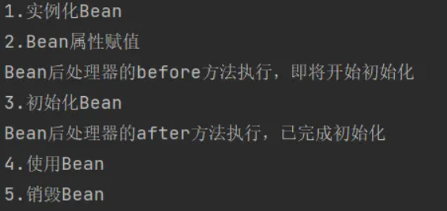

如果加上Bean后处理器的话，Bean的生命周期就是7步了：

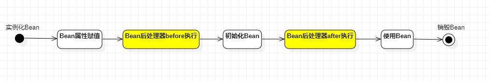

## 演练2.bean生命周期的7步说法示例

### 2.1还是上面的004项目，我们新建一个LogBeanPostProcessor类实现BeanPostProcessor接口

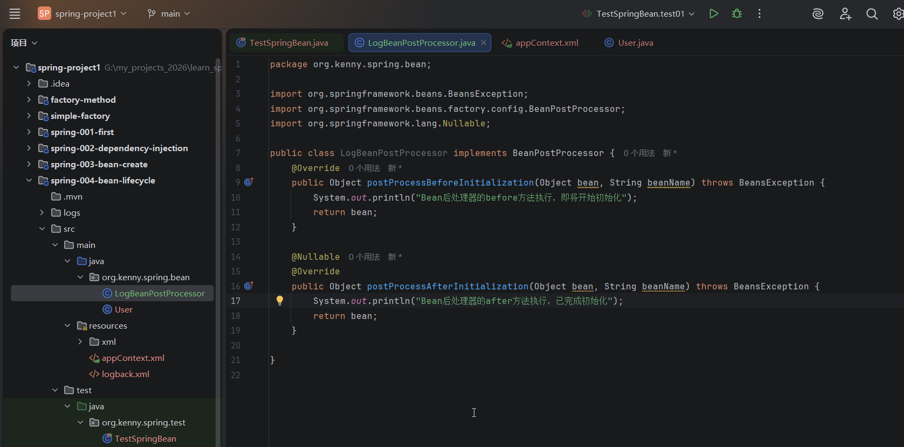

### 2.2.在appContext.xml在给这个类配置一个bean，注意，它不需要id

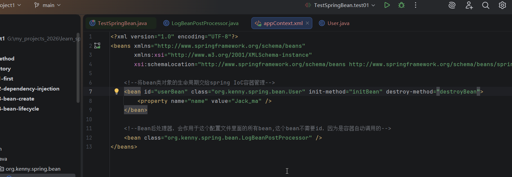

### 2.3.运行上一节课的测试代码，效果如下

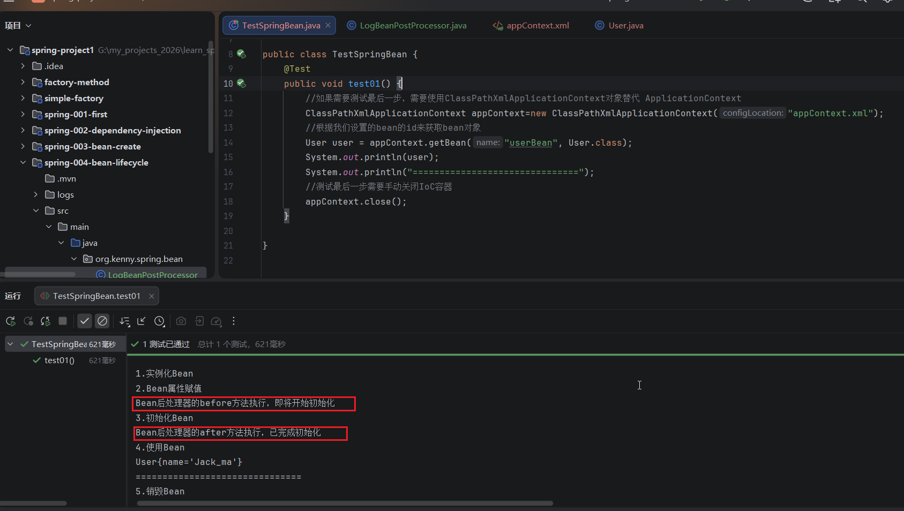

### 2.4.我们新建一个Client类

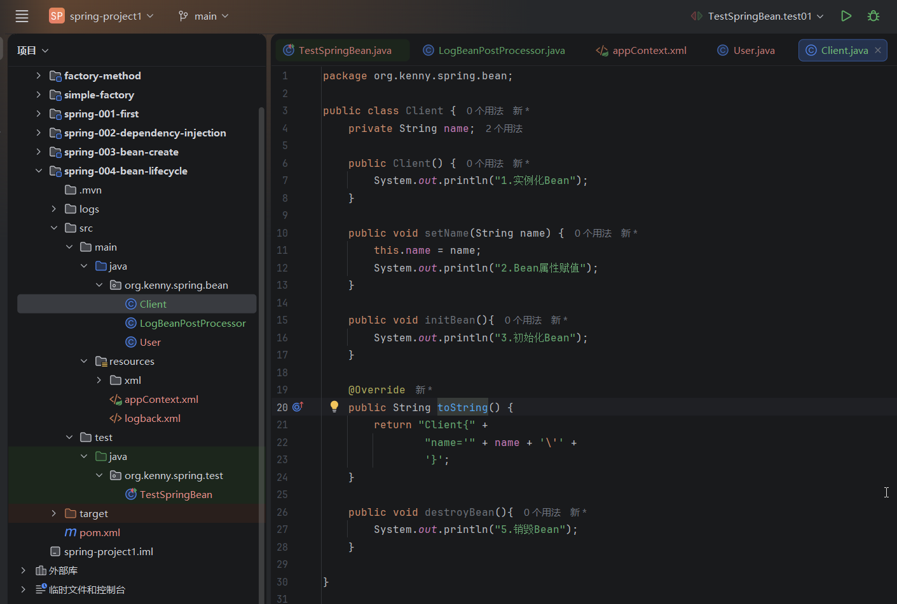

### 2.5在appContext.xml里面给它配置一个bean

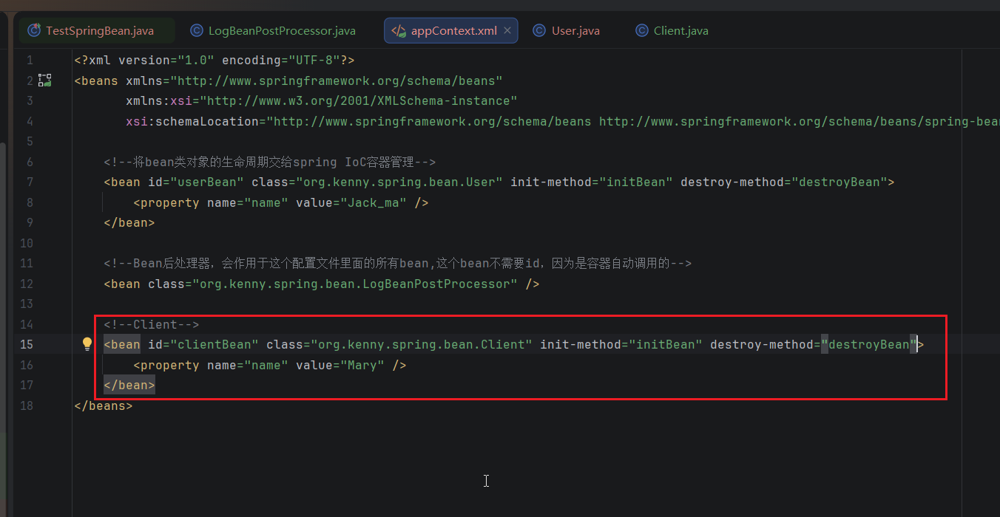

### 2.6我们写一个测试代码来获取clientBean对象，发现userBean对象也创建了，并且执行了一些方法和Bean后处理器类的2个方法

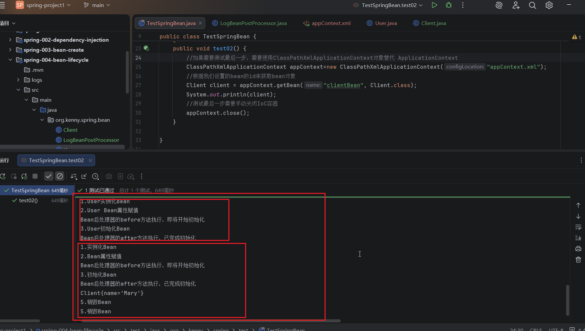


## Bean生命周期之10步

如果根据源码跟踪，可以划分更细粒度的步骤，10步：

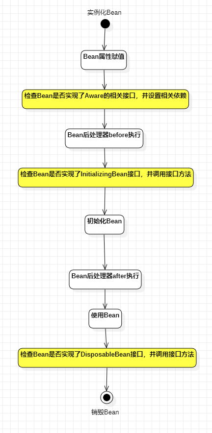

上图中检查Bean是否实现了Aware的相关接口是什么意思？

Aware相关的接口包括：BeanNameAware、BeanClassLoaderAware、BeanFactoryAware

* 当Bean实现了BeanNameAware，Spring会将Bean的名字传递给Bean。
* 当Bean实现了BeanClassLoaderAware，Spring会将加载该Bean的类加载器传递给Bean。
* 当Bean实现了BeanFactoryAware，Spring会将Bean工厂对象传递给Bean。

测试以上10步，可以让User类实现5个接口，并实现所有方法：

* BeanNameAware
* BeanClassLoaderAware
* BeanFactoryAware
* InitializingBean
* DisposableBean

代码如下：

```java
public class User implements BeanNameAware, BeanClassLoaderAware, BeanFactoryAware, InitializingBean, DisposableBean {
    private String name;

    public User() {
        System.out.println("1.实例化Bean");
    }

    public void setName(String name) {
        this.name = name;
        System.out.println("2.Bean属性赋值");
    }

    public void initBean(){
        System.out.println("6.初始化Bean");
    }

    public void destroyBean(){
        System.out.println("10.销毁Bean");
    }

    @Override
    public void setBeanClassLoader(ClassLoader classLoader) {
        System.out.println("3.类加载器：" + classLoader);
    }

    @Override
    public void setBeanFactory(BeanFactory beanFactory) throws BeansException {
        System.out.println("3.Bean工厂：" + beanFactory);
    }

    @Override
    public void setBeanName(String name) {
        System.out.println("3.bean名字：" + name);
    }

    @Override
    public void destroy() throws Exception {
        System.out.println("9.DisposableBean destroy");
    }

    @Override
    public void afterPropertiesSet() throws Exception {
        System.out.println("5.afterPropertiesSet执行");
    }
}

```

```java
public class LogBeanPostProcessor implements BeanPostProcessor {
    @Override
    public Object postProcessBeforeInitialization(Object bean, String beanName) throws BeansException {
        System.out.println("4.Bean后处理器的before方法执行，即将开始初始化");
        return bean;
    }

    @Override
    public Object postProcessAfterInitialization(Object bean, String beanName) throws BeansException {
        System.out.println("7.Bean后处理器的after方法执行，已完成初始化");
        return bean;
    }
}

```

执行结果：

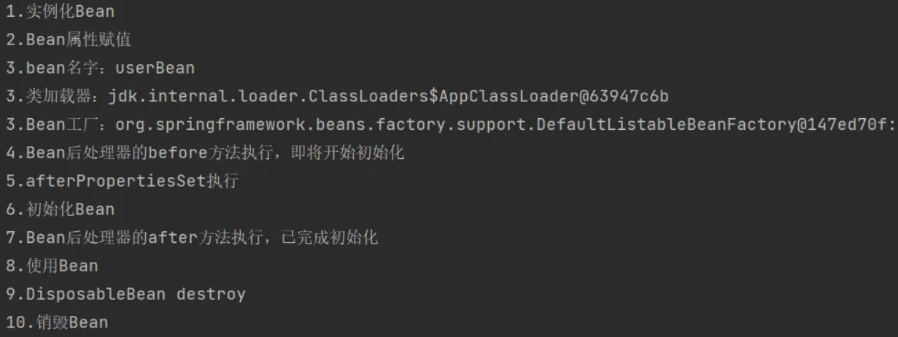

**<font style="color:#F5222D;">通过测试可以看出来：</font>**

* **<font style="color:#F5222D;">InitializingBean的方法早于init-method的执行。</font>**
* **<font style="color:#F5222D;">DisposableBean的方法早于destroy-method的执行。</font>**

<font style="color:#000000;">对于SpringBean的生命周期，掌握之前的7步即可。够用。</font>

<font style="color:#000000;"></font>

**<font style="color:#000000;">相关源码：</font>**

```java
protected Object doCreateBean(String beanName, RootBeanDefinition mbd, @Nullable Object[] args)
        throws BeanCreationException {

    // 第1步：Bean实例化 - 创建Bean的原始对象
    BeanWrapper instanceWrapper = null;
    if (mbd.isSingleton()) {
        instanceWrapper = this.factoryBeanInstanceCache.remove(beanName);
    }
    if (instanceWrapper == null) {
        // 真正的实例化逻辑：通过构造函数、工厂方法等创建Bean实例
        instanceWrapper = createBeanInstance(beanName, mbd, args);
    }
    Object bean = instanceWrapper.getWrappedInstance();
    Class<?> beanType = instanceWrapper.getWrappedClass();
    if (beanType != NullBean.class) {
        mbd.resolvedTargetType = beanType;
    }

    synchronized (mbd.postProcessingLock) {
        if (!mbd.postProcessed) {
            try {
                applyMergedBeanDefinitionPostProcessors(mbd, beanType, beanName);
            }
            catch (Throwable ex) {
                throw new BeanCreationException(mbd.getResourceDescription(), beanName,
                        "Post-processing of merged bean definition failed", ex);
            }
            mbd.markAsPostProcessed();
        }
    }

    // 提前暴露单例Bean的引用，用于解决循环依赖问题
    boolean earlySingletonExposure = (mbd.isSingleton() && this.allowCircularReferences &&
            isSingletonCurrentlyInCreation(beanName));
    if (earlySingletonExposure) {
        if (logger.isTraceEnabled()) {
            logger.trace("Eagerly caching bean '" + beanName +
                    "' to allow for resolving potential circular references");
        }
        // 将Bean的早期引用（可能被代理包装）添加到单例工厂中（三级缓存）
        addSingletonFactory(beanName, () -> getEarlyBeanReference(beanName, mbd, bean));
    }

    // 这是Bean生命周期的核心部分
    Object exposedObject = bean; // 最终暴露给外部的Bean（可能是原始Bean也可能是代理后的Bean）
    try {
        // 第2步：属性赋值 - 依赖注入发生在这里
        // 包括@Autowired、@Value、@Resource等注解的注入
        populateBean(beanName, mbd, instanceWrapper);
        
        // 第3步：初始化Bean - 包含Aware接口、BeanPostProcessor、初始化方法等
        exposedObject = initializeBean(beanName, exposedObject, mbd);
    }
    catch (Throwable ex) {
        if (ex instanceof BeanCreationException bce && beanName.equals(bce.getBeanName())) {
            throw bce;
        }
        else {
            throw new BeanCreationException(mbd.getResourceDescription(), beanName, ex.getMessage(), ex);
        }
    }

    // 处理循环依赖的最终检查
    if (earlySingletonExposure) {
        Object earlySingletonReference = getSingleton(beanName, false);
        if (earlySingletonReference != null) {
            if (exposedObject == bean) {
                exposedObject = earlySingletonReference;
            }
            else if (!this.allowRawInjectionDespiteWrapping && hasDependentBean(beanName)) {
                String[] dependentBeans = getDependentBeans(beanName);
                Set<String> actualDependentBeans = CollectionUtils.newLinkedHashSet(dependentBeans.length);
                for (String dependentBean : dependentBeans) {
                    if (!removeSingletonIfCreatedForTypeCheckOnly(dependentBean)) {
                        actualDependentBeans.add(dependentBean);
                    }
                }
                if (!actualDependentBeans.isEmpty()) {
                    throw new BeanCurrentlyInCreationException(beanName,
                            "Bean with name '" + beanName + "' has been injected into other beans [" +
                            StringUtils.collectionToCommaDelimitedString(actualDependentBeans) +
                            "] in its raw version as part of a circular reference, but has eventually been " +
                            "wrapped. This means that said other beans do not use the final version of the " +
                            "bean. This is often the result of over-eager type matching - consider using " +
                            "'getBeanNamesForType' with the 'allowEagerInit' flag turned off, for example.");
                }
            }
        }
    }

    // 第5步：注册可销毁的Bean - 为Bean的销毁阶段做准备
    try {
        // 注册实现了DisposableBean接口或配置了destroy-method的Bean
        registerDisposableBeanIfNecessary(beanName, bean, mbd);
    }
    catch (BeanDefinitionValidationException ex) {
        throw new BeanCreationException(
                mbd.getResourceDescription(), beanName, "Invalid destruction signature", ex);
    }

    // 返回最终处理完成的Bean（可能是原始对象，也可能是代理对象）
    return exposedObject;
}
```

<font style="color:#000000;"></font>

## 演练3.bean生命周期的10步说法示例

### 3.1让我们的User类实现BeanNameAware, BeanClassLoaderAware, BeanFactoryAware, InitializingBean, DisposableBean这些接口，

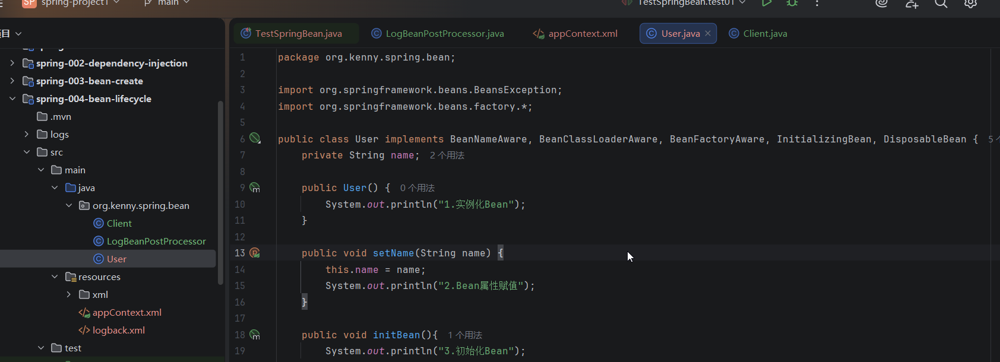

### 代码如下

```
package org.kenny.spring.bean;

import org.springframework.beans.BeansException;
import org.springframework.beans.factory.*;

public class User implements BeanNameAware, BeanClassLoaderAware, BeanFactoryAware, InitializingBean, DisposableBean {
    private String name;

    public User() {
        System.out.println("1.实例化Bean");
    }

    public void setName(String name) {
        this.name = name;
        System.out.println("2.Bean属性赋值");
    }

    public void initBean(){
        System.out.println("3.初始化Bean");
    }

    public void destroyBean(){
        System.out.println("5.销毁Bean");
    }

    @Override
    public void setBeanClassLoader(ClassLoader classLoader) {
        System.out.println("类加载器：" + classLoader);
    }

    @Override
    public void setBeanFactory(BeanFactory beanFactory) throws BeansException {
        System.out.println("Bean工厂：" + beanFactory);
    }

    @Override
    public void setBeanName(String name) {
        System.out.println("bean名字：" + name);
    }

    @Override
    public void destroy() throws Exception {
        System.out.println("DisposableBean destroy");
    }

    @Override
    public void afterPropertiesSet() throws Exception {
        System.out.println("afterPropertiesSet执行");
    }

    @Override
    public String toString() {
        System.out.println("4.使用bean");
        return "User{" +
                "name='" + name + '\'' +
                '}';
    }
}

```

### 3.2为了不干扰我们的效果，我们在appContext.xml中把clientBean的创建代码注释了

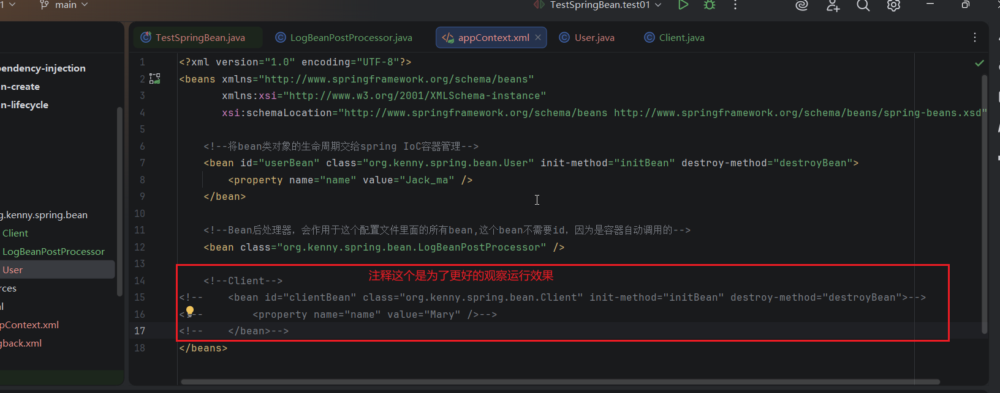

### 3.3运行测试程序1，效果如下，大体上还是5个步骤

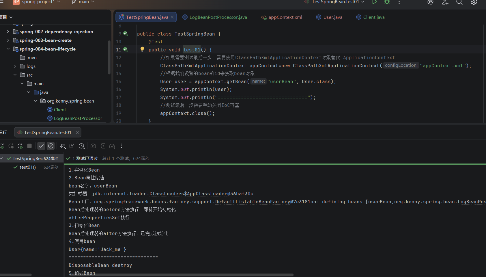


## Bean的作用域不同，管理方式不同

Spring 根据Bean的作用域来选择管理方式。

* 对于singleton作用域的Bean，Spring 能够精确地知道该Bean何时被创建，何时初始化完成，以及何时被销毁；
* 而对于 prototype 作用域的 Bean，Spring 只负责创建，当容器创建了 Bean 的实例后，Bean 的实例就交给客户端代码管理，Spring 容器将不再跟踪其生命周期。

我们把之前User类的spring.xml文件中的配置scope设置为prototype：

```xml
<!--
  init-method属性指定初始化方法。
  destroy-method属性指定销毁方法。
-->
<bean id="userBean" class="com.jkweilai.spring.bean.User" init-method="initBean" destroy-method="destroyBean" scope="prototype">
    <property name="name" value="zhangsan"/>
</bean>

<!--配置Bean后处理器。这个后处理器将作用于当前配置文件中所有的bean。-->
<bean class="com.jkweilai.spring.bean.LogBeanPostProcessor"/>
```

执行测试程序：

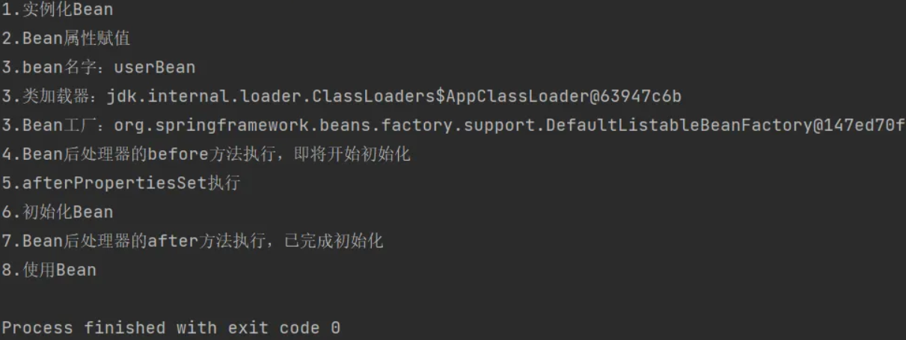

通过测试一目了然。只执行了前8步，第9和10都没有执行。

## 自己new的对象如何让Spring管理

有些时候可能会遇到这样的需求，某个java对象是我们自己new的，然后我们希望这个对象被Spring容器管理，怎么实现？

```java
public class User {
}

```

```java
public class RegisterBeanTest {

    @Test
    public void testBeanRegister(){
        // 自己new的对象
        User user = new User();
        System.out.println(user);

        // 创建 默认可列表BeanFactory 对象
        DefaultListableBeanFactory factory = new DefaultListableBeanFactory();
        // 注册Bean
        factory.registerSingleton("userBean", user);
        // 从spring容器中获取bean
        User userBean = factory.getBean("userBean", User.class);
        System.out.println(userBean);
    }
}

```

执行结果：


## 演练4.自己创建的对象交给spring管理

## 4.1新建有空Vip类

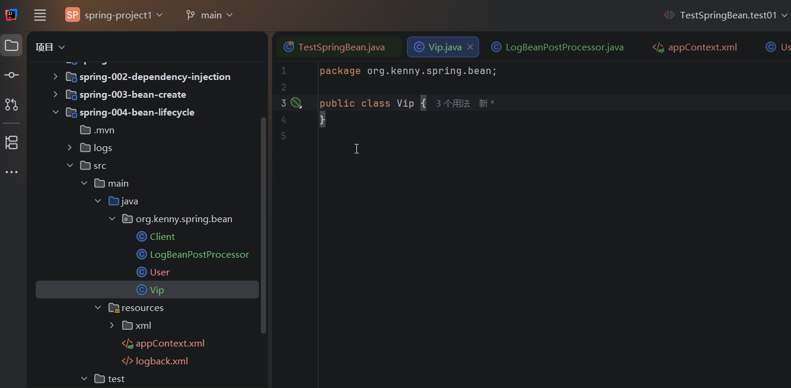

### 4.2 在测试代码里面使用DefaultListableBeanFactory来注册和获取bean，效果如下

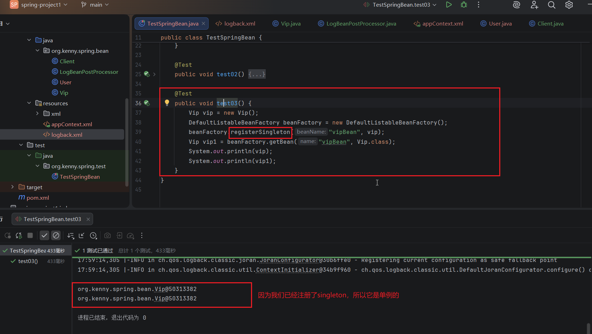

### 注意：不需要在配置文件里面配置任何东西

