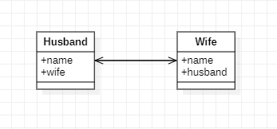
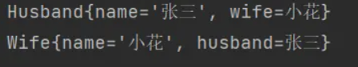
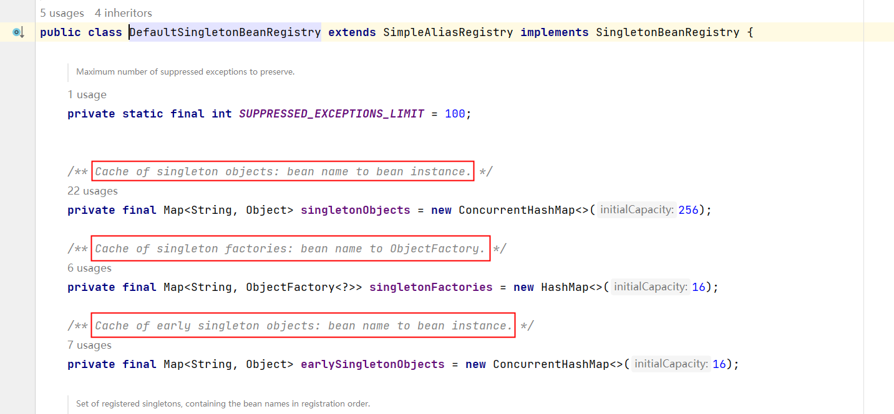

# **<font style="color:#F5222D;">Bean的循环依赖问题</font>**

## **<font style="color:#F5222D;">什么是Bean的循环依赖</font>**

A对象中有B属性。B对象中有A属性。这就是循环依赖。我依赖你，你也依赖我。

比如：丈夫类Husband，妻子类Wife。Husband中有Wife的引用。Wife中有Husband的引用。



```java
public class Husband {
    private String name;
    private Wife wife;
}

```

```java
public class Wife {
    private String name;
    private Husband husband;
}

```

## Spring 的重要策略

* **<font style="color:rgb(15, 17, 21);">Singleton</font>**<font style="color:rgb(15, 17, 21);">：创建实例（</font><code><font style="color:rgb(15, 17, 21);background-color:rgb(235, 238, 242);">new</font></code><font style="color:rgb(15, 17, 21);">）出来之后，</font>**<font style="color:rgb(15, 17, 21);">会立即</font>**<font style="color:rgb(15, 17, 21);">把这个“半成品”对象放到公共缓存中，供其他 Bean 提前引用。</font>
* **<font style="color:rgb(15, 17, 21);">Prototype</font>**<font style="color:rgb(15, 17, 21);">：创建实例之后，</font>**<font style="color:rgb(15, 17, 21);">不会放到任何公共缓存中</font>**<font style="color:rgb(15, 17, 21);">，每次获取都是重新创建，创建完就交付，用完就销毁。</font>

## **<font style="color:#F5222D;">singleton下的set注入的循环依赖没问题</font>**

我们来编写程序，测试一下在singleton+setter的模式下产生的循环依赖，Spring是否能够解决？

```java
public class Husband {
    private String name;
    private Wife wife;

    public void setName(String name) {
        this.name = name;
    }

    public String getName() {
        return name;
    }

    public void setWife(Wife wife) {
        this.wife = wife;
    }

    // toString()方法重写时需要注意：不能直接输出wife，输出wife.getName()。要不然会出现递归导致的栈内存溢出错误。
    @Override
    public String toString() {
        return "Husband{" +
                "name='" + name + '\'' +
                ", wife=" + wife.getName() +
                '}';
    }
}

```

```java
public class Wife {
    private String name;
    private Husband husband;

    public void setName(String name) {
        this.name = name;
    }

    public String getName() {
        return name;
    }

    public void setHusband(Husband husband) {
        this.husband = husband;
    }

    // toString()方法重写时需要注意：不能直接输出husband，输出husband.getName()。要不然会出现递归导致的栈内存溢出错误。
    @Override
    public String toString() {
        return "Wife{" +
                "name='" + name + '\'' +
                ", husband=" + husband.getName() +
                '}';
    }
}

```

```xml
<bean id="husbandBean" class="com.jkweilai.spring.bean.Husband" scope="singleton">
    <property name="name" value="张三"/>
    <property name="wife" ref="wifeBean"/>
</bean>
<bean id="wifeBean" class="com.jkweilai.spring.bean.Wife" scope="singleton">
    <property name="name" value="小花"/>
    <property name="husband" ref="husbandBean"/>
</bean>
```

```java
public class CircularDependencyTest {

    @Test
    public void testSingletonAndSet(){
        ApplicationContext applicationContext = new ClassPathXmlApplicationContext("spring.xml");
        Husband husbandBean = applicationContext.getBean("husbandBean", Husband.class);
        Wife wifeBean = applicationContext.getBean("wifeBean", Wife.class);
        System.out.println(husbandBean);
        System.out.println(wifeBean);
    }
}

```

执行结果：



**<font style="color:#E8323C;">通过测试得知：在singleton + set注入的情况下，循环依赖是没有问题的。Spring可以解决这个问题。</font>**

**<font style="color:#E8323C;"></font>**

## **<font style="color:#F5222D;">prototype下的set注入的循环依赖有问题</font>**

我们再来测试一下：prototype+set注入的方式下，循环依赖会不会出现问题？

```xml
<bean id="husbandBean" class="com.jkweilai.spring.bean.Husband" scope="prototype">
    <property name="name" value="张三"/>
    <property name="wife" ref="wifeBean"/>
</bean>
<bean id="wifeBean" class="com.jkweilai.spring.bean.Wife" scope="prototype">
    <property name="name" value="小花"/>
    <property name="husband" ref="husbandBean"/>
</bean>
```

执行测试程序：发生了异常，异常信息如下：

Caused by: org.springframework.beans.factory.**<font style="color:#E8323C;">BeanCurrentlyInCreationException</font>**: Error creating bean with name 'husbandBean': Requested bean is currently in creation: Is there an unresolvable circular reference?

```
at org.springframework.beans.factory.support.AbstractBeanFactory.doGetBean(AbstractBeanFactory.java:265)

at org.springframework.beans.factory.support.AbstractBeanFactory.getBean(AbstractBeanFactory.java:199)

at org.springframework.beans.factory.support.BeanDefinitionValueResolver.resolveReference(BeanDefinitionValueResolver.java:325)

... 44 more
```

翻译为：创建名为“husbandBean”的bean时出错：请求的bean当前正在创建中：是否存在无法解析的循环引用？

通过测试得知，当循环依赖的\*\*<font style="color:#F5222D;">所有Bean</font>**的scope="prototype"的时候，产生的循环依赖，Spring是无法解决的，会出现**<font style="color:#E8323C;">BeanCurrentlyInCreationException</font>\*\*异常。

**<font style="color:#DF2A3F;">大家可以测试一下，以上两个Bean，如果其中一个是singleton，另一个是prototype，是没有问题的。</font>**

* 当一个是 `singleton`，另一个是 `prototype`。如果先实例化的是`prototype`的对象，同样有问题。
* 但实际情况是，`prototype`的对象是懒加载的，容器启动的时候会先创建 `singleton`的对象。因此就没有问题了。

为什么两个Bean都是prototype时会出错呢？由于是 prototype，因此会注入一个新的对象，新对象注入时又需要关联注入一个新对象。

## **<font style="color:#F5222D;">singleton下的构造注入产生的循环依赖</font>**

我们再来测试一下singleton + 构造注入的方式下，spring是否能够解决这种循环依赖。

```java
public class Husband {
    private String name;
    private Wife wife;

    public Husband(String name, Wife wife) {
        this.name = name;
        this.wife = wife;
    }

    // -----------------------分割线--------------------------------
    public String getName() {
        return name;
    }

    @Override
    public String toString() {
        return "Husband{" +
                "name='" + name + '\'' +
                ", wife=" + wife.getName() +
                '}';
    }
}

```

```java
public class Wife {
    private String name;
    private Husband husband;

    public Wife(String name, Husband husband) {
        this.name = name;
        this.husband = husband;
    }

    // -------------------------分割线--------------------------------
    public String getName() {
        return name;
    }

    @Override
    public String toString() {
        return "Wife{" +
                "name='" + name + '\'' +
                ", husband=" + husband.getName() +
                '}';
    }
}

```

```xml
<bean id="hBean" class="com.jkweilai.spring.bean2.Husband" scope="singleton">
    <constructor-arg name="name" value="张三"/>
    <constructor-arg name="wife" ref="wBean"/>
</bean>

<bean id="wBean" class="com.jkweilai.spring.bean2.Wife" scope="singleton">
    <constructor-arg name="name" value="小花"/>
    <constructor-arg name="husband" ref="hBean"/>
</bean>
```

```java
@Test
public void testSingletonAndConstructor(){
    ApplicationContext applicationContext = new ClassPathXmlApplicationContext("spring2.xml");
    Husband hBean = applicationContext.getBean("hBean", Husband.class);
    Wife wBean = applicationContext.getBean("wBean", Wife.class);
    System.out.println(hBean);
    System.out.println(wBean);
}
```

执行结果：发生了异常，信息如下：

Caused by: org.springframework.beans.factory.**<font style="color:#F5222D;">BeanCurrentlyInCreationException</font>**: Error creating bean with name 'hBean': Requested bean is currently in creation: Is there an unresolvable circular reference?

```
at org.springframework.beans.factory.support.DefaultSingletonBeanRegistry.beforeSingletonCreation(DefaultSingletonBeanRegistry.java:355)

at org.springframework.beans.factory.support.DefaultSingletonBeanRegistry.getSingleton(DefaultSingletonBeanRegistry.java:227)

at org.springframework.beans.factory.support.AbstractBeanFactory.doGetBean(AbstractBeanFactory.java:324)

at org.springframework.beans.factory.support.AbstractBeanFactory.getBean(AbstractBeanFactory.java:199)

at org.springframework.beans.factory.support.BeanDefinitionValueResolver.resolveReference(BeanDefinitionValueResolver.java:325)

... 56 more
```

和上一个测试结果相同，都是提示产生了循环依赖，并且Spring是无法解决这种循环依赖的。

为什么呢？

**<font style="color:#F5222D;">主要原因是因为通过构造方法注入导致的：因为构造方法注入会导致</font>****<font style="color:#722ED1;">实例化对象的过程</font>****<font style="color:#F5222D;">和</font>****<font style="color:#722ED1;">对象属性赋值的过程</font>****<font style="color:#F5222D;">没有分离开，必须在一起完成导致的。</font>**

**<font style="color:#F5222D;"></font>**

**<font style="color:#2F8EF4;">为什么 Spring 建议使用构造器注入？因为它在启动时可以快速发现循环依赖。</font>**

**<font style="color:#F5222D;"></font>**

## **<font style="color:#F5222D;">Spring解决循环依赖的机理</font>**

面试题：Spring 是如何解决单例 Setter/字段注入的循环依赖的？

**<font style="color:#DF2A3F;">Spring通过  三级缓存+提前曝光  来解决单例 Setter/字段注入的循环依赖。</font>**

### **<font style="color:#F5222D;">三个缓存</font>**



| **<font style="color:rgb(15, 17, 21);">缓存级别</font>** | **<font style="color:rgb(15, 17, 21);">名称</font>**         | **<font style="color:rgb(15, 17, 21);">存储内容</font>**     | **<font style="color:rgb(15, 17, 21);">作用</font>**         |
| -------------------------------------------------------- | ------------------------------------------------------------ | ------------------------------------------------------------ | ------------------------------------------------------------ |
| **<font style="color:rgb(15, 17, 21);">第一级</font>**   | <code><font style="color:rgb(15, 17, 21);background-color:rgb(235, 238, 242);">singletonObjects</font></code> | <font style="color:rgb(15, 17, 21);">完整的、成熟的Bean</font> | <font style="color:rgb(15, 17, 21);">对外提供最终可用的Bean</font> |
| **<font style="color:rgb(15, 17, 21);">第二级</font>**   | <code><font style="color:rgb(15, 17, 21);background-color:rgb(235, 238, 242);">earlySingletonObjects</font></code> | <font style="color:rgb(15, 17, 21);">提前暴露的半成品 Bean</font> | <font style="color:rgb(15, 17, 21);">解决循环依赖，存放早期引用</font> |
| **<font style="color:rgb(15, 17, 21);">第三级</font>**   | <code><font style="color:rgb(15, 17, 21);background-color:rgb(235, 238, 242);">singletonFactories</font></code> | <code><font style="color:rgb(15, 17, 21);background-color:rgb(235, 238, 242);">ObjectFactory</font></code><font style="color:rgb(15, 17, 21);"></font> | **<font style="color:rgb(15, 17, 21);">负责生成 bean 的早期引用或代理对象</font>** |

### 只给一个缓存<font style="color:#DF2A3F;">既</font>存放成品<font style="color:#DF2A3F;">又</font>存放半成品不行吗

**<font style="color:rgb(15, 17, 21);">不行</font>**<font style="color:rgb(15, 17, 21);">，因为一级缓存是全局共享的，如果放入半成品，其他线程在 Bean 创建完成前就可能获取到不完整的 Bean，导致</font>**<font style="color:rgb(15, 17, 21);">并发环境下属性为 null 或状态不一致</font>**<font style="color:rgb(15, 17, 21);">；而区分一级（成品）和二级（半成品）正是为了</font>**<font style="color:rgb(15, 17, 21);">隔离可见性</font>**<font style="color:rgb(15, 17, 21);">——只有当前创建链中的 Bean 能访问半成品，外部线程无法拿到未完成的对象。</font>

### <font style="color:rgb(15, 17, 21);">三级缓存实现步骤</font>

假设有两个类：

```java
@Component
public class A {
    private B b;
    @Autowired public void setB(B b) { this.b = b; }
}

@Component
public class B {
    private A a;
    @Autowired public void setA(A a) { this.a = a; }
}
```

<font style="color:rgb(15, 17, 21);">第 1 步：创建 A</font>

```latex
开始创建 A
  ├── 实例化 A（调用构造函数，A 变成"半成品"）
  ├── 将 A 的 ObjectFactory 放入三级缓存（提前暴露）
  │   singletonFactories.put("a", objectFactory)
  ├── 填充 A 的属性
  │   └── 发现需要 B → 去容器获取 B
  │       ├── 一级缓存有 B 吗？ ❌
  │       ├── 二级缓存有 B 吗？ ❌
  │       └── 三级缓存有 B 吗？ ❌
  │           └── 开始创建 B ⬇️
```

<font style="color:rgb(15, 17, 21);">第 2 步：创建 B（此时 A 还在创建中）</font>

```latex
开始创建 B
  ├── 实例化 B（B 变成"半成品"）
  ├── 将 B 的 ObjectFactory 放入三级缓存
  │   singletonFactories.put("b", objectFactory)
  ├── 填充 B 的属性
  │   └── 发现需要 A → 去容器获取 A
  │       ├── 一级缓存有 A 吗？ ❌（A 还没创建完）
  │       ├── 二级缓存有 A 吗？ ❌
  │       ├── 三级缓存有 A 吗？ ✅ 有！
  │       │   └── 通过 ObjectFactory 获取 A 的早期引用
  │       │       ├── 将 A 从三级缓存移到二级缓存
  │       │       │   earlySingletonObjects.put("a", aRef)
  │       │       │   singletonFactories.remove("a")
  │       │       └── 返回 A 的引用给 B
  │       └── B 的属性注入完成（拿到了 A 的半成品引用）
  ├── 执行 B 的初始化方法（@PostConstruct 等）
  └── 将完整的 B 放入一级缓存
      singletonObjects.put("b", b)
      earlySingletonObjects.remove("b")
      singletonFactories.remove("b")
```

<font style="color:rgb(15, 17, 21);">第 3 步：回到 A，继续完成创建</font>

```latex
回到 A 的创建（此时 B 已经创建完成）
  ├── A 的属性注入完成（拿到了完整的 B）
  ├── 执行 A 的初始化方法
  └── 将完整的 A 放入一级缓存
      singletonObjects.put("a", a)
      earlySingletonObjects.remove("a")
      singletonFactories.remove("a")
```

### 两个缓存不能解决吗？

**<font style="color:rgb(15, 17, 21);">从“解决循环依赖”这个功能本身来说，两个缓存（一级+二级）确实“完全可以”</font>**<font style="color:rgb(15, 17, 21);">。</font>\
**<font style="color:rgb(15, 17, 21);">Spring 之所以非要三个缓存，不是为了解决“循环依赖”，而是为了解决“循环依赖 + AOP（动态代理）”这个复合问题。</font>**

**<font style="color:rgb(15, 17, 21);"></font>**

<font style="color:rgb(15, 17, 21);">如果只有</font><font style="color:rgb(15, 17, 21);"> </font>**<font style="color:rgb(15, 17, 21);">一级（成品）+ 二级（半成品）</font>**<font style="color:rgb(15, 17, 21);">，流程是这样的：</font>

1. <font style="color:rgb(15, 17, 21);">A 实例化 → 放入二级缓存（半成品）</font>
2. <font style="color:rgb(15, 17, 21);">A 填充属性，发现需要 B → 创建 B</font>
3. <font style="color:rgb(15, 17, 21);">B 实例化 → 放入二级缓存</font>
4. <font style="color:rgb(15, 17, 21);">B 填充属性，发现需要 A → 从二级缓存拿到 A（半成品）</font>
5. <font style="color:rgb(15, 17, 21);">B 完成创建 → 放入一级缓存</font>
6. <font style="color:rgb(15, 17, 21);">A 拿到完整的 B，完成创建 → 放入一级缓存</font>

**<font style="color:rgb(15, 17, 21);">对于普通 Bean（没有 AOP），这完全没问题，完美运行。</font>**

**<font style="color:rgb(15, 17, 21);"></font>**

**<font style="color:rgb(15, 17, 21);">为什么偏要添加一个三级缓存？</font>**

**<font style="color:rgb(15, 17, 21);">因为 Spring 要支持 AOP（比如</font>\*\*\*\*<font style="color:rgb(15, 17, 21);"> </font>**<code>**<font style="color:rgb(15, 17, 21);background-color:rgb(235, 238, 242);">@Transactional</font>**</code>**<font style="color:rgb(15, 17, 21);">）。</font>**

<font style="color:rgb(15, 17, 21);">在 Spring 中，</font>**<font style="color:#DF2A3F;">代理对象不是在实例化时生成的，而是在“初始化后”才能生成代理对象的</font>**<font style="color:#DF2A3F;">。</font>

**<font style="color:rgb(15, 17, 21);">问题</font>**<font style="color:rgb(15, 17, 21);">：</font>

* <font style="color:rgb(15, 17, 21);">A 被</font><font style="color:rgb(15, 17, 21);"> </font><code><font style="color:rgb(15, 17, 21);background-color:rgb(235, 238, 242);">@Transactional</font></code><font style="color:rgb(15, 17, 21);"> </font><font style="color:rgb(15, 17, 21);">修饰，需要生成代理对象。</font>
* <font style="color:rgb(15, 17, 21);">在步骤 4 中，B 需要注入 A。</font>
* <font style="color:rgb(15, 17, 21);">但此时 A 还在“填充属性”阶段，</font>**<font style="color:rgb(15, 17, 21);">还没走到“初始化后”生成代理的那一步</font>**<font style="color:rgb(15, 17, 21);">。</font>
* <font style="color:rgb(15, 17, 21);">如果二级缓存里存的是</font>**<font style="color:rgb(15, 17, 21);">原始对象 A</font>**<font style="color:rgb(15, 17, 21);">，B 拿到的就是原始对象，不是代理对象。</font>
* <font style="color:rgb(15, 17, 21);">等 A 初始化完生成开始生成代理对象，</font>**<font style="color:rgb(15, 17, 21);">B 手里的 A 还是原始的，导致事务失效（</font>****<font style="color:#DF2A3F;">B 手里应该持久 A 的代理对象就没事了</font>****<font style="color:rgb(15, 17, 21);">）</font>**<font style="color:rgb(15, 17, 21);">。</font>

<font style="color:rgb(15, 17, 21);"></font>

**<font style="color:rgb(15, 17, 21);">三级缓存如何完美解决？</font>**

<font style="color:rgb(15, 17, 21);">三级缓存不存“对象”，存的是</font><font style="color:rgb(15, 17, 21);"> </font>**<font style="color:rgb(15, 17, 21);">“能生成对象的工厂”</font>**<font style="color:rgb(15, 17, 21);">。</font>

* <font style="color:rgb(15, 17, 21);">当 B 需要 A 时，不是直接拿对象，而是</font>**<font style="color:rgb(15, 17, 21);">执行 A 的工厂</font>**<font style="color:rgb(15, 17, 21);">。</font>
* <font style="color:rgb(15, 17, 21);">这个工厂会判断：</font>**<font style="color:rgb(15, 17, 21);">“A 需不需要代理？”</font>**
  * <font style="color:rgb(15, 17, 21);">如果需要 →</font><font style="color:rgb(15, 17, 21);"> </font>**<font style="color:rgb(15, 17, 21);">现在就提前生成代理对象</font>**<font style="color:rgb(15, 17, 21);">，给 B 用。</font>
  * <font style="color:rgb(15, 17, 21);">如果不需要 → 返回原始对象。</font>
* <font style="color:rgb(15, 17, 21);">工厂生成的代理对象，会</font>**<font style="color:rgb(15, 17, 21);">存入二级缓存</font>**<font style="color:rgb(15, 17, 21);">（</font><code><font style="color:rgb(15, 17, 21);background-color:rgb(235, 238, 242);">earlySingletonObjects</font></code><font style="color:rgb(15, 17, 21);">）。</font>
* <font style="color:rgb(15, 17, 21);">等 A 自己初始化完成后，Spring 发现 A 已经有一个代理对象了（在二级缓存里），</font>**<font style="color:rgb(15, 17, 21);">就不再重新生成</font>**<font style="color:rgb(15, 17, 21);">，直接用这个。</font>

<font style="color:rgb(15, 17, 21);"></font>

**<font style="color:rgb(15, 17, 21);">不能把工厂也放到二级缓存吗？</font>**

<font style="color:rgb(15, 17, 21);">二级缓存（</font><code><font style="color:rgb(15, 17, 21);background-color:rgb(235, 238, 242);">earlySingletonObjects</font></code><font style="color:rgb(15, 17, 21);">）的类型是 </font><code><font style="color:rgb(15, 17, 21);background-color:rgb(235, 238, 242);">Map<String, Object></font></code><font style="color:rgb(15, 17, 21);">，它存储的是“最终要使用的 Bean 实例（原始对象或代理对象）”；而工厂（</font><code><font style="color:rgb(15, 17, 21);background-color:rgb(235, 238, 242);">ObjectFactory</font></code><font style="color:rgb(15, 17, 21);">）是一个“生产者”，你不能把一个生产者当作产品塞进产品仓库里，否则后续消费者拿到的是一个工厂，而不是 Bean，调用方法时就会报 </font><code><font style="color:rgb(15, 17, 21);background-color:rgb(235, 238, 242);">ClassCastException</font></code><font style="color:rgb(15, 17, 21);">。</font>

## <font style="color:rgb(15, 17, 21);">循环依赖的面试题</font>

### Spring 是如何解决循环依赖的?

解决办法是：三级缓存+提前曝光。

接下来可以描述一个实际的步骤：

* 假设 A 中有 B，B 中有 A。
* 一上来会先实例化 A，此时 A 是一个半成品，会将 A 对应的 ObjectFactory 放到三级缓存中。
* 给 A 的属性 B 赋值，从一级二级三级中查找，都没有 B。
* 实例化 B，此时 B 也是一个半成品，会将 B 对应的 ObjectFactory 放到三级缓存中。
* **<font style="color:#DF2A3F;">给 B 的属性 A 赋值，从一级二级三级中查找，结果在三级缓存中找到 A 对应的 ObjectFactory 对象。</font>**
* **<font style="color:#DF2A3F;">ObjectFactory 会进行判断，如果 A 需要创建代理对象，ObjectFactory 会立即创建 A 对应的代理对象。将代理对象赋值给 B 的属性 A。如果不需要创建代理，则将原始 A 赋值给B 的属性 A。</font>**
* B 完成初始化（B 现在成熟了。是成品了。），将 B 的成品存放到一级缓存中。
* 继续给 A 的属性 B 赋值，将一级缓存中的成品 B 赋值给 A 的属性 B。
* A 完成初始化，将 A 的成品存放到一级缓存中。

### 两级缓存不行吗？为什么需要三个缓存？

两级缓存完全可以解决循环依赖，但是无法解决 AOP 代理问题。

主要原因是因为代理对象的创建时机是在“初始化”之后。

假设 A 中有 B，B 中有 A， 如果只有两级缓存，又正好 A 需要创建代理对象时，底层会导致 B 对象持有的 A 是原始对象而非代理对象。最终导致代理失效。引入三级缓存，三级缓存中存储的是 ObjectFactory 工厂对象，工厂对象创建 A 时，会判断 A 是否需要创建代理，不需要等到初始化之后，这样最终 B 对象持有是 A 对象的代理对象，代理不会失效。