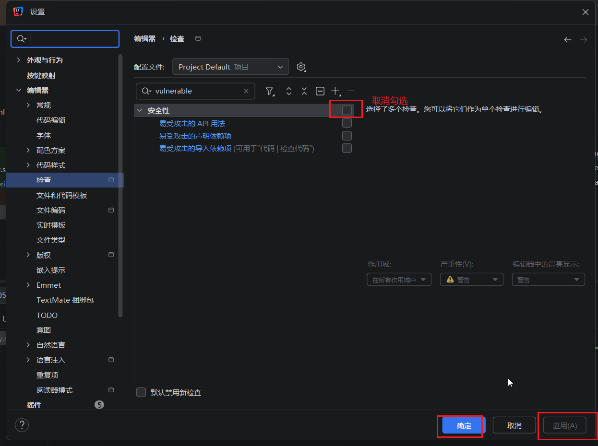

Maven 项目引入依赖后出现**黄色波浪线**，通常是 IDE（如 IntelliJ IDEA）的**警告提示（Warning）**，而不是编译错误（红色报错）。

常见原因与解决方法

1. **依赖存在已知安全漏洞（最常见）**

   - IDEA 会检测依赖版本是否存在安全漏洞，并在 `pom.xml` 中标黄。

   - **解决**：将鼠标悬停在黄线上查看具体提示；若确认无影响或想关闭该提醒，可在 IDEA 中打开 **Settings > Editor > Inspections**，搜索 `vulnerable`，取消勾选 **Security** 下的相关检查项（如易受攻击的依赖声明/导入）。

     

2. **依赖冲突或重复引入**

   - 传递依赖版本不一致或重复声明同一组件，可能触发警告。
   - **解决**：检查 `pom.xml` 中是否有重复依赖，或使用 Maven 依赖分析工具（如 `mvn dependency:tree` 或 IDEA 的 **Maven Helper** 插件）排查并 `<exclusion>` 冲突版本。

3. **配置规范、过时版本或 IDE 缓存警告**

   - 某些依赖版本已标记为过时（Deprecated）、写法不规范，或 IDEA 索引未及时刷新。
   - **解决**：升级到推荐的稳定版本，或点击 Maven 面板的 **Reload All Maven Projects** 刷新项目

